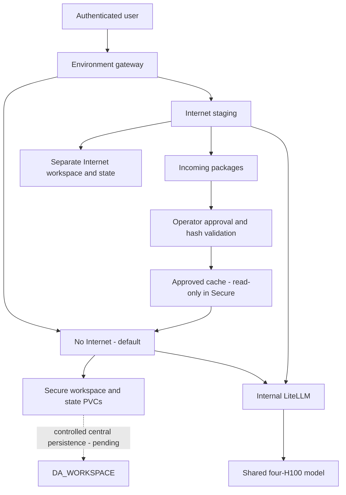

# DSH — Enterprise Execution Environments and RDT Pilot

DSH combines a username-authenticated gateway, No Internet and Internet execution environments, internal LiteLLM and a shared four-H100 model. **The RDT pilot controls are partially implemented, not fully closed.**

Start with the [interactive security/architecture walkthrough](docs/DSH_RDT_PILOT_SECURITY_CONTROL_ASSESSMENT.html) or its [Markdown source](docs/DSH_RDT_PILOT_SECURITY_CONTROL_ASSESSMENT.md). The HTML is self-contained and includes SMP EDA-style diagrams with zoom, fullscreen, source copy and SVG/PNG export.

## Features, design decisions and actual status

| Feature | Design reason | Status |
|---|---|---|
| No Internet / Internal default | Constrain generated code without relying on prompts | Live restricted-egress pool; not an air gap |
| Internet environment | Prepare dependencies without mounting protected data | Live separate staging/workspace/history |
| Authenticated session routing | Keep HTTP, WebSocket, terminal and applications in the chosen environment | Live environment routing; per-user routing only prepared |
| Safe runtime replacement | Keep state single-writer; detect backend-token rotation and actual application health | Build 62702 live in gateway and both pools; restart/login/content tests passed |
| Registration closed | Administrative account provisioning for a named pilot | Deployed and actual denial tested; approved pilot membership still pending |
| Approved package transfer | Supply offline libraries without sharing writable protected workspaces | Incoming, operator review, hash-checked promotion, read-only approved cache |
| Dedicated user runtime | Isolate execution, workspace, history and attachments | Generator and routing source tests pass; not deployed |
| Read-only RDT source | Prevent source modification and broad data access | Approved snapshot support prepared; dataset/account and negative tests pending |
| Central persistence | Preserve durable data independently of runtime | Current local PVCs have no ongoing DA_WORKSPACE synchronization; correction required |
| Shared GPU service | Conserve the existing single-node four-GPU resources | Backend ceiling 1M; DSH/LiteLLM still 128K |
| Interactive scheduling | Keep short requests responsive during long prefill | Controlled 133K mixed-load tests passed; near-1M mixed load not revalidated |

## Architecture and security boundary

The gateway authenticates and pins a login to an execution environment. Runtime NetworkPolicies enforce egress; choosing a radio button alone does not enforce it. Secure is allowed cluster DNS and internal LiteLLM. Internet has public access and does not mount protected source/workspace/history. DNS forwarding and indirect inference-service paths still require leakage acceptance checks.

Each current environment has its own writable PVCs, but users inside that environment share a process and volumes. Directory names are not a security boundary with shell/tool execution. The intended user-isolated design assigns a private pod, workspace PVC and state/history PVC to each approved identity/environment pair, sharing only inference and approved packages read-only. This is prepared, not live. See [per-user isolation](docs/PER_USER_ISOLATION.md).

Runtime containers run as UID/GID 10001, disable privilege escalation and drop capabilities. These controls limit privileges; they do not establish RDT authorization. Use a dedicated non-admin source identity and approved read-only snapshot/view. Write results separately. Verify actual source-write and out-of-scope-read denial before admitting protected RDT work.

No Internet is restricted egress, not a strict air gap. Browser/gateway, cluster DNS, storage and inference remain connected. An internal hostname alone does not prove a destination cannot relay externally.

## Storage — important correction

Current Secure `/workspace` and `/state` use separate local TopoLVM PVCs. Internet has its own staging/state PVCs. The legacy main deployment retains `da-workspace-pvc-new` but is scaled to zero. A one-time migration copied data from DA_WORKSPACE; **new-pool writes are not automatically synchronized back**.

Earlier claims about automatic CIFS shutdown flush, zero data loss and complete user isolation were not accurate for these new pools. The original documentation is preserved in [the legacy README](docs/archive/README_BEFORE_RECONCILIATION_20261015.md). The original CIFS workaround should not have silently changed central persistence policy.

Restore central persistence through a controlled reconciliation and ACL-aware design: preserve both old and new files, identify conflicts, keep live database locks on suitable storage, create coherent/versioned state backups and test restore. Do not blindly remount the old share or treat a copy of changing database files as a coherent backup. See [current storage guide](docs/MULTI_TENANT_STORAGE_AND_PERSISTENCE.md).

## Dependency workflow

1. Internet downloads candidate Python/Node artifacts to incoming storage.
2. An operator checks provenance, license/security results and exact SHA-256 values.
3. The controlled promotion job rejects unsafe paths, missing files and hash mismatches.
4. Secure reads approved artifacts through a read-only mount; Python no-index and npm offline settings avoid public repositories.

Hash matching proves integrity against the approved manifest, not package safety. Internet cannot directly install into Secure or write its workspace. Switching login environments does not copy project data or conversation history.

## Setup and controlled deployment

1. Build the pinned `@deepseek-ai/dsh@0.2.0-rc.2` runtime through the approved Azure pipeline; inspect packaged tests and pushed immutable digest. Startup must not install software from the Internet.
2. Provision reviewed Secrets, separate PVCs and the network policies in `k8s/dsh-egress-policies.yaml`. Do not put credentials in Git or reports.
3. For private runtimes, obtain approved identities and data scope, then run `scripts/generate_user_runtimes.py --users APPROVED_USERS --image REGISTRY/IMAGE@sha256:DIGEST --output candidate.yaml`. The output is reviewable and is not applied automatically.
4. Optional paired `--rdt-source-pvc APPROVED_SNAPSHOT --rdt-approval-ref OWNER_REFERENCE` mounts `/data/rdt` read-only in Secure only. Database permissions require separate provisioning.
5. Establish file/history ownership and save rollback before migration. Never clone shared histories into every user. Do not run two DSH writers against one state directory during image replacement.
6. Test candidate login/logout, fixed user routing, anonymous/cross-user denial, terminal, WebSocket, tools, attachments, restart/persistence, source denial, egress and approved package installation before ingress cutover.
7. Read back deployed image, effective profiles and actual affected behavior. Preserve rollback and record remaining limitations.

The existing main `dsh`, `dsh-user2` and `dsh3` are legacy workloads with different storage/network configurations. They must be explicitly included or excluded from pilot scope; do not assume the new policies protect them.

## Model limits and performance

The inference server has a 1,048,576-token ceiling with memory fraction 0.90, chunked prefill 1,024, maximum prefill 2,048 and concurrency 16. An earlier million-token backend test passed. The newer scheduler improved short-request completion during approximately 133K prefill from 32–34 seconds to 0.59–1.47 seconds in controlled tests, at an observed increase in long-request completion from about 36 to 39–40 seconds.

DSH and LiteLLM still enforce 131,072 total tokens, 8,192 output and compaction near 98,304. End-to-end 1M and sustained throughput are not established. See [context trial history](docs/CONTEXT_OPTIMIZATION_20261015.md) and [scheduling evidence](docs/SCHEDULING_FAIRNESS_20261015.md).

## Official DSH and regression-safe maintenance

Official upstream is a plugin-based developer preview. Our repository contains deployment/authentication/configuration overlays, not a fully synchronized source fork. The inspected official master is `571902028a75c64c1d767f4ae5fd099485f0ddf0`; newer inspected tag is `dsh-v0.2.1-alpha.3`. Our package remains rc.2. No upstream upgrade was deployed in this documentation update.

The [feature comparison and pinned sources](docs/DSH_RDT_PILOT_SECURITY_CONTROL_ASSESSMENT.md#official-upstream-comparison) explain Web tasks, model configuration, authentication, public URL support, credential precedence, sessions, storage and overlay risks. In particular, the legacy `isLoopbackHostname` bypass broadens a trust check, and missing-image placeholders do not recover original evidence. The client-helper override alone does not prove the server Host fence is disabled. These require explicit review rather than automatic reapplication.

Prefer supported configuration/plugins; fail on changed patch targets. Candidate upgrades must preserve old state and pass auth, Host/Origin, session/attachment, credential, tool, WebSocket, network/data isolation, restart and restore gates. See [upstream synchronization procedure](docs/UPSTREAM_SYNC_AND_INTERNET_POLICY.md).

## Evidence and closure

At **20:39 ICT, 15 October 2026**, gateway, Secure and Internet all run build **62702**, image `sha256:96be6e7fad0a1d456484bacfed45612c3d3ba95290a9f59a03eb612d50a4efc1`, built from Azure source `3fa74b72eaad7d7dd1e0986dd07a176f45ab2153`. Fresh login/logout, held sessions across backend restarts, actual catalog API and internal inference passed in both pools. Secure retained 80 listed histories and 2,732 checked regular files with zero content failures; Internet retained two controlled markers (its real history list was empty). [Live readback and test results](docs/context-evidence/runtime-rollout-live-20261015.json) and the [rollout walkthrough](docs/DSH_RDT_PILOT_SECURITY_CONTROL_ASSESSMENT.md#safe-runtime-rollout--actual-deployed-result) record exact scope and failed verification attempts.

Pools now use actual application startup/readiness/liveness checks and Recreate to prevent concurrent state writers. Gateway cookie caching detects rotated backend launch tokens; cookies default Secure. No tested application regression required rollback. Original deployment specs and coherent local archive PVCs remain available; full archive restore and intentional rollback were not exercised. Terminal HTTP pages passed, but interactive terminal/WebSocket behavior was not retested. New documentation/operator-script commits are not the image-source commit.

Registration is closed and active catalogs are internal-only. Named-user isolation, approved RDT access and central DA_WORKSPACE persistence remain pending. The local snapshots do not protect against node loss. Owner approval and assessor sign-off remain separate from code completion.
