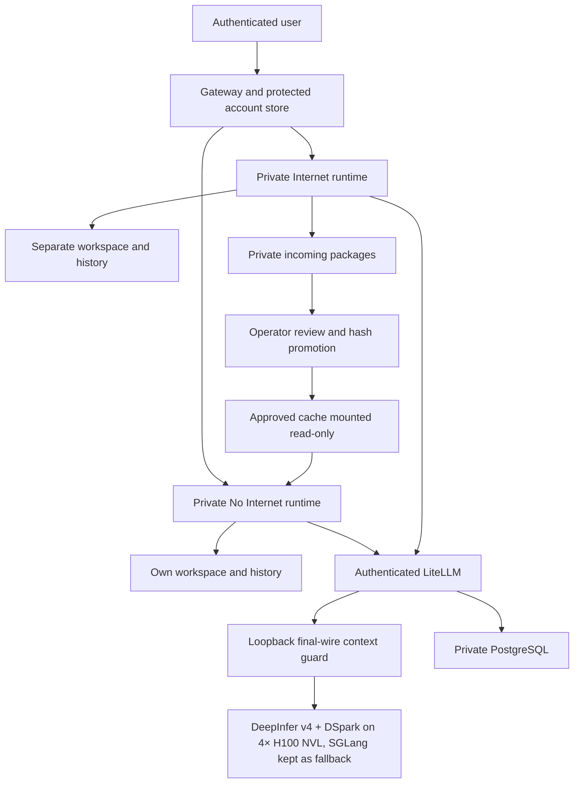

# Private AI Workspaces - Kubernetes and 1M Context

Based on [deepseek-ai/deepseek-harness](https://github.com/deepseek-ai/deepseek-harness); not a GitHub fork. Upstream releases are tracked by the auto-port workflow (`.github/workflows/upstream-auto-port.yml`).

**GPU serving today (30 Oct 2026):** DeepInfer + DSpark on 4× H100 NVL, 1M context; see [docs/deepseek-v41-h100](docs/deepseek-v41-h100/README.md#current-production-30-oct-2026-utc). The 24 October section below describes the earlier SGLang setup.


[English Fola video guide](docs/COURSE_GUIDE.md) · [Video and presentation index](docs/PRESENTATION_EDITION.md)
## Application links and learning materials

The [Main/Test application guide](docs/APP_LINKS_AND_STATUS.html) provides the deployment status, application login flow, slides and English video. Main application controls are separate from the controlled App5/App6 Test examples.

## Application sign-in and return

The [application login guide](docs/APP_SIGNIN_AND_RETURN.html) explains app-focused team login, the Test continuation flow, returning to the requested app, and Public access with separate destination authentication. RegChat, App5 and App6 are examples rather than hardcoded login paths.

## Managed provider login

Keep the team gateway login and native DSH authentication. Managed LiteLLM profiles hide the separate official DeepSeek account sign-in. See [the login guide](docs/MANAGED_PROVIDER_LOGIN.html) for user steps, configuration and hot reload.

## Three risk controls

Start with [the design and operating principles](docs/THREE_RISK_CONTROLS.md) or its [HTML guide](docs/THREE_RISK_CONTROLS.html): prevent external leakage, prevent damage or excessive access, and keep results within authorized users. GPU configuration and measurements belong in the technical references after the controls. [Risk-first course delivery](docs/COURSE_DELIVERY.md) explains authenticated video, captions, source snapshots and safe updates.

## AD / LDAP authentication

Start with the [user manual](docs/DSH_USER_MANUAL.md) or its [standalone HTML version](docs/DSH_USER_MANUAL.html) for sign-in, private environments, tools, application URLs and administrator controls. The [current-guide policy](docs/CURRENT_GUIDE.md) describes the single deployment guide and preserved archives.

Optional verified LDAPS sign-in supports private No Internet accounts with Internet access approved separately by an administrator. An AD username that conflicts with an existing local account is rejected with a clear instruction to contact an administrator to resolve the identity conflict; no account or history is automatically merged or deleted. Existing local recovery sign-in remains available. See [configuration, collision handling and tests](docs/LDAP_AUTHENTICATION.md).

## Authenticated application sharing

Owners can explicitly share an ordinary local web app with enabled DSH users while keeping JupyterLab, terminals, workspaces and histories private. Existing mappings remain owner-only. See the [sharing guide](docs/AUTHENTICATED_APP_SHARING.md) or its [HTML version](docs/AUTHENTICATED_APP_SHARING.html) for setup, isolation boundaries and application responsibilities.

## Public presentation and speaker guide

[Editable PowerPoint](docs/presentations/guarding-the-value-stream/Guarding_the_Value_Stream.pptx) · [Slide PDF](docs/presentations/guarding-the-value-stream/Guarding_the_Value_Stream.pdf) · [Detailed storytelling PDF](docs/presentations/guarding-the-value-stream/Guarding_the_Value_Stream_Story.pdf)

The 23-slide talk covers agent incidents, controls, governance, illustrative banking and insurance workflows, and DSH. Its final QR links to this repository. Research infographics are credited to **Thanatchon Chongmankhong** ([HarnessWatch](https://thanatchon36.github.io/harnesswatch/paper/) and [airmkit](https://thanatchon36.github.io/airmkit/paper/)). The examples are hypothetical and are not a claim of live business automation or certified compliance.

This public tree contains sanitized installation code and generic configuration for the approved core version. Site-specific configuration, identities, credentials and operational history remain in an access-controlled repository. See [publication boundaries](docs/PUBLICATION.md).

A configurable deployment of DeepSeek Harness, internal LiteLLM and a four-GPU
inference backend (DeepInfer + DSpark in production since 29 Oct 2026; SGLang kept as the fallback). The repository includes the GPU manifests, model-download job,
storage, context guard, scheduler overlays, private user environments and setup
instructions. No separate infrastructure repository is required.

This is a **fresh-install reference**, not an export of an existing organization
or a promise that any four-GPU machine will sustain 1M context. Model weights,
hardware, storage drivers, domain names, certificates and credentials are supplied
by the operator. The public examples contain no real deployment addresses,
personal accounts, operational transcripts or credential values.

## What it provides

- One private non-root runtime, workspace and history volume per user/environment.
- No Internet as the main login default; separate Internet dependency preparation.
- Protected local password records, owner-bound routing and an admin access log.
- Managed Claude Code and TrueForge configuration using model-only client keys.
- Four-GPU serving with DeepInfer + DSpark (DP-attention and expert parallelism over four ranks) or
  SGLang tensor parallelism as the fallback, 1,048,576 total-token capacity,
  chunked prefill and fail-closed scheduler compatibility checks.
- LiteLLM authentication, PostgreSQL-backed virtual keys and a loopback final-wire
  context guard. Text above 32K counted input plus reserved output uses bounded
  managed admission; shorter requests can remain concurrent. Input includes the
  complete conversation and tool context, not only the latest prompt. That is not two simultaneous full-1M requests or an SLA.
- Persistent storage and read-only approved packages. Persistence is not backup.

## Roadmap

Planned, not yet delivered. Each item is tested in a disposable profile or a test window before it reaches users.

- **Theme centre.** A small skin format (`dsh-themes`) and a picker (`@dsh-suite/themes`) so an operator can offer several reviewed themes beside the native Light/Dark/System appearance, instead of shipping one fixed theme package. It follows the optional `dsh-theme-custom-light` plugin and an operator's custom theme release (0.2.0: a separate colour row under the untouched native Appearance setting, plus brand slots). Installation stays pinned and hash-checked; an existing older copy is upgraded only from an exact, qualified version, with a rollback copy kept.
- **Prefix cache for DeepInfer.** DeepInfer has no cross-request prefix cache yet: a follow-up turn on a long conversation re-reads the whole prompt (first token about 38 s at 127K, 145 s at 498K and 301 s at 995K tokens). The host prefix-cache (hicache) module is not in the upstream tree; the plan is row K ("host prefix cache", in the configuration matrix of [DeepInfer#221](https://github.com/deepseek-ai/DeepInfer/discussions/221)).
- **Host GPU peer-to-peer fix.** On the reference node, writes between GPUs on different CPU sockets are silently dropped with the IOMMU in translated mode, so DeepInfer exchanges experts through host memory. Requested host change: `iommu=pt` (then ACS off or the vendor's GPU BIOS profile if needed). Estimate after the fix: about 80–150 tok/s for one user, about 1.3–2.5× today in total; to be re-measured with DeepEP.
- **One canonical source for portable code.** This repository is to become the canonical home of the portable product code; a site deployment carries only that code plus its private overlay (site names, identities, branding, operations). Until then, the publication boundaries in [docs/PUBLICATION.md](docs/PUBLICATION.md) describe what stays private; the path-by-path mapping will be added there.

## Start here

1. Read [prerequisites and complete installation](docs/INSTALL.md).
2. Copy `config.example.yaml` to ignored `config.local.yaml`; supply your storage,
   domain and built runtime-image digest. Never put credentials in that file.
3. Render `generated/` with `python scripts/render_k8s.py --config config.local.yaml --output generated`.
4. Follow the ordered namespace/storage, Secret, model-download, platform and
   client-key steps in the guide. Do not apply everything before downloading weights.
5. Perform [acceptance tests](docs/ACCEPTANCE.md) before allowing real workloads.

The renderer refuses unresolved placeholders. It never reads a live cluster or
renders Secret values. Helpers create fresh Secrets through stdin, do not print
their values and refuse to overwrite existing credentials.

## Architecture



The browser does not select a backend host. The server binds each login to an
operator-provisioned user/environment mapping. Runtime pods have no account-store
mount or Kubernetes API token. No corporate identity provider or datalake is
implicitly configured. [Security boundaries](docs/SECURITY.md).

## Context and performance

The reference profile reserves up to 8,192 output tokens and 256 proxy tokens.
With that full output reservation, maximum counted input is 1,040,128 tokens.
DSH automatic compaction is configured near 917,504 estimated tokens, with exact
wire budgeting enforced separately. Long prefill can take minutes and reduce
short-request throughput. Use [the tuning guide](docs/CONTEXT_1M.md); qualify your
own memory margin, cancellation, tools and mixed load before increasing limits.

## Verification and maintenance

```sh
python -m pip install -r requirements-dev.txt
python scripts/scan_public.py .
python -m unittest discover -s tests -p 'test_public_manifests.py'
node tests/test_password_store.js
node tests/test_workspace_policy.js
```

Pinned package/image compatibility checks fail closed on upstream changes. A
source or schema test is not proof of successful GPU inference. Keep local
configuration, generated manifests, keys, tickets, backups and results out of Git.
See [release validation](docs/VALIDATION.md) and [third-party notices](docs/THIRD_PARTY.md).

For custom automatic provisioning, see [signup capacity, pressure gating and automatic recovery](docs/SIGNUP_CAPACITY.md). The portable evaluator is supplied for integration; it does not install a collector or enable registration.

## Application access and proxy setup

Private local applications and explicitly approved HTTPS destinations can use owner-bound app URLs, with DSH sign-in required by default. See the [application proxy setup and regression checks](docs/APP_PROXY.md) for origin policies, DNS/TLS, optional Gradio compatibility and destination-authentication boundaries.

For existing installations that cannot restart immediately, the optional [managed-client compatibility layer](docs/LIVE_CLIENT_COMPATIBILITY.md) applies only to new launches. It preserves existing processes and history; permanent image adoption remains separate.

## DeepInfer on four H100 GPUs

**Current (30 Oct 2026):** DeepInfer v4 + DSpark serves production on 4× H100 NVL (SM90) with a 1M-token
context, 8 requests at once and least-loaded routing. SGLang + DSpark is kept switched off as the measured
baseline and rollback. Cross-socket GPU peer-to-peer drops writes on the reference host, so experts are
exchanged over an NCCL all-to-all fallback instead of DeepEP. Configuration, the matched DeepInfer-versus-SGLang
comparison and the open items (host P2P fix, prefix cache): [docs/deepseek-v41-h100](docs/deepseek-v41-h100/README.md#current-production-30-oct-2026-utc).

The SM90 engine tree (based on the community SM90 work in DeepInfer #92 and #200) will be published as a public
fork of `deepseek-ai/DeepInfer`; link to follow once it is published.

## Jupyter Start

Start safely reuses an already-enabled Jupyter service across Main DSH, DSH2 and DSH3.
[Administrator controls](docs/JUPYTER_START_CONTROLS.html) and the
[captioned walkthrough](docs/JUPYTER_DSH2_DSH3_WALKTHROUGH.html) explain Start, Stop and Restart.


## Current guide and lifecycle verification


### Application audiences and checkbox editing

The deployed Main-gateway update replaces typed usernames with a local-user checkbox picker and adds **Edit sharing / URL** for saved applications. New ordinary authenticated apps default to **All authenticated users (local and AD / LDAP)**; owners can choose all local users, all AD / LDAP users, selected local users or owner-only. Existing audiences stay unchanged until saved. JupyterLab and terminal remain owner-only.

Actual gateway tests cover local/directory identity enforcement, private routing and HTTP/WebSocket revocation; form-script tests cover checkbox editing and defaults. The update is deployed on Main DSH. The exact deployed source passed 158 tests in the running runtime image; existing accounts, app audiences, sessions and worker/history preservation were verified. Legacy DSH2/DSH3 entrypoints remain owner-only. See [audience choices, edit workflow and boundaries](docs/AUTHENTICATED_APP_SHARING.md).

## Jupyter automatic startup

Private workspaces seed managed Jupyter in both environments. Internet startup still requires admin-approved Internet access. Autostart recovers the saved desired state after replacement; Admin Stop stays disabled. Existing on-demand servers are left running until natural handover, preserving active notebooks. Saved files and settings remain in their private storage. See the [lifecycle guide](docs/JUPYTER_APP_LIFECYCLE.html) and [operator backfill procedure](docs/JUPYTER_AUTOSTART_BACKFILL.html).


Jupyter dashboard status distinguishes **Waiting for existing Jupyter**, **Internet approval pending**, **Account disabled** and **Recovery retry pending**. These labels do not change startup or access permissions. See the [status explanation](docs/JUPYTER_APP_LIFECYCLE.html) and [captioned walkthrough](docs/JUPYTER_DSH2_DSH3_WALKTHROUGH.html).

Jupyter status transitions are verified using disposable users: Internet approval clears the pending label, and exiting an existing server permits automatic handover to **Running**. Existing saved notebook/settings markers remained unchanged. See the [lifecycle guide](docs/JUPYTER_APP_LIFECYCLE.html) and [walkthrough](docs/JUPYTER_DSH2_DSH3_WALKTHROUGH.html).

## Three-site code and maintenance

The approved DSH application is 0.2.1-rc.5 with pi-ai 1.3.0; sites still running 0.2.1-rc.2 move to it when redeployed. Main DSH, DSH2 and DSH3 share the core build and inspected transport/supervisor code while retaining distinct authentication and environment policies. Use the managed LiteLLM model and choose the correct local or AD sign-in provider. New releases are ported automatically when no reviewed file changed: [automatic pin ports](docs/UPSTREAM_AUTO_PORT.md).

## User-managed credentials

[Credential management guide and Fola lesson](docs/USER_CREDENTIAL_MANAGEMENT.html): aliases instead of secrets in chat; owner/workspace/environment/action policy; lifecycle and audit controls. Implemented for configured API-token/PAT connectors; OAuth consent and Kerberos acquisition are not included.

[Institutional theme runtime qualification](docs/CREDENTIAL_THEME_QUALIFICATION.md) records the Main and legacy rollout, preservation checks and bounded transport-health repair. [OpenShell prerequisites](docs/OPENSHELL_RUNTIME_PREREQUISITES.md) separates the completed CPU-only preflight from its 25 unrun product gates. [OAuth/Kerberos explanation](docs/CREDENTIAL_OPERATIONS.md#why-oauth-and-kerberos-are-separate) describes these optional integrations and the configuration they need.

## Optional persistent secondary registry

The [registry installation, CI and recovery guide](docs/SECONDARY_REGISTRY.md) includes a machine-only token service, isolated Test deployment renderer, same-image promotion and reproducible synthetic tests. Primary registry defaults stay explicit; this package never deploys applications or enables automatic failover.


## Standalone compaction guard plugin

The [additive plugin bundle](plugins/compaction-provenance-guard/README.md) is independent of the deployment overlays. DSH 0.2.1-rc.1, rc.2 and rc.3 passed disposable-profile CLI install, native startup, uninstall and rollback on Windows/Node 24.18.1, with synthetic streams and native compaction. It owns one entry ID, has no runtime dependencies or install hooks, and does not replace official packages. Exact results and limitations are in the [compatibility matrix](plugins/compaction-provenance-guard/compatibility.json). This packaging release does not deploy the plugin or change live workspaces, histories or GPU settings. DSH Store review remains separate.

## Managed coding-agent integration candidate

The [Deep Agents and DSH CLI candidate](integrations/managed-agents/README.md) adds an opt-in image overlay and fixed-model launchers. It is source-tested, not built or deployed. Web Terminal runs the actual CLIs; DSH web chat does not automatically control their sessions. See the [public-source review scope](docs/PUBLIC_SOURCE_REVIEW.md) for publication checks and limitations.

## History (dated note, 31 Oct 2026)

Before 29 Oct 2026 the reference node served the model with SGLang + DSpark (1M context, 8 requests at once). The
19–24 Oct qualification and acceptance records (GPU trial status, preparation review, Jupyter, LDAP sign-in,
capacity planner, three-site sync and document alignment) were dated snapshots of that setup; they were removed on
31 Oct 2026 so that each document exists once, in its current form. Their full text remains in this repository's
Git history (before this note). Current figures: [docs/deepseek-v41-h100](docs/deepseek-v41-h100/README.md#current-production-30-oct-2026-utc).
