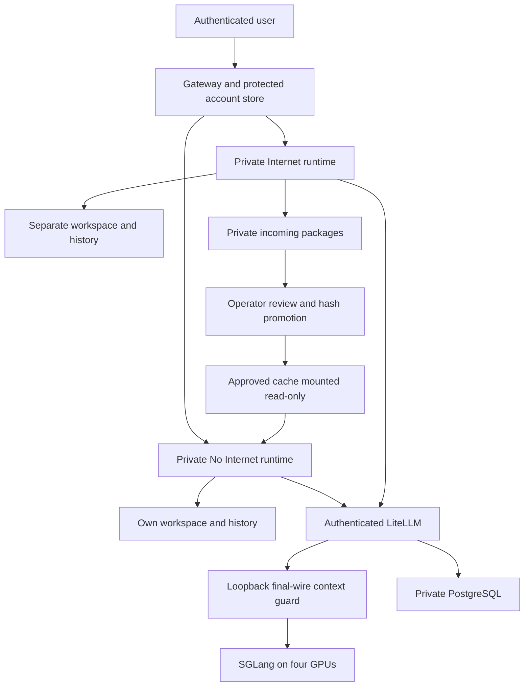

# Private AI Workspaces - Kubernetes and 1M Context

## Application links and learning materials

The [Main/Test application guide](docs/APP_LINKS_AND_STATUS.html) provides the deployment status, application login flow, slides and English video. Main application controls are separate from the controlled App5/App6 Test examples.

## Application sign-in and return

The [application login guide](docs/APP_SIGNIN_AND_RETURN.html) explains app-focused team login, the Test continuation flow, returning to the requested app, and Public access with separate destination authentication. RegChat, App5 and App6 are examples rather than hardcoded login paths.

## Managed provider login

Keep the team gateway login and native DSH authentication. Managed LiteLLM profiles hide the separate official DeepSeek account sign-in. See [the login guide](docs/MANAGED_PROVIDER_LOGIN.html) for user steps, configuration and hot reload.

## Three risk controls

Start with [the design and operating principles](docs/THREE_RISK_CONTROLS.md) or its [HTML guide](docs/THREE_RISK_CONTROLS.html): prevent external leakage, prevent damage or excessive access, and keep results within authorized users. GPU configuration and measurements belong in the technical references after the controls. [Risk-first course delivery](docs/COURSE_DELIVERY.md) explains authenticated video, captions, source snapshots and safe updates.

## AD / LDAP authentication

Start with the [user manual](docs/DSH_USER_MANUAL.md) or its [standalone HTML version](docs/DSH_USER_MANUAL.html) for sign-in, private environments, tools, application URLs and administrator controls. The [current-guide policy](docs/CURRENT_GUIDE.md) describes the single deployment guide and preserved archives.

Optional verified LDAPS sign-in supports private No Internet accounts with Internet access approved separately by an administrator. An AD username that conflicts with an existing local account is rejected with a clear instruction to contact an administrator to delete that local account; no account or history is automatically merged or deleted. Existing local recovery sign-in remains available. The 23 October main-gateway rollout verified AD/UPN application sign-in, conflict refusal and history preservation; see the [acceptance record](docs/LDAP_APP_LOGIN_ACCEPTANCE_20261023.md). See [configuration, collision handling and tests](docs/LDAP_AUTHENTICATION.md).

## Authenticated application sharing

Owners can explicitly share an ordinary local web app with enabled DSH users while keeping JupyterLab, terminals, workspaces and histories private. Existing mappings remain owner-only. See the [sharing guide](docs/AUTHENTICATED_APP_SHARING.md) or its [HTML version](docs/AUTHENTICATED_APP_SHARING.html) for setup, isolation boundaries and application responsibilities.

## Public presentation and speaker guide

[Editable PowerPoint](docs/presentations/guarding-the-value-stream/Guarding_the_Value_Stream.pptx) ยท [Slide PDF](docs/presentations/guarding-the-value-stream/Guarding_the_Value_Stream.pdf) ยท [Detailed storytelling PDF](docs/presentations/guarding-the-value-stream/Guarding_the_Value_Stream_Story.pdf)

The 23-slide talk covers agent incidents, controls, governance, illustrative banking and insurance workflows, and DSH. Its final QR links to this repository. Research infographics are credited to **Thanatchon Chongmankhong** ([HarnessWatch](https://thanatchon36.github.io/harnesswatch/paper/) and [airmkit](https://thanatchon36.github.io/airmkit/paper/)). The examples are hypothetical and are not a claim of live business automation or certified compliance.

This public tree is a **portable fresh-install reference**, not the latest deployment source or operational history of an institution. Private implementation and evidence must remain in an access-controlled repository. See [publication boundaries](docs/PUBLICATION.md).

A configurable deployment of DeepSeek Harness, internal LiteLLM and a four-GPU
SGLang backend. The repository includes the GPU manifests, model-download job,
storage, context guard, scheduler overlays, private user environments and setup
instructions. No separate infrastructure repository is required.

This is a **fresh-install reference**, not an export of an existing organization
or a promise that any four-GPU machine will sustain 1M context. Model weights,
hardware, storage drivers, domain names, certificates and credentials are supplied
by the operator. The public examples contain no real deployment addresses,
personal accounts, operational transcripts or credential values.

## What it provides

- One private non-root runtime, workspace and history volume per user/environment.
- No Internet as the main login default; separate Internet dependency preparation.
- Protected local password records, owner-bound routing and an admin access log.
- Managed Claude Code and TrueForge configuration using model-only client keys.
- SGLang tensor parallelism across four GPUs, 1,048,576 total-token capacity,
  chunked prefill and fail-closed scheduler compatibility checks.
- LiteLLM authentication, PostgreSQL-backed virtual keys and a loopback final-wire
  context guard. Text above 32K counted input plus reserved output uses bounded
  managed admission; shorter requests can remain concurrent. Input includes the
  complete conversation and tool context, not only the latest prompt. That is not two simultaneous full-1M requests or an SLA.
- Persistent storage and read-only approved packages. Persistence is not backup.

## Start here

1. Read [prerequisites and complete installation](docs/INSTALL.md).
2. Copy `config.example.yaml` to ignored `config.local.yaml`; supply your storage,
   domain and built runtime-image digest. Never put credentials in that file.
3. Render `generated/` with `python scripts/render_k8s.py --config config.local.yaml --output generated`.
4. Follow the ordered namespace/storage, Secret, model-download, platform and
   client-key steps in the guide. Do not apply everything before downloading weights.
5. Perform [acceptance tests](docs/ACCEPTANCE.md) before allowing real workloads.

The renderer refuses unresolved placeholders. It never reads a live cluster or
renders Secret values. Helpers create fresh Secrets through stdin, do not print
their values and refuse to overwrite existing credentials.

## Architecture



The browser does not select a backend host. The server binds each login to an
operator-provisioned user/environment mapping. Runtime pods have no account-store
mount or Kubernetes API token. No corporate identity provider or datalake is
implicitly configured. [Security boundaries](docs/SECURITY.md).

<!-- GPU_PERFORMANCE_STATUS_20261023:START -->
## GPU performance and 1M operation - 23 October 2026

- **Actual DSH retry R completed:** **1,002,051 input / 636 output tokens**, **29m26.56s preparation**, **29m32.09s to first text**, **29m44.28s whole client turn**, **61.56 streaming output tokens/sec**, zero request retries. All **110 short replies** passed their content checks; **104 completed entirely during the long turn**. Client median/p95/maximum: **6.03s / 10.06s / 14.06s**. The startup fix passed all four bounded startup requests. **100+ per near-1M conversation is not reached.** Strict source-only narrative failed; GPU counter coverage ends five seconds before completion. Forwarding preparation and native time to first text are measured separately. The saved original model specification and a real READY response were verified after recovery; 32-worker / 256 session-and-attachment-file snapshots matched. The experimental profile was not permanently adopted; R did not run compaction.

- **100+ output tokens/sec is not yet qualified for the latest near-1M optimization.** The earlier 21 October cold actual-DSH prose run used 1,008,049 input / 540 output tokens: **28m32.25s preparation**, **66.00 wire-streaming tokens/sec**, zero retries.
- **Final N did not qualify:** 1,002,056 input tokens were tokenized, but only partial prefill ran. Correct numeric/prose short replies took **13.70s / 15.83s native** (**14.11s / 16.06s client**), zero retries. Prose exceeded the unchanged **15s client ceiling**, so the owned long request was stopped. No completed near-1M answer, new long-answer tokens/sec or compaction result. Four-rank zero allocator/OOM deltas cover only the captured partial window. The original source/image/spec and native READY route were restored; recorded 32-worker / 256 session-and-attachment-file snapshots matched.
- Earlier completed full-model candidate M: **74.03 tokens/sec at 128K** and **75.85 at 384K**; its near-1M stage was rejected after one allocation retry on each GPU. No substantial near-1M output or new compaction result was obtained.
- **Trial M: 136/136 ordinary replies** passed recorded content checks with zero retries. The **86 replies during near-1M preparation** had **4.28s median / 6.48s p95 / 9.40s maximum** native turn time.
- N9 passed five bounded BF16 numerical cases with zero allocation retries/OOMs, using synthetic metadata and no model weights. Full-model near-1M throughput for that fix is not yet qualified.
- The restored 18:16 ICT snapshot is **SGLang on four H100s**, not DeepInfer: memory fraction **0.922**, **1,024 / 1,024-token prefill**, **1,048,576 context tokens**, a running-request cap of eight and one above-128K input admission lane; shorter work remains parallel. The older 158.04 tokens/sec numeric-short median and 117.75 combined four-client rate are different measures.
- Earlier 21 October compaction from **948,102 source tokens** passed with **393.12s summary / 388.90s continuation**, **23 short replies** (6.04s median / 10.06s maximum), 0.024s cancellation and preserved recall/history after replacement. That is a dated profile, not acceptance of the latest candidate.

[Full results and definitions](docs/GPU_TRIAL_STATUS_20261023.html). Generation speed excludes cold preparation; these workloads and timing methods are not a matched before/after benchmark.
<!-- GPU_PERFORMANCE_STATUS_20261023:END -->

## Context and performance

The corrected-route qualification reserved **1,002,081 input / 8,192 output tokens**, but failed its memory-warning gate before a substantial near-1M answer. **53 ordinary replies** passed with median **4.66 s** and maximum **11.78 s**, without retries. Compaction was not started and no new 100+ tokens/sec result is claimed. The compatible unfused profile was restored with the 1M ceiling retained; a fresh canonical native DSH recovery reply passed in **3.825 s**, zero retries. Earlier trials remain separate records. [Qualification results and recovery scope](docs/GPU_PREPARATION_REVIEW_20261022.html).

The reference profile reserves up to 8,192 output tokens and 256 proxy tokens.
With that full output reservation, maximum counted input is 1,040,128 tokens.
DSH automatic compaction is configured near 917,504 estimated tokens, with exact
wire budgeting enforced separately. Long prefill can take minutes and reduce
short-request throughput. Use [the tuning guide](docs/CONTEXT_1M.md); qualify your
own memory margin, cancellation, tools and mixed load before increasing limits.

## Verification and maintenance

```sh
python -m pip install -r requirements-dev.txt
python scripts/scan_public.py .
python -m unittest discover -s tests -p 'test_public_manifests.py'
node tests/test_password_store.js
node tests/test_workspace_policy.js
```

Pinned package/image compatibility checks fail closed on upstream changes. A
source or schema test is not proof of successful GPU inference. Keep local
configuration, generated manifests, keys, tickets, backups and results out of Git.
See [release validation](docs/VALIDATION.md) and [third-party notices](docs/THIRD_PARTY.md).

For custom automatic provisioning, see [signup capacity, pressure gating and automatic recovery](docs/SIGNUP_CAPACITY.md). The portable evaluator is supplied for integration; it does not install a collector or enable registration.

## Application access and proxy setup

Private local applications and explicitly approved HTTPS destinations can use owner-bound app URLs, with DSH sign-in required by default. See the [application proxy setup and regression checks](docs/APP_PROXY.md) for origin policies, DNS/TLS, optional Gradio compatibility and destination-authentication boundaries.

For existing installations that cannot restart immediately, the optional [managed-client compatibility layer](docs/LIVE_CLIENT_COMPATIBILITY.md) applies only to new launches. It preserves existing processes and history; permanent image adoption remains separate.

## DeepInfer candidate

The [DeepInfer integration guide](docs/DEEPINFER_INTEGRATION.md) includes a pinned,
read-only hardware/source gate and the H100 porting requirements. The reviewed
official candidate requires SM100 kernels; the existing four H100/SM90 GPUs fail
that gate. DeepInfer is not installed or benchmarked; SGLang remains the serving
engine. This gate does not change DSH accounts, files, histories or model routing.

## DeepInfer on four H100 GPUs

The 23 October read-only review found that official DeepInfer revision `9bd9cf2`
still requires SM100 attention/MoE paths; the installed four H100s are SM90.
DeepInfer was not installed or benchmarked, and SGLang remains in use. There is
no matched DeepInfer-versus-SGLang 1M compaction or throughput result.
See the [compatibility and comparison status](docs/DEEPINFER_INTEGRATION.html)
or [Markdown guide](docs/DEEPINFER_INTEGRATION.md) for the source checks,
recorded SGLang results and same-node qualification gates.


## Earlier graph-batch GPU status — 23 October 2026

The 23 October GPU candidate was rejected at the allocator-warning gate after passing 128K/384K stages. Four short DSH conversations overlapped at 117.75 combined output tokens/sec (30.07–33.77 per conversation including whole-turn time); this does not establish 100+ per conversation or two simultaneous 1M requests. The saved baseline retains the 1M ceiling. See the dated results for definitions and recovery checks. [Detailed results](docs/GPU_TRIAL_STATUS_20261023.html).


### Jupyter Start

Start safely reuses an already-enabled Jupyter service across Main DSH, DSH2 and DSH3.
[Administrator controls](docs/JUPYTER_START_CONTROLS.html) and the
[captioned walkthrough](docs/JUPYTER_DSH2_DSH3_WALKTHROUGH.html) explain Start, Stop and Restart.


## Current guide and lifecycle verification

See [document alignment](docs/DOCUMENT_ALIGNMENT_20261023.md) for current controls, tests and historical-media limits.


### Application audiences and checkbox editing

The deployed Main-gateway update replaces typed usernames with a local-user checkbox picker and adds **Edit sharing / URL** for saved applications. New ordinary authenticated apps default to **All authenticated users (local and AD / LDAP)**; owners can choose all local users, all AD / LDAP users, selected local users or owner-only. Existing audiences stay unchanged until saved. JupyterLab and terminal remain owner-only.

Actual gateway tests cover local/directory identity enforcement, private routing and HTTP/WebSocket revocation; form-script tests cover checkbox editing and defaults. The update is deployed on Main DSH. The exact deployed source passed 158 tests in the running runtime image; existing accounts, app audiences, sessions and worker/history preservation were verified. Legacy DSH2/DSH3 entrypoints remain owner-only. See [audience choices, edit workflow and boundaries](docs/AUTHENTICATED_APP_SHARING.md).

## Jupyter automatic startup

Private workspaces seed managed Jupyter in both environments. Internet startup still requires admin-approved Internet access. Autostart recovers the saved desired state after replacement; Admin Stop stays disabled. Existing on-demand servers are left running until natural handover, preserving active notebooks. Saved files and settings remain in their private storage. See the [lifecycle guide](docs/JUPYTER_APP_LIFECYCLE.html) and [operator backfill procedure](docs/JUPYTER_AUTOSTART_BACKFILL.html).


Jupyter dashboard status distinguishes **Waiting for existing Jupyter**, **Internet approval pending**, **Account disabled** and **Recovery retry pending**. These labels do not change startup or access permissions. See the [status explanation](docs/JUPYTER_APP_LIFECYCLE.html) and [captioned walkthrough](docs/JUPYTER_DSH2_DSH3_WALKTHROUGH.html).

Jupyter status transitions are verified using disposable users: Internet approval clears the pending label, and exiting an existing server permits automatic handover to **Running**. Existing saved notebook/settings markers remained unchanged. See the [lifecycle guide](docs/JUPYTER_APP_LIFECYCLE.html) and [walkthrough](docs/JUPYTER_DSH2_DSH3_WALKTHROUGH.html).
