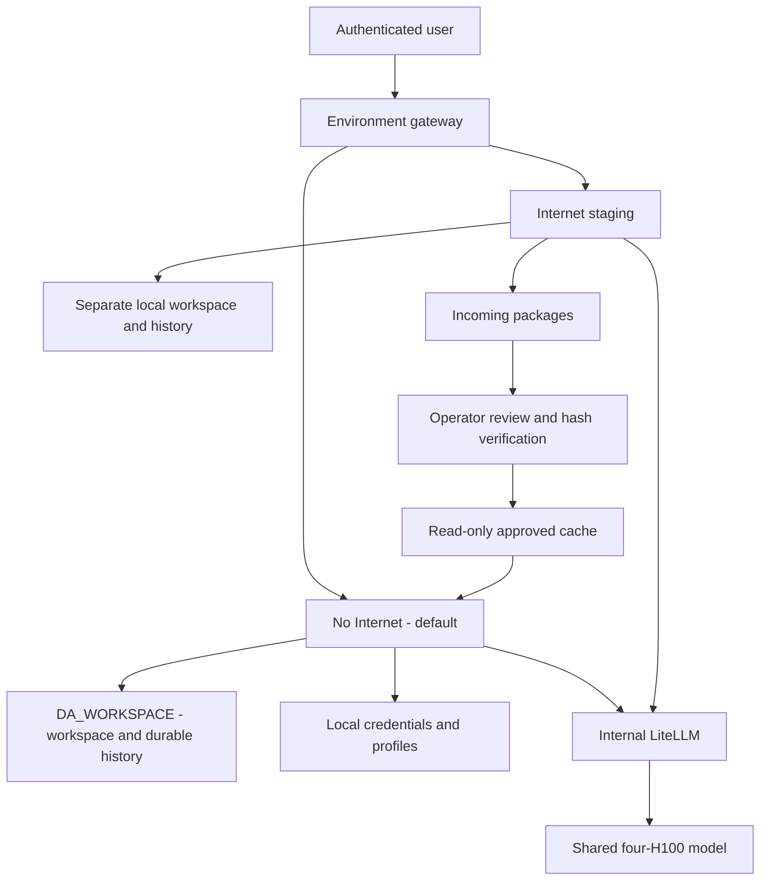

# DSH — Enterprise Execution Environments and RDT Pilot

DSH provides an authenticated gateway, separate **No Internet / Internal (default)** and **Internet** environments, internal LiteLLM and a shared four-H100 model. The three RDT pilot controls remain partially satisfied: the storage regression is corrected, but existing shared pools do not establish per-user isolation or approved read-only RDT access.

Start with the English [interactive security and architecture walkthrough](docs/DSH_RDT_PILOT_SECURITY_CONTROL_ASSESSMENT.html), its [Markdown source](docs/DSH_RDT_PILOT_SECURITY_CONTROL_ASSESSMENT.md), and the [central-state restoration procedure](docs/CENTRAL_STATE_RESTORATION_20261015.md). The standalone HTML embeds the README and evidence, with SMP EDA-style diagram zoom, fullscreen, source copy and SVG/PNG export.

## Latest live review and performance — 16 October 2026

The candidate-tested identity-header correction is now deployed to the Production gateway through immutable ConfigMap `dsh-gateway-source-c9737befbe88`. The image remains build 62702; its source overlay is tracked separately. Fresh login/logout, environment binding, history listing and terminal pages passed after replacement. Execution pools and the model were not restarted. All 80 legacy histories in 82 files remain byte-identical. Temporary probe credentials were removed.

Current mount readback confirms Secure workspace and durable state are direct CIFS mounts; no continuous copy loop is required for those directories. The parent `/state` still holds local credentials/configuration. Secure GitHub/PyPI/npm probes timed out while Internet returned 200. DSH2/DSH3 remain legacy root-based, Internet-connected environments with mounted service-account tokens; they are not covered by Secure pilot acceptance.

Three short model replies completed in 0.230–0.231 seconds. Two concurrent exact 119-token replies completed in 3.381–3.386 seconds each, about 35.2 effective output tokens/sec per request. Backend ceiling is 1M; the DSH/LiteLLM product guardrail remains 128K. This bounded sample does not prove near-1M fairness, sustained capacity or full agent-turn speed.

A fresh 24,047-token synthetic request completed in 4.987 seconds while three repeated short replies finished in 0.466–0.588 seconds, all before the longer request ended. This adds bounded live scheduling evidence; it is not near-1M acceptance.

Existing Production pools still share users; real RDT scope/identity is not identified or granted. Synthetic isolation and read-only tests are complete within their scope. They do not close real-user Production acceptance. See [live status, correction, performance and remaining work](docs/LIVE_REVIEW_AND_PERFORMANCE_20261016.md). Preserve the tracked gateway source overlay when applying base manifests or building its replacement image.

## Features, design decisions and current deployment

| Feature | Design reason | Actual status |
|---|---|---|
| No Internet default | Infrastructure restrictions apply to generated code and subprocesses | Separate restricted-egress pool; not an air gap |
| Internet environment | Download dependencies without exposing protected work | Separate local staging, history and credentials; no protected CIFS mount |
| Gateway login, routing and logout | Pin an authenticated login to one environment | Deployed; registration disabled; runtime-token rotation handled |
| Mounted central workspace | Preserve the original DA_WORKSPACE design | Secure `/workspace` mounts CIFS subpath `dsh` |
| Central sessions, attachments and durable storage | Persist actual active content centrally rather than substitute a backup | Secure durable `/state` subdirectories bind directly to `dsh/dsh_storage`; local credentials/profiles remain separate |
| Legacy working-directory compatibility | Resume from canonical accessible project folders | Explicit header-only mapping preserves original files and byte-identical conversation frames |
| Approved package transfer | Provide offline dependencies without sharing writable workspaces | Separate Incoming, operator/hash review, promotion and read-only Approved cache |
| Private user runtimes | Prevent users sharing execution and state | Two-user live synthetic canary passed with restart persistence; existing Production pools have not been cut over |
| Read-only RDT source | Limit reads and prevent source modification | Synthetic read-only source and out-of-scope denial passed; actual RDT source scope, identity and acceptance remain required |
| Shared inference | Use the existing one-node four-GPU system efficiently | Backend ceiling 1M; DSH web/LiteLLM user guardrail 128K |
| Interactive scheduling | Interleave short requests with long prefill | Deployed V2; bounded 133K mixed-load tests passed, near-1M mixed load not revalidated |

## Latest synthetic isolation acceptance — 16 October 2026

Two disposable users, each with Secure and Internet runtimes, passed real gateway/history/terminal tests before and after replacing all four runtime processes. Own reports, attachment-file fixtures and DSH histories persisted. Other user/environment histories, forged HTTP/WebSocket identities and anonymous reads were denied. Both Secure workers rejected source append/delete/create (six EROFS results); Internet had no source mount. Direct neighbor-runtime HTTP was denied. Secure GitHub requests timed out while Internet returned 200.

All **80 legacy histories in 82 generation files stayed byte-identical**, aggregate SHA-256 `7bb4aa235893e12b0bf545a4f87e00a3a6df2a656e33acdb5231c8def460c317`. Candidate workloads are stopped, temporary Kubernetes Secrets removed and synthetic audit volumes retained. No legacy histories were assigned or moved.

The first run exposed a custom-proxy identity-header defect. The corrected HTTP/WebSocket binding passed a negative-control regression and the revised live canary. **At the time of the canary the source correction was candidate-only; the later live review above records its Production deployment.** Existing shared Production pools remain shared; no actual RDT was used or authorized. Empty package-cache fixtures, synthetic attachment-file serving and bounded GitHub tests do not validate package installation, upstream uploads or every leakage path.

See the [complete test and experience record](docs/USER_ISOLATION_SYNTHETIC_TEST_20261016.md), [successful evidence](docs/context-evidence/user-isolation-canary-20261016.json) and [first-attempt evidence](docs/context-evidence/user-isolation-canary-first-attempt-20261016.json). Reproduction uses `scripts/run_isolation_canary.py` with a fresh isolated namespace. Resource validation refuses Production namespaces/claims and legacy subpaths.

## Architecture and security boundary

The environments share inference and approved dependency artifacts, not writable project data, chat histories, credentials or attachments. Internet cannot directly install inside Secure. Secure installs reviewed packages from Approved. Dependencies can execute arbitrary code after installation, so promotion requires provenance/security review; hashes alone do not prove safety.

No Internet means restricted egress, not physical disconnection. Secure still requires internal inference, DNS, storage and authenticated gateway traffic. A direct public HTTPS timeout is bounded evidence; DNS forwarding, allowed-service relays and every pilot worker must also be assessed. Inspected LiteLLM routes point to internal services with no configured fallback; this does not establish that every indirect network path is blocked.

## Exact storage mapping

| Data | Secure | Internet |
|---|---|---|
| `/workspace` | `\\bot.or.th\cfs\FILESERV\DA_WORKSPACE\workstation\dsh` | Separate local staging PVC |
| `/state/sessions`, `/state/attachments`, `/state/storages`, `/state/workspaces`, `/state/logs` | Direct CIFS submounts under `dsh/dsh_storage/<directory>` | Separate local state PVC |
| Credentials and web profiles | Original local state PVC | Its own local state PVC |
| Package access | Approved cache read-only | Incoming writable; no protected mount |

The raw export verifies the name **dsh_storage**, not dsh_volume. Earlier local-only state statements describe prior snapshots. Direct central mounts supersede the need for the legacy 15-second copy loop. Original local state and previous central versions are retained for recovery; the live share itself is not a backup or a zero-loss/disaster-recovery guarantee. See [live restoration evidence](docs/context-evidence/central-state-live-20261015.json).

## Setup and change procedure

1. Build and verify the pinned runtime through `azure-pipelines.yml`; use an immutable digest. Current image is build 62702, digest `sha256:96be6e7fad0a1d456484bacfed45612c3d3ba95290a9f59a03eb612d50a4efc1`. Later operator/manifests/document commits do not imply a rebuilt image.
2. Provision protected Secrets, auth state, separate runtime volumes and the tested CIFS claim in `k8s/dsh-da-workspace.yaml`. Never commit passwords, PATs or kubeconfigs.
3. Apply reviewed gateway, environment and egress manifests. For current build 62702, retain `k8s/dsh-gateway-identity-overlay.yaml`: `scripts/rollout_gateway_identity.py --output <new-private-rollback-directory>` creates the immutable source ConfigMap, gates its hash against the canary and verifies behavior before/after replacement. Do not reapply the older gateway base alone and silently remove the source correction. Secure uses UID/GID 10001, no privilege escalation, dropped capabilities, no service-account token and resource limits. CIFS UID/GID mapping does not establish Windows/server ACLs or per-file POSIX mode semantics.
4. For existing state, use `scripts/restore_central_state.py` with a new rollback directory and the private temporary-account probe. It stops the writer, verifies copied content, preserves central originals, reconciles canonical central projects and changes only explicit legacy cwd headers before cutover. Do not run it as a routine startup script or concurrently with a live state writer.
5. Check actual mounts, file hashes, real login/logout, history paths and restart persistence. Retain rollback volumes. Reconcile any newer central writes before reverting to an older local mount.
6. Before private-user cutover, establish named identities and history ownership, pre-create bounded central subpaths and revoke broad legacy access to private trees. Never copy all shared histories into every account. `scripts/generate_user_runtimes.py` generates identity-specific workspace and durable-state subpaths; it does not infer ownership or migrate users.
7. Grant RDT access only through an explicitly scoped read-only snapshot/view and dedicated identity. Test source-write and out-of-scope-read denial against approved test data. DA_WORKSPACE restoration is separate from granting RDT permissions.

## Context, speed and concurrency

Backend: context 1,048,576; memory fraction 0.90; running-request cap 16; prefill chunk 1,024; maximum prefill 2,048; mixed prefill/decode; decode interval four. The V2 overlay reserves up to 512 prefill tokens for short uncached tails while preserving long progress. It rejects an unexpected upstream scheduler source hash.

DSH web profiles and LiteLLM retain 131,072 total tokens, 8,192 maximum output and a 256-token proxy reserve. Automatic compaction is configured at 75%, approximately 98,304 tokens. Compaction success for every historical session is not established.

Recorded V2 mixed-load tests completed short requests in 0.59–1.47 seconds during approximately 133K input work. A later two-request short test verified exact output and about 34–35 output tokens/second per request including request elapsed time. These are bounded samples, not an SLA or sustained benchmark. The earlier successful near-1M test belongs to the prior scheduling profile; it is not fresh proof of end-to-end DSH 1M, two simultaneous 1M sessions or V2 near-1M fairness. See [trial history](docs/CONTEXT_OPTIMIZATION_20261015.md) and [scheduling evidence](docs/SCHEDULING_FAIRNESS_20261015.md).

## Upstream synchronization and rollback

This repository maintains deployment/authentication/configuration overlays, not a fully synchronized official source fork. The previously inspected official master was `571902028a75c64c1d767f4ae5fd099485f0ddf0`; inspected tag `dsh-v0.2.1-alpha.3`; deployed package remains rc.2. These are dated observations, not a fresh upstream check. No package upgrade is implied by the storage deployment.

Rebase overlays onto a candidate pinned release, fail closed on changed patch targets, and test auth/Host/Origin, HTTP/WebSocket terminal, sessions, attachments, tools, network isolation, restart and restore before switching. Keep the installed image and coherent old state available for rollback. See [upstream procedure](docs/UPSTREAM_SYNC_AND_INTERNET_POLICY.md).

The same reviewed DSH tree is mirrored under `GPU_server/deployment/vllm/dsh-environments`; GPU model and scheduling sources remain in GPU_server. Historical reports stay dated and preserved. Source completion, live behavior, scan results and owner/assessor acceptance are separate claims.

## Unknown legacy ownership: safe next step

A read-only review found 9 gateway accounts and 80 unique histories in 82 generation files; session headers contain no authenticated ownership field. Preserve legacy records together without broadening access. Validate isolation with two disposable identities and synthetic data; give confirmed future private users fresh histories. Assign old records only after verified ownership or an explicit shared-access decision. Keep new pilot RDT access unconfigured until a limited source and identity are identified. This is a proposed staged path, not a completed user cutover or an access change. Account names are kept in a private local CSV, not published here. See the English report, section 10.
