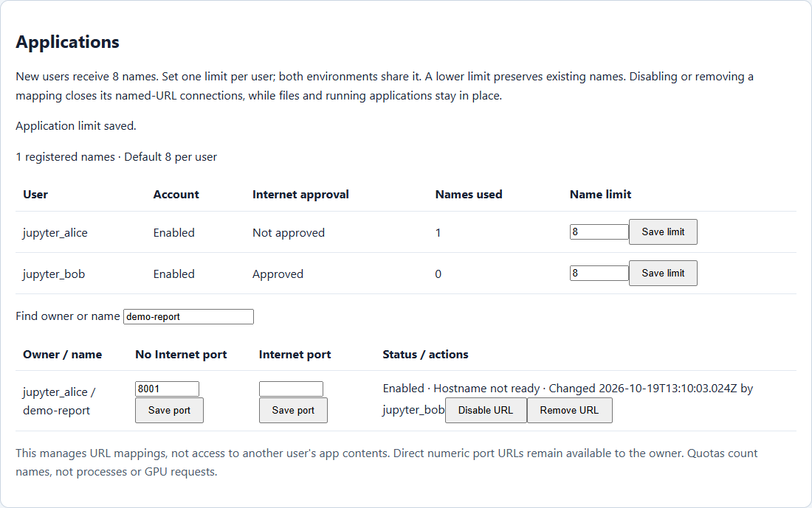

# Admin usage and storage overview

Administrators can use `/admin` to manage accounts and review numeric activity summaries for the main service's configured private runtimes. Account permissions, Internet grants, private routing and conversation ownership remain separate from monitoring.

**New-user slots** shows current remaining capacity, assigned/prepared slots and enabled/disabled accounts. Capacity and DSH activity refresh every 15 seconds while visible. A slot is one new account's private environment pair, not a project folder or application name. Unavailable activity clears old numeric readings; storage samples older than five minutes are marked. [Capacity, monitoring and shared-client walkthrough](PLATFORM_CAPACITY_AND_CLIENTS.html).


The illustration uses synthetic accounts and counters to explain the layout; it is not a live user's activity record.

## Accounts and Internet approval

Users select **Create account** on the login page. Signup assigns an exclusive qualified runtime pair and denies Internet by default. Open **User management** to create an account from available capacity, enable or disable access, sign out sessions, or select **Allow Internet** / **Disable Internet**. Reload the page to pick up new registrations. The usage collector includes assigned signup pairs alongside explicitly configured accounts; unused pairs are capacity, not user activity.

Disabling an account retains its assignment, files and histories. Internet revocation invalidates gateway sessions and closes tracked connections; it does not terminate detached tools already running inside a runtime. An administrator cannot select arbitrary backend addresses or self-assign the admin role through the signup form. Operators replenish empty pairs; the gateway has no Kubernetes management token. See the [signup and approval procedure](SELF_SERVICE_SIGNUP.html).

## Application names, ports and limits



[Watch the recorded admin workflow](ADMIN_APPLICATIONS_WALKTHROUGH.html).

Open **Applications** in `/admin` to manage registered app URLs for the main gateway's users. This is separate from User management, which controls account access and Internet approval.

### One limit per user

Every account starts with **8 names**, shared across No Internet and Internet. In the account table, edit **Name limit**, select **Save limit** and confirm. There are no approval tiers or special 16/64-name rules. Set the number appropriate to that person's work; zero prevents new registrations. The existing 4,096-name site safety bound also bounds accepted numeric limits.

**Names used** includes both enabled and disabled mappings. One alias counts once even if it has two environment ports and both a path and hostname. Lowering the limit preserves existing URLs, files and history. An over-limit owner can update or remove existing mappings but cannot register another name until usage is below the new limit. Removing a mapping frees its name and one quota slot.

Eight names is a practical starting allowance for a notebook, report preview, API and several project apps. Aliases are small routing records, not pods, reserved ports or GPU allocations. Their limit keeps the registry understandable and reduces name hoarding; it is not a substitute for runtime CPU/memory limits or model admission control.

### Manage names and ports

1. Search by owner or application name.
2. Review the No Internet and Internet ports separately, along with account status, Internet approval, mapping enabled state and hostname readiness.
3. To change a port, edit its environment's field, select **Save port** and confirm. The destination remains that owner's provisioned runtime. Saving an Internet mapping does not grant Internet permission.
4. Select **Disable URL** to stop named path/hostname forwarding and close the mapping's tracked connections. Select **Enable URL** to restore it.
5. Select **Remove URL** and confirm to remove the mapping from both environments. This neither deletes files nor stops the underlying application process.

Port changes also close the mapping's open connections so a browser reconnects to the updated destination. The owner cannot re-enable an administrator-disabled mapping by saving it in My apps. Administration does not give the admin access to another user's app contents, workspace or histories, and does not transfer ownership.

These are URL controls. The owner retains direct numeric port routes within their own runtime. To revoke a person's access, use account Disable or Sign out; to stop an application process, use the appropriate runtime operation. Removing a name is not a process or network firewall.

### Storage, audit and operation

Mappings remain in protected `app-links.json`; per-user limit overrides are atomically saved in separate `app-policy.json`, alongside the gateway's protected account storage. Workspace files, passwords and histories are not copied into the app registry. Missing overrides use the default of 8. Invalid policy or registry data produces an unavailable response rather than an empty inventory.

Only an authenticated administrator can use the all-user inventory and mutation endpoint `/api/admin/apps`. Mutations require a current session-bound CSRF token and the canonical same origin. Account, owner, environment, port and input size are checked again before saving. App configuration audit records include the actor, owner, alias/environment, old/new limit or port, time and requested/applied outcome; credentials and application contents are excluded.

Keep the existing single gateway writer for the file-based registry. Before adding gateway replicas, move mappings and policies to transactional shared storage. Saved URL configuration survives gateway replacement through its protected persistent volume.

The user-facing **My apps** page displays names used and the effective limit. Jupyter and terminal launch choices remain independent of the number of custom names. See [application URL setup](APP_URLS_AND_INGRESS.html).

## Managed startup services

Use the separate **Managed startup services** section to save and approve Jupyter or user-app startup definitions. **Start** enables autostart, **Stop** disables it, **Restart** replaces the managed process and **Remove** deletes the definition. Existing URL controls still manage URLs only. An application can be running with its URL disabled, or its URL can exist while no server is running.

Definitions are protected on a dedicated persistent volume, separate from accounts and histories. Each private runtime receives only its own definition directory, read-only, and a constrained non-root supervisor sidecar. No Internet/Internet authorization remains independent. New services are stopped until explicitly approved. Status is supervisor-reported; unknown is not healthy.

Read [startup controls, isolation architecture, credential handling and installation](APP_SERVICE_SUPERVISION.html). [Watch the lifecycle walkthrough](APP_AUTOSTART_WALKTHROUGH.html).

## Usage panels

| Panel | Meaning |
|---|---|
| Stored conversations | Native DSH session records, including blank, imported and copied sessions |
| Running DSH agents | Sessions whose native `running` flag is true; detached terminal processes are separate |
| Queued messages | Messages in the next-turn and next-step inboxes |
| Recorded turns | Turn counters retained by DSH |
| LLM steps | Recorded model steps, including tool continuations; separate from browser logins |
| Accumulated input tokens | Uncached input plus cache-read and cache-write token counters in stored DSH sessions |
| Accumulated output tokens | Output counters retained in those sessions |
| Recorded decode tokens/sec | Sum of recorded decode tokens divided by recorded decode time; excludes preparation and tool time |
| Recent conversation decode tokens/sec | Newly recorded decode tokens divided by their recorded decode time between complete samples |
| Recent output tokens/sec | Output-counter changes between two complete samples, divided by elapsed time |

The panel refreshes every 15 seconds while visible. Concurrent admin viewers share the same short-lived sample. It displays the available/configured runtime count and the number of sessions with usable token records. A failed worker remains unavailable rather than being presented as an empty workspace. The first recent-rate sample is unknown; incomplete coverage, removed histories or counter resets also invalidate that interval. Importing an old history does not turn its accumulated output into new tokens/sec.

Step counts follow DSH's step lifecycle: completed, failed and cancelled steps are counted. A retried step can contain several HTTP attempts, so this counter is not a count of every backend request. Duration counters preserve the fractional milliseconds supported by the installed SDK.

Stored totals describe retained history, including copies. They are not a deduplicated inference-billing ledger. Claude Code or TrueForge sessions launched independently in a terminal have their own accounting; these DSH application counters do not silently claim to include them.

## Storage panels

Storage observations report workspace file lengths, durable session/attachment/state file lengths, and local state filesystem usage/capacity separately. Partial scans are marked. File-size views may overlap, so they must not be added together and presented as physical disk allocation or a user quota. Shared CIFS server capacity is not a private user's storage quota.

Local state directories can be absent until first use and then contain zero files. The collector uses the actual pod's explicit state mounts to distinguish these optional directories from required mounted roots; a missing required root remains incomplete.

An operator with existing Kubernetes access can collect a new observation:

```powershell
python .\scripts\collect_admin_capacity.py --namespace YOUR_NAMESPACE --output .\private-capacity-observation.json --publish
```

Use a new output filename each time to retain earlier observations. The collector reads only file metadata from fixed workspace and state roots, never follows symlinks, limits each scan and performs at most four worker probes concurrently. It publishes a numeric projection to the gateway's protected audit volume and verifies the saved hash. It grants no new cluster role and restarts no workload. Storage freshness is shown separately from live usage sampling; clicking Refresh does not launch an operator command.

## Access and privacy

Only the gateway's configured administrator role can access the telemetry endpoint. Browser headers cannot elevate an ordinary user. The collector uses operator-provisioned destinations and launch tokens; request parameters cannot select a different host or filesystem path. Requests have time and response-size limits.

The response contains numeric usage summaries and existing provisioned account/environment names. Conversation titles, prompts, answers, tool contents, file paths, cookies and credentials are not returned. Counters are operational summaries reported by the application, not a tamper-proof command or remote-job ledger. Datalake identities and permissions are unchanged.

Internet permission grants and revocations are included in the central access audit alongside the existing account events.

## Verification

```powershell
node .\tests\test_admin_telemetry.js
node .\tests\test_admin_dashboard.js
node .\tests\test_admin_users.js
```

These checks cover the native HTTP summary protocol, numeric projection, private-field exclusion, unavailable workers, caching, rate arithmetic, imported histories, counter resets, role enforcement, read-only methods and browser rendering. Deployment verification separately checks the mounted gateway source, current account records and actual private-runtime responses.
