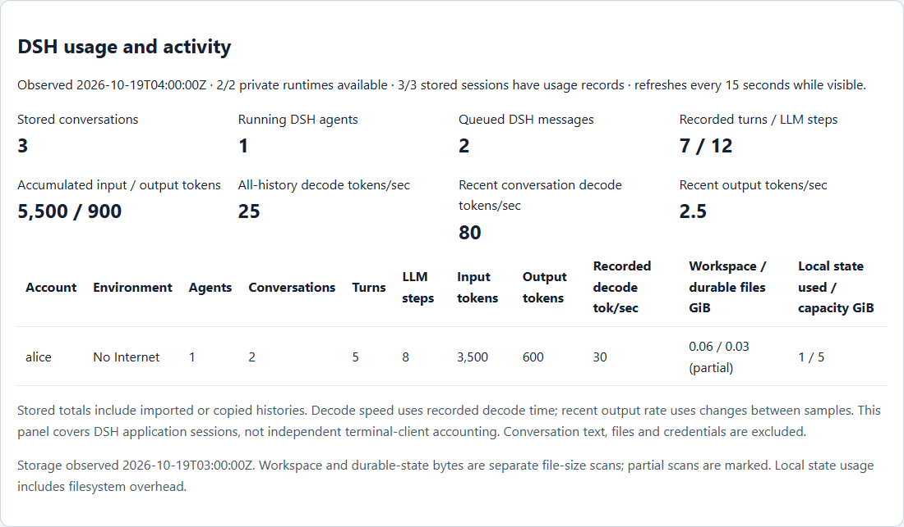

# Admin usage and storage overview

Administrators can use `/admin` to manage accounts and review numeric activity summaries for the main service's configured private runtimes. Account permissions, Internet grants, private routing and conversation ownership remain separate from monitoring.



The illustration uses synthetic accounts and counters to explain the layout; it is not a live user's activity record.

## Accounts and Internet approval

Users select **Create account** on the login page. Signup assigns an exclusive qualified runtime pair and denies Internet by default. Open **User management** to create an account from available capacity, enable or disable access, sign out sessions, or select **Allow Internet** / **Disable Internet**. Reload the page to pick up new registrations. The usage collector includes assigned signup pairs alongside explicitly configured accounts; unused pairs are capacity, not user activity.

Disabling an account retains its assignment, files and histories. Internet revocation invalidates gateway sessions and closes tracked connections; it does not terminate detached tools already running inside a runtime. An administrator cannot select arbitrary backend addresses or self-assign the admin role through the signup form. Operators replenish empty pairs; the gateway has no Kubernetes management token. See the [signup and approval procedure](SELF_SERVICE_SIGNUP.html).

## Application names, ports and limits

### Available today

Users open **My apps** (`/applications`) to check, save and remove their own application names and ports. The central dashboard records app mapping save/delete events, but does **not yet provide an all-user application inventory, mapping controls or editable per-user limits**. The live gateway reviewed on 19 October 2026 matches the repository: its fixed limits are 64 names per user and 4,096 names overall. No custom names were registered at that observation.

One name counts once across No Internet and Internet. Its owner can configure a different port in each environment. The path and hostname are two ways to open the same mapping; they do not consume two names. Saving a name creates no pod, process, GPU allocation or additional Ingress object. Starting an application uses that user's existing runtime resources.

### Recommended administration design — planned

Add an **Applications** tab to `/admin`, alongside User management. Show the following current registry fields without opening users' application contents:

| Field | Purpose |
|---|---|
| Owner and account status | Identify the accountable user and disabled accounts |
| Application name | Show the unique name and its path/hostname |
| No Internet / Internet ports | Show each configured mapping separately |
| Internet approval | Distinguish a saved Internet mapping from permission to use it |
| Name usage / effective limit | Explain whether another name can be created |
| Hostname reservation status and observation time | Identify conflicts or stale inventory |
| Enabled state and last configuration change | Show whether a mapping is routable and who last changed it |

Provide owner/name/environment filters, an individual mapping disable/re-enable action, port editing, confirmed mapping removal and a per-user limit editor. Disabling or deleting a URL must stop routing through both its path and hostname; it must not delete files or kill the user's application process. Management does not grant admin permission to use another user's app or read their history. Ownership transfer is outside the first release; recreate a mapping only through an explicit reviewed process.

Recommended starting policy for the current small deployment:

| Setting | Proposed value | Reason |
|---|---|---|
| Default names per account | 8, shared across both environments | Enough for a notebook, preview, API and several project apps |
| Routine administrator-approved increase | Up to 16 | Accommodate active developers without making a large allocation the default |
| Absolute per-user ceiling | 64 | Retain the existing upper bound for exceptional approved use |
| Total site limit | 256 | Bound the single gateway registry while leaving room for growth |
| Zero-name account limit | Allowed | Prevent new registrations while existing mappings remain manageable |

These are an initial operating policy, not a measured throughput optimum. Aliases are small metadata records; 64 names do not reserve 64 ports or start 64 apps. A lower limit reduces clutter and name hoarding, but does not enforce a process, storage or inference quota. Continue enforcing runtime CPU/memory limits and the independent long-request admission policy.

Store a protected default/site policy and explicit per-user overrides separately from password records and workspace files. Show effective values in both the admin tab and My apps. Keep one gateway writer for the existing file-based registry. If the gateway is later replicated, move registry and policy changes to transactional shared storage before enabling concurrent writers.

If a limit is reduced below existing usage, retain all mappings and allow editing/removal; deny only creation of additional names until usage falls below the limit. Never silently delete or reassign working URLs. Apply the site cap to new registrations, not updates to existing mappings. Reserve existing service names and enforce owner/environment checks for every HTTP and WebSocket route.

### Implementation and acceptance plan

1. Add validated policy storage and metadata fields, preserving existing app mappings. Read-only inventory comes first; a failed registry read must show an unavailable state rather than an empty inventory.
2. Add admin-only inventory and mutation endpoints. Require the existing administrator role, same-origin checks, session-bound CSRF tokens and bounded input. Recheck authorization immediately before each write.
3. Add the Applications tab, quota editor and user-facing usage/limit display. Require confirmation and a reason for disruptive changes. Record actor, owner, alias, environment, previous/new port or limit, action, time and outcome in the central audit; omit passwords, cookies and application content.
4. Test ordinary-user denial, cross-user denial, CSRF, naming collisions, quota boundaries, quota reductions, disabled-account behavior and restart persistence. Verify that disabled mappings deny both HTTP and WebSocket access and that already-open connections close when that mapping is revoked.
5. Test with disposable users and real applications, then perform a gateway-only rollout with saved rollback. Verify account records, histories and storage mounts remain unchanged. Confirm admin edits affect the intended user's route, not admin's runtime.

The dashboard controls and proposed limits above have not been deployed. The current 64/4,096 limits remain in force until implementation and acceptance complete.

## Usage panels

| Panel | Meaning |
|---|---|
| Stored conversations | Native DSH session records, including blank, imported and copied sessions |
| Running DSH agents | Sessions whose native `running` flag is true; detached terminal processes are separate |
| Queued messages | Messages in the next-turn and next-step inboxes |
| Recorded turns | Turn counters retained by DSH |
| LLM steps | Recorded model steps, including tool continuations; separate from browser logins |
| Accumulated input tokens | Uncached input plus cache-read and cache-write token counters in stored DSH sessions |
| Accumulated output tokens | Output counters retained in those sessions |
| Recorded decode tokens/sec | Sum of recorded decode tokens divided by recorded decode time; excludes preparation and tool time |
| Recent conversation decode tokens/sec | Newly recorded decode tokens divided by their recorded decode time between complete samples |
| Recent output tokens/sec | Output-counter changes between two complete samples, divided by elapsed time |

The panel refreshes every 15 seconds while visible. Concurrent admin viewers share the same short-lived sample. It displays the available/configured runtime count and the number of sessions with usable token records. A failed worker remains unavailable rather than being presented as an empty workspace. The first recent-rate sample is unknown; incomplete coverage, removed histories or counter resets also invalidate that interval. Importing an old history does not turn its accumulated output into new tokens/sec.

Step counts follow DSH's step lifecycle: completed, failed and cancelled steps are counted. A retried step can contain several HTTP attempts, so this counter is not a count of every backend request. Duration counters preserve the fractional milliseconds supported by the installed SDK.

Stored totals describe retained history, including copies. They are not a deduplicated inference-billing ledger. Claude Code or TrueForge sessions launched independently in a terminal have their own accounting; these DSH application counters do not silently claim to include them.

## Storage panels

Storage observations report workspace file lengths, durable session/attachment/state file lengths, and local state filesystem usage/capacity separately. Partial scans are marked. File-size views may overlap, so they must not be added together and presented as physical disk allocation or a user quota. Shared CIFS server capacity is not a private user's storage quota.

Local state directories can be absent until first use and then contain zero files. The collector uses the actual pod's explicit state mounts to distinguish these optional directories from required mounted roots; a missing required root remains incomplete.

An operator with existing Kubernetes access can collect a new observation:

```powershell
python .\scripts\collect_admin_capacity.py --namespace YOUR_NAMESPACE --output .\private-capacity-observation.json --publish
```

Use a new output filename each time to retain earlier observations. The collector reads only file metadata from fixed workspace and state roots, never follows symlinks, limits each scan and performs at most four worker probes concurrently. It publishes a numeric projection to the gateway's protected audit volume and verifies the saved hash. It grants no new cluster role and restarts no workload. Storage freshness is shown separately from live usage sampling; clicking Refresh does not launch an operator command.

## Access and privacy

Only the gateway's configured administrator role can access the telemetry endpoint. Browser headers cannot elevate an ordinary user. The collector uses operator-provisioned destinations and launch tokens; request parameters cannot select a different host or filesystem path. Requests have time and response-size limits.

The response contains numeric usage summaries and existing provisioned account/environment names. Conversation titles, prompts, answers, tool contents, file paths, cookies and credentials are not returned. Counters are operational summaries reported by the application, not a tamper-proof command or remote-job ledger. Datalake identities and permissions are unchanged.

Internet permission grants and revocations are included in the central access audit alongside the existing account events.

## Verification

```powershell
node .\tests\test_admin_telemetry.js
node .\tests\test_admin_dashboard.js
node .\tests\test_admin_users.js
```

These checks cover the native HTTP summary protocol, numeric projection, private-field exclusion, unavailable workers, caching, rate arithmetic, imported histories, counter resets, role enforcement, read-only methods and browser rendering. Deployment verification separately checks the mounted gateway source, current account records and actual private-runtime responses.
