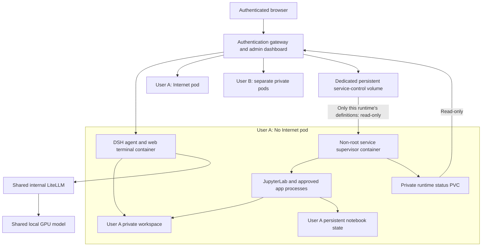
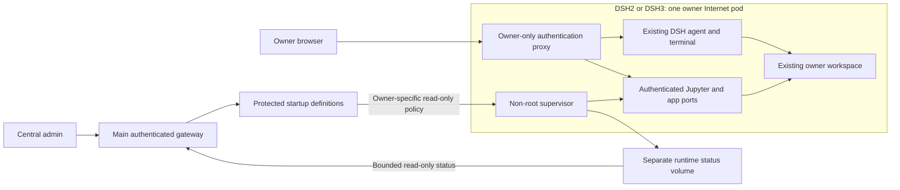

# Managed Jupyter and application startup

## What starts automatically

New accounts receive the built-in Jupyter service automatically when their No Internet environment is assigned. Administrators can manage that service and approve additional custom startup commands. A newly saved custom service starts stopped. Editing an enabled definition applies its new approved command and restarts it; use Stop first if you want it held for a later Start. **Start** enables automatic startup, including after its worker pod is replaced. **Stop** disables it and stops its managed process group. **Restart** replaces the managed process; **Remove** removes the startup definition. These controls are separate from enabling or removing an application URL.

A saved notebook, script or data file lives in persistent workspace storage. A process, open kernel, Python variable or terminal job is memory, not durable data. Autostart creates a new server process; it does not restore an interrupted computation or an unsaved notebook. Save notebooks before maintenance.

### Jupyter for newly created accounts

New private runtime pairs include a fixed Jupyter definition on port 8888, with `/workspace` as the notebook root. An unassigned pair remains disallowed. Successful account creation enables its No Internet environment without individual administrator approval; Internet remains disallowed until the administrator grants it.

The fixed notebook uses one of four managed-service positions in that environment, leaving three for custom managed apps. It does not consume an application URL name. First activation follows the permission-reconciliation and supervisor ticks; allow a few seconds and refresh if needed.

This default applies only to first initialization. It does not replace an existing definition, reset an administrator's Stop choice or change another user's startup policy. User-defined command services still start stopped when first saved. Admin can Start, Stop or Restart the managed Jupyter process later. Stop controls automatic startup; it does not remove saved notebooks or revoke the user's separate terminal permissions.

The supervisor is a separate container: packages installed only into the DSH container’s ephemeral root are not automatically available to it. Use dependencies included in the pinned runtime image, approved offline artifacts, or project-local dependencies visible through the shared owner workspace. The recorded acceptance covers JupyterLab and a standard-library Python application; it does not qualify every framework or virtual-environment launcher.

## Architecture and user isolation



The main platform assigns each user a private No Internet runtime and a separate private Internet runtime. A runtime is a Kubernetes pod managed by a Deployment. Its DSH agent, terminal and tools operate as a non-root identity. Different users do not share the same process or workspace mounts. The two environments have separate workspaces, histories, attachment storage and credential state. The expensive inference endpoint remains shared.

The supervisor is an additional container in the **same user/environment pod**. It shares that pod's network restrictions, CPU node and approved workspace, but has its own process namespace. It is not a second Internet route. It receives no GPU, Kubernetes management token, gateway account store or model API-key environment. Source code is mounted read-only, privilege escalation is disabled, capabilities are dropped and the root filesystem is read-only. A small temporary volume is provided for runtime files.

The supervisor mounts only the owner's existing workspace views, the owner's notebook-state subdirectory, approved package-cache views and its own service-control/status directories. Existing workspace masks remain in place. It does not mount the entire DSH history or credential directory. The gateway may change approved startup definitions; user code sees those definitions read-only. Startup definitions are stored separately from password records, app URL mappings and histories.

The per-runtime status PVC is separate from the shared policy volume and is read-only at the gateway. Status input is bounded; oversized or stale reports become unknown.

The current containers use non-root UID/GID 10001; a distinct Linux UID is not allocated to every account. Isolation therefore comes from the separate pod/container namespaces, private volume mounts, fixed authenticated routing and network policies, rather than from different directory names or UID numbers alone. Cluster and storage administrators remain trusted infrastructure operators.

No Internet workspaces and durable histories retain their existing central CIFS-backed mounts. Internet workspaces and histories remain separate. The notebook-state subdirectory stays on the original user's persistent state volume. The shared approved package cache is read-only; the Internet environment prepares incoming artifacts for reviewed promotion, rather than writing inside a protected workspace. The service installation does not move any of those files.

Platform passwords remain salted scrypt records in the gateway's protected account volume. Per-runtime launch tokens authenticate the internal proxy route; they are not user startup arguments. The DSH agent's own configured inference credentials stay in its existing user-scoped worker configuration. An agent with terminal/tool access can use that user's credentials and writable data; it does not receive another user's identity simply because the model suggested it. Applications must not be given admin passwords or credentials belonging to a different user.

This separates **users** and **environments**. It does not make an agent and all applications belonging to the same user mutually untrusted tenants. They can share and modify that user's approved workspace. An approved workspace script can change when its owner edits it. Approval grants permission to launch that script as that user; it is not a code-integrity signature or a stronger data entitlement.

## Permissions and credentials

| Component | Permission |
|---|---|
| Ordinary user | Uses their own DSH, terminal, notebooks, files and app URLs; cannot approve or edit startup definitions |
| Administrator | Chooses an existing owner/environment, approves startup definitions, starts/stops/restarts services and reviews status; this does not log admin into another user's app |
| DSH agent | Executes tools with its runtime identity and existing mounts; model suggestions do not elevate Linux, network, storage or datalake permissions |
| Supervisor and managed app | Runs non-root in the selected owner's environment, within the supervisor container resource limit |
| Gateway | Authenticates accounts, selects fixed provisioned destinations, writes protected control definitions and records lifecycle events; no Kubernetes management token |
| Infrastructure operator | Installs sidecars, mounts and policies and performs controlled rollouts; this remains privileged administration |

Local DSH credentials establish the platform login. A Kerberos principal is a separate user-specific identity. Its existing AD/datalake grants remain unchanged. The managed supervisor does not automatically inherit the agent's model keys, launch tokens, saved client profiles or Kerberos ticket cache. Authenticate a notebook/application through the user's approved mechanism when needed; never paste credentials into startup arguments, notebooks intended for sharing, reports or videos. A persistent notebook directory is not a credential vault.

For main DSH, Internet approval remains independent of startup approval. Managed Internet services are paused when the account is disabled or Internet approval is revoked; the gateway reconciles that permission and the supervisor applies it within a few seconds. Logout does not stop an explicitly approved background service. No Internet services retain the existing restricted-egress policy. Remote execution through other platforms retains those platforms' authorization and network boundaries.

## Admin workflow

Managed service names use 3–40 lowercase letters/digits/hyphens and must begin with a letter; an app URL with a longer or incompatible name needs a compatible alias before it can be managed.

1. Open **Admin overview → Managed startup services**.
2. Select **Main DSH private runtime**, enter the exact existing owner and select No Internet or Internet. Alternatively select the explicitly provisioned **DSH2** or **DSH3** target: its existing owner and Internet environment are fixed.
3. For Jupyter, use service name **jupyter**, kind **Jupyter**, directory `/workspace`. Its authenticated port and root are fixed.
4. For a user app, first save its owned URL/port in Applications. Use the same service name, kind **Command**, a directory beneath `/workspace` and a JSON argv array, for example `["python3","app.py"]` or `["node","server.js"]`.
5. For a simple static preview, use `["python3","-m","http.server","8000","--bind","0.0.0.0"]` with a URL mapped to port 8000. A named npm script uses `["npm","run","dev"]`. Install dependencies beforehand through the appropriate approved workflow; startup does not install packages.
6. **Save definition**. A new definition is stopped. Review the selected owner and environment, then select **Start** and confirm.
7. Refresh to see supervisor-reported status. Open the user's authenticated Jupyter/app route through their own login to test it.
8. Use **Stop** before disabling a background workload, or **Restart** after a deliberate configuration change. Removing a URL alone does not remove its startup definition. Changing a URL port does not rewrite an approved command's arguments; update both deliberately.

Arguments are passed as an array, not a shell command. Supported executable forms are deliberately limited. The working directory and script must resolve beneath `/workspace`; symlink escapes are refused. There is no arbitrary destination host, Kubernetes command or credential editor. At most four managed services are permitted per environment. The existing per-user app-name quota remains separate.

A service that fails repeatedly uses exponential restart backoff capped at 60 seconds. If its requested port is already used, the supervisor reports the conflict and does not kill the unknown process. Invalid/unavailable control data stops managed services rather than using unreviewed settings. Status is supervisor-reported, with stale/missing reports shown as unknown. Output is not copied into the central dashboard or audit; credentials printed by an app must not become a central activity feed.

The stop operation targets the supervisor's managed process group. It is operational lifecycle management, not a universal sandbox for malicious code. Infrastructure termination of the container/pod remains the stronger containment action for deliberately escaping or uncooperative code.

## Installation and controlled rollout

1. Keep the existing pinned DSH runtime, authenticated gateway, private user routing, persistent workspace/state and network policies. No external package download is required during startup.
2. Prepare a private target file containing only reviewed `{user, mode, host}` rows. `mode` is `off` or `on`; hosts must be the existing private runtime destinations. Do not place credentials in this file or the public repository.
3. Render/review installation with the current pinned runtime image and a dedicated service-control PVC. The installer preserves existing application container settings and workspace masks, adds only the supervisor and its separate control mounts, and saves original deployment specifications privately.

```sh
python scripts/deploy_app_supervision.py \
  --gateway dsh-environment-gateway \
  --targets /private/service-targets.json \
  --control-pvc dsh-app-service-control \
  --output /private/supervision-plan
```

4. Qualify disposable users first: approved Jupyter and a real app must start automatically after pod replacement, retain saved notebook/data/settings, obey admin Stop, and reject ordinary-user control requests. Production installation requires the matching supervisor-source acceptance record.
5. Apply the reviewed installation with `--apply --acceptance /private/lifecycle-acceptance.json` to a new output directory. Use the existing idle-worker/persistence checks and perform a rolling handover. Adding a sidecar replaces a worker pod, so active memory-only computations need a maintenance handover.
6. The dedicated control PVC is mounted read/write only by the trusted gateway and through each runtime's individual read-only subdirectory. Do not mount the gateway auth volume in workers. Notebook state remains on the original user state volume. Each runtime has a separate small status PVC; only its supervisor writes it, and the gateway mounts it read-only. No worker writes on the shared control volume, so filling an own status volume cannot fill another user's policy store.
7. Publish the new gateway source only after its matching signup, authorization and persistence tests pass. Keep the saved gateway and worker specifications for rollback. Rollback removes startup functionality; it must never restore older workspace, history, notebook or account bytes.

The present file-based control store assumes one gateway writer and storage accessible to those pods on the current node. A multi-node deployment needs an appropriate shared storage class; a multi-replica gateway needs transactional control storage before enabling multiple writers. Destination FQDN and external GPU/LiteLLM placement remain operator configuration and do not require moving private workspaces to the GPU machine.

## DSH2 and DSH3 owner-only runtimes

DSH2 and DSH3 use the same managed Jupyter/application supervisor and central admin controls. Each remains one owner-only Internet pod with its existing authenticated proxy, workspace PVC, history/state directory, password store and audit exporter. This feature does not create another login, move histories, add a No Internet environment or change Kerberos grants.

The central dashboard reads a small operator-provisioned startup-target registry. It binds a fixed target ID to its existing owner and workload. **Runtime → DSH2/DSH3** locks the owner and selects Internet; ordinary users cannot register a target or supply a destination host. Startup definitions are written by the central gateway to the dedicated policy volume. Each supervisor sees only its own directory read-only and writes its separate bounded status PVC, mounted read-only at the gateway. The central dashboard does not receive a mount of either owner's files, account records, agent credentials or histories.



To approve Jupyter, select the target, use **jupyter**, kind **Jupyter**, and save/start it. Port 8888 and notebook routing are fixed. To approve a user app, enter its 3–40 character service name, workspace directory, supported argv and explicit application port. For example, `["python3","server.py"]` may listen on 8000. The owner opens the existing instance's authenticated `/proxy/8000/` route. This does not reserve a new main-service hostname, consume a main-service URL alias or allow a management port. Keep the argv listener and selected port consistent.

DSH2/DSH3 account administration stays in their existing owner-only authentication boundary. A main-platform account with a similar name is not the same identity. Stop managed services before an operator disables a local owner account; disabling an unrelated main-platform account does not alter this separate instance. An operator can disable a registered target in the read-only registry, which pauses all its managed services. No password is copied into the registry. Removed or invalid registrations pause their managed services; main-account permission reconciliation continues independently.

The older layout nests private agent state under its workspace volume. The supervisor therefore masks `.legacy-home-v2` and `.legacy-cutover-checkpoint` with empty read-only views, while retaining only the dedicated notebook-state subdirectory at `/state/jupyter`. These masks apply to the supervisor container; the DSH agent's original files and mounts remain unchanged. Apps still share their owner's approved project data, not another user's storage.

### Install the owner-only adapter

Use the existing pinned notebook-capable runtime and qualified supervisor acceptance record. The installer admits only the two explicit owner-only deployments, verifies the single active owner, refuses active agents/manual notebooks, snapshots session IDs and hashes, and saves rollback specifications privately.

```sh
python scripts/deploy_legacy_app_supervision.py \
  --phase prepare --output /private/owner-services-prepare \
  --acceptance /private/lifecycle-acceptance.json --apply
python scripts/deploy_legacy_app_supervision.py \
  --phase workers --output /private/owner-services-workers \
  --acceptance /private/lifecycle-acceptance.json --apply
```

Prepare provisions the two private status claims, initializes protected control directories and renders a private startup registry. Workers installs the same supervisor without changing existing application images, authentication/audit containers or data mounts. Definitions remain stopped until approved. Publish the qualified gateway source with the generated immutable registry ConfigMap through `rollout_admin_management.py --service-targets-configmap ... --app-services-pvc ... --app-services-status-targets /private/owner-services-prepare/targets.private.json`, retaining the reviewed expected source hash and existing gateway settings. Add the current versioned manual directory during the same gateway handover.

Verify actual owner login, Jupyter save/reopen, app replies and automatic recovery after replacement. Repeat replacement after Stop to verify it remains stopped. Compare original histories, profile files and project-file hashes. Rollback restores the saved deployment specification only; it must never replace current workspace, history or credential data with an older copy.

Before rolling the gateway back to a version without registered owner-only targets, Stop those services first. The saved worker specification removes the supervisor without reverting workspace, history or credentials. Retain the private control definitions for review rather than copying old user data over current files.

## New upstream runtime: restart qualification

The 20 October isolated qualification used DSH 0.2.1-rc.2 and the same image for the agent and app supervisor. In both No Internet and Internet environments, approved Jupyter and an actual Python app returned after worker and gateway replacement without manual relaunch. After an administrator selected Stop, another replacement left both services stopped.

Account settings, application names, port 8000, a two-name test quota and startup definitions survived. Twelve checked files—including session, notebook, attachment, application source and private configuration files—remained byte-identical across the replacement checks. Separate status volumes, read-only definitions, denied ordinary-user approval changes and denied direct peer connections preserved the isolation boundary. No model calls were made by this application test.

The new runtime recording shows the actual administrator controls with disposable accounts. It qualifies the candidate image; the upgrade procedure must still verify each deployed runtime and its retained state before routing users to it.


## Jupyter Start controls

**Start is safe to repeat:** an already-enabled managed Jupyter service keeps its
process, restart counter, notebooks and kernel variables. Start enables a stopped
service; Restart and Stop deliberately interrupt its kernels and retain their
confirmation prompts. See [administrator steps and behavior](JUPYTER_START_CONTROLS.html)
and the [captioned walkthrough](JUPYTER_DSH2_DSH3_WALKTHROUGH.html).
