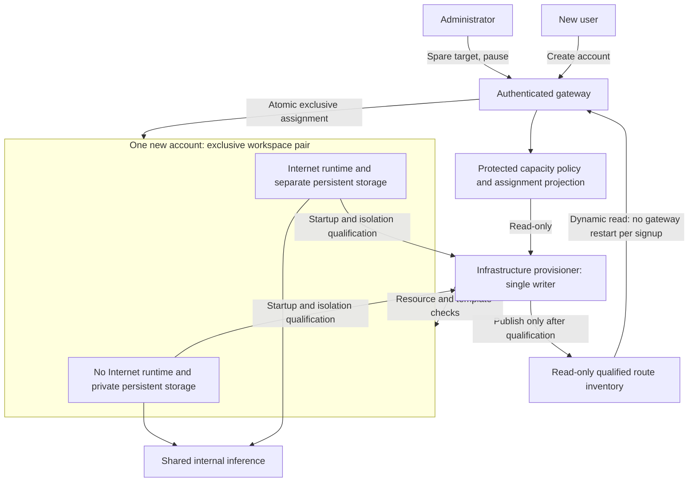

# Account capacity and automatic workspace preparation

Administrators control how many main-platform accounts may be created and how many empty private workspace pairs remain ready for signup. The default replenishment target is **two warm spare slots**. One slot serves one account and contains separate No Internet and Internet environments.

Watch the capacity administration walkthrough.

## Create an account

Successful signup enables your private **No Internet / Internal** workspace immediately, without individual administrator approval. **Only Internet access requires a separate administrator grant.** Account capacity controls are not an approval queue.

1. Open **Create account** and read the current **new-user slots available** count.
2. Choose a username and password. Signup assigns a ready private pair and saves the account and assignment together.
3. Sign in to **No Internet / Internal**. Internet permission starts disabled, regardless of values supplied in the signup request.
4. If Internet work is needed, an administrator approves it separately in User management. Its workspace and history remain separate.

After a signup consumes a slot, the provisioner prepares a replacement until the spare target is reached. This is background preparation, not a new shared workspace. If every ready slot is taken, retry when preparation finishes; an incomplete account is not created. There is no account limit (removed 30 Oct 2026): an account holds storage only, and new sign-ups pause only when local storage would fall below the 200 GiB reserve.

The count is refreshed from current assignments. It is not a limit on project folders, application names, browser sessions or simultaneous model requests. An account-capacity increase does not allocate another GPU model or change the existing context/concurrency controls.

## Administrator controls

Open **Admin overview → Account capacity and automatic provisioning**.

| Setting | Effect |
|---|---|
| Account limit | None since 30 Oct 2026. An account holds storage only; sign-ups pause only below the 200 GiB local-storage reserve. |
| Warm spare slots | Desired unassigned prepared pairs (stopped; storage only). Default: 2; accepted range: 0–8. |
| Automatic replenishment | Allows or pauses background preparation. Existing accounts and already-ready slots remain available. |
| Provisioner status | Shows the last observation, preparation/resource wait, paused state or satisfied spare target. An unavailable or stale status is shown explicitly. |

1. Enter the spare target.
2. Select or clear **Automatic replenishment**.
3. Select **Save capacity settings**.
4. Check the saved values and provisioner observation after refresh.

Lowering a target does not delete excess spare pairs. Assigned slots remain reserved when accounts are disabled. Existing files, conversations, attachments, credentials, app URLs and startup definitions are retained. There is no automatic recycling of a previous user's workspace.

Fresh pairs created by the automatic controller include the fixed Jupyter service, enabled for future use but disallowed while unassigned. Account reconciliation permits No Internet after signup; Internet still requires its separate grant. Initialization is exclusive and preserves every existing policy file, including an explicit Admin Stop. It does not recycle another user's data or approve user-defined command services.

Account admission and Internet approval are separate controls. Neither capacity settings nor signup grant an administrator role, change datalake permissions, approve arbitrary startup commands or increase application-name allowances.

## How preparation works



The login gateway has no Kubernetes management token. A separate infrastructure component creates new workloads from an operator-reviewed, pinned image/template. Dashboard inputs are bounded numbers and a pause flag; users cannot supply an image, command, host, storage path or Kubernetes object.

The provisioner creates one pair at a time. It uses fresh identity paths, new private volumes and restricted inference credentials, and never copies a template user's files, histories or personal credentials. Unexpected credential mounts or literal credential values cause refusal. The No Internet environment retains the approved restricted network policy; Internet preparation uses a separate environment.

Before publishing a slot, preparation checks actual runtime images, mounts and security settings, authenticates the private DSH route, checks empty histories and performs representative network tests from the execution pod. Issued inference credentials are tested and cannot administer the proxy or select an unapproved model. A failed pair stays unpublished for review.

Policy/assignments and published inventory are stored on separate persistent volumes with opposite write permissions. A runtime's application status stays on its own volume. A separate trusted helper publishes only a bounded, validated status summary and that runtime's rotating launch token; user applications cannot write the shared capacity inventory.

Creation pauses when current assignment state, CPU, memory, pod or storage headroom cannot be established. There is no account limit; each sign-in start is admitted against live CPU, memory and pod headroom, first come, first served. Existing extra spares are retained during migration instead of deleting or reassigning their storage.

## Install and qualify

First complete the [platform installation](INSTALLATION_WALKTHROUGH.md), including private routing, central storage, authenticated ingress, the pinned runtime image, filtered DNS and the internal inference service. The installer uses the existing in-cluster LiteLLM issuer and a reviewed ordinary user's runtime manifests as templates. It rejects the legacy owner/admin as template sources. Site-specific issuer, storage and DNS dependencies must exist before application.

Keep generated manifests, evidence and rollback snapshots in a private operator directory outside the repository. No password or token is supplied through these commands.

```powershell
$PrivateOutput = 'C:\operator-private\capacity-release'

# Render and review first; no resources are applied.
python scripts/deploy_capacity_controller.py `
  --namespace llm --template-user template-user --canary --instance qa-qualified `
  --output "$PrivateOutput\candidate-plan"

# Install an isolated candidate with its own accounts, volumes and registry.
python scripts/deploy_capacity_controller.py `
  --namespace llm --template-user template-user --canary --instance qa-qualified `
  --output "$PrivateOutput\candidate-install" --apply

# Run signup, replenishment, native DSH/terminal/isolation checks,
# replace the assigned candidate runtimes and check persistence.
python scripts/run_auto_capacity_acceptance.py `
  --plan "$PrivateOutput\candidate-install\plan.json" `
  --output "$PrivateOutput\acceptance"

# Use the exact current gateway source digest from private live readback.
python scripts/deploy_capacity_controller.py `
  --namespace llm --template-user template-user `
  --expected-source-sha256 CURRENT_GATEWAY_SOURCE_SHA256 `
  --warm-spares 2 --max-accounts 16 `
  --acceptance "$PrivateOutput\acceptance\result.json" `
  --output "$PrivateOutput\production" --apply
```

The infrastructure component is trusted administration: it has resource-creation and credential-issuance privileges. These privileges and the issuer key are not mounted in the gateway, DSH, terminal, notebook or user-app containers. The installer rejects network changes that would newly isolate an existing shared workload. It preserves shared inference ingress rather than adding a restrictive first ingress policy.

After the handover, verify the exact source/image, existing account/settings fingerprints, published assignments, sign-in, internal inference and the manual served by the live gateway. Preserve the original gateway specification. The deployment does not restart existing execution workers or the GPU model.

## Pause or roll back

For normal maintenance, clear **Automatic replenishment**. This stops new preparation while preserving ready and assigned environments. It does not stop users' approved background applications.

If a gateway rollback is required, retain every account assigned since the rollout. The rollback helper freezes the full published route inventory and preserves its read-only launch-token view before restoring the previous gateway source. Registration is paused; workspaces, histories and account records are not restored from an older copy.

```powershell
python scripts/rollback_capacity_controller.py `
  --before "$PrivateOutput\production\gateway-before.private.json" `
  --output "$PrivateOutput\rollback-plan"

# Review the frozen route inventory, then use a fresh output directory.
python scripts/rollback_capacity_controller.py `
  --before "$PrivateOutput\production\gateway-before.private.json" `
  --output "$PrivateOutput\rollback-apply" --apply
```

Do not delete an assigned volume, remove an account-to-slot mapping or reuse a prior user's storage to make the available count increase.
