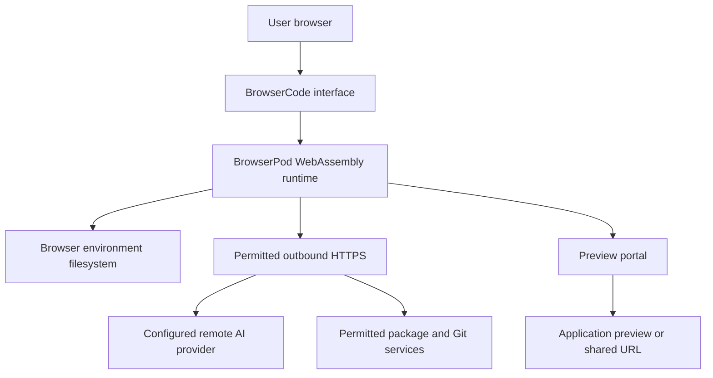
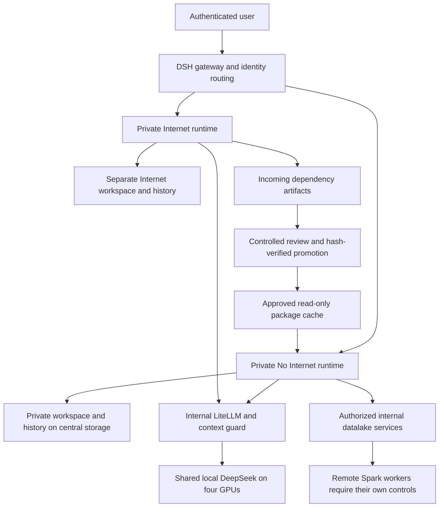

# BrowserCode and BOT DSH

## Decision summary

**Retain BOT DSH for controlled internal analysis. Evaluate BrowserCode separately as an optional public-data coding playground.** BrowserCode provides a useful example of disposable browser execution and integrated previews. It is not a drop-in replacement for private server workspaces, corporate data access or our local inference route.

Review date: **17 October 2026 ICT**. BrowserCode source was refreshed from official `main` and remained at commit `7eb2c0dfb2389f6382c01c26eebe4dd185142fa6`, package version 1.3.0. This is a source/design comparison, not a penetration test or performance benchmark of BrowserCode. DSH descriptions refer to our tracked implementation and previously verified deployment; this document does not claim a fresh full security acceptance.

## Where execution and data live

BrowserCode runs agent CLIs and development tools inside BrowserPod's browser WebAssembly environment. Its POSIX-like filesystem belongs to that environment. This reduces direct access to the user's operating-system files, but does not prevent code from sending data through permitted network routes. The model itself is not thereby running locally: the configured CLI can call a remote provider. The official README describes this browser execution model and the provider sign-in flows. [Official README](https://github.com/leaningtech/browsercode/blob/7eb2c0dfb2389f6382c01c26eebe4dd185142fa6/README.md).

BOT DSH executes tools on the internal Kubernetes platform. A user's No Internet and Internet environments have separate execution and storage boundaries. The shared local model remains behind internal LiteLLM; sharing GPU inference does not require sharing user workspaces. Central CIFS storage preserves durable DSH content, while credentials and runtime configuration use their designated private state. Persistence is not an independent backup.

These diagrams explain boundaries; arrows do not establish that every possible integration has passed an end-to-end security test.

## Feature and architecture comparison

| Area | BrowserCode at the reviewed commit | BOT DSH implementation |
|---|---|---|
| Execution location | BrowserPod WebAssembly in the user's browser | Server-side Kubernetes runtime per user/environment |
| Tool compatibility | Node.js 22, Rust and preview Python; native binaries are not generally supported according to the README | Linux runtime supporting installed CLI tools and internal data tooling, subject to container restrictions |
| Coding agents | Claude Code, Codex CLI and Pi advertised as available; other entries include future features | DeepSeek Harness plus managed Claude Code and TrueForge installation; individual feature acceptance remains separate |
| Model destination | Provider chosen by the CLI; the reviewed Codex defaults use `api.openai.com` | Managed internal LiteLLM route to the shared local DeepSeek model |
| Network design | HTTPS-only allowlist includes package/Git services and major AI providers; this is not No Internet | Separate No Internet/restricted-egress and Internet workloads; network policy must cover each actual execution location |
| Identity | CLI/provider authentication is documented; this does not establish corporate identity-to-workspace authorization | Gateway local identity routes to private runtime/storage; AD/Kerberos identity separately controls datalake permissions |
| Durable state | SDK `storageKey` is configured per CLI environment; Codex API key is stored in browser localStorage | Central DA_WORKSPACE/CIFS content with separate user/environment paths and private state management |
| Administration | No equivalent to our centralized user-routing/audit design established by this source review | Central admin dashboard and audit; oversight is distinct from ownership of user files |
| Preview/sharing | BrowserPod portal integration surfaces development server URLs | Authenticated report/file routes are the required containment boundary; public previews must not be introduced implicitly |
| Corporate data tools | Kerberos/Livy/HDFS integration is not established by this review | Internal datalake integration preserves each authenticated AD principal's permissions; downstream workers remain a separate boundary |
| Capacity | No BrowserCode comparison benchmark was run | Recorded DSH near-1M text/tool cases and bounded concurrency tests; see the separate LLM guide |
| Dependencies and terms | BrowserCode repository has Apache-2.0 source licensing; BrowserPod SDK/service and CLI/provider terms require their own review | DSH, model, runtime packages and integrations likewise require component-level review; local deployment is not a license conclusion |

Source pointers: [CLI bootstrap and storage key](https://github.com/leaningtech/browsercode/blob/7eb2c0dfb2389f6382c01c26eebe4dd185142fa6/src/lib/agents/boot.ts), [Codex configuration and key storage](https://github.com/leaningtech/browsercode/blob/7eb2c0dfb2389f6382c01c26eebe4dd185142fa6/src/lib/agents/codex.ts), [CLI catalogue](https://github.com/leaningtech/browsercode/blob/7eb2c0dfb2389f6382c01c26eebe4dd185142fa6/src/lib/config/tools.ts), [repository license](https://github.com/leaningtech/browsercode/blob/7eb2c0dfb2389f6382c01c26eebe4dd185142fa6/LICENSE.txt).

## Compare the three risk controls

### 1 Prevent external leakage

The critical question is which network destinations generated code can reach, not whether execution is labelled browser-based or local. BrowserCode's permitted provider and package connections can carry information outside the organization. An allowlist limits destinations; it does not prove that permitted requests contain no sensitive data.

DSH's default No Internet runtime is intended to deny public egress while retaining necessary internal inference, storage and data services. Its Internet runtime must not mount protected workspace/history content. Approved dependency artifacts move through a controlled cache rather than a shared writable project folder. This is restricted egress, not a strict air gap.

Remote execution is a separate boundary. A DSH request sent to Livy can cause work on Spark machines outside the DSH pod policy. Those workers require their own network restrictions. The previously accepted remote-egress exception is not closed merely because local DSH egress is restricted. BrowserCode would also require review of every external execution, preview and provider path before internal-data use.

### 2 Prevent damage or excessive access

Browser sandbox isolation limits direct host-operating-system access. It does not protect files inside the writable sandbox from its own generated code, nor restrict permissions granted to remote APIs. A broad API token remains broad even when used from a browser sandbox.

DSH uses separate user/environment runtimes and storage mounts, non-admin execution and limited container capabilities. Data authorization belongs to the authenticated data principal: a DSH account does not create or reduce AD rights automatically. For the public-data pilot, the intended system principal and sandbox grants must be checked at the datalake. Preserve existing AD permissions unless a separately approved data policy changes them. Read-only data access must never be inferred from a workspace mount.

### 3 Keep results contained

BrowserCode's preview portals are convenient for sharing prototypes. Their accessibility, authentication, expiry and revocation must be established before using them for restricted output. A private browser tab does not make a shared preview URL private. Browser-stored keys and files also require endpoint and origin-security controls.

DSH should keep reports, attachments, histories and terminal routes behind authentication and owner-aware authorization. Admin monitoring does not turn an administrator into the owner of ordinary users' content. Downloads and manual sharing require user/endpoint controls in addition to pod egress rules. Neither product can honestly promise universal prevention of intentional copying by an authorized viewer.

## What we can adopt without replacing DSH

| Useful BrowserCode idea | Suitable DSH adaptation | Boundary to preserve |
|---|---|---|
| Fast disposable coding environment | Optional public-data training/playground offering | No protected storage, AD tickets or production credentials mounted |
| Editor, terminal and preview in one interface | Improve DSH navigation and authenticated internal previews | Owner-aware authorization for every file, terminal and preview request |
| Explicit runtime limitations | Display supported languages/tools and execution restrictions clearly | Never imply an unavailable sandbox feature is operational |
| Browser-contained execution | Evaluate as a separate low-trust execution option | Verify actual network routes, provider destination and data handling first |
| Simple project onboarding | Public templates and reproducible dependency bundles | Controlled promotion to No Internet; no direct writable cross-environment sharing |

This is a recommendation, not a deployed BrowserCode integration. Keep the existing private DSH service as the internal workflow while evaluating the playground independently.

## Evaluation and setup plan

Start with a separate development deployment and synthetic/public projects only. Pin the BrowserCode commit and dependency lockfile, obtain an appropriate BrowserPod development key through its normal process, and follow the official `npm install` / `npm run dev` instructions. Use a supported Chromium browser. Embedding requires the documented cross-origin isolation headers and iframe permission; it is not just an unrestricted iframe embed. [Pinned embedding guide](https://github.com/leaningtech/browsercode/blob/7eb2c0dfb2389f6382c01c26eebe4dd185142fa6/docs/embedding.md).

Before connecting internal LiteLLM, establish whether BrowserPod's network policy permits the internal HTTPS endpoint, how its browser-facing authentication works, and whether a protocol-compatible CLI can use it. Do not place a shared inference administrator key in browser code or storage. A backend service being local does not by itself make a browser integration secure.

Test actual outbound access, provider destination, file persistence after reload, cross-user/browser-profile separation, API-key storage, terminal execution, package compatibility, preview access without authentication and removal/revocation behavior. Exercise cancellation and restart/reload. Record failures as well as passes. No such BrowserCode runtime acceptance was performed in this source review.

## Recommendation and next decision

BOT DSH remains the better fit for our current internal integration and centrally governed workspace requirements. BrowserCode is a credible candidate for a separate public-data prototyping experience where its browser runtime and preview workflow are useful. That recommendation is based on architecture and source inspection, not comparative speed, stronger overall security or completed enterprise acceptance.

The next decision is whether to authorize a synthetic/public-only BrowserCode pilot. This review does not deploy it, connect protected data or change the current DSH service. DSH capacity and measured throughput remain in the separate [LLM setup and test guide](LLM_SETUP_AND_TEST_RESULTS.html); the focused [three-risk design report](DSH_RDT_PILOT_SECURITY_CONTROL_ASSESSMENT.html) remains unchanged.
