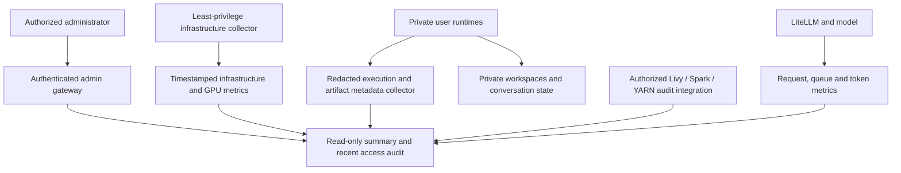

# Central dashboard and activity logging — scope and design

## Purpose from the conversation

The requested dashboard is a central administration and accountability view across DSH, its No Internet/Internet environments, shared inference and the related execution services. It is broader than a login counter. Earlier instructions asked to “add dashboard summary for admin user,” explained that centralized dashboard/logging was needed to manage existing histories, and repeatedly asked about isolation, persistence, context limits, concurrency and response speed. Those requirements belong together in the operating view below.

Central visibility must not undo isolation. A user's workspaces, histories, attachments and Kerberos credentials remain private. The legacy owner remains the owner; an administrator's dashboard role is not automatic ownership or permission to read all conversations. Environment selection chooses a separate runtime and state, while the model is shared. Data permissions remain the authenticated principal's datalake permissions, not a dashboard setting or central-storage mount.

## Coverage: existing implementation versus intended central view

The numeric usage extension is described in [Admin usage and storage overview](ADMIN_USAGE_TELEMETRY.md). Usage is sampled from native DSH session summaries; infrastructure observations and storage scans retain their own timestamps. Fixture tests, actual runtime checks and deployment acceptance are recorded separately.

| Area | Implemented coverage | Intended central coverage and remaining work |
|---|---|---|
| Users and administration | Registered accounts, roles, environment assignments, Internet grants, enabled/disabled status, account creation for provisioned identities, enable/disable and sign-out actions | Runtime provisioning and administrator-role changes remain operator responsibilities. Account actions do not grant datalake access. |
| Sessions and environment routing | Current browser-login counts, private routing, per-account/environment stored conversations, recorded turns/LLM steps, native running-agent flags and queued messages | Browser logins, retained conversations and running agents are different counts. Detached terminal processes need separate instrumentation. |
| History and workspace persistence | Timestamped workspace/durable-state file sizes, scan completeness and local state filesystem usage/capacity; private state remains in user runtimes | Logical file views can overlap and are not physical allocation or per-user quota. Mount/recovery health requires separate checks. Opening another user's content requires separate authorization. |
| Authentication and access audit | Login success/denial, logout, denied admin access, runtime HTTP forwarding, terminal-open and application-WebSocket events | Correlated request/session/runtime IDs, outcome/status, authorized admin changes, password-change events without password data, and searchable retained records. Current events do not include request paths, command bodies or response status. |
| Execution and files | Terminal connection opening is recorded | Tool start/end, exit status, execution target, changed-file metadata and artifact access can support investigations. These require explicit instrumentation; a WebSocket-open event is not a terminal-command transcript. Prefer operation metadata and redaction over command/prompt bodies that may contain secrets or data. |
| No Internet / Internet boundaries | Timestamped saved network descriptions; environment-tagged access events | Last independently tested egress policy, actual worker identity/environment, policy/image/source drift, blocked connection counts and policy exceptions. A green snapshot must not imply a continuously tested boundary. Remote compute remains its own network boundary. |
| Runtime health | Saved environment readiness and observation time | Live availability, restarts, CPU/RAM/storage pressure, failed starts, version/digest and propagation drift across runtimes. A separate least-privilege collector is needed; do not grant Kubernetes administration to the web gateway. |
| LLM use and fairness | Native DSH accumulated input/output tokens, all-history/recent decode averages and recent wall-clock output rate; checkpoint/limits and saved performance; content-free forwarding diagnostics | Continuous GPU and inference-lane metrics need separate integration. These DSH counters do not include independently launched Claude/TrueForge clients or every HTTP retry. Copied histories count in retained totals, not as new output rate. |
| Remote datalake jobs | No complete job ledger | Principal, originating user/environment, Livy session/batch and Spark/YARN job/driver/executor IDs, resource use, outcomes and links to authorized downstream logs. Requires remote-service audit integration; local gateway events cannot prove remote worker permissions or egress. Preserve existing AD permissions and the explicit decision to keep Livy/Spark available with its remote-egress exception. |
| Reports and outputs | Gateway authentication and private runtime routes protect ordinary access | Authorized artifact listing/access/download metadata, output owner, automatic publication/export configuration and failures. Endpoint/browser downloads and manual sharing require endpoint/governance controls; pod egress is not a download-control mechanism. |
| Retention and response | Bounded access files, rotation and audit-write failure count; recent legacy projections | Retention/capacity/freshness alerts, approved archival, protected centralized collector, review/export permissions and incident investigation. Current storage is not a tamper-proof SIEM or an unlimited archive. |

## What the access log actually contains

The access record uses a constrained schema: `time`, `event`, `user`, `environment`, with a validated subject for supported account-management events. The allowlist covers login success/denial, logout, denied administrator access, runtime forwarding, terminal/application-WebSocket opening and account-management actions, including Internet grants/revocations. Passwords, tickets, API keys, prompts, responses, file contents and command bodies are excluded.

The admin audit endpoint returns the latest **100 combined events** from the current main log and the two recent legacy projections, sorted by time. It does not browse all rotated archives. Each legacy instance projects sanitized recent events every **30 seconds**, and projection age is displayed. An empty or stale projection is not proof that nothing happened.

The main log rotates at **5 MiB**, retaining up to five archives. It refuses new audited access when another rotation would overwrite the oldest retained archive; it does not silently discard that archive. Operators therefore need archival/capacity alerts. Login success and runtime forwarding check audit persistence; other event paths do not all have identical failure handling. Do not describe this as universally atomic or fail-closed logging. The failure count is since gateway start, not a lifetime total.

The overview combines current gateway account/login/routing values with bounded native DSH usage sampling and an operator-supplied **timestamped infrastructure snapshot**. Usage refreshes at most every 15 seconds across viewers. Recent rates need two complete samples; unavailable workers, removed histories or counter resets make that interval unknown. Storage is a separate metadata-only operator observation. Refresh does not run Kubernetes/network/GPU probes. Saved test samples retain their checkpoint, date, workload and client scope.

## Architecture and permissions

The diagram shows both existing gateway/audit/snapshot paths and target collectors. The target collectors and integrations are not implied to be deployed by publishing this design. Keep infrastructure tokens and archive administration outside execution workers. The Internet worker must not mount the No Internet user's storage merely to supply packages; only reviewed artifacts cross through the approved cache workflow.

Use separate capabilities for platform administration, audit review, data ownership and infrastructure operations. Admin summary access should not automatically grant raw prompt/history/attachment access. If incident review needs sensitive content, require a narrowly authorized process and record that access. Kerberos credentials and personal tickets must never be central dashboard payloads.

## Implementation sequence and acceptance

1. Extend the event schema with stable correlation IDs and outcome metadata; version it and keep compatibility with existing archives. Add deliberate redaction and size limits. Test that secrets, forged identities and user-supplied role fields do not reach privileged views.
2. Add a separate least-privilege metrics collector for runtime readiness/restarts/storage and backend GPU/request metrics. Display `observedAt`, collector freshness and errors for every panel. Query failure must show unknown/stale, not healthy.
3. Add per-request inference metadata for the final guarded route, preserving the one-long-request admission policy. Measure actual client time to first text separately from backend generation time and output tokens/sec. Distinguish DSH, Claude and TrueForge tests.
4. Integrate remote-job attribution only through approved Livy/Spark/YARN APIs and the applicable user identity. Do not infer remote execution controls from local pod policies.
5. Add authenticated archive search/export and retention/capacity alerting; test unauthorized-user denial and storage-full behavior. Alert delivery or messages require the owner's configured destination and authorization.
6. Qualify restart/persistence, current owner access, cross-user denials, both environments, logging failure handling and protected collector credentials before calling the expanded dashboard complete.

## Source map

- `scripts/auth_proxy.js`: `adminSummary`, `recentAudit`, `auditEvent`, admin route authorization and WebSocket event hooks.
- `scripts/update_admin_snapshot.py`: controlled replacement of the saved infrastructure snapshot and access checks.
- `scripts/collect_legacy_audit.py`: sanitized bounded legacy access projections.
- Local LLM setup, stress results and limits.
- [Portable inference setup](../gpu-stack/README.md).

The existing dashboard is an access and operating-summary view. The broader target is centralized operational and activity metadata with protected content boundaries; publishing this scope does not claim the missing collectors or logs already exist.
