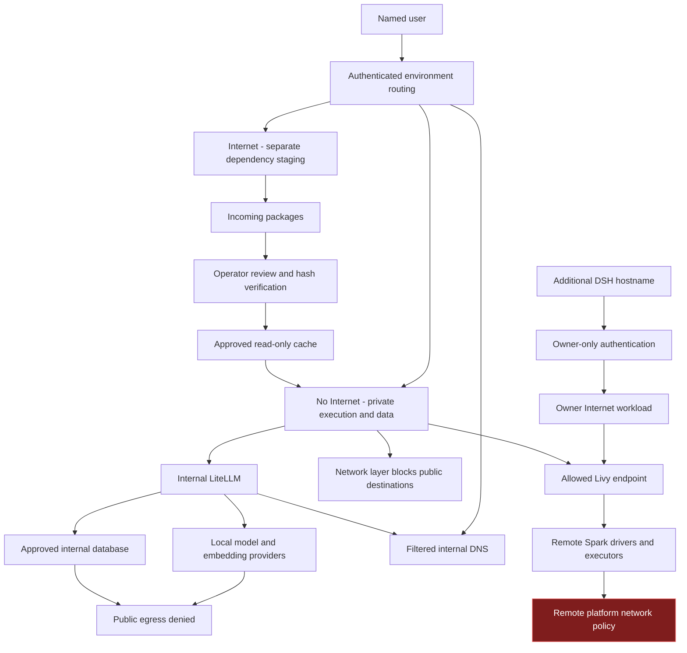
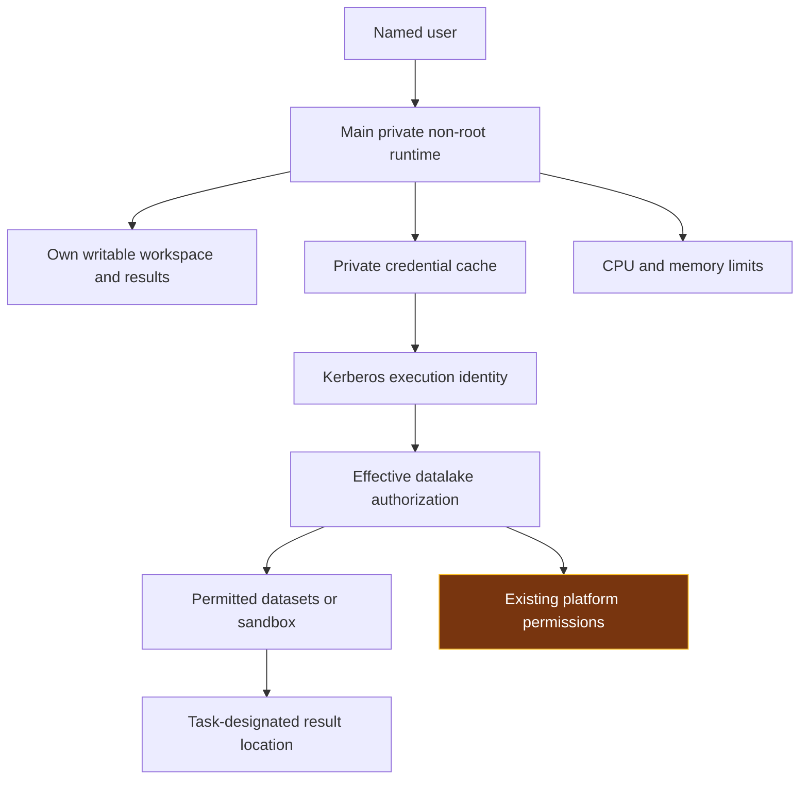
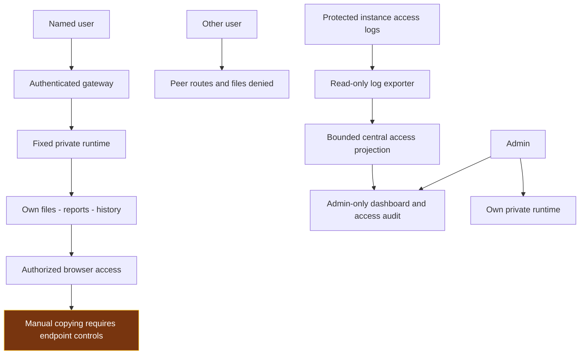
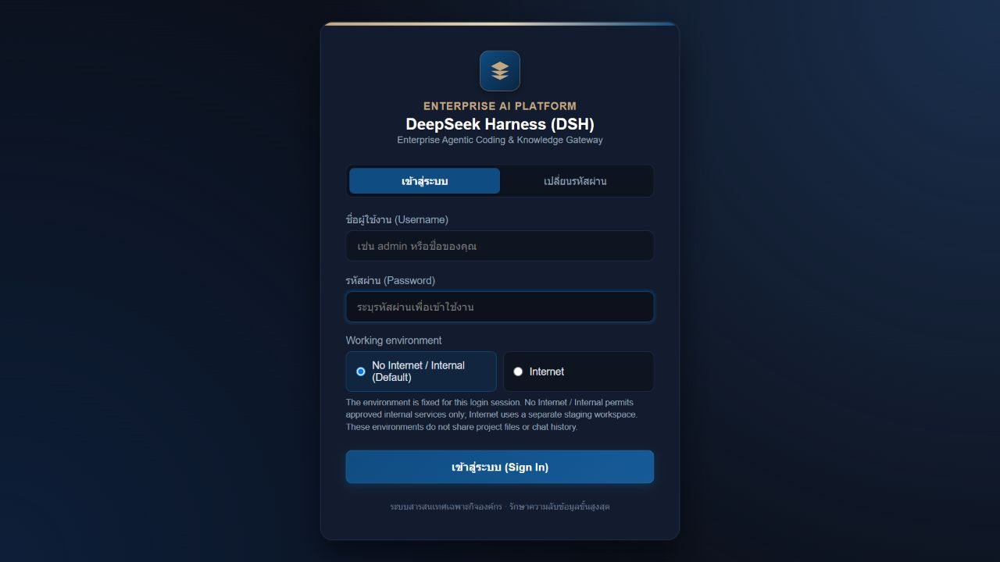
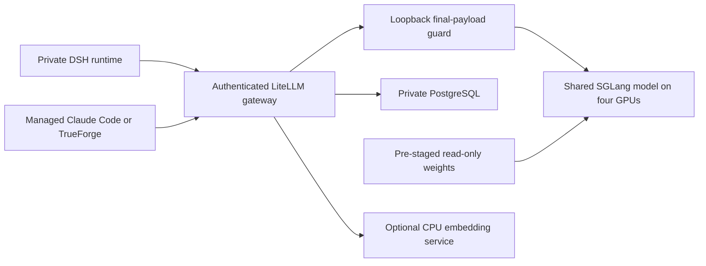

# DSH Platform Guide

DSH controls three risks: external leakage, damage or excessive access, and exposure of results. The Harness, its tools and generated code are treated as automation that can make mistakes. The application therefore enforces boundaries through network policy, private execution, scoped storage and authenticated routes rather than relying on prompt instructions.

### Technology choices and the boundaries they support

The pilot outline separates the technology choice from the acceptable risk boundary. A component being installed, or a rule appearing in a prompt, does not establish that the boundary is enforced. The following summary describes how the DSH design addresses the outline; it does not adopt its illustrative responses as approved requirements.

| Component | DSH design and reason | Risk-control role |
|---|---|---|
| Agent framework / Harness | DeepSeek Harness provides the web workspace, file operations, tools and report generation. Generated code is treated as untrusted automation. | Put enforcement outside the agent: private execution, destination restrictions and authenticated file access. |
| Language model | Internally hosted DeepSeek-V4.1-Flash is reached through the managed LiteLLM route. | Keep managed model requests on internal infrastructure; disable external fallback instead of relying on the model to avoid external providers. |
| Model serving | LiteLLM provides the controlled API route to the SGLang GPU service. A local embedding service is separate from generation. | Separate shared inference from private workspaces and keep provider credentials outside user-controlled routing decisions. The outline's Ollama serving example is not the DSH text-generation architecture. |
| Code execution | Tools run in each user's selected Kubernetes runtime. Libraries come from the prepared runtime and approved package path. | Non-root identity, limited mounts, resource limits and network policy contain execution. Remote submitted jobs have a separate platform boundary. |
| Infrastructure and storage | Kubernetes supplies compute isolation; scoped central CIFS directories provide durable working files and histories. | Separate users and environments, avoid broad parent mounts, and keep original inputs apart from writable results when a task requires input protection. Persistence is not an independent backup. |
| UI and data access | An authenticated gateway serves user-bound workspaces, reports and terminals. Connected data services apply the chosen execution identity's permissions. | No public file bypass or automatic publication. An internal UI does not by itself restrict datasets or make remote execution offline. |

The outline uses public snapshots, read-only originals and no production connection as examples. Those are valid choices for a specifically approved exercise, but they are not universal restrictions imposed by this deployment. Define the permitted data, account, destinations, write scope and output recipients before an exercise. If its boundary requires sandbox-only access or immutable inputs, provision the matching platform permissions or protected input copy; instructions alone are insufficient.

## 1 Prevent external leakage

### Control objective

Prevent unauthorized public connections from the No Internet execution environment while retaining only the internal services required for work. Internet access is provided through a separate environment for dependency preparation, with no automatic transfer of protected data.

### Separate execution and network boundaries

No Internet / Internal is the default login choice. Each main user has a private runtime for this environment and a different private Internet runtime. Authentication fixes the user/environment route for the login session. Switching environments requires logout and a new login; a submitted username, routing header or changed selection cannot choose another user's backend.

No Internet has a restricted outbound network policy. Its approved paths include internal inference, controlled DNS and permitted authentication or job-submission services. Public-domain and direct-IP connectivity are restricted at the network layer, including commands launched from the terminal. The runtime has no Kubernetes management token with which to change its own policy.

The Internet environment has separate compute, workspace, histories and credentials. It does not mount protected No Internet working data. Its public connectivity supports dependency preparation; it is not an alternate processing route for protected prompts, tickets, datasets or reports. The shared internal gateway and inference services do not merge user workspaces. This architecture provides restricted egress, rather than a strict air gap.

The gateway, LiteLLM, local model providers and supporting database have their own destination restrictions. Filtered internal DNS serves approved internal names rather than forwarding arbitrary public lookups. Supplied model clients use internal LiteLLM with model-scoped credentials and operator-owned configuration; external model fallback is disabled for the managed route. Client configuration complements infrastructure enforcement and does not replace it.

### Transfer dependencies without sharing protected workspaces

The Internet environment downloads package artifacts into an incoming area. An operator reviews their source, version and expected hashes. A controlled promotion process verifies selected bytes and places approved artifacts in a separate cache. No Internet mounts that cache read-only and installs without a public package index.

Internet cannot directly install into the protected runtime or modify its workspace. Prompts, datasets, credentials, histories and reports are not dependency artifacts and must not use this transfer path. Hash verification establishes artifact integrity; package approval remains necessary because an intact package can still contain harmful code.



### Keep environment choices explicit

DSH2 and DSH3 are owner-only Internet-capable instances. The No Internet choice is disabled on these instances. Their authenticated proxies and ingress restrictions prevent direct peer access, while retaining their intended internal inference and permitted service connections. Protected offline work uses the designated No Internet environment.

An internal connection to another platform does not grant administration of that platform. If a submitted command executes remotely, that platform applies its own permissions and network rules; this responsibility is separated in the final section.

## 2 Prevent damage or excessive access

### Control objective

Contain local execution and prevent peer or administrative access beyond the selected user's environment. Preserve existing permissions on connected platforms instead of silently granting broader access or imposing an unrequested replacement authorization policy.

### Run tools within a private, restricted workload

Each main user/environment has a separate execution process with bounded workspace, session, attachment and credential mounts. Isolation is enforced through the workload and mounted scope, rather than merely choosing different folders in one shared process. Broad parent directories containing other users' data and host-management interfaces are not exposed to ordinary execution.

The workloads execute as non-root, disable privilege escalation, drop Linux capabilities, use RuntimeDefault seccomp and have no mounted Kubernetes management token. CPU and memory limits constrain local resource use. Additional instances similarly use restricted non-root execution with a designated owner account.

DSH, Claude Code and TrueForge inherit the selected runtime's identity, mounts and network policy. Installing a tool does not grant a privileged container, host socket or another user's credentials. TrueForge's optional nested sandbox is disabled. Its ordinary tools run within the selected runtime's existing restrictions.

### Preserve private work and bounded write access

Protected working files and durable histories use bounded central CIFS paths. Internet workspaces and histories remain separate. Credentials and profiles remain in their designated private state locations, while approved dependency artifacts are read-only. Generated outputs belong in the user's designated writable working area.

Existing histories and files retain their ownership. An explicitly authorized support copy is independent and does not reassign the source, expose a shared parent directory or establish ongoing synchronization. Persistence across runtime replacement is part of the application design; independent recovery from authorized or accidental deletion is a separate storage-service responsibility.

### Use connected services under existing authorization

Datalake connections authenticate with the applicable Kerberos principal. DSH does not expand that principal's permissions, grant administration of the datalake or redefine its dataset scope. Submitted commands remain subject to that platform's authorization and execution controls. Existing personal and system-account entitlements are preserved.

A generated command can still make a mistake within permissions already granted. Tasks should therefore separate original inputs from outputs and review destructive operations where appropriate. For sandbox-only or read-only work, use an entitlement provisioned by the relevant platform owner.



### Separate input protection from permission to execute

A private runtime prevents access to another user's workspace; it does not make the current user's writable source data immutable. Where the agreed task forbids modifying originals, expose an approved read-only input snapshot or view and write generated code, reports and working copies to a separate writable location. The data or storage owner must enforce that distinction. Do not describe preserved personal read/write entitlements as a read-only guarantee.

The agent may generate and run analytical code within its assigned boundary, but must not receive cluster administration, host-management sockets, unrelated service credentials or permission to enlarge its own mounts or network access. Tool approval is an additional operational choice; it is not a substitute for restricting the execution identity. A connected remote job inherits the remote platform's controls, not the local container's filesystem or egress policy.

### Bound shared resources

The inference route counts the complete request, reserves output capacity and controls admission of expensive work. Long requests use bounded waiting and an explicit busy response while shorter work remains schedulable. Admission manages shared capacity independently of data authorization. Local process limits and shared inference scheduling are DSH controls; remote job queues remain under the platform that executes those jobs.

For a shared-service pilot, define a workload budget as well as CPU and memory limits: allowed job duration, cancellation responsibility, output/storage growth and expected concurrent use. Long-running or repeated work should be cancellable through its executing service and should not bypass admission controls by spawning unrelated jobs. Administrators use the centralized dashboard and activity log to identify the affected user/environment and investigate abnormal consumption. Gateway access events are not complete CPU/GPU, disk or remote-cluster telemetry; remote job accounting, disk quotas and enforced execution deadlines must be configured where those workloads run before claiming those specific boundaries.

## 3 Keep results contained

### Control objective

Keep histories, reports, files, attachments and terminal access within authorized user routes. Separate operational oversight from automatic access to user content.

### Authenticate access and bind it to private storage

The gateway admits provisioned named accounts, disables self-registration and binds each authenticated user to the assigned runtime. Reports, files, attachments and terminal WebSockets use the authenticated boundary. Server-side identity and route checks reject forged roles, peer-runtime selection and direct bypass paths.

Each user/environment has separate working files and history storage. Switching environments does not automatically transfer content or credentials. Logout invalidates the gateway session. Additional instances admit only their designated owners; shared guest and cross-account logins are disabled.

Account stores use salted scrypt password records and bounded verification. Authentication records are stored outside execution workspaces, with protected account volumes and operator-only recovery material. Supplied bootstrap configuration does not create factory-password accounts. Users can change passwords through the authenticated flow; startup does not overwrite a changed password.

### Centralize oversight without merging user content

The admin-only dashboard combines operational information and access events. Administrative visibility does not automatically grant access to another user's conversations or files. Any authorized support copy remains in a separate private store and preserves the original owner's records.

Access auditing records relevant events, user, environment and time outside execution workspaces. It excludes passwords, Kerberos tickets and conversation bodies. Instance exporters read only their access-log scope and write a bounded central projection. Execution users do not receive the account or audit stores. Required gateway auditing fails closed when an access event cannot be persisted.

The dashboard distinguishes timestamped infrastructure snapshots from current gateway information. Refresh reloads the saved snapshot. Access logs support accountability; a full command recorder, conversation archive and independent audit-retention service are separate capabilities.



### Deliver generated results through the same boundary

Working reports, charts, temporary files and generated applications remain in the private environment. Server-side file access uses the authenticated identity rather than a submitted owner name or arbitrary filesystem path. Exposing a new application requires the same authenticated proxy and user-bound storage; it does not justify a new public bypass route.

The managed workflow does not automatically publish protected results externally. The No Internet environment's network policy blocks direct public transmission from its execution runtime. Internet-capable tools must not be represented as having the same offline restriction. Authorized viewing and downloading are normal application functions; additional restrictions on what a person copies require an explicit handling policy and endpoint controls.

### Review analytical results before operational use

Containment includes controlling how a result is used, not only who can download it. Keep generated code, input selection, calculation assumptions and resulting reports together in the private workspace so an authorized reviewer can reproduce the analysis. Label exploratory findings as provisional and compare important calculations with known reference results before relying on them.

A fluent answer, a completed tool run or a plausible chart is not validation of analytical correctness. The pilot workflow should require human review before a result triggers an operational decision, source-data correction or downstream publication. If an integration can perform such actions, enforce its permitted operations and approval step at that integration; a report warning alone does not prevent writeback. These are task-level operating boundaries, not a claim that DSH implements a universal accuracy gate or disables every user's existing write permission.

### Translate the pilot outline into an explicit decision

| Outline risk dimension | How it fits the three controls | Decision needed for the particular exercise |
|---|---|---|
| Data confidentiality | Risk 1 restricts outbound execution; Risk 3 limits access to resulting files. | Identify permitted data classification, destinations and recipients. A public-data-only claim needs a defined dataset and matching access scope. |
| Source-data integrity | Risk 2 separates protected originals from writable results. | Decide whether originals must be read-only and arrange that permission at the source. |
| System access and autonomy | Risk 2 constrains identities, tools, mounts and privilege changes. | Define allowed connected services and destructive operations; retain remote-platform enforcement. |
| Resource and operational impact | Risk 2 bounds local execution and shared inference; central oversight supports investigation. | Assign job deadlines, cancellation, storage budgets and remote-cluster monitoring to the enforcing service. |
| Analytical reliability | Risk 3 keeps provisional findings in an authorized review workflow. | Set reference calculations, reviewer and permitted downstream actions; do not treat generated output as approved automatically. |

Agree the boundary first, then identify the enforcing component and its owner. A boundary that is undecided or not checked must remain explicitly unconfirmed; the outline's example controls and this design explanation do not establish a new acceptance result. This keeps the three-risk structure while making the pilot's technology, autonomy and review decisions understandable.

## Connected services and responsibilities

Use these responsibility boundaries when planning connected services, data access and operations.

| Boundary | Responsibility and agreed treatment |
|---|---|
| Remote Livy/Spark execution | The datalake platform controls its drivers, executors, job limits and outbound network. DSH restricts its local submission path but does not administer those machines. Livy/Spark remains available. Its remote workers require their own outbound controls. |
| Dataset and sandbox authorization | The platform's existing Kerberos/AD and data permissions remain authoritative. Use a sandbox-only or read-only entitlement when the task requires it. |
| Authorized browser handling | Viewing, copying and downloading by an authorized person are distinct from peer access or unauthorized publication. Device restrictions, managed browsers or DLP apply only where required by the organization's handling policy. |
| Identity lifecycle | Authentication uses local accounts with an authenticated password-change flow. Corporate SSO/MFA and organization-wide recovery require separate integration. Change any exposed or known password; hashing protects stored records, not a password already known to someone else. |
| Storage recovery and infrastructure administration | Central storage provides persistence. Storage-server ACL administration, independent backups and disaster recovery belong to that service. Cluster, host and storage administrators remain trusted privileged operators. |
| Audit-service extensions | Current central access logging and dashboard oversight are included. Complete command/body capture, remote-job correlation and independently retained audit archives require additional collectors and an operating policy. |
| Deliberately Internet-capable environments | Internet staging and the additional Internet instances retain their intended public connectivity. They are not protected No Internet environments and must not be used as an automatic bridge for protected content. |

## Platform features and intended use

The main interface is the DSH web workspace. Claude Code and TrueForge are optional clients available inside its private execution environment; they do not replace the DSH web interface. One shared local model serves these clients without sharing their working files.

| Capability | How it is used | Implemented boundary or limitation |
|---|---|---|
| Named local login | Sign in with a provisioned account; change your password through the login page | Local DSH identity is separate from AD. Self-registration is disabled; corporate SSO/MFA is not included. |
| Environment selection | No Internet / Internal is the default; Internet is a separate login choice | Logout and sign in again to change environment. Project files, histories and credentials are not automatically transferred. |
| Private user execution | Work in the assigned runtime and its mounted workspace | Main users have separate runtimes in both environments. Additional instances are owner-only Internet environments. |
| Web chat and task execution | Ask DSH to inspect code, edit files, explain documents and run available tools | Commands run with the runtime's non-root permissions. Review consequential changes; model output is not automatically correct. |
| Workspaces and projects | Keep repositories, scripts and results under `/workspace` | The selected environment's mounts define what is visible. A folder name alone is not the isolation mechanism. |
| Persistent history and attachments | Reopen sessions and use their associated files | Workspace, session and attachment stores persist according to their mounts. Credential/profile state has a separate scope. |
| Long-context analysis | Supply relevant repository/document material to the managed local model | DSH supports a 1,048,576 total-token budget, not unlimited input plus output. Large cold prompts can take many minutes. |
| Compaction and tool-result pruning | Use `/compact` where appropriate; automatic compaction is configured | Compaction must reduce context; it can refuse a non-reducing summary. Save important findings and source references before compacting. |
| Web terminal | Open the authenticated terminal and run tools in the selected environment | Same user, mounts, non-root identity and network boundary; opening a terminal does not grant host or cluster administration. |
| Application previews | Start a server on an approved free port, then open the authenticated app route | Serve only the intended result folder. A new server must remain behind the gateway; an arbitrary public route is not automatically protected. |
| Claude Code | Run the installed `claude` client from the terminal | Managed internal endpoint/model and persistent private client state. Current default uses the client's 1,000,000-token mode. |
| TrueForge | Start `trueforge`, then open its authenticated port-3000 app route | Private client state and managed internal model. Optional nested code sandbox is disabled. |
| Offline dependency preparation | Download in Internet, approve artifacts, install from the read-only cache in No Internet | Python/npm helpers exist. Native/OS dependencies may need a qualified runtime-image build; the package cache is not a shared writable workspace. |
| Kerberos and datalake connection | Authenticate privately using the intended principal and configured client | Existing platform permissions remain authoritative. Local DSH login and central storage do not grant data access. |
| Central dashboard and user management | Admin reviews accounts, private environments, browser sessions and access events; creates provisioned accounts, enables/disables access and signs users out | User files and history remain intact. Creating execution environments and granting administrator roles remain operator actions. |
| Plugins and upstream tools | Use approved installed DSH plugins/tools within the same runtime | The upstream plugin architecture is available; each optional integration needs its own configuration and qualification. |
| Upstream maintenance | Detect releases, verify patch contracts, build and test candidates | Default follows the official npm latest channel. Reviewed compatibility patches and deployment overlays are separate; no automatic Production merge. |
| Operations and rollback | Preserve specifications, image/source digests and mounted data before change | Restore compatible configuration on regression; never overwrite newer work with an older history copy. |

### Installed clients

Installed main-runtime versions: DSH `0.2.0-rc.2`, Claude Code `2.1.301`, TrueForge `0.179.2`.

## Deployments and access points

DEPLOYMENT_SUMMARY

PUBLIC_DEPLOYMENT_TABLE

SITE_DEPLOYMENT_DETAILS

Main DSH routes each identity to its own selected runtime. Main service aliases and app ports are entry routes, not extra independent copies of a user's workspace. DSH2 and DSH3 have their own designated owners and remain Internet-only. Claude Code and TrueForge run inside those assigned workloads; they are not additional shared GPU deployments.

The original unisolated `dsh` deployment and the alternative model Deployments listed as scaled to zero are retained configurations, not currently available parallel model capacity. Do not scale another four-GPU model while the only GPU node is occupied without a reviewed capacity/handover plan.

### Supporting services and standby models

The environment gateway handles login, fixed private routing, authenticated app/terminal access and the admin view. The internal DNS service provides the approved name-resolution path. LiteLLM and its final-payload guard handle model authentication, exact budgets and admission; PostgreSQL supports LiteLLM's persistent service state. The shared SGLang workload runs the active generative model. A documentation server serves operational guides; the workload-switcher service supports operator-controlled model changes.

Alternative GLM/Qwen and earlier model-runtime Deployments are explicitly identified as scaled to zero in the inventory. They do not provide simultaneous GPU capacity, an automatic fallback model or an operational service merely because their configuration exists.

### Optional CPU embeddings

A separate CPU Ollama workload provides optional embeddings without using the generative model’s GPUs. Use `/api/ps` to check loaded models and load the approved model before the first embedding request.

## Example usage

Choose the intended environment before starting. The examples below cover common tasks.

### 1 Sign in and choose the environment

1. Open the main DSH address and sign in with your provisioned local account.
2. Leave No Internet / Internal selected for protected local work. Choose Internet only for its intended staging work.
3. Open the intended workspace or create a new session. Verify which environment you are using before adding files or authenticating to connected services.
4. To switch environments, logout and sign in again. To change a password, use the authenticated password-change flow; do not put credentials in chat or project files.

Check connectivity from the selected environment when needed; a listed web tool may still be blocked by its network policy.

### 2 Review a repository with traceable answers

Example prompt:

> Inspect this repository without changing files. Explain the request path, authentication boundary and persistence locations. Cite the exact file and line range for each factual claim. Separate observations from assumptions and list anything you could not verify.

For a large review, choose relevant code and documents rather than padding the input. Ask for a source ledger and check it against the actual files. Keep enough context headroom for tool definitions, output and follow-up work.

### 3 Produce a bounded analysis result

Place `sample.csv` in the selected workspace and ask:

> Read sample.csv. Report its row count, column names and missing-value counts. Write results/summary.json and a short results/report.html. Do not modify the input. State the exact files you read and verify the saved output.

Run a local inspection from the terminal when useful:

```sh
cd /workspace/<project>
python3 -m json.tool results/summary.json
```

Compare the saved results with the input and the requested calculations.

### 4 Use the web terminal and application preview

Open the authenticated terminal route for the selected DSH service. It runs in the assigned environment, not directly on the Kubernetes node. A new terminal tab does not switch identities or network environments.

To preview an existing result folder on a free approved port:

```sh
cd /workspace/<project>
python3 -m http.server 8080 --bind 0.0.0.0 --directory results
```

Open the service's authenticated `/proxy/8080/` route or configured port-8080 alias. Login must still be required. Stop the server with Ctrl+C after use. Serving only `results` avoids unintentionally publishing the entire workspace. Do not add an ingress or disable authentication merely to make a preview work.

### 5 Prepare Python dependencies for No Internet

In the Internet environment, create a pinned requirements file:

```sh
printf 'six==1.17.0\n' > requirements.txt
prepare-offline-deps python requirements.txt
```

This downloads to the incoming package area. An operator reviews source/version/hashes and performs controlled promotion. In No Internet, after approval:

```sh
python3 -m venv /workspace/<project>/.venv
/workspace/<project>/.venv/bin/python -m pip install \
  --no-index --find-links=/packages/approved/python six==1.17.0
/workspace/<project>/.venv/bin/python -c "import six; print(six.__version__)"
```

For npm, `prepare-offline-deps npm <project-directory>` requires the project's lockfile and populates incoming cache with install scripts disabled. Native modules, platform-specific wheels and OS libraries require compatibility review; copying an arbitrary package directory between environments is not a supported substitute.

### 6 Use managed alternative clients

From the selected terminal:

```sh
cd /workspace/<project>
claude -p "Read README.md and list three implementation questions; cite the relevant sections."
```

To use TrueForge, first ensure port 3000 is free, run `trueforge`, wait for its listening message and open the service's authenticated `/proxy/3000/` route or configured port-3000 alias. Its model/provider configuration is operator-managed; private chat state remains in that environment. Do not enable privileged container features to make the optional nested sandbox start.

### 7 Authenticate to a permitted datalake service

```sh
kinit <approved-principal>
klist
```

Enter the password only at the private authentication prompt. Use your configured Livy/Spark/Hive/HDFS client under that principal. DSH preserves the platform's effective permissions; an internal job submission is not datalake administration. Keep output in its intended location, review destructive operations and follow the platform's rules. Do not move tickets into Internet staging.

### 8 Use the admin overview

An authorized admin opens `/admin` through the main gateway. Review account/session counts, per-user routing, the observation timestamp, environment descriptions and recent access events. Refresh rereads the saved infrastructure snapshot and current gateway values; it does not execute a GPU benchmark or network probe. Use the separate operational tools for live troubleshooting. Admin rights do not automatically expose private conversation bodies; an explicitly authorized support copy remains independent.

## Interface screenshots

The login screenshots show the live interfaces. Dashboard screenshots use demonstration accounts and values to explain the controls.

### Main login and environment selection



No Internet / Internal is selected by default.

### Central dashboard and user management

Open **Admin overview** from DSH, or sign in as an administrator and open `/admin`.


Dashboard interface with demonstration accounts. The account table shows each user's role, enabled status, assigned environments and active browser sessions.

1. **Review accounts:** inspect the account table and environment assignments. Current account/session information is read from the gateway; infrastructure panels show their observation time.
2. **Create an account:** choose an identity whose private No Internet and Internet runtimes have already been provisioned, enter an initial password of at least 12 characters, and select **Create account**. The new user changes their password privately through the sign-in page. If no identity is available, an operator provisions its private runtimes first.
3. **Disable or enable access:** select **Disable** or **Enable** beside an ordinary account. Disabling prevents new logins and ends its active gateway sessions and WebSocket connections. Its workspace and histories are preserved.
4. **Sign a user out:** select **Sign out** to revoke current gateway sessions and close browser/terminal WebSocket connections. This does not disable the account or cancel a tool already running in its private runtime.
5. **Review activity:** open **Central access audit** to inspect login, access and account-management events. Management events identify the administrator and affected account.

Administrator accounts and roles are maintained by the operator. The dashboard does not grant datalake permissions or expose stored passwords, Kerberos credentials or conversation contents.

## Storage, administration and maintenance

### Where work is stored

`/workspace` is the working location presented to each runtime; its backing PVC/subpath defines the durable store. Main No Internet project data and durable DSH histories use scoped central CIFS mounts. Credentials and profiles remain in private state locations. Internet workspaces/state remain separate, and the approved cache is mounted read-only where needed. Consult the runtime’s mount configuration for its backing storage.

DSH sessions/attachments and managed-client state are distinct stores. Claude uses its persistent private state; TrueForge uses its private application state. Instance client `/state` wiring can alias its existing owner-only durable home rather than creating another shared tree. Do not replace a working mount without stopped-writer reconciliation and preservation of newer writes.

### User and audit administration

Operators provision private runtime mappings through the identity and routing procedure. Administrators then manage provisioned local accounts through the dashboard. Account changes require an authenticated administrator session and a session-bound management token; ordinary users and cross-origin requests cannot perform these actions. Passwords are stored as salted scrypt records. Disabling access preserves ownership, files and histories; removing workloads or data is a separate operator procedure.

The access audit records bounded metadata such as time, event, user and environment. It is not a terminal-command recorder or an archive of all prompts/responses. Additional-instance access projections and main gateway events are combined under the admin boundary. Retention capacity, off-platform archival and remote-job correlation need the defined operational policy.

### Deploy dashboard changes

Run the account-management and existing dashboard regression suites before replacing the gateway:

```sh
node tests/test_admin_users.js
node tests/test_admin_dashboard.js
```

Use a new private rollback directory and the SHA-256 of the currently mounted gateway source. First inspect the plan, then repeat with `--apply` for the reviewed handover:

```sh
python scripts/rollout_admin_management.py \
  --output /private/admin-management-rollout \
  --expected-source-sha256 <current-mounted-source-sha256>

python scripts/rollout_admin_management.py \
  --output /private/admin-management-rollout \
  --expected-source-sha256 <current-mounted-source-sha256> \
  --apply
```

The rollout replaces only the authentication gateway, preserves account content and checks the mounted source and authentication behavior. Users sign in again after the gateway reload. Inference services, private execution pods and history mounts are not replaced. On failed checks, the procedure restores the previous deployment configuration without restoring older account or history data.

### Updates and rollback

The official npm package remains the base. Local gateway/Kubernetes/model overlays and the versioned ten-target DSH compatibility patch set are maintained separately. Daily/manual candidate qualification tracks npm latest; changed upstream hashes stop the patch process. Patch preflight and postchecks verify the expected upstream code before a candidate is promoted. Missing source assets cause an explicit error.

Before a rollout, retain the exact image, source ConfigMaps, profile and workload specification; verify that the relevant agents are idle. Replace workloads in a controlled sequence and read back affected content, history and mounts. On regression, restore a compatible configuration/image while preserving newer durable writes. A mounted share is persistence, not an independent backup. Do not restart the shared model merely to update a document or client page.

## LLM and GPU setup

The platform uses one shared four-GPU generative model. Private user runtimes share inference while keeping their own files and state. Use the portable `gpu-stack` source and supply private site values outside Git.



### Runtime profile and context budget

| Setting | Live configured profile |
|---|---|
| Model | DeepSeek-V4.1-Flash on the existing four-GPU node |
| Runtime image | `lmsysorg/sglang@sha256:4a5d132a06a77c8331e15845f2e925adc788b00105097ad55409afa3f4fa4860` |
| Tensor parallelism | `--tp-size 4` |
| Total context ceiling | `--context-length 1048576` |
| Static memory fraction | `--mem-fraction-static 0.90` |
| Maximum running requests | `--max-running-requests 16` |
| Prefill work | `--chunked-prefill-size 512`, `--max-prefill-tokens 1024` |
| Bounded prefill | `--prefill-max-requests 2`; mixed prefill/decode batches disabled |
| Decode scheduling | `--prefill-decode-interval 4`; ordinary decodes remain concurrent |
| Prefix reuse | `--swa-prefix-tails 8` |
| Model runner | Original image runner; experimental allocator-cache hook removed |
| Model output budget | At most 8,192 output tokens; final guard reserves another 256 tokens |
| Clients | DSH/TrueForge declare 1,048,576 total; Claude's current default uses its 1,000,000-token mode |

One expensive request above the managed 128K threshold is admitted at a time; ordinary requests remain concurrent. The running-request cap of 16 applies to workloads that fit the shared memory budget. The final-wire policy has one active long request plus one FIFO waiting position, with up to 1,500 seconds waiting for admission; additional long requests receive a capacity error. Ordinary work bypasses this long-request queue. Streaming keepalive comments permit cancellation before model output; they are not generated answers. Keep a single forwarder process/replica because the admission lease is not distributed.

### GPU memory and scheduling design

The model uses the original runner with **512-token prefill chunks**, a **1,024-token maximum prefill batch**, and at most **two prefill requests per batch**. Prefill and decode run in separate batches: `--enable-mixed-chunk` is omitted. This bounds the long-context prefill work without forcing ordinary conversations to execute one at a time. The decode scheduler still permits parallel ordinary requests, with a running-request cap of **16**.

The **eight sliding-window prefix tails** reserve cache capacity for prefix reuse while other conversations run. The server reports **1,150,208 full-context token slots** and **16,640 sliding-window slots** in their respective pools. Memory fraction remains **0.90**, tensor parallelism **4**, and the maximum conversation budget remains **1,048,576 tokens**. The experimental allocator-cache hook is removed.

Managed admission allows **one request above 128K active** and **one bounded FIFO waiter**. Ordinary requests bypass that long-request admission queue. One near-1M conversation can run alongside ordinary conversations. The configured cap of 16 is not sixteen full-million contexts. The 17 October eight-client sample reused identical short prompts; the later diverse-prompt burst exposed a cache-retention failure, so those results are not equivalent.

### Actual DSH 1M and concurrency results

The final bounded-prefill qualification **passed**, completing at **23:57 ICT on 17 October 2026**. The complete known answer was read back from the DSH session, with the prompt preserved and no retry. Ordinary requests continued to complete during the long run.

| Check | Recorded result |
|---|---|
| Near-1M DSH input and output | **1,007,697 input / 119 output tokens**, complete correct saved answer |
| Cold near-1M elapsed time | **24m36s** (1,475.94s), including preparation and delivery |
| Near-1M retries | **0** |
| Near-1M answer-stream speed | **33.34 output tokens/sec** over 3.539s |
| Ordinary replies alongside long work | **62/62** correct and persisted, all with zero retries |
| Ordinary reply latency | **5.58–11.69s**, median **7.62s** |
| Ordinary streaming speed | **21.62–36.42 output tokens/sec per conversation** |
| Ordinary request size | **7,674 input / 119 output tokens** per reply |
| Final-generation mapping-OOM warnings / unexpected model restarts | **0 / 0** |

The 62 ordinary replies include these three eight-client cohorts; 62 is a total completed count, not a simultaneous-request count:

| Eight-client cohort | Elapsed time per reply | Combined output tokens/sec, full request window |
|---|---|---:|
| Scheduled cohort 1: 8 concurrent replies | **9.64–10.16s** | **90.04** |
| Scheduled cohort 2: 8 concurrent replies | **11.11–11.69s** | **80.86** |
| Late cohort: 8 concurrent replies at a 907,264-token prepared prefix | **7.09–7.63s** | **121.63** |

The late cohort began at a recorded **907,264-token prepared prefix**. The long turn was active both before and after that cohort. Its **121.63 combined output tokens/sec** includes waiting, preparation and delivery across all eight replies; it is not a 121.63 tokens/sec single conversation.

**Reading the speed figures:** per-conversation streaming rate is `(output tokens − 1) / first-to-last-text seconds`. Combined cohort throughput divides all eight replies' output tokens by the time from the earliest request start to the latest completion. The cold near-1M preparation time is separate from the 3.539-second answer stream.

This test uses actual DSH session APIs in a disposable runtime through the shared live LiteLLM/model route. It verifies synthetic text capacity, saved answers and bounded mixed-workload concurrency. Existing long-answer analytical reviews and Claude Code/TrueForge acceptance remain separate tests.

[Detailed qualification and retained failed experiments](https://github.com/skunpoj/dsh_setup/blob/main/docs/GPU_ALLOCATOR_QUALIFICATION_20261017.md) · [Recorded measurements](https://github.com/skunpoj/dsh_setup/blob/main/docs/context-evidence/gpu-allocator-qualification-20261017.json).

### Restored profile: fresh DSH verification

The restored profile returned the complete saved answer for **1,007,752 input / 431 output tokens**, with zero retries, no allocator warning and no restart. **42/42** paired short replies passed in **6.07–10.60s** (median **7.62s**), including 42 confirmed complete while the long turn remained active. The same-text recovery took **24m43.7s**; retained cache may contribute, so it does not replace the cold reference above or establish a preparation speedup.

The authenticated admin route was also checked after recovery: one 119-token reply in **5.504s**, and a concurrent pair in **4.243s / 4.445s**, all exact, saved and retry-free. Across 20 runtimes, **164 original histories / 182 original session files** kept their IDs and byte hashes. Three new labelled test histories were archived through the application.

### Preparation and single-conversation speed

The 24m36s reference run spent **1,466.18 seconds preparing context**, including **118.21 seconds yielding to ordinary requests**; its 119-token answer then streamed at **33.34 tokens/sec**. Preparation latency and answer-generation speed require different optimizations.

| Existing four-GPU trial | Actual DSH result | Operating decision |
|---|---|---|
| Larger 8,192-token preparation steps | Focused 256K turn completed in 137.27s; near-1M trial lost cached prefix after diverse concurrent short traffic | Restored 2,048-token preparation steps |
| DSpark speculative decoding | Structured 599-token answers reached **162.50–165.61 tokens/sec**; prose sample **69.56 tokens/sec** | Rejected after a long-input temporary-memory failure |
| Diverse short traffic during the near-1M preparation trial | **24/24** saved, exact, retry-free replies in **6.57–16.66s** | Short replies passed; the long request did not |

**100+ output tokens/sec per conversation together with stable 1M operation is not qualified.** The restored operating profile retains the 1M ceiling and ordinary concurrency. Its fresh recovery result is described in the [optimization report](https://github.com/skunpoj/dsh_setup/blob/main/docs/PERFORMANCE_OPTIMIZATION_20261018.html). The [small-question guide](https://github.com/skunpoj/dsh_setup/blob/main/docs/SHORT_REQUEST_LATENCY_20261018.html) also explains agent/tool overhead, which can dominate a short user prompt.

### 1 Prepare prerequisites and a test environment

Use a reviewed test namespace and verify GPU capacity before scheduling. Install the approved NVIDIA device plugin and an enforcing network-policy implementation. The portable template requests 256 GiB host RAM and allows 512 GiB; verify actual capacity rather than assuming it is available.

Stage the approved model revision in a PVC, with the expected model path under `/approved`. Verify the complete files against their approved source/revision/hash manifest. Review any model code required by `--trust-remote-code`; runtime downloads remain disabled and the model cache is read-only.

### 2 Provision private database and inference credentials

Provision PostgreSQL and its protected durable storage through the site's operating process. The portable renderer does not create or migrate the database. Prepare credential and database Secrets privately. The example bundle refers to `local-inference-credentials` and `local-inference-database`; required keys include `LITELLM_MASTER_KEY`, `INTERNAL_ROUTE_KEY` and `DATABASE_URL`.

Never put their values in the guide, Git, model prompts or shell transcripts. The master key is for operators. Give each runtime a restricted model-only client key and verify that administrative API operations are denied. Only the authenticated gateway should reach the model; clients must not bypass the final-wire guard through a direct model ingress.

### 3 Render a candidate from portable settings

Copy `gpu-stack/settings.example.json` into a private location. Set the namespace, model PVC, existing Secret names and qualified digest-pinned gateway image there. Install Python and PyYAML in the operator's tooling environment, then render:

```sh
python gpu-stack/render.py \
  --settings /private/settings.json \
  --output /private/inference-candidate.yaml
kubectl -n <test-namespace> apply --dry-run=server \
  -f /private/inference-candidate.yaml
```

Inspect the rendered objects before applying them. The renderer refuses mutable image tags, unexpected settings and accidental overwrite of an existing candidate. The reviewed scheduler source hashes must match the installed runtime.

### 4 Apply network boundaries and health checks

Clients reach authenticated LiteLLM on port 4000. The final-wire listener is loopback-only, not a Kubernetes Service. The model listens on port 8000 behind the gateway boundary; PostgreSQL uses its narrowly allowed internal path. Client/worker, gateway, model, database and DNS policies must be considered separately. Use the site's approved internal resolver; generic DNS allowance alone is not a No Internet boundary.

Start the candidate only after weights, Secrets and database are available. Align the startup probe and progress deadline with the measured model initialization time; the reviewed deployment uses a 2,100-second progress deadline. Check actual loaded source, arguments, image IDs and response content rather than accepting readiness alone. A single shared model restart interrupts inference and needs a controlled handover.

### 5 Configure the clients consistently

Point managed DSH and CLI profiles at internal LiteLLM using restricted credentials. Keep total context, output ceiling, timeout, compaction policy and the final payload counter aligned. The managed SDK loader corrects the qualified character-estimation output-budget issue for the internal route only; unrelated clients/routes retain their own limits.

Use read-only operator-managed client policy. Claude/TrueForge installations and private state are separate from GPU provisioning. TrueForge's optional nested sandbox is not required for ordinary chat/API use and remains disabled under the current container restrictions. Do not grant privilege or mount a host socket to make it work.

### Optional embedding integration

BGE-M3 is a separate embedding use case, not the shared generative GPU model. Stage its approved model in the CPU Ollama service and use only the permitted internal or authenticated embedding route. Not every DSH runtime necessarily has direct permission to contact that provider. Do not add a public egress exception to make an embedding example work.

Example for an already permitted endpoint, using normal TLS verification:

```python
import json
import os
import urllib.request

request = urllib.request.Request(
    os.environ["APPROVED_EMBEDDING_URL"],
    data=json.dumps({
        "model": "bge-m3:latest",
        "input": ["Sample public financial inquiry"]
    }).encode(),
    headers={"Content-Type": "application/json"},
)
with urllib.request.urlopen(request, timeout=30) as response:
    vector = json.load(response)["embeddings"][0]
print(len(vector))  # BGE-M3's expected vector length is 1024.
```

Load the approved model before embedding requests. A model installed on disk may not be loaded in memory; check `/api/ps`. Configure the trusted CA and keep certificate verification enabled.

### 6 Qualify behavior and preserve rollback

Progressively test 128K, 256K, 512K and near-1M input with known answers and source checks. Verify substantial output, actual file/tool continuation and persisted responses. Run ordinary DSH requests during long work, distinguish API versus DSH versus alternative-client results, and measure admission/first-text/preparation/streaming separately. Test cancellation, queue bounds, endpoint overrides, over-budget refusal, credential scope and direct-model denial.

Retain the last qualified profile/image/source and state-preservation baseline before a change. Keep sufficient temporary GPU workspace by preserving the qualified memory fraction and bounded prefill settings. Keep the one-long-request admission policy and check answer accuracy against the task’s sources. Roll back on a genuine regression without overwriting newer workspace/history data.

The portable setup and its tests are maintained in `gpu-stack/`; detailed dated performance and acceptance records remain in the separate LLM guide.
