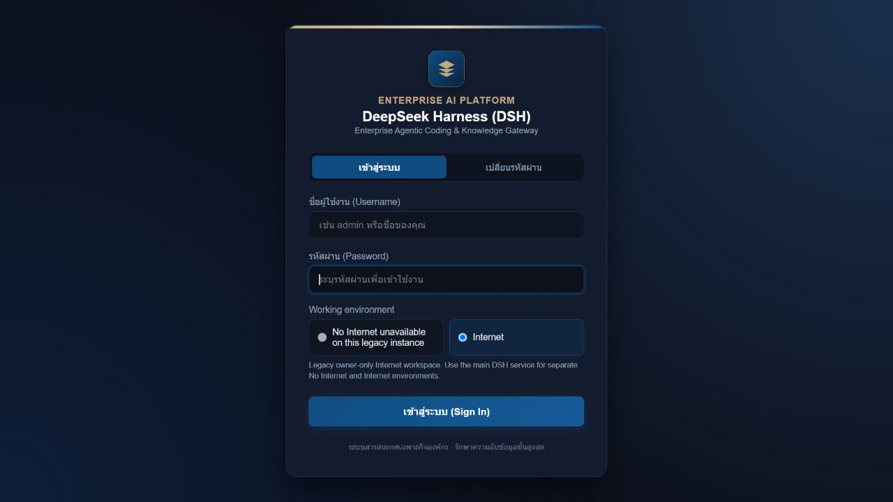
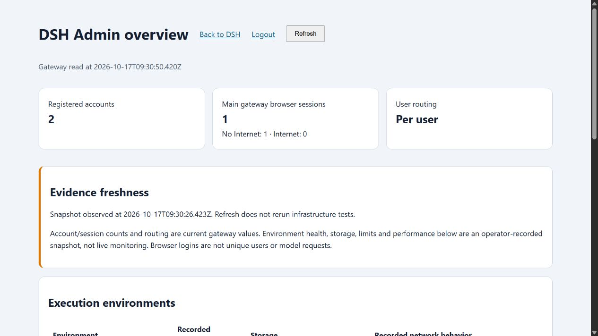
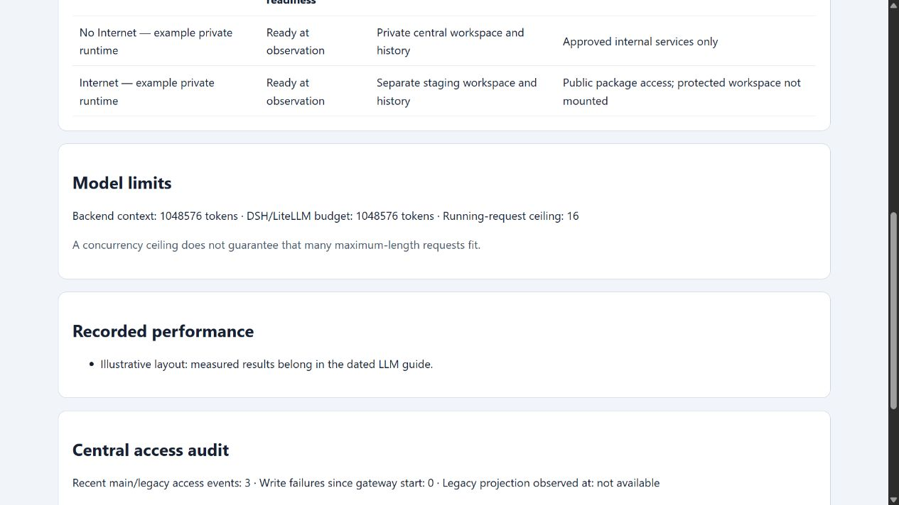
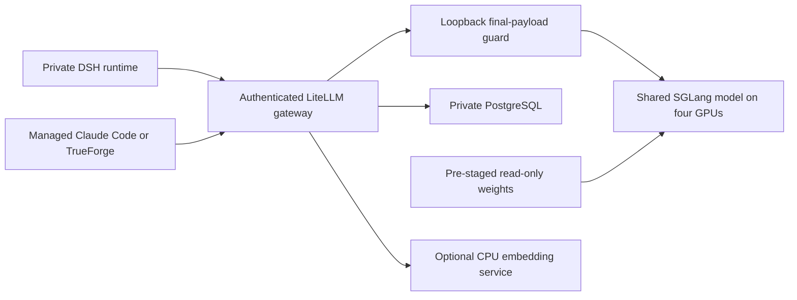

# DSH platform features and usage

## Platform features and intended use

The main interface is the DSH web workspace. Claude Code and TrueForge are optional clients available inside its private execution environment; they do not replace the DSH web interface. One shared local model serves these clients without sharing their working files.

| Capability | How it is used | Implemented boundary or limitation |
|---|---|---|
| Named local login | Sign in with a provisioned account; change your password through the login page | Local DSH identity is separate from AD. Self-registration is disabled; corporate SSO/MFA is not included. |
| Environment selection | No Internet / Internal is the default; Internet is a separate login choice | Logout and sign in again to change environment. Project files, histories and credentials are not automatically transferred. |
| Private user execution | Work in the assigned runtime and its mounted workspace | Main users have separate runtimes in both environments. Legacy instances are owner-only Internet environments. |
| Web chat and task execution | Ask DSH to inspect code, edit files, explain documents and run available tools | Commands run with the runtime's non-root permissions. Review consequential changes; model output is not automatically correct. |
| Workspaces and projects | Keep repositories, scripts and results under `/workspace` | The selected environment's mounts define what is visible. A folder name alone is not the isolation mechanism. |
| Persistent history and attachments | Reopen sessions and use their associated files | Workspace, session and attachment stores persist according to their mounts. Credential/profile state has a separate scope. |
| Long-context analysis | Supply relevant repository/document material to the managed local model | DSH supports a 1,048,576 total-token budget, not unlimited input plus output. Large cold prompts can take many minutes. |
| Compaction and tool-result pruning | Use `/compact` where appropriate; automatic compaction is configured | Compaction must reduce context; it can refuse a non-reducing summary. It is not a backup or a promise to retain every detail. |
| Web terminal | Open the authenticated terminal and run tools in the selected environment | Same user, mounts, non-root identity and network boundary; opening a terminal does not grant host or cluster administration. |
| Application previews | Start a server on an approved free port, then open the authenticated app route | Serve only the intended result folder. A new server must remain behind the gateway; an arbitrary public route is not automatically protected. |
| Claude Code | Run the installed `claude` client from the terminal | Managed internal endpoint/model and persistent private client state. Current default uses the client's 1,000,000-token mode. |
| TrueForge | Start `trueforge`, then open its authenticated port-3000 app route | Private client state and managed internal model. Optional nested code sandbox is disabled; this is not a fully qualified sandbox feature. |
| Offline dependency preparation | Download in Internet, approve artifacts, install from the read-only cache in No Internet | Python/npm helpers exist. Native/OS dependencies may need a qualified runtime-image build; the package cache is not a shared writable workspace. |
| Kerberos and datalake connection | Authenticate privately using the intended principal and configured client | Existing platform permissions remain authoritative. Local DSH login and central storage do not grant data access. |
| Admin overview and access audit | Admin opens the dashboard; views current gateway values and dated infrastructure observations | Admin-only oversight. No automatic ownership of user content, complete command transcript, live GPU dashboard or unlimited archive. |
| Plugins and upstream tools | Use approved installed DSH plugins/tools within the same runtime | The upstream plugin architecture is available; each optional integration needs its own configuration and qualification. |
| Upstream maintenance | Detect releases, verify patch contracts, build and test candidates | Default follows the official npm latest channel. Reviewed compatibility patches and deployment overlays are separate; no automatic Production merge. |
| Operations and rollback | Preserve specifications, image/source digests and mounted data before change | Restore compatible configuration on regression; never overwrite newer work with an older history copy. |

### Installed clients

The inventory read back the installed main-runtime packages: DSH `0.2.0-rc.2`, Claude Code `2.1.301`, TrueForge `0.179.2`. Version presence is not a fresh end-to-end test of every command. The separate deployment and client reports contain the recorded acceptance scope. New upstream-patch candidate fixes are qualified separately and are not assumed present in an older running image.

## Deployments and access points

DEPLOYMENT_SUMMARY

PUBLIC_DEPLOYMENT_TABLE

SITE_DEPLOYMENT_DETAILS

Main DSH routes each identity to its own selected runtime. Main service aliases and app ports are entry routes, not extra independent copies of a user's workspace. DSH2 and DSH3 have their own designated owners and remain Internet-only. Claude Code and TrueForge run inside those assigned workloads; they are not additional shared GPU deployments.

The original unisolated `dsh` deployment and the alternative model Deployments listed as scaled to zero are retained configurations, not currently available parallel model capacity. Do not scale another four-GPU model while the only GPU node is occupied without a reviewed capacity/handover plan. No deployment was changed for this guide.

### Supporting services and standby models

The environment gateway handles login, fixed private routing, authenticated app/terminal access and the admin view. The internal DNS service provides the approved name-resolution path. LiteLLM and its final-payload guard handle model authentication, exact budgets and admission; PostgreSQL supports LiteLLM's persistent service state. The shared SGLang workload runs the active generative model. A documentation server and workload-switcher service are also deployed; readiness/configuration presence does not freshly qualify their administrative operations, and this guide does not invoke model switching.

Alternative GLM/Qwen and earlier model-runtime Deployments are explicitly identified as scaled to zero in the inventory. They do not provide simultaneous GPU capacity, an automatic fallback model or an operational service merely because their configuration exists.

### Optional CPU embeddings

A separate Ollama workload was found outside the main inference namespace with CPU/memory limits and no requested GPU. Its HTTPS `/api/ps` readback returned no currently loaded models. Earlier BGE-M3 embedding acceptance is a historical result; this readback does not claim a fresh embedding inference test or a currently loaded model. CPU embeddings do not require another copy of the four-GPU generative model.

## Example usage

These are user workflows and sample commands, not a claim that each example was executed while building this guide. Use synthetic/public input first and review the selected environment before running a task.

### 1 Sign in and choose the environment

1. Open the main DSH address and sign in with your provisioned local account.
2. Leave No Internet / Internal selected for protected local work. Choose Internet only for its intended staging work.
3. Open the intended workspace or create a new session. Verify which environment you are using before adding files or authenticating to connected services.
4. To switch environments, logout and sign in again. To change a password, use the authenticated password-change flow; do not put credentials in chat or project files.

A model's statement that it has web tools is not proof of network access. If connectivity is relevant, request an actual approved connectivity check and its observed result in the selected environment; do not infer access from the presence of a tool name.

### 2 Review a repository with traceable answers

Example prompt:

> Inspect this repository without changing files. Explain the request path, authentication boundary and persistence locations. Cite the exact file and line range for each factual claim. Separate observations from assumptions and list anything you could not verify.

For a large review, choose relevant code and documents rather than padding the input. Ask for a source ledger and check it against the actual files. A near-1M capacity result does not establish general correctness of every answer. Keep enough context headroom for tool definitions, output and follow-up work.

### 3 Produce a bounded analysis result

Place `sample.csv` in the selected workspace and ask:

> Read sample.csv. Report its row count, column names and missing-value counts. Write results/summary.json and a short results/report.html. Do not modify the input. State the exact files you read and verify the saved output.

Run a local inspection from the terminal when useful:

```sh
cd /workspace/<project>
python3 -m json.tool results/summary.json
```

A local file inspection can verify saved content; it does not independently establish the correctness of the source dataset.

### 4 Use the web terminal and application preview

Open the authenticated terminal route for the selected DSH service. It runs in the assigned environment, not directly on the Kubernetes node. A new terminal tab does not switch identities or network environments.

To preview an existing result folder on a free approved port:

```sh
cd /workspace/<project>
python3 -m http.server 8080 --bind 0.0.0.0 --directory results
```

Open the service's authenticated `/proxy/8080/` route or configured port-8080 alias. Login must still be required. Stop the server with Ctrl+C after use. Serving only `results` avoids unintentionally publishing the entire workspace. Do not add an ingress or disable authentication merely to make a preview work.

### 5 Prepare Python dependencies for No Internet

In the Internet environment, create a pinned requirements file:

```sh
printf 'six==1.17.0\n' > requirements.txt
prepare-offline-deps python requirements.txt
```

This downloads to the incoming package area. An operator reviews source/version/hashes and performs controlled promotion; the example does not grant the downloader permission to approve its own artifacts. In No Internet, after approval:

```sh
python3 -m venv /workspace/<project>/.venv
/workspace/<project>/.venv/bin/python -m pip install \
  --no-index --find-links=/packages/approved/python six==1.17.0
/workspace/<project>/.venv/bin/python -c "import six; print(six.__version__)"
```

For npm, `prepare-offline-deps npm <project-directory>` requires the project's lockfile and populates incoming cache with install scripts disabled. Native modules, platform-specific wheels and OS libraries require compatibility review; copying an arbitrary package directory between environments is not a supported substitute.

### 6 Use managed alternative clients

From the selected terminal:

```sh
cd /workspace/<project>
claude -p "Read README.md and list three implementation questions; cite the relevant sections."
```

To use TrueForge, first ensure port 3000 is free, run `trueforge`, wait for its listening message and open the service's authenticated `/proxy/3000/` route or configured port-3000 alias. Its model/provider configuration is operator-managed; private chat state remains in that environment. Do not enable privileged container features to make the optional nested sandbox start.

### 7 Authenticate to a permitted datalake service

```sh
kinit <approved-principal>
klist
```

Enter the password only at the private authentication prompt. Use your configured Livy/Spark/Hive/HDFS client under that principal. DSH preserves the platform's effective permissions; an internal job submission is not datalake administration. Keep output in its intended location, review destructive operations and follow the platform's rules. Do not move tickets into Internet staging.

### 8 Use the admin overview

An authorized admin opens `/admin` through the main gateway. Review account/session counts, per-user routing, the observation timestamp, environment descriptions and recent access events. Refresh rereads the saved infrastructure snapshot and current gateway values; it does not execute a GPU benchmark or network probe. Use the separate operational tools for live troubleshooting. Admin rights do not automatically expose private conversation bodies; an explicitly authorized support copy remains independent.

## Interface screenshots

The screenshots below are page-content captures, without fabricated browser chrome. Login captures are from the live main/legacy pages with empty input fields. Dashboard captures are clearly labelled synthetic illustrations from the actual gateway code, using demonstration accounts and values; they are not Production statistics. Private conversations, credentials and Kerberos tickets are excluded.

### Main login and environment selection


Live page capture, 17 October 2026. No Internet / Internal is selected by default. The interface currently includes bilingual login labels; the guide's narrative is English.

### Legacy owner-only Internet deployments


DSH2 live login capture. No Internet is unavailable on this legacy instance; Internet is selected.



DSH3 live login capture. Similar appearance reflects the shared login implementation, not a second copy of the same deployment screenshot.

### Admin overview and limits



Documentation fixture, not live Production metrics. Two demonstration accounts and one demonstration browser session illustrate the account, private-routing and snapshot panels.



Documentation fixture, not a live GPU monitor. The screenshot illustrates the separate model-budget, recorded-performance and access-audit sections. The feature examples above explain terminals and clients; those authenticated working screens are not represented here as newly captured live sessions.

## Storage, administration and maintenance

### Where work is stored

`/workspace` is the working location presented to each runtime; its backing PVC/subpath defines the durable store. Main No Internet project data and durable DSH histories use scoped central CIFS mounts. Credentials and profiles remain in private state locations. Internet workspaces/state remain separate, and the approved cache is mounted read-only where needed. Do not infer a network filesystem from a directory name or assume every legacy/client state store has moved to CIFS.

DSH sessions/attachments and managed-client state are distinct stores. Claude uses its persistent private state; TrueForge uses its private application state. Legacy client `/state` wiring can alias its existing owner-only durable home rather than creating another shared tree. Do not replace a working mount without stopped-writer reconciliation and preservation of newer writes. Exact site paths belong in the private inventory, not in the public portable template.

### User and audit administration

Accounts and private runtime mappings are provisioned by the operator; the dashboard is not a full account CRUD console. Password hashing, private mounts and fixed routing are separate controls. Disable/deprovision access through the reviewed identity/routing procedure while preserving ownership and retention requirements. Do not copy one user's history to all accounts.

The access audit records bounded metadata such as time, event, user and environment. It is not a terminal-command recorder or an archive of all prompts/responses. Legacy access projections and main gateway events are combined under the admin boundary. Retention capacity, off-platform archival and remote-job correlation need the defined operational policy.

### Updates and rollback

The official npm package remains the base. Local gateway/Kubernetes/model overlays and the versioned ten-target DSH compatibility patch set are maintained separately. Daily/manual candidate qualification tracks npm latest; changed upstream hashes stop the patch process. The new candidate fixes include strict patch preflight/postchecks and explicit refusal of a missing original image instead of fabricated pixels. Passing candidate tests is not a statement that an existing Production image was replaced.

Before a rollout, retain the exact image, source ConfigMaps, profile and workload specification; verify that the relevant agents are idle. Replace workloads in a controlled sequence and read back affected content, history and mounts. On regression, restore a compatible configuration/image while preserving newer durable writes. A mounted share is persistence, not an independent backup. Do not restart the shared model merely to update a document or client page.

## LLM and GPU setup

This final section is an operator setup guide, not a command to redeploy the current cluster. The existing site uses one shared four-GPU generative model; private user runtimes do not each require their own model copy. Use the portable `gpu-stack` source and supply private site values outside Git.



### Runtime profile and context budget

| Setting | Reviewed model profile |
|---|---|
| Model | DeepSeek-V4.1-Flash on the existing four-GPU node |
| Runtime image | `lmsysorg/sglang@sha256:4a5d132a06a77c8331e15845f2e925adc788b00105097ad55409afa3f4fa4860` |
| Tensor parallelism | `--tp-size 4` |
| Total context ceiling | `--context-length 1048576` |
| Static memory fraction | `--mem-fraction-static 0.90` |
| Maximum running requests | `--max-running-requests 16` |
| Prefill work | `--chunked-prefill-size 1024`, `--max-prefill-tokens 2048` |
| Mixed scheduling | `--enable-mixed-chunk`, `--prefill-decode-interval 4` |
| Model output budget | At most 8,192 output tokens; final guard reserves another 256 tokens |
| Clients | DSH/TrueForge declare 1,048,576 total; Claude's current default uses its 1,000,000-token mode |

One expensive request above the managed 128K threshold is admitted at a time; ordinary requests remain concurrent. A cap of 16 is not a guarantee of sixteen million-token requests. The reviewed final-wire policy has one active long request plus one FIFO waiting position, with up to 1,500 seconds waiting for admission; additional long requests receive a capacity error. Ordinary work bypasses this long-request queue. Streaming keepalive comments permit cancellation before model output; they are not generated answers. Keep a single forwarder process/replica because the admission lease is not distributed.

The recorded occupied-slot retest completed an actual DSH request with 1,007,704 input / 119 output tokens and zero retries. Its 25m52s total included 5m16s admission waiting and 20m27s context preparation; the answer stream took 3.53s, approximately 33.42 output tokens/sec. All 46 overlapping ordinary replies passed in 4.05–9.12s; 38 ran after the artificial hold released, during real long work. Active cancellation released the lease in 1.48s, and queue overflow returned 429 promptly. The GPU did not restart, but recovering allocation warnings still show tight memory. These bounded cases do not establish two simultaneous full-1M GPU requests or a latency guarantee.

The total budget includes messages, tools, requested output and the guard reserve. A cold million-token prompt requires substantial preparation even if the latest user sentence is short. Cached follow-ups can be faster. Time to first text, queue wait, preparation time, answer-stream rate and whole-request time are different measurements.

### 1 Prepare prerequisites and a test environment

Use a reviewed test namespace and verify GPU capacity before scheduling. Install the approved NVIDIA device plugin and an enforcing network-policy implementation. The portable template requests 256 GiB host RAM and allows 512 GiB; verify actual capacity rather than assuming it is available. No additional node or GPU purchase is assumed by this design.

Stage the approved model revision in a PVC, with the expected model path under `/approved`. Verify the complete files against their approved source/revision/hash manifest. A readable `config.json` alone is not weight-integrity verification. Review any model code required by `--trust-remote-code`; runtime downloads remain disabled and the model cache is read-only.

### 2 Provision private database and inference credentials

Provision PostgreSQL and its protected durable storage through the site's operating process. The portable renderer does not create or migrate the database. Prepare credential and database Secrets privately. The example bundle refers to `local-inference-credentials` and `local-inference-database`; required keys include `LITELLM_MASTER_KEY`, `INTERNAL_ROUTE_KEY` and `DATABASE_URL`.

Never put their values in the guide, Git, model prompts or shell transcripts. The master key is for operators. Give each runtime a restricted model-only client key and verify that administrative API operations are denied. Only the authenticated gateway should reach the model; clients must not bypass the final-wire guard through a direct model ingress.

### 3 Render a candidate from portable settings

Copy `gpu-stack/settings.example.json` into a private location. Set the namespace, model PVC, existing Secret names and qualified digest-pinned gateway image there. Install Python and PyYAML in the operator's tooling environment, then render:

```sh
python gpu-stack/render.py \
  --settings /private/settings.json \
  --output /private/inference-candidate.yaml
kubectl -n <test-namespace> apply --dry-run=server \
  -f /private/inference-candidate.yaml
```

Inspect the rendered objects before applying them. The renderer refuses mutable image tags, unexpected settings and accidental overwrite of an existing candidate. The reviewed scheduler source hashes must match the installed runtime. The example does not contain a private node name, registry credential, corporate endpoint or central-share location.

### 4 Apply network boundaries and health checks

Clients reach authenticated LiteLLM on port 4000. The final-wire listener is loopback-only, not a Kubernetes Service. The model listens on port 8000 behind the gateway boundary; PostgreSQL uses its narrowly allowed internal path. Client/worker, gateway, model, database and DNS policies must be considered separately. Use the site's approved internal resolver; generic DNS allowance alone is not a No Internet boundary.

Start the candidate only after weights, Secrets and database are available. Align the startup probe and progress deadline with the measured model initialization time; the reviewed deployment uses a 2,100-second progress deadline. Check actual loaded source, arguments, image IDs and response content rather than accepting readiness alone. A single shared model restart interrupts inference and needs a controlled handover.

### 5 Configure the clients consistently

Point managed DSH and CLI profiles at internal LiteLLM using restricted credentials. Keep total context, output ceiling, timeout, compaction policy and the final payload counter aligned. The managed SDK loader corrects the qualified character-estimation output-budget issue for the internal route only; unrelated clients/routes retain their own limits.

Use read-only operator-managed client policy. Claude/TrueForge installations and private state are separate from GPU provisioning. TrueForge's optional nested sandbox is not required for ordinary chat/API use and remains disabled under the current container restrictions. Do not grant privilege or mount a host socket to make it work.

### Optional embedding integration

BGE-M3 is a separate embedding use case, not the shared generative GPU model. Stage its approved model in the CPU Ollama service and use only the permitted internal or authenticated embedding route. Not every DSH runtime necessarily has direct permission to contact that provider. Do not add a public egress exception to make an embedding example work.

Example for an already permitted endpoint, using normal TLS verification:

```python
import json
import os
import urllib.request

request = urllib.request.Request(
    os.environ["APPROVED_EMBEDDING_URL"],
    data=json.dumps({
        "model": "bge-m3:latest",
        "input": ["Sample public financial inquiry"]
    }).encode(),
    headers={"Content-Type": "application/json"},
)
with urllib.request.urlopen(request, timeout=30) as response:
    vector = json.load(response)["embeddings"][0]
print(len(vector))  # BGE-M3's expected vector length is 1024.
```

This sample is not a new inference result. At the guide's inventory time, the CPU workload was Ready but no model was loaded according to `/api/ps`. A model may be installed on disk without being currently loaded. Keep CA trust correct rather than disabling certificate verification.

### 6 Qualify behavior and preserve rollback

Progressively test 128K, 256K, 512K and near-1M input with known answers and source checks. Verify substantial output, actual file/tool continuation and persisted responses. Run ordinary DSH requests during long work, distinguish API versus DSH versus alternative-client results, and measure admission/first-text/preparation/streaming separately. Test cancellation, queue bounds, endpoint overrides, over-budget refusal, credential scope and direct-model denial.

Retain the last qualified profile/image/source and state-preservation baseline before a change. GPU memory is tight: the earlier 0.92 allocation left too little temporary workspace and failed around 262K; smaller prefill chunks and 0.90 were then qualified. A successful long capacity result does not establish two-full-1M concurrency, every analytical answer, vision or a guaranteed latency. Roll back on a genuine regression without overwriting newer workspace/history data.

The portable setup and its tests are maintained in `gpu-stack/`; detailed dated performance and acceptance records remain in the separate LLM guide. This document supplies the setup content itself so the local HTML is usable without opening those links.
