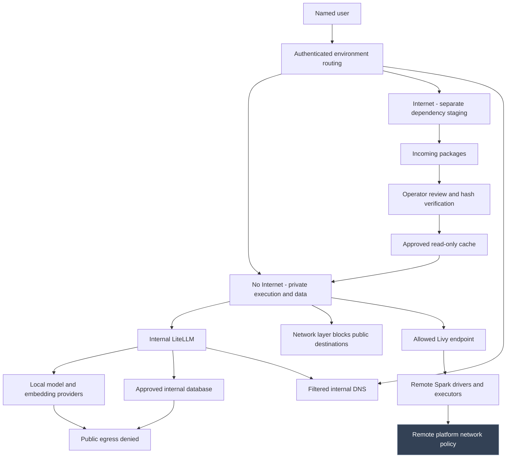
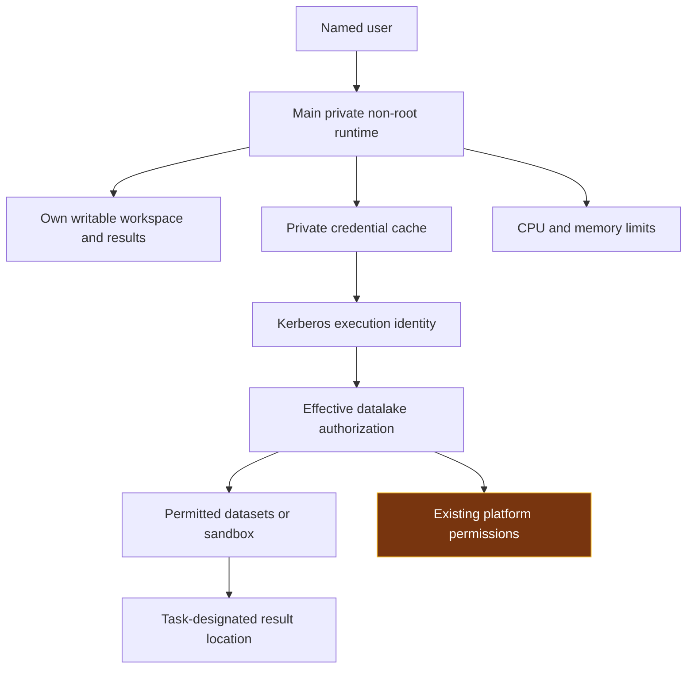
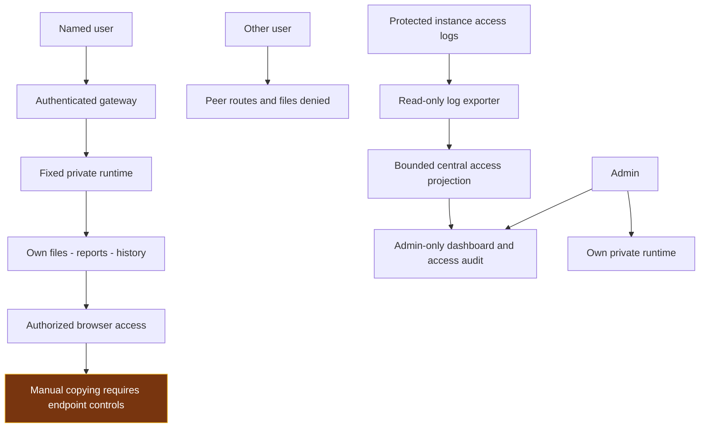
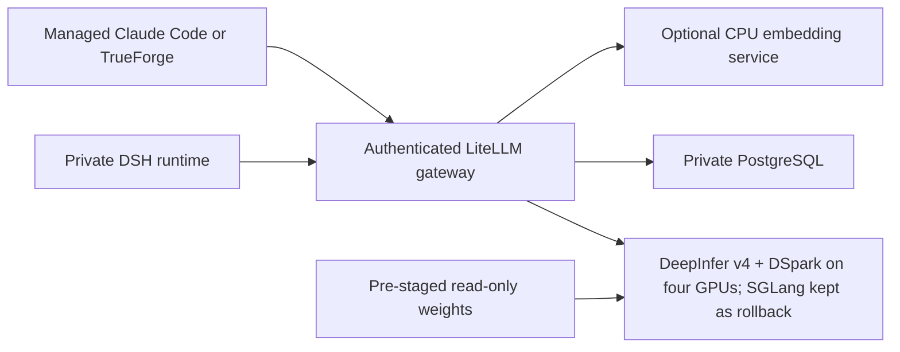

# DSH — Controlling Three Security Risks

Current DSH guide and PowerPoint

DSH provides private AI workspaces for code, documents and analysis. Its design controls three risks: sending protected information outside its permitted boundary, damaging data or reaching resources beyond the task, and exposing results to unauthorized people.

The Harness, its tools and generated code run within boundaries enforced by infrastructure, execution identities, storage permissions and authenticated routes. The model's instructions help describe the task; they do not replace these controls.

| Risk | How DSH controls it | How to work within the boundary |
|---|---|---|
| **1 Prevent external leakage** | No Internet execution by default, restricted destinations and separate Internet staging | Keep protected work in No Internet; transfer approved packages rather than protected workspaces |
| **2 Prevent damage or excessive access** | Private non-root execution, scoped mounts and credentials, resource limits and bounded inference admission | Use the intended identity; keep protected originals separate from writable working results |
| **3 Keep results contained** | User-bound file/history/terminal routes, explicit app access choices and protected access auditing | Keep protected reports private; share only with the intended audience |

Follow the three controls below. [Appendix A](#appendix-a) contains features, everyday examples and administration. [Appendix B](#appendix-b) contains LLM/GPU setup and measured results. The [user manual](DSH_USER_MANUAL.html) gives task-by-task instructions, and the English video course explains the implementation.

## 1 Prevent external leakage

### Control objective

Prevent unauthorized public connections from the No Internet execution environment while retaining only the internal services required for work. Internet access is provided through a separate environment for dependency preparation, with no automatic transfer of protected data.

### Separate execution and network boundaries

No Internet / Internal is the default login choice. Each main user has a private runtime for this environment and a different private Internet runtime. Authentication fixes the user/environment route for the login session. Switching environments requires logout and a new login; a submitted username, routing header or changed selection cannot choose another user's backend.

No Internet has a restricted outbound network policy. Its approved paths include internal inference, controlled DNS and permitted authentication or job-submission services. Public-domain and direct-IP connectivity are restricted at the network layer, including commands launched from the terminal. The runtime has no Kubernetes management token with which to change its own policy.

The Internet environment has separate compute, workspace, histories and credentials. It does not mount protected No Internet working data. Its public connectivity supports dependency preparation; it is not an alternate processing route for protected prompts, tickets, datasets or reports. The shared internal gateway and inference services do not merge user workspaces. This architecture provides restricted egress, rather than a strict air gap.

The gateway, LiteLLM, local model providers and supporting database have their own destination restrictions. Application proxy destinations require an approved origin and network path; registering an app does not provide an unrestricted outbound fetch service. Filtered internal DNS serves approved internal names rather than forwarding arbitrary public lookups. Supplied model clients use internal LiteLLM with model-scoped credentials and operator-owned configuration; external model fallback is disabled for the managed route. Client configuration complements infrastructure enforcement and does not replace it.

### Transfer dependencies without sharing protected workspaces

Supported pinned Python wheels use the self-service My Python environments workflow. After the administrator grants Internet access to the account, an isolated Internet job downloads the artifacts. Validation and offline installation create a new private No Internet virtual environment and Jupyter kernel without replacing existing environments or sharing writable workspaces. Source builds, direct URLs and startup .pth hooks require operator review.

For shared package caches, the Internet environment downloads artifacts into an incoming area. An operator reviews their source, version and expected hashes. Controlled promotion verifies selected bytes and places approved artifacts in a separate cache. No Internet mounts that cache read-only and installs without a public package index.

Internet cannot directly install into the protected runtime or modify its workspace. Prompts, datasets, credentials, histories and reports are not dependency artifacts and must not use this transfer path. Hash verification establishes artifact integrity. Dependency selection must follow the task's policy; isolation and offline installation constrain execution rather than make downloaded code trustworthy.



### Keep environment choices explicit

Use the designated No Internet environment for protected offline work. The additional owner-only sites are Internet-capable and display that environment explicitly; an internal-looking address does not turn them into No Internet workspaces.

An internal connection to another platform does not grant administration of that platform. If a submitted command executes remotely, that platform applies its own permissions and network rules; this responsibility is separated in the final section.

## 2 Prevent damage or excessive access

### Control objective

Contain local execution and prevent peer or administrative access beyond the selected user's environment. Preserve existing permissions on connected platforms instead of silently granting broader access or imposing an unrequested replacement authorization policy.

### Run tools within a private, restricted workload

Each main user/environment has its own lightweight Kubernetes runtime with bounded workspace, session, attachment and credential mounts. The expensive inference service is shared; user execution and files are not. Isolation is enforced through the workload and mounted scope, rather than merely choosing different folders in one shared process. Broad parent directories containing other users' data and host-management interfaces are not exposed to ordinary execution.

The workloads execute as non-root, disable privilege escalation, drop Linux capabilities, use RuntimeDefault seccomp and have no mounted Kubernetes management token. CPU and memory limits constrain local resource use. Additional instances similarly use restricted non-root execution with a designated owner account.

DSH and the managed Claude Code, TrueForge and Kilo CLI clients inherit the selected runtime's identity, mounts and network policy. Installing a tool does not grant a privileged container, host socket or another user's credentials. TrueForge's optional nested sandbox is disabled. Its ordinary tools run within the selected runtime's existing restrictions.

### Preserve private work and bounded write access

Protected working files and durable histories use bounded central CIFS paths. Internet workspaces and histories remain separate. Credentials and profiles remain in their designated private state locations, while approved dependency artifacts are read-only. Generated outputs belong in the user's designated writable working area.

Existing histories and files retain their ownership. An explicitly authorized support copy is independent and does not reassign the source, expose a shared parent directory or establish ongoing synchronization. Persistence across runtime replacement is part of the application design; independent recovery from authorized or accidental deletion is a separate storage-service responsibility.

### Use connected services under existing authorization

Connected data services authenticate the selected execution identity and enforce its existing permissions. For the datalake this is the user-specific Kerberos principal, separate from the DSH workspace sign-in session. DSH neither grants dataset access nor replaces those permissions. Tasks requiring read-only inputs or a limited sandbox use the corresponding entitlement at that service.

A generated command can still make a mistake within permissions already granted. Tasks should therefore separate original inputs from outputs and review destructive operations where appropriate. For sandbox-only or read-only work, use an entitlement provisioned by the relevant platform owner.



### Separate input protection from permission to execute

A private runtime prevents access to another user's workspace; it does not make the current user's writable source data immutable. Where the agreed task forbids modifying originals, expose an approved read-only input snapshot or view and write generated code, reports and working copies to a separate writable location. The data or storage owner must enforce that distinction. Do not describe preserved personal read/write entitlements as a read-only guarantee.

The agent may generate and run analytical code within its assigned boundary, but must not receive cluster administration, host-management sockets, unrelated service credentials or permission to enlarge its own mounts or network access. Tool approval is an additional operational choice; it is not a substitute for restricting the execution identity. A connected remote job inherits the remote platform's controls, not the local container's filesystem or egress policy.

### Bound shared resources

The inference route counts the complete request, reserves output capacity and controls admission of expensive work. Long requests use bounded waiting and an explicit busy response while shorter work remains schedulable. Admission manages shared capacity independently of data authorization. Local process limits and shared inference scheduling are DSH controls; remote job queues remain under the platform that executes those jobs.

For a shared-service pilot, define a workload budget as well as CPU and memory limits: allowed job duration, cancellation responsibility, output/storage growth and expected concurrent use. Long-running or repeated work should be cancellable through its executing service and should not bypass admission controls by spawning unrelated jobs. Administrators use the centralized dashboard and activity log to identify the affected user/environment and investigate abnormal consumption. Gateway access events are not complete CPU/GPU, disk or remote-cluster telemetry; remote job accounting, disk quotas and enforced execution deadlines must be configured where those workloads run before claiming those specific boundaries.

## 3 Keep results contained

### Control objective

Keep histories, reports, files, attachments and terminal access within authorized user routes. Separate operational oversight from automatic access to user content.

### Authenticate access and bind it to private storage

The gateway supports self-service account creation by assigning an exclusive, prepared private runtime pair. New accounts have Internet denied by default; an administrator grants it separately. Each authenticated identity is bound to its own assigned runtime, and full capacity causes signup refusal rather than shared execution. Reports, files, attachments and terminal WebSockets use the authenticated boundary. Server-side identity and route checks reject forged roles, peer-runtime selection and direct bypass paths.

Each user/environment has separate working files and history storage. Switching environments does not automatically transfer content or credentials. Logout invalidates the gateway session. Additional instances admit only their designated owners; shared guest and cross-account logins are disabled.

Account stores use salted scrypt password records and bounded verification. Authentication records are stored outside execution workspaces, with protected account volumes and operator-only recovery material. Supplied bootstrap configuration does not create factory-password accounts. Users can change passwords through the authenticated flow; startup does not overwrite a changed password.

### Centralize oversight without merging user content

The admin-only dashboard combines operational information and access events. Administrative visibility does not automatically grant access to another user's conversations or files. Any authorized support copy remains in a separate private store and preserves the original owner's records.

Access auditing records relevant events, user, environment and time outside execution workspaces. It excludes passwords, Kerberos tickets and conversation bodies. Instance exporters read only their access-log scope and write a bounded central projection. Execution users do not receive the account or audit stores. Required gateway auditing fails closed when an access event cannot be persisted.

The dashboard shows current gateway records and timestamped collector summaries. Check each panel's freshness: reloading a saved infrastructure snapshot does not run a new probe. Access events provide operational accountability; commands, prompts, response bodies and remote job contents are not a complete central recording.



### Deliver generated results through the same boundary

Working reports, charts, temporary files and generated applications remain in the private environment. Server-side file access uses the authenticated identity rather than a submitted owner name or arbitrary filesystem path. Publish an app through an explicit gateway mapping. Private local apps remain bound to their owner and environment. An explicitly Public mapping is a deliberate publication choice for its selected app, not access to the whole workspace; destination authentication can still apply. Keep protected reports behind sign-in. Built-in terminals and notebooks cannot be published through the Public option.

The managed workflow does not automatically publish protected results externally. The No Internet environment's network policy blocks direct public transmission from its execution runtime. Internet-capable tools must not be represented as having the same offline restriction. Authorized viewing and downloading are normal application functions; additional restrictions on what a person copies require an explicit handling policy and endpoint controls.


## How the three controls relate to OWASP Agentic Top 10 (2026)

This is a mapping of documented DSH controls to OWASP risks, not a certification or a new security test. Containment reduces possible harm; it does not prove that a model will reject malicious instructions or that every workflow is safe. Coverage below is partial unless a specific saved acceptance test establishes the stated boundary.

Control 1 limits unauthorized network transmission. Control 2 limits execution and access. Control 3 keeps files and outputs behind explicit authorization. Apply these controls together; review the residual risks below for each pilot.

| OWASP risk | Documented overlap and remaining test |
| --- | --- |
| ASI01 — Agent Goal Hijack | Execution and network containment limit consequences; no explicit goal-integrity/injection test matrix. |
| ASI02 — Tool Misuse and Exploitation | Restricted workloads and existing service permissions; no complete tool/argument approval assessment. |
| ASI03 — Identity and Privilege Abuse | Private identities, routes and mounts; remote entitlements and identity lifecycle remain separately owned. |
| ASI04 — Agentic Supply Chain Vulnerabilities | Pinned dependency transfer, offline validation and review of source builds/hooks; no full agent/MCP provenance assessment. |
| ASI05 — Unexpected Code Execution | Non-root execution, limited mounts/capabilities and restricted egress constrain execution; do not prevent all hostile code in writable scope. |
| ASI06 — Memory and Context Poisoning | Private history isolation is described; persisted malicious context, provenance and safe reset are not explicitly assessed. |
| ASI07 — Insecure Inter-Agent Communication | User routing does not establish authenticated agent messages, replay protection or delegated authority. |
| ASI08 — Cascading Failures | Resource admission and local limits; downstream failure propagation, circuit breaking and end-to-end recovery remain workflow-specific. |
| ASI09 — Human-Agent Trust Exploitation | Explicit sharing and handling responsibilities; misleading output and meaningful human review require workflow tests. |
| ASI10 — Rogue Agents | Runtime restrictions limit blast radius; autonomous scope drift, detection and containment need explicit tests. |

Practical example: a claims file could contain instructions to send customer data elsewhere. A blocked public connection limits that route, but does not prevent a misleading local report. Use a harmless test file to check the full path: input provenance, permitted tools, saved context, output review and attempted external requests. Test agent messages and downstream jobs separately where used. Record the exact version, expected refusal or containment, actual result and remaining owner action; do not mark a gap closed from a prompt or configuration alone.

Source and attribution: [OWASP GenAI Security Project — OWASP Top 10 for Agentic Applications 2026](https://genai.owasp.org/resource/owasp-top-10-for-agentic-applications-for-2026/), December 2025. Risk names are attributed to OWASP; the DSH mapping and examples are our analysis, not OWASP endorsement. No claim of full compliance is made.

## Responsibilities on connected systems

The DSH controls above cover its gateway and execution workspaces. The following requirements belong to the service or person that enforces the connected boundary. They do not grant additional access or change existing permissions.

| Boundary | Responsibility and agreed treatment |
|---|---|
| Remote Livy/Spark execution | The datalake platform controls its drivers, executors, job limits and outbound network. DSH restricts its local submission path but does not administer those machines. Livy/Spark remains available. Its remote workers require their own outbound controls. |
| Dataset and sandbox authorization | The platform's existing Kerberos/AD and data permissions remain authoritative. Use a sandbox-only or read-only entitlement when the task requires it. |
| Authorized browser handling | Viewing, copying and downloading by an authorized person are distinct from peer access or unauthorized publication. Device restrictions, managed browsers or DLP apply only where required by the organization's handling policy. |
| Identity lifecycle | Main sign-in supports Local accounts and the configured AD/LDAP provider. Corporate credentials use certificate-verified LDAPS; Local accounts retain their authenticated password-change flow. A corporate username that collides with a Local account is refused for administrator review; identities and histories are not automatically merged. MFA and organization-wide recovery remain separate identity-service controls. Change any exposed or known password; hashing protects stored records, not a password already known to someone else. |
| Storage recovery and infrastructure administration | Central storage provides persistence. Storage-server ACL administration, independent backups and disaster recovery belong to that service. Cluster, host and storage administrators remain trusted privileged operators. |
| Audit-service extensions | Current central access logging and dashboard oversight are included. Complete command/body capture, remote-job correlation and independently retained audit archives require additional collectors and an operating policy. |
| Deliberately Internet-capable environments | Internet staging and the additional Internet instances retain their intended public connectivity. They are not protected No Internet environments and must not be used as an automatic bridge for protected content. |

A task owner identifies permitted data, allowed operations, output recipients and review requirements before the work starts. Source permissions and output-sharing choices must match that task.

## Appendix A — Features, use and administration

The main interface is the DSH web workspace. Claude Code, TrueForge and Kilo CLI are optional clients available inside its private execution environment; they do not replace the DSH web interface. One shared local model serves these clients without sharing their working files.

| Capability | How it is used | Implemented boundary or limitation |
|---|---|---|
| Named local login | Use Create account, then sign in to your private No Internet workspace; change your password through the login page | Internet needs separate admin approval. Signup is bounded by private-pair capacity; local identity is separate from AD. |
| Environment selection | No Internet / Internal is the default; Internet is a separate login choice | Logout and sign in again to change environment. Project files, histories and credentials are not automatically transferred. |
| Private user execution | Work in the assigned runtime and its mounted workspace | Main users have separate runtimes in both environments. Additional instances are owner-only Internet environments. |
| Web chat and task execution | Ask DSH to inspect code, edit files, explain documents and run available tools | Commands run with the runtime's non-root permissions. Review consequential changes; model output is not automatically correct. |
| Workspaces and projects | Keep repositories, scripts and results under `/workspace` | The selected environment's mounts define what is visible. A folder name alone is not the isolation mechanism. |
| Persistent history and attachments | Reopen sessions and use their associated files | Workspace, session and attachment stores persist according to their mounts. Credential/profile state has a separate scope. |
| Long-context analysis | Supply relevant repository/document material to the managed local model | DSH supports a 1,048,576 total-token budget, not unlimited input plus output. Large cold prompts can take many minutes. |
| Compaction and tool-result pruning | Use `/compact` where appropriate; automatic compaction is configured | Compaction must reduce context; it can refuse a non-reducing summary. Save important findings and source references before compacting. |
| Web terminal | Open the authenticated terminal and run tools in the selected environment | Same user, mounts, non-root identity and network boundary; opening a terminal does not grant host or cluster administration. |
| Application previews | Register a local port or approved external HTTPS target, and choose its intended visitor access | Private local apps remain owner/environment-bound. Public is an explicit publication decision; destination permissions remain separate. See the application guide. |
| Claude Code | Run the installed `claude` client from the terminal | Managed internal endpoint/model and persistent private client state. Current default uses the client's 1,000,000-token mode. |
| TrueForge | Start `trueforge`, then open its authenticated port-3000 app route | Private client state and managed internal model. Optional nested code sandbox is disabled. |
| JupyterLab | Choose JupyterLab at sign-in or open `/proxy/8888/lab`; use Admin Start when managed startup has been stopped | Python notebooks in the selected private workspace; authenticated gateway, non-root kernel, unchanged environment network restrictions. |
| Kilo Code CLI | Run `kilo` or `kilo run` from the authenticated terminal | Pinned managed CLI, internal LiteLLM only, private `/state/kilo` state, sharing/telemetry disabled. Qualification is recorded in the [managed-client guide](MANAGED_CLIENT_SUPPORT.md). |
| Offline dependency preparation | Use My Python environments for supported pinned wheels, or operator-reviewed shared-cache promotion for other approved artifacts | Python/npm helpers exist. Native/OS dependencies may need a qualified runtime-image build; the package cache is not a shared writable workspace. |
| Kerberos and datalake connection | Authenticate privately using the intended principal and configured client | Existing platform permissions remain authoritative. Local DSH login and central storage do not grant data access. |
| Central dashboard and user management | Admin reviews accounts, private environments, browser sessions and access events; creates accounts from available private capacity, approves/revokes Internet, enables/disables access and signs users out | User files and history remain intact. Replenishing private capacity and granting administrator roles remain operator actions. |
| Plugins and upstream tools | Use approved installed DSH plugins/tools within the same runtime | The upstream plugin architecture is available; each optional integration needs its own configuration and qualification. |
| Upstream maintenance | Detect releases, verify patch contracts, build and test candidates | Default follows the official npm latest channel. Reviewed compatibility patches and deployment overlays are separate; no automatic Production merge. |
| Flexible inference placement | Keep DSH workspaces separate from LiteLLM and GPU compute | Same-cluster node separation uses Service DNS. A remote GPU origin is supported by the portable renderer; remote LiteLLM uses the approved gateway relay or coordinated client policies. See [topology and setup](FLEXIBLE_DEPLOYMENT.md). |
| Operations and rollback | Preserve specifications, image/source digests and mounted data before change | Restore compatible configuration on regression; never overwrite newer work with an older history copy. |

### Managed client compatibility

DSH, Claude Code, TrueForge and Kilo share the selected private project files, while retaining separate client conversations and state. The [managed-client guide](MANAGED_CLIENT_SUPPORT.md) records versions, tested file operations and the current existing-workspace launch procedure. Opening a new client does not grant another user's files, another environment or an external model endpoint.

### Installed clients

Use the [managed-client guide](MANAGED_CLIENT_SUPPORT.md) for the qualified client versions and launch instructions, and the [JupyterLab guide](JUPYTERLAB.md) for notebooks. Runtime package versions and configured context budgets are separate: a model label alone does not verify the full request path.

### Open your workspace

SITE_DEPLOYMENT_DETAILS

Main DSH routes each identity to its own selected runtime. Main service aliases and app ports are entry routes, not extra independent copies of a user's workspace. DSH2 and DSH3 have their own designated owners and remain Internet-only. Managed clients run inside their assigned workloads; they are not additional shared GPU deployments.

Use the main DSH sign-in page for your assigned workspace. The operator's deployment inventory is maintained separately from these user instructions.

### Supporting services and standby models

The environment gateway handles login, fixed private routing, authenticated app/terminal access and the admin view. The internal DNS service provides the approved name-resolution path. LiteLLM and its final-payload guard handle model authentication, exact budgets and admission; PostgreSQL supports LiteLLM's persistent service state. The shared DeepInfer workload runs the active generative model; SGLang is kept switched off as the rollback engine. A documentation server serves operational guides; the workload-switcher service supports operator-controlled model changes.

Alternative GLM/Qwen and earlier model-runtime Deployments are explicitly identified as scaled to zero in the inventory. They do not provide simultaneous GPU capacity, an automatic fallback model or an operational service merely because their configuration exists.

### Optional CPU embeddings

A separate CPU Ollama workload provides optional embeddings without using the generative model’s GPUs. Use `/api/ps` to check loaded models and load the approved model before the first embedding request.

### Example usage

Choose the intended environment before starting. The examples below cover common tasks.

### 1 Sign in and choose the environment

1. Open the main DSH address. If you are new, use Create account and set a unique username and a password of at least 12 characters. Then sign in to your private workspace.
2. Leave No Internet / Internal selected for protected local work. Choose Internet only for its intended staging work.
3. Open the intended workspace or create a new session. Verify which environment you are using before adding files or authenticating to connected services.
4. To switch environments, logout and sign in again. To change a password, use the authenticated password-change flow; do not put credentials in chat or project files.

Check connectivity from the selected environment when needed; a listed web tool may still be blocked by its network policy.

### 2 Review a repository with traceable answers

Example prompt:

> Inspect this repository without changing files. Explain the request path, authentication boundary and persistence locations. Cite the exact file and line range for each factual claim. Separate observations from assumptions and list anything you could not verify.

For a large review, choose relevant code and documents rather than padding the input. Ask for a source ledger and check it against the actual files. Keep enough context headroom for tool definitions, output and follow-up work.

### 3 Produce a bounded analysis result

Place `sample.csv` in the selected workspace and ask:

> Read sample.csv. Report its row count, column names and missing-value counts. Write results/summary.json and a short results/report.html. Do not modify the input. State the exact files you read and verify the saved output.

Run a local inspection from the terminal when useful:

```sh
cd /workspace/<project>
python3 -m json.tool results/summary.json
```

Compare the saved results with the input and the requested calculations.

### 4 Use the web terminal and application preview

Open the authenticated terminal route for the selected DSH service. It runs in the assigned environment, not directly on the Kubernetes node. A new terminal tab does not switch identities or network environments.

To preview an existing result folder on a free approved port:

```sh
cd /workspace/<project>
python3 -m http.server 8080 --bind 0.0.0.0 --directory results
```

Open the service's authenticated `/proxy/8080/` route or configured port-8080 alias. Login must still be required. Stop the server with Ctrl+C after use. Serving only `results` avoids unintentionally publishing the entire workspace. Do not add an ingress or disable authentication merely to make a preview work.

### 5 Prepare Python dependencies for No Internet

In the Internet environment, create a pinned requirements file:

```sh
printf 'six==1.17.0\n' > requirements.txt
prepare-offline-deps python requirements.txt
```

This downloads to the incoming package area. An operator reviews source/version/hashes and performs controlled promotion. In No Internet, after approval:

```sh
python3 -m venv /workspace/<project>/.venv
/workspace/<project>/.venv/bin/python -m pip install \
  --no-index --find-links=/packages/approved/python six==1.17.0
/workspace/<project>/.venv/bin/python -c "import six; print(six.__version__)"
```

For npm, `prepare-offline-deps npm <project-directory>` requires the project's lockfile and populates incoming cache with install scripts disabled. Native modules, platform-specific wheels and OS libraries require compatibility review; copying an arbitrary package directory between environments is not a supported substitute.

### 6 Use managed alternative clients

From the selected terminal:

```sh
cd /workspace/<project>
claude -p "Read README.md and list three implementation questions; cite the relevant sections."
```

To use TrueForge, first ensure port 3000 is free, run `trueforge`, wait for its listening message and open the service's authenticated `/proxy/3000/` route or configured port-3000 alias. Its model/provider configuration is operator-managed; private chat state remains in that environment. Do not enable privileged container features to make the optional nested sandbox start.

For Kilo CLI, run `kilo` in the authenticated terminal, or `kilo run --format json "Reply exactly KILO_READY"`. The managed launcher uses only internal LiteLLM, stores private client state under `/state/kilo`, and disables sharing, public-provider selection and background downloads. See the [managed-client guide](MANAGED_CLIENT_SUPPORT.md) for the qualified versions, policy and ordinary-versus-near-1M test scope.

### 7 Authenticate to a permitted datalake service

```sh
kinit <approved-principal>
klist
```

Enter the password only at the private authentication prompt. Use your configured Livy/Spark/Hive/HDFS client under that principal. DSH preserves the platform's effective permissions; an internal job submission is not datalake administration. Keep output in its intended location, review destructive operations and follow the platform's rules. Do not move tickets into Internet staging.

### 8 Use the admin overview

An authorized admin opens `/admin` through the main gateway. Review account/session counts, per-user routing, the observation timestamp, environment descriptions and recent access events. Refresh rereads the saved infrastructure snapshot and current gateway values; it does not execute a GPU benchmark or network probe. Use the separate operational tools for live troubleshooting. Admin rights do not automatically expose private conversation bodies; an explicitly authorized support copy remains independent.

### Admin activity and usage summaries

The main gateway now serves authenticated numeric usage panels for the configured private runtimes, including assigned signup pairs: stored sessions, running agents, queued messages, turns, LLM steps, cumulative input/output tokens, all-history and recent recorded decode rates, wall-clock output rate, and workspace/durable-storage sizes. Account and environment filters keep these measures attributable to the selected scope. Stored-history counts are distinct from active browser sessions; decode speed is distinct from total task time, and LLM steps include failed/cancelled steps and may contain retries.

Authorization and actual numeric collection were accepted with a loopback-only disposable hashed-auth process running the exact deployed gateway code. Ordinary and forged-role requests were denied; anonymous/logout requests receive sign-in content rather than counters. This was not a real administrator password/browser login. Existing account bytes, GPU identity and user-runtime identities were unchanged by the gateway rollout. The panels do not include independent Claude/TrueForge accounting or live GPU metrics. See [dashboard definitions](ADMIN_USAGE_TELEMETRY.md).

### Interface screenshots

### DSH working session: controlled tool operation

This is an actual completed synthetic DSH conversation in a disposable No Internet runtime using the 1017 checkpoint. The task creates, reads and removes one synthetic file, then returns its exact marker. The screenshot shows the operating interface and recorded response; corresponding execution records confirm the tool result and cleanup. It is not a Production user session, a general authorization test or complete 1017 near-1M qualification.


The login screenshots show the live interfaces. Dashboard screenshots use demonstration accounts and values to explain the controls.

### Main login and environment selection


No Internet / Internal is selected by default.

### Central dashboard and user management

Open **Admin overview** from DSH, or sign in as an administrator and open `/admin`.


Dashboard interface with demonstration accounts. The account table shows each user's role, enabled status, assigned environments and active browser sessions.

1. **Review accounts:** inspect the account table and environment assignments. Current account/session information is read from the gateway; infrastructure panels show their observation time.
2. **Create an account:** enter a unique username and an initial password of at least 12 characters, then select **Create account**. An exclusive prepared private pair is assigned automatically. The user can also sign up through the login page. If capacity is full, an operator adds new empty pairs; existing slots are not recycled.
3. **Disable or enable access:** select **Disable** or **Enable** beside an ordinary account. Disabling prevents new logins and ends its active gateway sessions and WebSocket connections. Its workspace and histories are preserved.
4. **Sign a user out:** select **Sign out** to revoke current gateway sessions and close browser/terminal WebSocket connections. This does not disable the account or cancel a tool already running in its private runtime.
5. **Review activity:** open **Central access audit** to inspect login, access and account-management events. Management events identify the administrator and affected account.

Administrator accounts and roles are maintained by the operator. The dashboard does not grant datalake permissions or expose stored passwords, Kerberos credentials or conversation contents.

### Storage, administration and maintenance

### Where work is stored

`/workspace` is the working location presented to each runtime; its backing PVC/subpath defines the durable store. Main No Internet project data and durable DSH histories use scoped central CIFS mounts. Credentials and profiles remain in private state locations. Internet workspaces/state remain separate, and the approved cache is mounted read-only where needed. Consult the runtime’s mount configuration for its backing storage.

DSH sessions/attachments and managed-client state are distinct stores. Claude uses its persistent private state; TrueForge uses its private application state. Instance client `/state` wiring can alias its existing owner-only durable home rather than creating another shared tree. Do not replace a working mount without stopped-writer reconciliation and preservation of newer writes.

### User and audit administration

Operators replenish qualified private runtime capacity. Users can self-register into an exclusive pair, and administrators manage accounts and Internet grants through the dashboard. See the [signup and approval guide](SELF_SERVICE_SIGNUP.md). Account changes require an authenticated administrator session and a session-bound management token; ordinary users and cross-origin requests cannot perform these actions. Passwords are stored as salted scrypt records. Disabling access preserves ownership, files and histories; removing workloads or data is a separate operator procedure.

The access audit records bounded metadata such as time, event, user and environment. It is not a terminal-command recorder or an archive of all prompts/responses. Additional-instance access projections and main gateway events are combined under the admin boundary. Retention capacity, off-platform archival and remote-job correlation need the defined operational policy.

### Deploy dashboard changes

Run the account-management and existing dashboard regression suites before replacing the gateway:

```sh
node tests/test_admin_users.js
node tests/test_admin_dashboard.js
```

Use a new private rollback directory and the SHA-256 of the currently mounted gateway source. First inspect the plan, then repeat with `--apply` for the reviewed handover:

```sh
python scripts/rollout_admin_management.py \
  --output /private/admin-management-rollout \
  --expected-source-sha256 <current-mounted-source-sha256>

python scripts/rollout_admin_management.py \
  --output /private/admin-management-rollout \
  --expected-source-sha256 <current-mounted-source-sha256> \
  --apply
```

The rollout replaces only the authentication gateway, preserves account content and checks the mounted source and authentication behavior. Users sign in again after the gateway reload. Inference services, private execution pods and history mounts are not replaced. On failed checks, the procedure restores the previous deployment configuration without restoring older account or history data.

### Updates and rollback

The official npm package remains the base. Local gateway/Kubernetes/model overlays and the versioned ten-target DSH compatibility patch set are maintained separately. Daily/manual candidate qualification tracks npm latest; changed upstream hashes stop the patch process. Patch preflight and postchecks verify the expected upstream code before a candidate is promoted. Missing source assets cause an explicit error.

Before a rollout, retain the exact image, source ConfigMaps, profile and workload specification; verify that the relevant agents are idle. Replace workloads in a controlled sequence and read back affected content, history and mounts. On regression, restore a compatible configuration/image while preserving newer durable writes. A mounted share is persistence, not an independent backup. Do not restart the shared model merely to update a document or client page.

## Appendix B — LLM/GPU setup and measured results

The platform uses one shared four-GPU generative model. Private user runtimes share inference while keeping their own files and state. Production runs DeepInfer v4 + DSpark on 4× H100 NVL with a 1,048,576-token context and up to eight requests at once; SGLang + DSpark is kept switched off as the rollback engine. The portable `gpu-stack` source renders the SGLang rollback profile; supply private site values outside Git.



### Served model and configuration

The served checkpoint is DeepSeek-V4.1-Flash-1017 revision `1bae0e1088993b9b82de08f59de5be5a34e42170`. Cross-socket GPU P2P drops writes on this host, so experts are exchanged over an NCCL all-to-all fallback instead of DeepEP. Configuration and every measurement: [current production](deepseek-v41-h100/README.md#current-production-30-oct-2026-utc).

### Measured results

> **Current speed (30 Oct 2026, one standard).** DeepInfer 1M in production, decode rate D per user: 57.8 tok/s on a fixed 512-token essay (W1) and 62.1 on free text (W4) for one user; at 16 clients 384 (W1) and 421 (W4) tok/s in total. SGLang (rollback engine): 67.6 (W1) and 68.0 (W4) for one user, 126 and 145 in total at 16 clients. One user: SGLang is about 9–17 % faster; many users: DeepInfer gives about 3× the total. Definitions, method and every result: LLM speed comparison.

### 1 Prepare prerequisites and a test environment

Use a reviewed test namespace and verify GPU capacity before scheduling. Install the approved NVIDIA device plugin and an enforcing network-policy implementation. The portable template requests 256 GiB host RAM and allows 512 GiB; verify actual capacity rather than assuming it is available.

Stage the approved model revision in a PVC, with the expected model path under `/approved`. Verify the complete files against their approved source/revision/hash manifest. Review any model code required by `--trust-remote-code`; runtime downloads remain disabled and the model cache is read-only.

### 2 Provision private database and inference credentials

Provision PostgreSQL and its protected durable storage through the site's operating process. The portable renderer does not create or migrate the database. Prepare credential and database Secrets privately. The example bundle refers to `local-inference-credentials` and `local-inference-database`; required keys include `LITELLM_MASTER_KEY`, `INTERNAL_ROUTE_KEY` and `DATABASE_URL`.

Never put their values in the guide, Git, model prompts or shell transcripts. The master key is for operators. Give each runtime a restricted model-only client key and verify that administrative API operations are denied. Only the authenticated gateway should reach the model; clients must not bypass the final-wire guard through a direct model ingress.

### 3 Render a candidate from portable settings

Copy `gpu-stack/settings.example.json` into a private location. Set the namespace, model PVC, existing Secret names and qualified digest-pinned gateway image there. Install Python and PyYAML in the operator's tooling environment, then render:

```sh
python gpu-stack/render.py \
  --settings /private/settings.json \
  --output /private/inference-candidate.yaml
kubectl -n <test-namespace> apply --dry-run=server \
  -f /private/inference-candidate.yaml
```

Inspect the rendered objects before applying them. The renderer refuses mutable image tags, unexpected settings and accidental overwrite of an existing candidate. The reviewed scheduler source hashes must match the installed runtime.

### 4 Apply network boundaries and health checks

Clients reach authenticated LiteLLM on port 4000. The final-wire listener is loopback-only, not a Kubernetes Service. The model listens on port 8000 behind the gateway boundary; PostgreSQL uses its narrowly allowed internal path. Client/worker, gateway, model, database and DNS policies must be considered separately. Use the site's approved internal resolver; generic DNS allowance alone is not a No Internet boundary.

Start the candidate only after weights, Secrets and database are available. Align the startup probe and progress deadline with the measured model initialization time; the reviewed deployment uses a 2,100-second progress deadline. Check actual loaded source, arguments, image IDs and response content rather than accepting readiness alone. A single shared model restart interrupts inference and needs a controlled handover.

### 5 Configure the clients consistently

Point managed DSH and CLI profiles at internal LiteLLM using restricted credentials. Keep total context, output ceiling, timeout, compaction policy and the final payload counter aligned. The managed SDK loader corrects the qualified character-estimation output-budget issue for the internal route only; unrelated clients/routes retain their own limits.

Use read-only operator-managed client policy. Claude/TrueForge installations and private state are separate from GPU provisioning. TrueForge's optional nested sandbox is not required for ordinary chat/API use and remains disabled under the current container restrictions. Do not grant privilege or mount a host socket to make it work.

### Optional embedding integration

BGE-M3 is a separate embedding use case, not the shared generative GPU model. Stage its approved model in the CPU Ollama service and use only the permitted internal or authenticated embedding route. Not every DSH runtime necessarily has direct permission to contact that provider. Do not add a public egress exception to make an embedding example work.

Example for an already permitted endpoint, using normal TLS verification:

```python
import json
import os
import urllib.request

request = urllib.request.Request(
    os.environ["APPROVED_EMBEDDING_URL"],
    data=json.dumps({
        "model": "bge-m3:latest",
        "input": ["Sample public financial inquiry"]
    }).encode(),
    headers={"Content-Type": "application/json"},
)
with urllib.request.urlopen(request, timeout=30) as response:
    vector = json.load(response)["embeddings"][0]
print(len(vector))  # BGE-M3's expected vector length is 1024.
```

Load the approved model before embedding requests. A model installed on disk may not be loaded in memory; check `/api/ps`. Configure the trusted CA and keep certificate verification enabled.

### 6 Qualify behavior and preserve rollback

Progressively test 128K, 256K, 512K and near-1M input with known answers and source checks. Verify substantial output, actual file/tool continuation and persisted responses. Run ordinary DSH requests during long work, distinguish API versus DSH versus alternative-client results, and measure admission/first-text/preparation/streaming separately. Test cancellation, queue bounds, endpoint overrides, over-budget refusal, credential scope and direct-model denial.

Run this native DSH concurrency probe from the repository root, supplying the approved disposable canary and a private result path. It refuses persistent or host-mounted storage and runs concurrent clients through one operator channel:

```sh
python scripts/probe_dsh_concurrency.py --namespace "$APP_NAMESPACE" --pod "$DISPOSABLE_DSH_POD" --expected-app "$DISPOSABLE_DSH_APP" --host "$DSH_HOST" --output "$PRIVATE_RESULT_JSON"
```

Check saved native answers and model health before attributing an operator transport failure to inference. The probe does not deploy or restart workloads. A confirmed incorrect answer or actual model failure remains a rollback trigger.

Retain the last qualified profile/image/source and state-preservation baseline before a change. Keep sufficient temporary GPU workspace by preserving the qualified memory fraction and bounded prefill settings. Keep the one-long-request admission policy and check answer accuracy against the task’s sources. Roll back on a genuine regression without overwriting newer workspace/history data.

The portable setup and its tests are maintained in `gpu-stack/`; detailed dated performance and acceptance records remain in the separate LLM guide.
