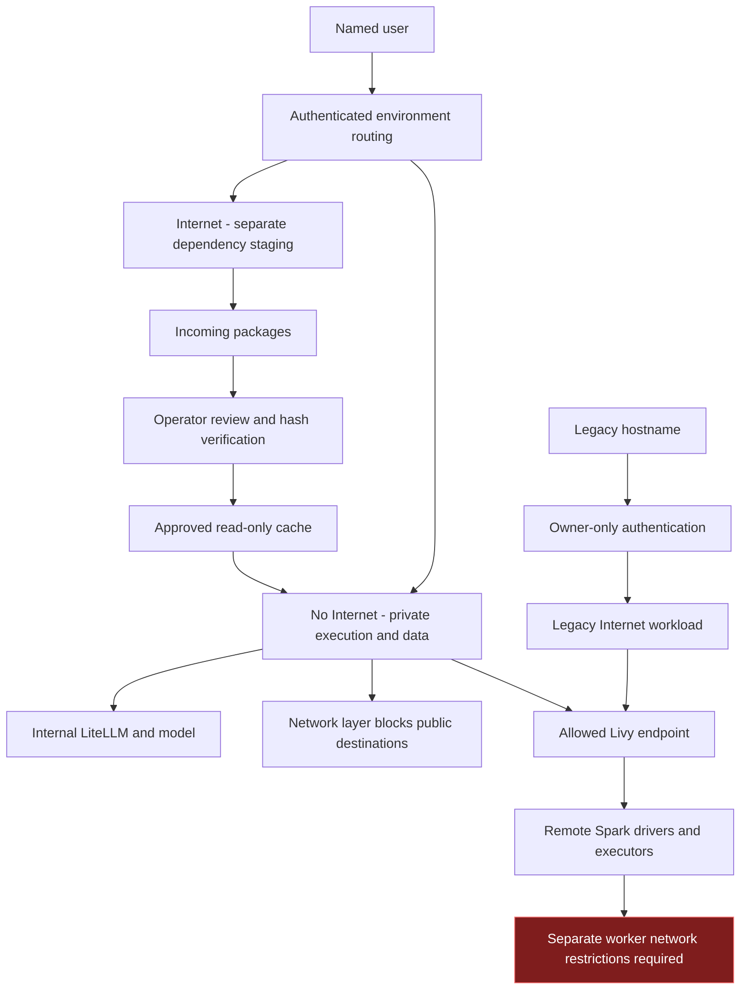
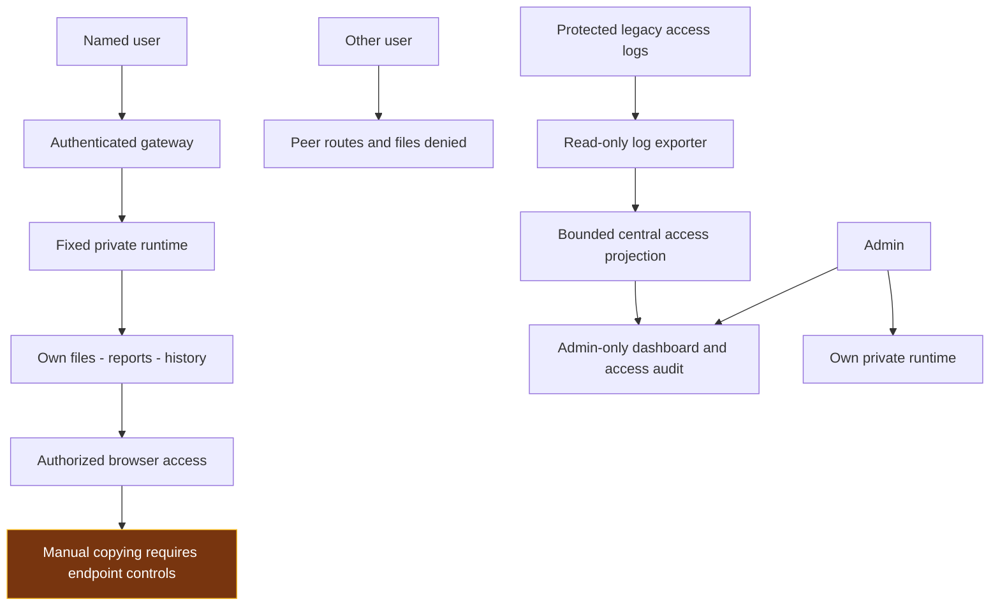

# DSH — Controlling Three Security Risks

This report explains how three risks are controlled: external leakage, damage or excessive access, and exposure of results. DSH, Claude Code and TrueForge are treated as untrusted automation: a model, tool, dependency or generated program can make a mistake. Infrastructure and effective permissions must contain that mistake. Client settings and prompt instructions support those boundaries; they cannot replace them.

The default No Internet environment is the protected working environment. Internet is a separate dependency-preparation environment, not a second route to protected data. The design keeps identities, workspaces, histories and credentials private, while sharing internal inference. Each section explains the boundary, the mechanism that enforces it and the action needed to complete it. An accepted exception is an exposure retained by decision, not a technically closed risk. Performance measurements and test records belong in the separate LLM guide.

## 1 Prevent external leakage

### Risk and control objective

Generated code, a tool or a dependency could send data, prompts, credentials or results to an external destination. The control objective is to block unauthorized outbound connections from every environment that executes the work, while retaining only the internal services needed for the task.

### Current implementation and remaining gaps

The main DSH deployment separates No Internet and Internet execution, with fixed user/environment routing and different storage mounts. No Internet workers have restricted outbound network policy; required internal inference and Livy connections remain available. Internet workers retain public connectivity for dependency preparation. The separation controls local execution paths; it is not an end-to-end air gap.

DSH2 and DSH3 are now restricted to their configured single login identities, `user2` and `user3`. Shared guest and cross-account logins are denied. Only the designated owner has an active password record; disabled legacy records are retained in an operator-only recovery Secret, outside execution mounts. Existing histories stay with their original instance. A dedicated network policy permits ingress-controller access to the authenticated proxy, blocks direct peer access, and retains internal inference, Kerberos and Livy connections. These legacy instances remain Internet-capable; their login page disables the No Internet choice rather than presenting a false offline boundary.

The material open boundary is **remote Livy/Spark execution**. The local runtime policy does not block public connections from the remote drivers and executors. Worker-side containment must be enforced on the datalake platform. Keeping Livy/Spark available is the user's accepted exception; acceptance does not remove the external-leakage path.

To close that boundary, the datalake infrastructure owner must apply destination restrictions to the actual driver/executor network and validate them from those processes. Until then, use only approved public or non-sensitive pilot data on that path; protected-data use must not rely on the No Internet label. Shared gateway/model services and internal relays also require their own egress and administrative review: the worker policy does not automatically constrain them. Internet staging must never receive protected prompts, datasets or credentials merely because its workspace is separate.

### Complete the leakage boundary

For protected-data work, every execution destination must enforce the same outbound restriction. Keep No Internet as default; permit only the required internal services; restrict the inference gateway and any internal relay; disable external provider fallback. Apply the rule where remote code actually runs as well as where it is submitted. A dependency-preparation environment must never receive protected workspaces, prompts or Kerberos tickets.

The currently retained Livy/Spark exception is incompatible with calling the whole workflow Internet-denied. Closing it requires worker-side restrictions on the datalake platform. If those restrictions cannot be provided, protected work must not be sent to that remote path. Keeping it available for the approved public-data pilot preserves the existing decision without claiming that the leakage path disappeared.

### Separate execution environments

The default **No Internet / Internal** environment runs the user's analysis and stores its protected files. Kubernetes network rules restrict its outbound destinations. Required internal connections include the model gateway, controlled DNS, Kerberos and the permitted Livy endpoint. Public connections must be denied at the network layer even when a user runs arbitrary terminal commands or generated Python code.

The **Internet** environment prepares dependencies. It has separate compute, workspace, history and credential storage. It does not mount the protected No Internet workspace. The user selects an environment at login and remains routed to that environment until logout. Selecting Internet must not carry protected files, tickets or conversation history into it.

User identity and environment are separate routing decisions: each main user receives a private No Internet runtime and a different private Internet runtime. A session is pinned to one of those runtimes; changing the radio selection in a request cannot expose the other runtime after login. The environments share internal inference and the authentication gateway. That necessary internal connectivity makes No Internet a restricted-egress environment, rather than a strict air gap.

### Keep inference and dependency transfer inside defined paths

Approved model clients send requests to internal LiteLLM with inference-only credentials. Operator-owned settings constrain the supplied clients' configured endpoint and model. External model fallback must remain disabled. These settings complement network enforcement: changing a client or running a different program must not make public destinations reachable from No Internet.

Dependencies move through a controlled package path:

1. Internet downloads artifacts into an incoming area.
2. An operator reviews the package source, version and expected hashes.
3. A promotion process verifies the selected bytes and copies approved artifacts into a separate cache.
4. No Internet mounts that cache read-only and installs without contacting a public package index.

Internet cannot directly install into the protected runtime or write its workspace. Hashes detect changed artifacts; package review is still necessary because a correctly hashed package can contain harmful code. Prompts, datasets, credentials and reports are not dependency artifacts and must not use this transfer path.

### Cover remote execution as well as DSH

A Spark job executes on remote drivers and executors. The DSH pod's network rules do not follow the code onto those workers. Remote execution therefore requires its own destination restrictions and DNS/proxy controls. An internal Livy connection is an execution path into another platform, so its drivers and executors must be included in the network design.

The same principle applies to any remote tool, notebook server or job runner: the component that executes code needs its own egress boundary. DSH restrictions cannot substitute for a firewall on a downstream platform. The datalake infrastructure owner controls worker destinations; the DSH operator controls the local runtime and which remote endpoints it may contact.

### Allow only necessary internal services

Use a default-deny policy and explicit destinations and ports. DNS should resolve only the names required by the environment, and alternative DNS, proxies and relay services must not create an unintended route outside the boundary. Approved internal services must themselves have an appropriate trust and outbound policy; an allowed internal endpoint can otherwise become an indirect path to the Internet.

Keep network changes under operator control rather than letting generated code change policy labels, routing or firewall rules. The execution identity should have no Kubernetes management credential. Dependency downloads, internal inference and distributed analysis remain distinct flows with separate permissions and owners.

## 2 Prevent damage or excessive access

### Risk and control objective

Generated code can delete writable files, change source records, use excessive resources or access unrelated systems. Internet denial does not prevent damage to internal resources. The control objective is to give execution only the identity, data scope, writable locations and resources needed for the approved task.

### Current implementation and remaining gaps

For the main service, user isolation means separate execution processes and separately mounted workspaces, sessions, attachments and credentials—not merely different folders in a shared process. The main user/environment runtimes are separate non-root workloads with private mounts, resource limits, disabled privilege escalation, dropped capabilities and no mounted Kubernetes management token. No Internet workspaces and durable histories use central CIFS paths; local credential state stays separate. Internet has separate workspace/state storage, and approved dependency artifacts are mounted read-only in No Internet. The legacy owner retains its original files and histories; private-user paths are masked from that broader legacy mount.

These controls reduce local damage and peer access, but **they do not make writable data read-only**. Each Kerberos principal retains its existing AD/datalake permissions, as requested. A successful login does not prove a limited sandbox entitlement. Exclusive rights to `sandbox_da_agent_public_data` have not been established for the system account. The effective catalog, HDFS and sandbox grants must define that boundary before it is used as a restricted identity.

Closure requires the datalake owner to confirm the exact allowed sandbox and effective grants, including denial outside that scope. A protected-source task additionally needs a principal whose source permissions are genuinely read-only; existing broad personal permissions must not be described as that control. Distributed-job quotas, cancellation and alerts require separate datalake acceptance. CIFS persistence and container resource limits are deployed mechanisms, while storage-server ACL correctness, deletion recovery and remote-compute limits remain separate operational responsibilities. A non-root writable workspace is still vulnerable to deletion by its own user or generated code.

### Apply the same boundary to every client

DSH, Claude Code and TrueForge run within the authenticated user's selected environment and must inherit its identity, mounts and network policy. Installing another harness must not add a host socket, privileged container, broad volume or cluster-management token. Claude tool execution remains inside the private workload. TrueForge's optional nested sandbox must remain disabled until it can run under the existing restrictions or an independently contained worker; enabling privilege merely to make it start would weaken containment.

A larger context window changes model capacity, not authorization. A near-1M prompt must still contain only data that the selected user and environment may access. Model endpoint allowlists and operator-owned configuration constrain the supplied clients; infrastructure must also constrain alternative programs a user can execute.

### Contain local code execution

Each main DSH user has a dedicated runtime for each network environment. The runtime executes as a non-root identity, disables privilege escalation, drops Linux capabilities, uses RuntimeDefault seccomp and has no mounted Kubernetes service-account token. CPU and memory limits bound local resource use.

Workspace, session, attachment and credential mounts are limited to the user and environment. The runtime must not mount another user's directory, a broad parent containing private users, host administration paths or credentials for unrelated services. Changing the current working directory is not isolation; access must be denied by the mounted scope and effective permissions.

Protected working files and durable history use bounded paths on the central CIFS storage. Internet staging uses separate storage. The package cache is read-only. Writable results belong in the user's designated working area. Central persistence keeps work available after a runtime replacement, but recovery from deletion requires a separate versioning or backup control.

### Constrain data access with the execution identity

Datalake jobs authenticate through Kerberos and execute through Livy/Spark under the applicable principal. Hive/HDFS and sandbox permissions determine the data that code may read or change. Each user's existing AD/datalake rights are preserved; DSH does not automatically reduce a writable entitlement to read-only.

For a bounded public-data exercise, the intended execution principal is **`da-agent-system-user`**, limited to **`sandbox_da_agent_public_data`**. Read/write access is appropriate within that disposable sandbox; unrelated datasets must be inaccessible. For tasks involving protected source records, the effective identity must have read-only source access and a separate permitted result location. A read-only view is insufficient if the same credentials can bypass it and modify the underlying source.

Credentials and Kerberos tickets must remain in the private No Internet credential area. A shared system principal requires correlation between the named DSH user, runtime, Livy session and Spark application so that its actions remain attributable to a person.

### Bound resource use and recover from mistakes

Count the complete model request, reserve an output budget and admit expensive work only when capacity is available. Use bounded waiting and a clear busy response; do not silently replay an expensive request. Keep smaller requests schedulable while long work progresses. This limits shared-resource pressure, but does not grant data access or guarantee response time.

Local CPU and memory limits protect the application host, but distributed jobs need datalake queue limits, executor limits, timeouts and cancellation controls. Resource monitoring should connect a named user and submitted job to its consumption so an operator can stop excessive work without affecting unrelated users.

Separate original inputs from generated outputs. Preserve a recoverable baseline for experiments, restrict deletion where practical and apply versioning or backups according to the data's recovery requirements. A mounted central share provides persistence; it does not prevent code with write permission from overwriting or deleting content.

Legacy instances now use a prebuilt non-root runtime. Owner-only login and a non-root identity remain separate controls: neither alone proves that every stored file, tool or application route has the correct scope. Any startup/storage migration must reconcile existing state and preserve ownership before the endpoint is qualified; changing only the container UID can hide histories or break writes.

The key principle is to constrain effective permissions, not merely the intended task. A non-root container can still damage files it may write, and a correctly authenticated job can still misuse broad data permissions. Network isolation, local execution restrictions and datalake authorization must work together.

## 3 Keep results contained

### Risk and control objective

Reports, conversation history, logs, attachments and temporary files can disclose data to another user or through an unintended publication route. The control objective is to keep those outputs accessible only to authorized people, with authenticated delivery and attributable access.

### Current implementation and remaining gaps

The gateway uses provisioned local accounts, fixed private routing and disabled self-registration. Main login routes, legacy-history denial, ordinary-user denial of admin endpoints, terminal-page routing and the admin audit interface were reviewed against the current deployment. `thanatcc` owns the preserved legacy histories; the admin role provides dashboard/audit oversight and a separate private runtime, not automatic access to those histories. This review does not replace earlier synthetic cross-file, attachment and restart checks with a claim that every route was freshly retested.

The main gateway and both legacy authentication processes now use **salted scrypt password records** instead of plaintext account values. Each password has a random salt; verification uses a constant-time key comparison, with bounded concurrent derivations. Account files are atomically replaced with owner-only permissions. Existing passwords and account names were preserved, and failed verification does not reveal a stored password. This changes password storage, not the strength of an existing password or the identity of its owner.

Corporate SSO/MFA, password recovery/lifecycle policy and credential rotation remain separate identity controls. The repository bootstrap templates no longer create factory-password accounts. Active legacy startup commands and environment no longer carry bootstrap passwords. Each authentication sidecar has a private hashed account volume; the harness cannot read that store. A protected Secret seeds an absent store without resetting a changed password on restart. Historical rollback material remains restricted to the operator. By explicit owner decision, current passwords remain unchanged until each owner changes their password privately through the authenticated password-change flow. No operator reset or automatic rotation is scheduled. Owners must not send replacement passwords through chat, reports or logs. The exposure from a known or default password remains until its owner changes it; salted hashing protects stored records but does not neutralize a known password. Retiring historical credential copies remains an operator lifecycle task. Infrastructure administrators remain trusted privileged users; ordinary-user isolation does not constrain a cluster or storage administrator.

Other open boundaries are authorized-browser downloads/copying and newly generated report servers. DSH2/DSH3 now have owner-only authentication, non-root private execution, protected account storage and authenticated terminal access. They remain Internet-only instances, not protected No Internet environments. There is no universal publication/DLP control over arbitrary user-written applications or Internet-environment code. Central access audit provides operational visibility, not a tamper-proof command ledger; retention, off-platform protection and full remote-job correlation still need an operating policy. Legacy audit exporters read only their protected access-log subdirectory and write a bounded, sanitized projection into separate central folders. The main admin dashboard merges these records and displays projection freshness; account credentials, prompts and command bodies are excluded.

To close these gaps, keep pilot membership named and approved, secure every report/file/terminal route through user-bound authorization, reject direct bypass paths, apply required endpoint handling controls, and qualify or retire legacy instances. Prohibit automatic external publication in the workflow and enforce it at relevant network/application endpoints; a written instruction alone is insufficient. None of these actions should grant additional datalake access.

### Authenticate every route and isolate each user's storage

The gateway admits provisioned named accounts and disables self-registration. It binds the authenticated identity to a fixed private runtime. A URL, submitted username or forged identity header must not select another user's backend. Reports, files, attachments and terminal WebSockets require the same authenticated boundary as the main application.

Each user and environment has separate workspace and history storage. Ordinary users must not read peer files through file APIs, terminal commands, attachment routes or direct backend connections. Logout revokes the gateway session. Switching network environments requires a new login and must not expose the other environment's history or credentials.

Data ownership and administration are separate. The owner retains access to their content; the admin dashboard provides operational oversight without granting ordinary application access to another user's histories. Cluster, host and storage administrators remain privileged identities and require separate administrative controls.

### Keep audit and delivery within the approved scope

The main central dashboard is admin-only. It separates operational oversight from ownership of conversations and files. The dashboard displays an explicitly dated operator snapshot plus current gateway account/session/audit information; refreshing it is not a new infrastructure health test. Main-gateway access auditing records login success/failure, logout, runtime HTTP access, admin denials and terminal/application WebSocket opening, with time, event, user and environment in storage outside execution workspaces. Passwords, tickets, prompts and conversation bodies are excluded from this access audit. These records support investigation and accountability; they are not a complete terminal-command transcript, model conversation archive or independently protected external audit service. Ordinary execution users receive neither the main audit mount nor the legacy account/audit volume. Each legacy exporter mounts only its audit subdirectory read-only and its own central projection folder writable; it shares the instance network and is a trusted operator component, not an independent network sandbox. The central dashboard combines main access events with recent legacy events; its main browser-session count does not count legacy sessions. The audit boundary also fails closed when it cannot persist a required access event, rather than silently admitting unlogged work.

Reports should be delivered through authenticated routes. Analysis must not automatically publish reports, create public links or export files to external services. Any generated application or new report-serving endpoint needs equivalent authentication and user-bound storage before it is used with protected content.

### Control the browser and legacy routes

An authorized browser can display, download or copy a result. Pod network policy does not control the user's device. Where the handling requirement prohibits those actions, managed-browser, VDI or endpoint DLP restrictions must enforce it, according to the required data-handling policy.

Every application instance, including a legacy runtime or separately launched report server, needs the same user, network and storage boundaries before it handles protected content. A separate hostname or a successful login does not isolate users who share one process and broad filesystem access.

### Keep containment consistent across the full workflow

Apply authorization when a file is created, listed, opened, downloaded or served by a generated application. Bind the request to the authenticated user on the server; do not trust a submitted owner name or a client-selected filesystem path. Restrict direct access to runtime ports so the gateway cannot be bypassed.

Temporary files, exported charts and application logs should stay in the same private scope as the underlying analysis. Use appropriate retention and cleanup, avoid recording credentials or unnecessary sensitive content, and ensure temporary download links do not become public or permanent access paths.

Keep operational oversight separate from access to user content. Administrative exceptions should be narrow, attributable and governed by an explicit support process. Network controls prevent unauthorized machine-to-machine transmission; authentication and private storage prevent peer access; endpoint handling controls govern what an authorized person can take away. Each addresses a different part of result containment.
