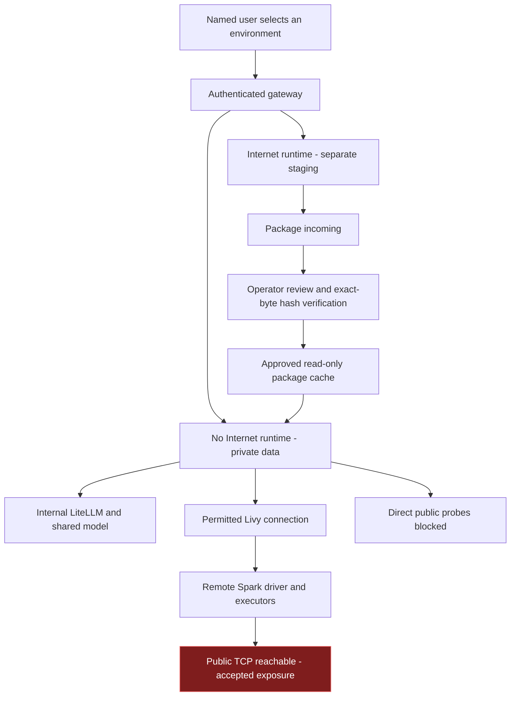
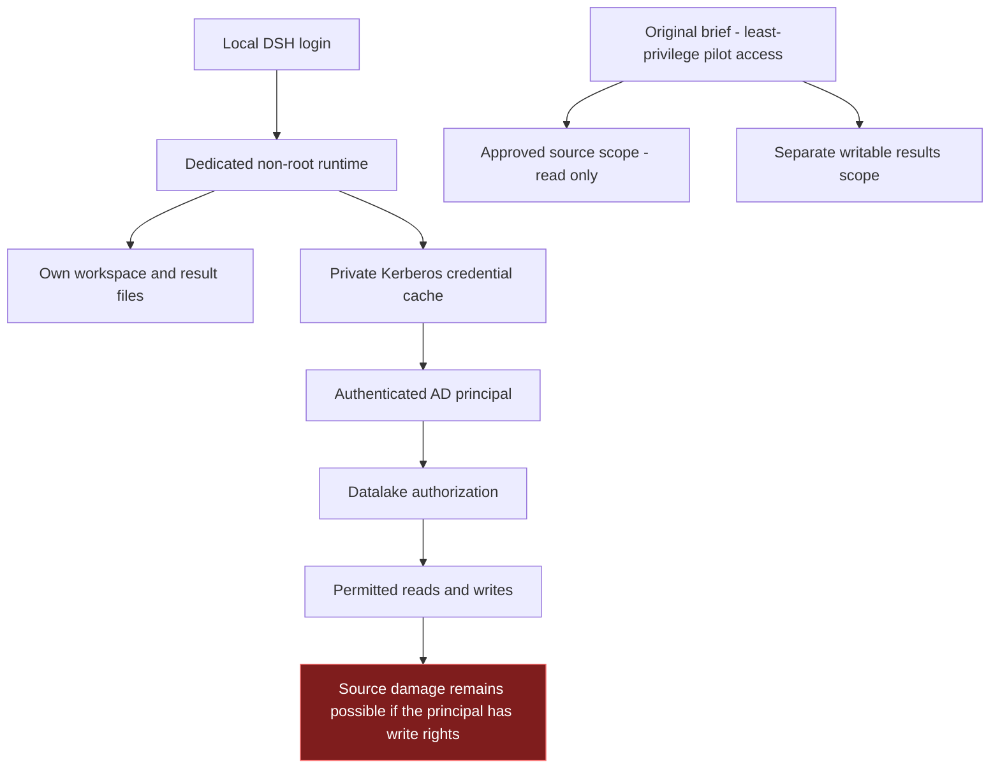
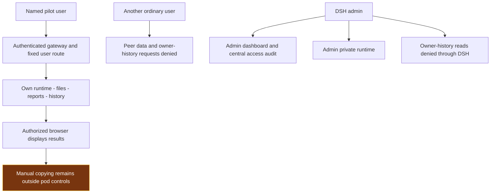

# DSH Pilot — Controlling Data Leakage, Source Damage and Result Exposure

The pilot assumes that the Harness, its tools and generated code can make mistakes or act beyond the intended task. Its protection therefore comes from network boundaries, execution identities, data permissions, private storage and authenticated access—not prompt instructions alone.

**The objective is to limit what can go wrong enough to make this specific pilot acceptable. It is not to prove that the Harness is universally safe.**

This report follows the three controls in the supplied pilot brief. It explains which environment to use, how each protection works, what the recorded tests establish and what still needs a decision or additional enforcement. The main DSH environment has deployed protections. The original full-path Internet-denial and read-only-source requirements are **not both satisfied** under the current operating decisions.

## Pilot boundary and environment choice

An analyst defines a DQ hypothesis and the permitted data scope. The agent can prepare Python or Spark code, execute it under the available identity and produce reports in that user's working area. The controls below must constrain those actions even when the generated code is wrong.

| Environment | Intended use | What it can reach and store |
|---|---|---|
| **No Internet / Internal — default** | Work with internal information and run approved analysis | Dedicated user workspace, history and credential state; internal inference, restricted DNS, Kerberos and the permitted Livy endpoint. Representative direct public connections are blocked. |
| **Internet** | Obtain libraries and prepare dependency artifacts | Separate workspace/history and package incoming area. It does not mount the protected No Internet workspace. Tested datalake/KDC destinations are denied. |
| **Remote Livy/Spark compute** | Execute distributed analysis under the authenticated principal | A separate execution boundary in the datalake platform. DSH pod policies do not govern its driver or executors. Public TCP connectivity was observed there. |

The two DSH environments share the internal inference service and authentication gateway, **not writable project data, conversation history or credentials**. Switching environments requires logout and a new login. This is restricted egress, not a strict air gap: the default environment still needs approved internal connections.

Only reviewed dependency artifacts should move from Internet staging to the No Internet package cache. Sensitive prompts, datasets, reports and credentials are not part of that transfer workflow. Existing users' AD/datalake permissions remain unchanged; selecting an environment does not grant a new data entitlement.

## 1 Prevent external leakage

**Risk:** the Harness or generated code could transmit RDT, prompts, credentials or results to an external destination. The network control must cover every place the code executes, including remote workers.

### What enforces the boundary

The default DSH runtime is selected by the authenticated gateway and placed under a Kubernetes egress policy. That policy permits only the required internal destinations: the internal model gateway, restricted DNS, Kerberos and the allowed Livy connection. The DNS relay accepts the required internal names and rejects public/encoded test names locally. Direct public DNS and direct CoreDNS bypass probes are denied.

Model requests use internal LiteLLM and inference-only credentials. The [mounted configuration readback](context-evidence/pilot-model-route-config-20261016.json) found 22 model entries using internal service hosts and no explicit fallback settings in the checked configuration scopes. Recorded tests denied model/key administration and a client-selected API-base override. External provider fallback must remain disabled for the pilot; this static-file check does not audit every dynamic model entry, plugin or client. These controls constrain the approved inference path, not every possible relay through an allowed internal service.

The Internet environment is separate compute and storage. It can download packages into an incoming area, but cannot install directly into the protected workspace or modify the approved cache. An operator reviews artifacts and their hashes; the promotion helper verifies the exact bytes and publishes them to a cache that No Internet mounts read-only. Hash verification proves integrity, not that a package is harmless.

### What is verified and what remains

| Recorded observation | Meaning for the risk |
|---|---|
| Public-domain, direct-IP and DNS-bypass probes failed from the tested No Internet workers; internal inference returned the required response | The tested local pod boundary works for those destinations. This is not an exhaustive proxy/IPv6/relay assessment. |
| Internet workers reached package sites but failed the tested KDC, Livy and unrelated internal-service connections | Dependency preparation is separated from the tested internal data-access paths. |
| A package was downloaded, hash-promoted, installed without an index and imported inside No Internet; cache writes were denied | The intended library-transfer path works without sharing writable workspaces. |
| The authenticated Spark driver **and executor** reached `github.com:443` and `1.1.1.1:443` | **The end-to-end Internet-denial requirement is not met.** Blocking Internet only in DSH does not contain code sent to remote Spark. |

The user explicitly chose to keep Livy/Spark available with this documented exposure. That is an accepted operational exception, not a repaired firewall. No RDT was read or transmitted by the recorded connectivity tests.

**To meet the original requirement:** the datalake infrastructure owner must enforce restricted egress for the actual Spark drivers/executors and retain only their necessary internal services. Acceptance must test outbound paths from each relevant execution mode, including direct IP, DNS, configured proxies and IPv6 where enabled. If that enforcement cannot be provided, sensitive remote execution needs an explicit risk decision or a restriction on its use. This report does not silently disable the retained Livy service.

Evidence: [local boundaries](context-evidence/design-consistency-live-20261016.json), [new admin runtimes](context-evidence/admin-private-network-20261016.json), [offline package workflow](context-evidence/package-workflow-live-20261016.json), [authenticated remote Spark retest](context-evidence/remote-spark-recheck-20261016.json).

## 2 Prevent damage or excessive access

**Risk:** generated code could modify source data, delete writable content or reach unrelated resources. Denying Internet access does not prevent those actions inside an authorized internal system.

### What enforces the boundary

Each main DSH user has a dedicated execution environment for each network mode. The runtime uses UID/GID 10001, disables privilege escalation, drops Linux capabilities, uses RuntimeDefault seccomp and does not mount a Kubernetes service-account token. Separate workspace, session, attachment and credential mounts prevent an ordinary user from obtaining another user's files through a shared process or filesystem. Resource limits constrain the local runtime; remote Spark resources and permissions remain a datalake responsibility.

Projects and results belong in the user's working area. No Internet durable files/history use the mounted DA_WORKSPACE CIFS storage with bounded user paths; Internet staging uses separate storage. The approved package cache is read-only. **DA_WORKSPACE is persistence, not the source of RDT authorization and not an independent backup.**

RDT access follows the authenticated AD principal through Kerberos and Livy/Spark to the applicable Hive/HDFS permissions. A local DSH login is a separate identity. The personal Kerberos retest found the required service ticket and confirmed that Livy's owner matched Spark's execution user; it did not establish read-only access to an unspecified table or path.

### Original brief versus the selected permission policy

| Requirement in the brief | Current position |
|---|---|
| Dedicated non-admin execution identity | Implemented for the main private DSH runtimes; DSH2/DSH3 still need migration. |
| Read-only access to a limited RDT snapshot/view | **Not imposed.** The later instruction was to preserve each user's existing AD/datalake rights. A write-capable principal remains write-capable. |
| Results written only to a separate working area | DSH provides private working areas. It does not override that principal's separate datalake write permissions. |
| Source writes and out-of-scope reads fail | Requires an approved test resource and its actual permissions. Neither the name `da-agent-system-user` nor successful authentication proves this result. |

**To meet the original read-only requirement without changing personal accounts:** provide a dedicated pilot principal limited to reading approved sources and writing only to an approved results location, or an equivalently enforced access broker that the execution environment cannot bypass. A view alone is insufficient if the same code can use broader credentials directly. This is a proposed pilot control; no AD entitlement was changed by this report.

The data owner should specify disposable test resources for one permitted read, a prohibited write/delete and an out-of-scope read. Acceptance must establish an authorization denial, not merely a missing object or network error. Test each distinct principal/role boundary; do not assume one account's result represents everyone.

Evidence: [private routing and audit checks](context-evidence/owner-admin-snapshot-live-20261016.json), [identity propagation](context-evidence/remote-spark-recheck-20261016.json), [Kerberos ticket-presence check](context-evidence/kerberos-personal-ticket-check-20261016.json).

## 3 Keep results contained

**Risk:** reports, logs, attachments or temporary files could expose RDT to another person, or be published/exported outside the approved pilot.

### What enforces the boundary

The main gateway admits provisioned local accounts and disables self-registration. It selects the user's fixed runtime; a URL, form field or forged identity header cannot select another user's backend. Application, report and terminal traffic pass through authenticated routes. Login sessions stay in one environment, and logout revokes the gateway session.

Workspaces, histories, attachments and credentials are private to the user and environment. Existing legacy content remains with its confirmed owner, `thanatcc`. Admin uses fresh private runtimes and cannot read those owner histories through DSH. The owner runtime masks the reviewed peer-data subtree, old authentication/credential aliases and recovery paths. Host, cluster and storage administrators remain a privileged trust boundary.

Central dashboard access is admin-only. The central access audit records time, event, user and environment—not passwords, Kerberos tickets, prompts or conversation bodies. Audit storage is outside the execution workspaces. It supports accountability, but is not a full command transcript or a tamper-proof external SIEM.

### What is verified and what remains

Recorded checks verified owner-history access, denial to other users including admin, non-admin denial of the dashboard/API and rejection of forged-role attempts. Real authenticated terminal WebSockets executed non-root commands in both owner and admin environments. Workspace/attachment markers survived replacement of the new admin runtime processes. The earlier isolated two-user acceptance also exercised synthetic report, attachment and session boundaries.

These checks establish the tested access paths. They do not certify every historical tool action, plugin or generated application. Pilot reports must remain behind the authenticated gateway; any publication or export must be separately authorized rather than treated as an automatic outcome of analysis.

**Browser boundary:** a person authorized to see a result can still copy, download, photograph or manually share it. Pod egress policies do not govern that person's device. If the pilot requires prevention of those actions, the endpoint owner must add managed-browser/VDI/DLP controls and verify the intended restrictions. This report does not claim those controls are deployed, and it does not disable useful downloads while presenting that as complete data-loss prevention.

**Legacy boundary:** DSH2 and DSH3 are not yet equivalent to the main deployment. They still run as root with a service-account token and three local accounts sharing each process. Basic anonymous/login/logout route checks passed, but that is not user isolation. Migration requires the pending decision on their history owners and reconciliation of live profiles/root working directories before restart. Their original data remains preserved.

Evidence: [owner/peer access](context-evidence/legacy-owner-restoration-live-20261016.json), [real terminal checks](context-evidence/owner-admin-terminal-live-20261016.json), [restart persistence](context-evidence/admin-private-persistence-20261016.json), [legacy response-content review](context-evidence/legacy-auth-content-review-20261016.json).

## Acceptance and remaining decisions

| Control | Current disposition | What is needed to satisfy the original brief |
|---|---|---|
| Prevent external leakage | Local No Internet controls verified; remote Spark public connectivity remains an accepted exposure | Infrastructure owner restricts and tests remote-worker egress, or an explicit sensitive-workload restriction/risk decision covers that exposure. |
| Prevent damage or excessive access | Main runtime isolation verified; existing AD permissions preserved | Data owner defines an enforced source/results scope and verifies the applicable read/write denials for the pilot identity. |
| Keep results contained | Main authenticated routes, private data boundaries and central audit verified | Finish legacy-instance migration; define report/export handling and add endpoint controls if manual-copy prevention is required. |

The environment choice, data scope and named participants should be recorded for each pilot exercise. Infrastructure owners own network enforcement; data owners own entitlements; the DSH operator owns runtime/routing/persistence; endpoint owners own device restrictions; the pilot owner decides whether residual exposure is acceptable. An accepted exception must not be labelled a technical fix.

The evidence linked here records specific checks on 16 October 2026. Opening or regenerating this HTML does not run new security tests or grant access to data. Detailed migration histories, raw logs, model trials and setup instructions are supporting material, not the main risk-control narrative.
