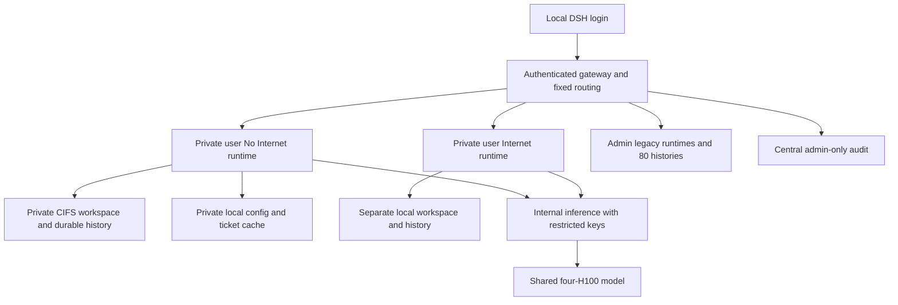
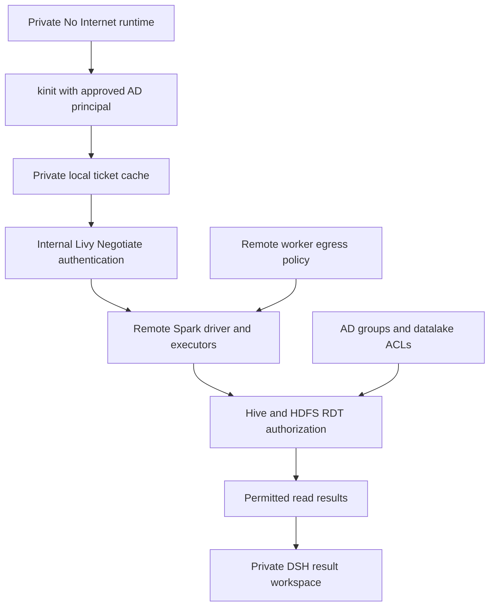
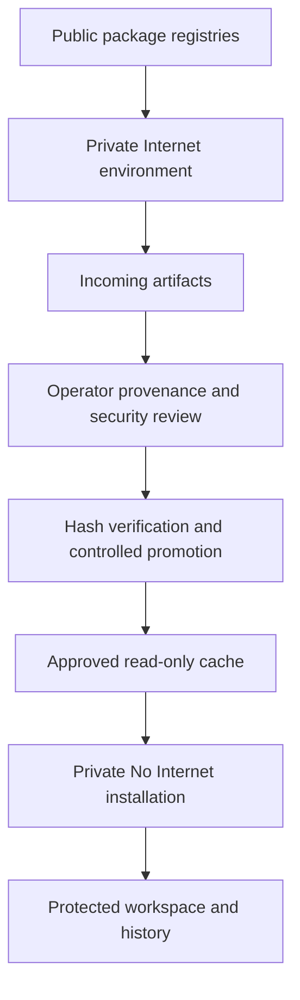

# DSH RDT Pilot — Security Controls and Execution Architecture

**16 October 2026: private user routing, central audit and datalake-aware restricted egress are deployed. Existing per-user AD/datalake rights are preserved. A real remote Spark test found public egress; full-path No Internet acceptance is not closed.**

The objective is to limit what can go wrong enough to make this specific pilot acceptable, rather than declare the Harness or generated code universally safe. This report explains where each control acts, what was tested and what remains unverified. Opening saved evidence does not run a new test or authorize data access.

## 1 Executive assessment

**RDT uses Kerberos (`kinit`) and the datalake connection, including Livy/Spark and Hive/HDFS authorization. DA_WORKSPACE stores DSH files and history.** Mounting it is neither the source of RDT authorization nor proof of read-only RDT access. A local DSH login such as `thanatcc` is not an AD identity. The earlier request for an RDT PVC/folder conflated these independent controls and is withdrawn.

| Risk | Deployed enforcement | Evidence and limit |
|---|---|---|
| Prevent external leakage | Private No Internet workers; exact internal DNS, Kerberos, Livy and inference destinations; restricted inference keys | All 18 workers tested. Public-domain and direct-IP probes fail from all 9 No Internet workers; internal paths work. Remote Spark driver and executor actually reached GitHub/public IP; local pod policy does not cover that downstream path. |
| Prevent damage/excessive access | Non-root execution, no Kubernetes token, private workspace/state and ticket cache | Local isolation/persistence tested. Per user instruction, existing AD/Hive/HDFS rights are inherited; DSH grants no new data authority and does not universally enforce read-only access. |
| Keep results contained | Fixed user/environment routing; authenticated application and terminal routes; admin-only legacy histories; central audit | All 16 private logins denied an admin history and admin APIs. Administrator remains trusted. Browser exports and remote reports need separate review. |

Local controls now go beyond the former shared-pool design. The approved data-access policy preserves each user’s existing AD/datalake permissions. This supersedes the earlier requirement for universal read-only RDT access; it is a requirement change, not proof that write-capable AD accounts became read-only. DA_WORKSPACE remains independent of datalake authorization.

## 2 Deployed user and environment architecture

Nine existing local accounts have fixed routes. Eight non-admin accounts each receive private No Internet and Internet runtimes: 16 private runtimes. Admin retains the two original runtimes and all 80 legacy histories. Registration remains disabled; switching environments requires logout and a new login.

Runtimes share inference, not writable workspaces, attachments, sessions or credentials. UID/GID 10001, disabled privilege escalation, dropped capabilities, RuntimeDefault seccomp, no service-account token and resource limits constrain execution. Per-user mounts provide isolation despite the same numeric container UID. This does not protect against trusted administrators or a host/kernel compromise.

### Storage and persistence

The original share remains `\\bot.or.th\cfs\FILESERV\DA_WORKSPACE\workstation`. Historical name: **dsh_storage**, not dsh_volume. Replacing this share after a CIFS permission failure was an implementation deviation, not a user requirement. UID/GID mapping resolved compatibility; direct central mounts were restored.

| Content | No Internet | Internet |
|---|---|---|
| Private `/workspace` | CIFS `dsh/private/<identity>/secure` | Per-user local PVC |
| Sessions, attachments, storages, workspaces, logs | CIFS `dsh/private/<identity>/state/<directory>` | Per-user local state PVC |
| Configuration, credentials and tickets | Private local `/state`; `/state/kerberos/ccache` | Separate private local state |
| Admin legacy data | Existing `dsh` and `dsh/dsh_storage` trees | Original admin Internet state |
| Package access | Approved cache read-only | Incoming writable |
| Gateway audit | CIFS `dsh-admin-audit`, outside runtime mounts | Same central gateway audit |

Direct CIFS mounts need no copy loop. Local credentials/configuration remain separate from conversation content. PVC persistence is not a backup or disaster recovery guarantee. Admin's broad legacy mount is an explicit trusted-admin exception; non-admins never receive that root mount. Two markers per private runtime survived process replacement. The unchanged legacy aggregate is 80 histories / 82 files, SHA-256 `7bb4aa235893e12b0bf545a4f87e00a3a6df2a656e33acdb5231c8def460c317`.

## 3 Control 1 — Prevent external leakage

Kubernetes NetworkPolicy restricts the No Internet pod, including DSH, generated code, terminal commands and local subprocesses. Allowed paths are internal LiteLLM port 4000, an allowlisted resolver, verified KDCs TCP/UDP 88 and the existing Livy endpoint TCP 28998. This is **No Internet / restricted egress**, not an air gap: internal authentication, application, storage and inference remain connected.

The resolver accepts exact internal names and necessary Kerberos SRV lookups. Public and encoded names return NXDOMAIN locally. Forwarded questions are rebuilt with client extra/EDNS payloads removed; query names are not logged. Direct CoreDNS and public DNS are blocked. Split-DNS inventory was verified from pods rather than assumed from Windows results.

Internet runtimes reach public registries but cannot reach KDC, Livy or unrelated private services. They do not mount protected data or histories. Users must not paste protected data into Internet sessions; infrastructure cannot undo an explicit transfer.

Private identities and admin pools use inference-only LiteLLM virtual keys. Exact inference works; key enumeration, key generation and model creation return 403. A client API-base override was rejected. The shared master key was not rotated for unrelated applications. Restricted credentials supplement network controls; they do not prove that every allowed service cannot relay data externally.

All 9 No Internet workers failed GitHub/PyPI/npm resolution, public direct-IP, public DNS and direct CoreDNS TCP/UDP probes. All resolved approved internal names, reached KDC 88, received anonymous Livy 401 with `WWW-Authenticate: Negotiate`, and returned exact internal inference. All 9 Internet workers reached registries/inference but failed KDC, Livy and unrelated PostgreSQL access. The PostgreSQL negative control succeeded before restrictions and failed afterward.

These are destination-specific observations, not exhaustive IPv6/proxy/relay/browser acceptance. Remote Spark executors are outside DSH pod policies. A real synthetic Livy/Spark test confirmed both driver and executor can connect to `github.com:443` and `1.1.1.1:443` (public DNS port 53 was blocked). This demonstrates an allowed public TCP path outside DSH’s local policy, which fails the intended outbound-denial requirement. These were TCP-connect probes, not HTTP-body or data-exfiltration tests; no RDT was read or transmitted, and no compromise is asserted. The test session owner matched the Spark user; this verifies the observed mechanism for one identity, not other users’ entitlements. The test used existing Windows SSPI Negotiate without retrieving a password or copying a ticket into DSH.

The first small session ended before probes. A retry using the existing example’s 2GiB driver/executor settings and a dedicated temporary staging path ran the probes successfully. Both sessions were explicitly stopped and verified absent from Livy’s active list. See [failed initial execution](context-evidence/remote-spark-first-attempt-20261016.json) and [actual driver/executor results](context-evidence/remote-spark-boundary-live-20261016.json).

A reversible patch removes only Livy port 28998 from No Internet egress, preserving Kerberos, inference, DNS and mounted storage. It passed server dry-run; that is preparation, not applied containment. Applying it temporarily disables new Livy/Spark connections from No Internet and does not terminate existing remote applications. Restoring protected remote Spark functionality requires enforced datalake driver/executor egress restrictions. See [prepared patch review](context-evidence/livy-containment-prepared-20261016.json).

Evidence: [all-worker network tests](context-evidence/internal-network-live-20261016.json), [applied policies](context-evidence/internal-network-policies-20261016.json), [split DNS review](context-evidence/internal-endpoint-split-dns-20261016.json).

## 4 Control 2 — Kerberos and datalake authorization

`kinit` establishes a user-specific identity. The user explicitly selected “Preserve each user’s existing AD/datalake permissions” on 16 October 2026. DSH therefore does not add a universal read-only restriction or provision a common service identity. Existing AD/Hive/HDFS authorization governs reads and writes. Generated code can perform operations already permitted to that principal: this is a retained authority and risk, not a new DSH grant.

One credential can test a common connection/identity mechanism; it cannot prove the entitlements of other users. DSH acceptance verifies private credential/cache storage, fixed local-user routing and execution/network containment. Data owners continue to administer each principal’s rights. Local DSH login and Kerberos identity are distinct: DSH does not force their usernames to match. It prevents gateway identity spoofing and shared mounts; it does not prevent a person from authenticating as another AD account whose credentials they possess.

The replacement runtime contains Kerberos tools. No Internet uses BOT.OR.TH configuration and a private ticket cache with group/other access denied. A set-group-ID bit inherited from Kubernetes fsGroup does not grant group access. No principal, keytab, AD login or new datalake permission was provisioned. Tickets/passwords must not enter Git, audit logs or Internet staging.

A universal read-only permission test is no longer a release requirement under the revised policy. A representative authenticated connection can establish mechanism behavior, while per-user entitlements remain the datalake owner’s responsibility. Do not infer authenticated identity from anonymous 401 or KDC connectivity. Remote Spark network behavior is evaluated with synthetic connectivity probes, without reading or modifying RDT.

Earlier canaries used a synthetic filesystem fixture historically named `/data/rdt`. Its read-only denials establish only fixture behavior. New source calls it a synthetic fixture explicitly; it is not the actual RDT access mechanism.

## 5 Control 3 — Contain reports, histories and execution

Authenticated session identity selects a fixed private runtime. Client headers cannot nominate another user. Applications and web terminals pass through authenticated proxy routes; terminal commands run in that selected environment, not in a cluster administrator shell. Runtime ingress permits the gateway rather than neighboring runtimes. Local DSH login is not AD/SSO.

Production tests exercised all 16 private login/environment combinations, terminal pages, denial of an admin history ID and admin APIs even with forged headers. A separate four-runtime canary tested HTTP/WebSocket binding, real terminal commands, synthetic reports/history and restart persistence. Admin retains all 80 legacy histories; they were not copied into other accounts.

Central audit fields are strictly time, event, user and environment. Events cover login/logout, runtime access, terminal/WebSocket access and admin denials, excluding passwords, tokens, prompts and conversation text. Only admin can read the audit API. Archives are retained; when configured capacity is exhausted, new login/runtime access fails closed until approved operator archival. This is access audit, not a full command transcript or tamper-proof SIEM.

No external publisher was introduced. That is narrower than proving every plugin, browser download or remote report path safe. Pod policies cannot stop an authorized browser user manually sharing displayed results. Named-pilot/export acceptance remains an owner decision. Legacy DSH2/DSH3 retain old root/Internet configurations and are excluded from private-pilot acceptance; they must not process protected RDT under this report's approval.

Evidence: [private Production routing](context-evidence/private-routing-live-20261016.json), [isolation/audit canary](context-evidence/isolation-audit-canary-20261016.json), [audit regressions](context-evidence/admin-dashboard-audit-tests-20261016.json).

## 6 Dependency supply without protected workspace sharing

Internet prepares packages; it cannot install directly into No Internet or edit protected files/history. An operator reviews provenance/security and promotes hash-verified artifacts into Approved. Secure installs from the read-only cache without public registries. Hashes detect substitution, not malicious package logic. The earlier canaries used empty caches. Fresh end-to-end acceptance now downloaded pinned `six==1.17.0` in Internet, matched its SHA-256 to HTTPS PyPI metadata, checked wheel members for path traversal, native code, .pth files and entry points, promoted it with reviewed hashes, then installed/imported it in a temporary No Internet venv using `--no-index`. The exact result was `OFFLINE_PACKAGE_OK`; attempts to append to Approved were denied. Temporary venv cleanup completed. These are functional/provenance checks, not a claim that hashes or a wheel inspection prove a package benign.

The old promoter hashed a pathname then reopened it for copying. The corrected operator code opens source components with directory descriptors and no-follow semantics, stages bytes from the same opened file, validates every row before publication, refuses symlink/path traversal and conflicting overwrites, and publishes individual artifacts atomically. The promotion job has no network egress, no Kubernetes token and a read-only root filesystem. Five real Linux regressions passed, including substitution after source open and hash failure without publishing another row. Operators still control admission and provenance review. The pinned runtime image is unchanged; reviewed promotion source runs from a separately hashed immutable ConfigMap. See [complete live package acceptance](context-evidence/package-workflow-live-20261016.json).

## 7 Rollout, rollback and experience

Azure build 62743 produced image `sha256:c10f792b1516813fb2d5c4b4de0bfe816931dfcf71caeab8cd161cb13c5a8ca6` from source `4b90c846ead7098433173a18046105b179744737`. Its matching disposable canary passed. Later operator/document changes are not represented as baked into that image. Gateway source is independently hashed.

Sequential runtime rollout checks actual imageID, two persistent markers and Kerberos client/cache behavior, then gateway login/history/terminal/audit. Failure restores prior specifications, not an old copy of user data. The model is not restarted by this change. The final retry passed on all 18 runtimes and the gateway: actual image digest, persistent markers, Kerberos client/cache, 16 private login/denial checks and unchanged 80-history aggregate. See [live acceptance](context-evidence/kerberos-runtime-live-62743.json) and [initial rollback](context-evidence/kerberos-runtime-first-attempt-62743.json). Pipeline success alone does not establish this.

| Trial | Finding and correction |
|---|---|
| CPU reservations | One CPU per runtime left four Pending. Requests became 250m CPU / 1Gi, limits remain 4 CPU / 8Gi. |
| Admin key replacement | First attempt missed `cordis.patch.yml` and rolled back. Exact old values were replaced across root YAML; retry passed inference and management denial. |
| Split DNS | Windows/pod mismatch stopped rollout before policy changes; reviewed pod addresses were used. |
| RKE2 DNS | Label discovery replaced an incorrect assumed service name. |
| Kerberos cache mode | Initial check rejected 2700 despite denied group/other access and rolled back. Corrected check separates permission bits from set-group-ID. |
| RDT confusion | Synthetic mount tests do not establish real Kerberos/datalake rights. DA_WORKSPACE restoration is independent. |
| Long context | Approximately 262K input previously caused attention-workspace OOM. Smaller prefill chunks enabled a historical near-1M test; KV slots alone did not prove operational capacity. |
| Package promotion | Hash-then-reopen allowed a replacement window. Same-descriptor staging and no-follow traversal passed five Linux attack regressions; actual offline install/import passed. |
| Remote Spark | First synthetic session ended before probes; the retry reached Internet from both driver/executor. Authenticated session owner matched Spark user. Both test sessions were stopped; no RDT was accessed. Local CNI policy cannot establish downstream egress protection. |

## 8 Context, performance and administration

Backend configuration: 1,048,576 context ceiling, memory fraction 0.90, request cap 16, prefill chunk 1,024, maximum prefill 2,048 and interleaved short-work scheduling. DSH/LiteLLM user guardrail remains 131,072 total, 8,192 output and a 256-token reserve; compaction is configured near 98,304. Configuration does not prove every session compacts successfully.

Earlier bounded samples: short replies around 0.23 seconds, two concurrent replies around 35 effective output tokens/sec each, and short replies 0.466–0.588 seconds during fresh 24,047-token work. Effective rate includes queue, prefill and network time. These are not sustained capacity, two simultaneous 1M sessions or fresh near-1M fairness. Fresh post-upgrade tests on 16 October at 07:41 UTC returned exact short replies in 0.223–0.233 seconds, two concurrent replies at 35.16–35.20 effective output tokens/sec each, and short replies in 0.440–0.588 seconds during a 24,044-token input request. All three short replies finished before the larger request ended. See [exact responses and timing](context-evidence/performance-private-live-20261016.json).

The admin dashboard combines live gateway account/session/audit counters with a timestamped infrastructure snapshot. Refresh does not rerun Kubernetes/datalake probes. Gateway receives no cluster API token. Saved infrastructure claims must be refreshed after changes.

## 9 Remaining acceptance

Local implementation is not blanket RDT approval. Remaining evidence is specific:

1. Existing user-specific AD/datalake entitlements remain inherited controls, not a missing universal read-only DSH feature. No new access was provisioned.
2. **Confirmed live gap:** remote Spark driver/executor public egress. Either contain new Livy connections or enforce downstream egress before full-path No Internet closure. A policy-change decision is pending; no successful test is fabricated.
3. Named-pilot/report/export governance remains an operational responsibility, including the trusted-admin and legacy-instance exceptions. Authentication and private report/file routes are tested; browser/manual export and every plugin are not certified by those tests.
4. Offline package workflow is now verified by an actual download → hash promotion → No Internet installation/import, with five adversarial promotion tests. Future artifacts still require operator review.

No new datalake permission was granted. No AD password or ticket was exported. The embedded README supplies setup/maintenance guidance; saved evidence preserves failed trials as well as successful ones.
