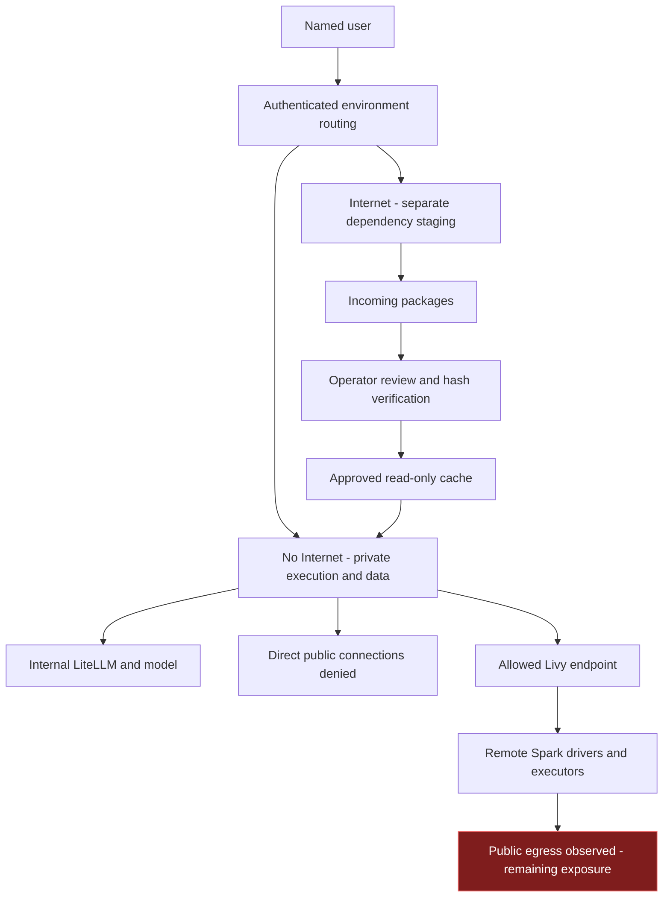
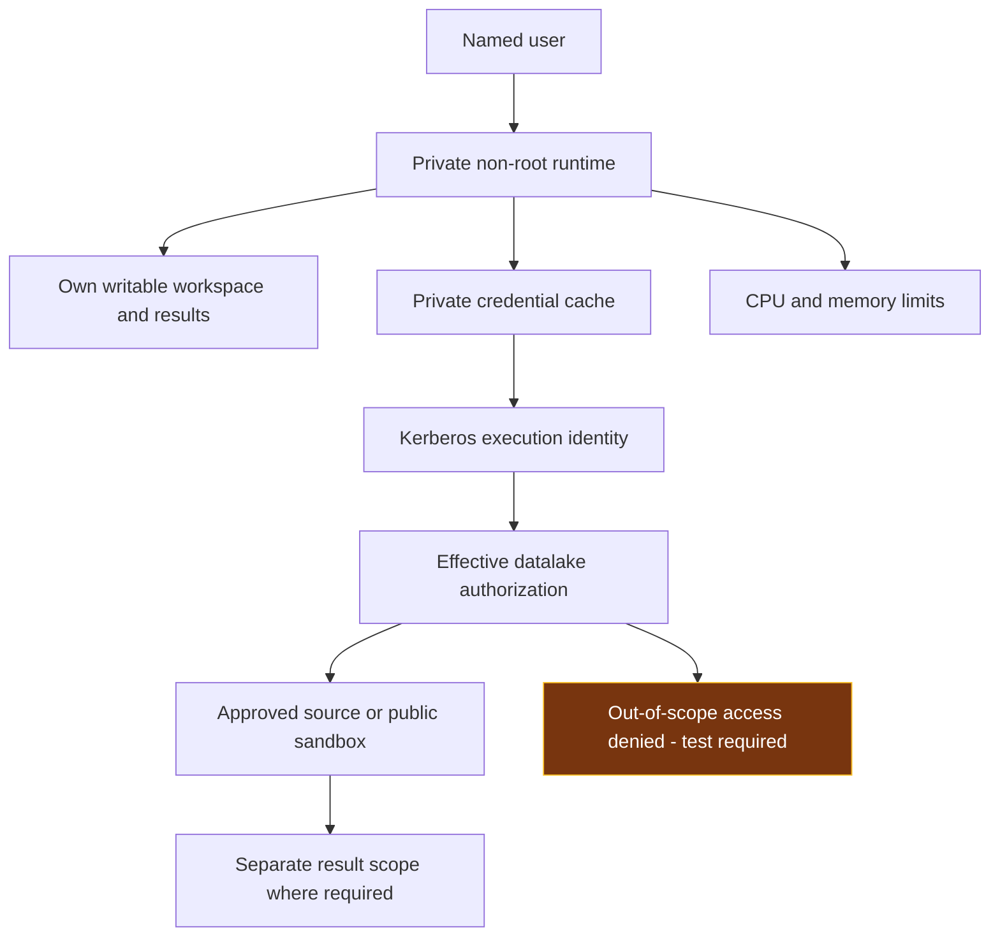
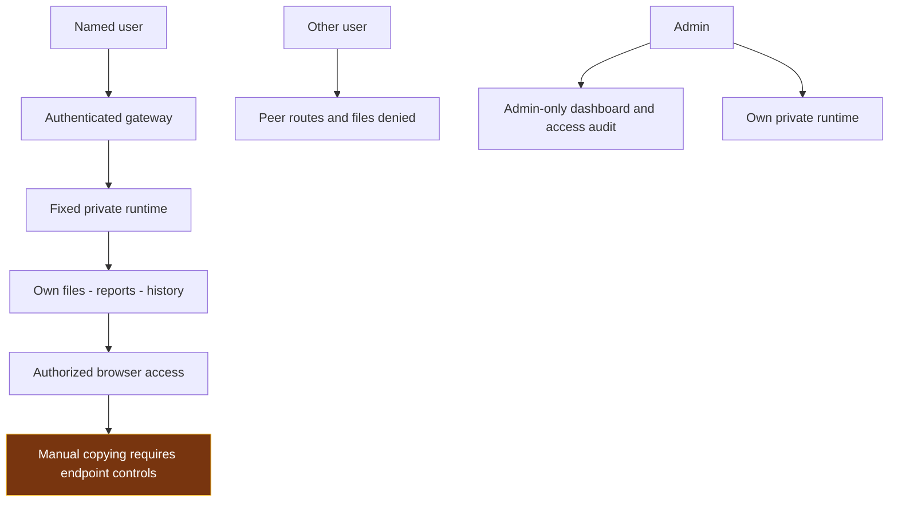

# DSH — Controlling Three Security Risks

The controls below limit what the Harness, its tools and generated code can reach, change and disclose. Enforcement belongs in network rules, execution identities, storage permissions and authenticated routes. A prompt asking the agent to behave safely is not an access control.

## 1 Prevent external leakage

### Risk and control objective

Generated code, a tool or a dependency could send data, prompts, credentials or results to an external destination. The control objective is to block unauthorized outbound connections from every environment that executes the work, while retaining only the internal services needed for the task.

### Separate execution environments

The default **No Internet / Internal** environment runs the user's analysis and stores its protected files. Kubernetes network rules restrict its outbound destinations. Required internal connections include the model gateway, controlled DNS, Kerberos and the permitted Livy endpoint. Public connections must be denied at the network layer even when a user runs arbitrary terminal commands or generated Python code.

The **Internet** environment prepares dependencies. It has separate compute, workspace, history and credential storage. It does not mount the protected No Internet workspace. The user selects an environment at login and remains routed to that environment until logout. Selecting Internet must not carry protected files, tickets or conversation history into it.

The environments share internal inference and the authentication gateway. That necessary internal connectivity makes No Internet a restricted-egress environment, rather than a strict air gap.

### Keep inference and dependency transfer inside defined paths

Approved model clients send requests to internal LiteLLM with inference-only credentials. Operator-owned settings constrain the supplied clients' configured endpoint and model. External model fallback must remain disabled. These settings complement network enforcement: changing a client or running a different program must not make public destinations reachable from No Internet.

Dependencies move through a controlled package path:

1. Internet downloads artifacts into an incoming area.
2. An operator reviews the package source, version and expected hashes.
3. A promotion process verifies the selected bytes and copies approved artifacts into a separate cache.
4. No Internet mounts that cache read-only and installs without contacting a public package index.

Internet cannot directly install into the protected runtime or write its workspace. Hashes detect changed artifacts; package review is still necessary because a correctly hashed package can contain harmful code. Prompts, datasets, credentials and reports are not dependency artifacts and must not use this transfer path.

### Cover remote execution as well as DSH

A Spark job executes on remote drivers and executors. The DSH pod's network rules do not follow the code onto those workers. Remote execution therefore requires its own destination restrictions, DNS/proxy controls and outbound tests. Allowing an internal Livy connection is safe only to the extent that the resulting remote execution is appropriately contained.

Livy/Spark remains available. Recorded driver and executor tests reached public TCP destinations, so complete outbound containment is not established. Closing this exposure requires the datalake infrastructure owner to restrict the actual worker network paths, or route protected jobs to a worker environment with equivalent restrictions. An accepted exception permits continued use; it does not block the connection.

### Verification and remaining exposure

| Check | Recorded result | Control implication |
|---|---|---|
| Public domains, direct public IPs and DNS bypass from tested No Internet runtimes | Representative requests failed while internal inference worked | The tested local outbound boundary is enforced. |
| Internet dependency access versus internal data-service access | Package sites were reachable; tested KDC, Livy and unrelated internal services were denied | Dependency preparation is separated from the tested data-access paths. |
| Offline dependency installation | Download, hash promotion, offline installation and import passed; writes to the approved cache were denied | Packages can be supplied without sharing writable workspaces. |
| Internal inference restrictions | Checked configuration used internal hosts; administration and endpoint-override requests were denied | The tested configured inference route is constrained. |
| Remote Spark driver and executor outbound access | Public TCP connections succeeded | Remote-worker containment remains open. |

Network acceptance must include each execution mode and representative domain, direct-IP, DNS, proxy and IPv6 paths where enabled. The infrastructure owner must confirm the enforced rules and repeat the checks after relevant routing or policy changes.

Supporting evidence: [local network boundaries](context-evidence/design-consistency-live-20261016.json), [dependency transfer](context-evidence/package-workflow-live-20261016.json), [model-route configuration](context-evidence/pilot-model-route-config-20261016.json), [remote-worker tests](context-evidence/public-pilot-system-account-live-20261016.json).

## 2 Prevent damage or excessive access

### Risk and control objective

Generated code can delete writable files, change source records, use excessive resources or access unrelated systems. Internet denial does not prevent damage to internal resources. The control objective is to give execution only the identity, data scope, writable locations and resources needed for the approved task.

### Contain local code execution

Each main DSH user has a dedicated runtime for each network environment. The runtime executes as a non-root identity, disables privilege escalation, drops Linux capabilities, uses RuntimeDefault seccomp and has no mounted Kubernetes service-account token. CPU and memory limits bound local resource use.

Workspace, session, attachment and credential mounts are limited to the user and environment. The runtime must not mount another user's directory, a broad parent containing private users, host administration paths or credentials for unrelated services. Changing the current working directory is not isolation; access must be denied by the mounted scope and effective permissions.

Protected working files and durable history use bounded paths on the central CIFS storage. Internet staging uses separate storage. The package cache is read-only. Writable results belong in the user's designated working area. Central persistence keeps work available after a runtime replacement, but recovery from deletion requires a separate versioning or backup control.

### Constrain data access with the execution identity

Datalake jobs authenticate through Kerberos and execute through Livy/Spark under the applicable principal. Hive/HDFS and sandbox permissions determine the data that code may read or change. Each user's existing AD/datalake rights are preserved; DSH does not automatically reduce a writable entitlement to read-only.

For a bounded public-data exercise, the intended execution principal is **`da-agent-system-user`**, limited to **`sandbox_da_agent_public_data`**. Read/write access is appropriate within that disposable sandbox; unrelated datasets must be inaccessible. For tasks involving protected source records, the effective identity must have read-only source access and a separate permitted result location. A read-only view is insufficient if the same credentials can bypass it and modify the underlying source.

Credentials and Kerberos tickets must remain in the private No Internet credential area. A shared system principal requires correlation between the named DSH user, runtime, Livy session and Spark application so that its actions remain attributable to a person.

### Verification and remaining exposure

| Check | Recorded result | Control implication |
|---|---|---|
| Private runtime execution and terminal access | Non-root execution and tested user boundaries passed | Local work is separated from peer workspaces and administrative execution. |
| Approved package cache | Write attempts were denied | Execution cannot alter the approved dependency source through that mount. |
| System-account authentication and identity propagation | Kerberos authentication passed; Livy owner and Spark execution user matched the system principal | The tested job used the expected identity. This does not prove its full entitlement scope. |
| Exact public sandbox and exclusive permissions | The expected sandbox was not visible in the checked catalog; permitted operations and out-of-scope denial were not accepted | Sandbox-only authorization remains unverified. |
| Remote resource control | ResourceManager metrics were available; pilot queue limits and alerts were not established | Monitoring visibility alone does not constrain a runaway remote job. |

Closure requires a confirmed sandbox catalog/path and effective grants, permitted reads/writes on disposable fixtures, and denied access to a safe out-of-scope fixture. For protected sources, verify denied writes without modifying genuine records. Remote jobs also require queue/resource limits and an operator response to excessive consumption. Keep a recoverable baseline for disposable test inputs and transformations.

Supporting evidence: [private routing and audit](context-evidence/owner-admin-snapshot-live-20261016.json), [execution identity and sandbox check](context-evidence/public-pilot-system-account-live-20261016.json), [remote resource metrics](context-evidence/public-pilot-da-resource-metrics-20261016.json).

## 3 Keep results contained

### Risk and control objective

Reports, conversation history, logs, attachments and temporary files can disclose data to another user or through an unintended publication route. The control objective is to keep those outputs accessible only to authorized people, with authenticated delivery and attributable access.

### Authenticate every route and isolate each user's storage

The gateway admits provisioned named accounts and disables self-registration. It binds the authenticated identity to a fixed private runtime. A URL, submitted username or forged identity header must not select another user's backend. Reports, files, attachments and terminal WebSockets require the same authenticated boundary as the main application.

Each user and environment has separate workspace and history storage. Ordinary users must not read peer files through file APIs, terminal commands, attachment routes or direct backend connections. Logout revokes the gateway session. Switching network environments requires a new login and must not expose the other environment's history or credentials.

Data ownership and administration are separate. The owner retains access to their content; the admin dashboard provides operational oversight without granting ordinary application access to another user's histories. Cluster, host and storage administrators remain privileged identities and require separate administrative controls.

### Keep audit and delivery within the approved scope

The central dashboard is admin-only. Access auditing records the time, event, user and environment in storage outside execution workspaces. Passwords, tickets, prompts and conversation bodies are excluded from this access audit. These records support investigation and accountability; they are not a complete command transcript or an independently protected external audit service.

Reports should be delivered through authenticated routes. Analysis must not automatically publish reports, create public links or export files to external services. Any generated application or new report-serving endpoint needs equivalent authentication and user-bound storage before it is used with protected content.

### Control the browser and legacy routes

An authorized browser can display, download or copy a result. Pod network policy does not control the user's device. Where the handling requirement prohibits those actions, managed-browser, VDI or endpoint DLP restrictions must enforce it, with explicit tests of the allowed and prohibited actions.

Legacy DSH2/DSH3 instances do not provide the same private-runtime boundary: their recorded configuration uses root execution, a service-account token and multiple accounts sharing a process. They must be migrated to equivalent isolation or excluded from handling protected pilot content. A successful login on those instances does not establish containment between their users.

### Verification and remaining exposure

| Check | Recorded result | Control implication |
|---|---|---|
| Owner versus peer history access | Owner access passed; other users, including the application admin, were denied ordinary access | The tested history routes respect ownership. |
| Dashboard and role manipulation | Non-admin dashboard/API requests and forged-role attempts were denied | The tested oversight routes are restricted. |
| Terminal and attachment boundaries | Authenticated terminal execution and synthetic user/session/file boundary tests passed | The tested interactive paths preserve the user boundary. |
| Runtime replacement | Workspace and attachment markers persisted in the tested replacements | The tested durable outputs survived process replacement. |
| Authorized-device copying | No managed-browser/VDI/DLP acceptance is established | Manual copying is outside the verified pod controls. |
| Legacy instances | Basic authentication passed; equivalent per-user containment is not established | Legacy routes must not inherit the main deployment's acceptance. |

Closure requires named participant provisioning, checks of every report/file/terminal route, denial of peer and unauthenticated access, and verification that generated tools do not add unauthenticated publishing paths. Apply endpoint restrictions where required and migrate or exclude legacy execution paths. Repeat these checks after changes to authentication, routing or storage mounts.

Supporting evidence: [owner and peer access](context-evidence/legacy-owner-restoration-live-20261016.json), [terminal routes](context-evidence/owner-admin-terminal-live-20261016.json), [private-state persistence](context-evidence/admin-private-persistence-20261016.json), [legacy access review](context-evidence/legacy-auth-content-review-20261016.json).
