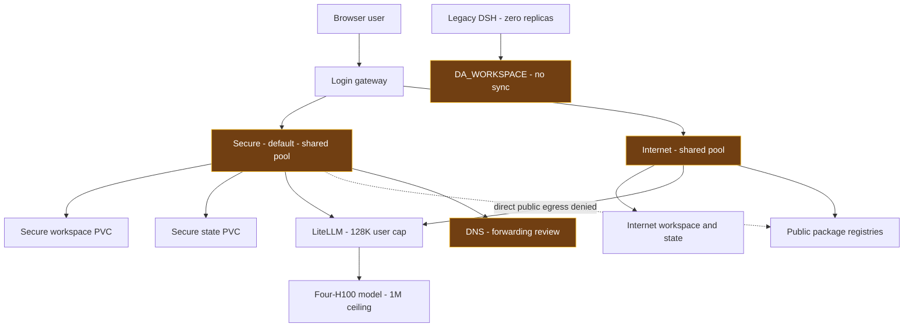
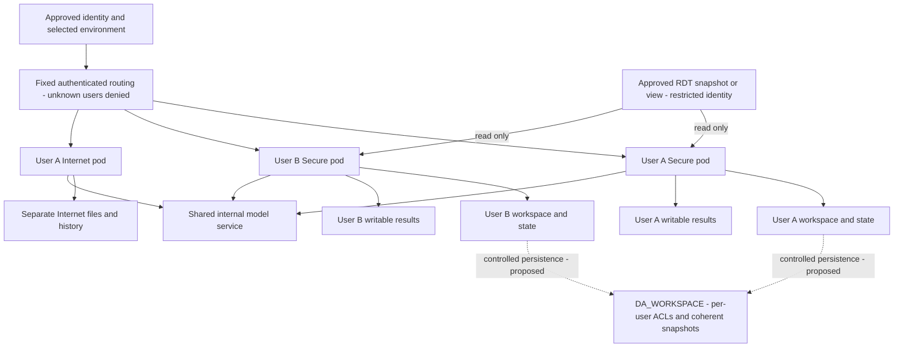
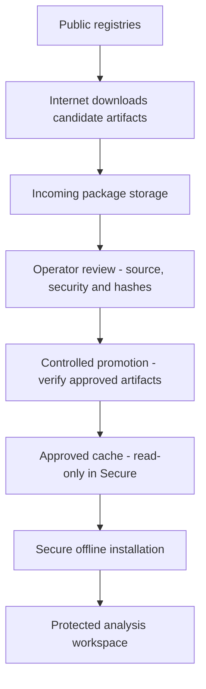

# DSH RDT Pilot — Security, Architecture and Operational Walkthrough

**Live evidence: 15 October 2026, 20:39 ICT. Runtime rollout completed; RDT security controls remain partially satisfied.**

This revision reconciles the live implementation, original design intent, deployment evidence and official upstream. The original [13:03 assessment](archive/DSH_RDT_PILOT_SECURITY_CONTROL_ASSESSMENT_1303.md) and original Desktop HTML are preserved.

## Executive summary / สรุปสำหรับผู้พิจารณา

DSH has an authenticated gateway and two execution environments. **No Internet / Internal is the default**, with restricted outbound access. Internet is separate staging for dependency preparation. Their writable files, histories, attachments and launch tokens are separated by environment. LiteLLM and the four-H100 model are shared. This constrains consequences of generated code; it does not establish that generated code is safe.

The live gateway now disables self-registration. A rejected registration left the account store unchanged. Anonymous report, proxy and session requests returned the actual login form. Secure public probes failed while internal LiteLLM remained accessible. These observations prove specific protections, not complete leakage prevention.

**Material gaps remain:** users within each pool share its process and volumes; an approved read-only RDT source/identity has not been established; new work is not synchronized to DA_WORKSPACE; and DNS/relay/export paths require further assessment. Dedicated per-user manifests and approved read-only snapshot mounts pass source tests but are not deployed. Approved pilot identities, RDT scope and ownership of legacy histories cannot be inferred.

## Current status — deployed versus prepared

| Capability | Status | Practical implication |
|---|---|---|
| Default environment | Live No Internet / Internal | Restricted egress, not a strict air gap |
| Environment separation | Live separate workspace/state PVCs | Internet does not mount Secure's protected workspace or history |
| Registration | Live disabled; POST 403 | Existing accounts are not automatically an approved pilot allow-list |
| User isolation | Tested source, not deployed | Users in the same pool are not strongly isolated |
| RDT snapshot | Generator supports read-only `/data/rdt` | Approved scope and actual access tests remain pending |
| Internal-only catalog | Live in both pools; actual catalog API inspected | Only `litellm-cluster` is routable; default DeepSeek V4.1 Flash |
| Runtime restart and persistence | Live rollout passed | Fresh/held login, logout, 80 Secure histories and content comparison verified |
| DA_WORKSPACE | Legacy mount retained; new pools use local PVCs | No ongoing central synchronization configured |
| Model backend | Configured ceiling 1,048,576 tokens | Earlier million-token test passed; new mixed scheduler has not repeated near-1M testing |
| DSH and LiteLLM | 131,072 total tokens | End-to-end DSH 1M is not enabled |

## Architecture 1 — live deployment

This depicts current shared pools. Amber nodes identify material boundaries still requiring work.

### Design intention and why two environments

The original purpose was for Internet to obtain libraries for No Internet without receiving protected data. Separating compute/network and dependency transfer does not require abandoning central durable storage. A session stays in its chosen environment. Switching requires logout/new login, with no automatic transfer of protected data or history.

A strict air gap has no live path crossing its disconnected boundary. Our runtime still communicates with the gateway, DNS, inference and storage. **Restricted egress** is the accurate term. DNS forwarding and allowed shared-service fallback can provide indirect paths, so a failed public HTTPS request alone does not close leakage risk.

## Architecture 2 — target user and data boundaries

**Target only: these private runtimes and central persistence are not deployed.** GPU sharing does not require file/history sharing.

Dedicated pods add process and mount boundaries but still share the node kernel. Generated runtimes disable service-account token mounting, run non-root, drop capabilities, disable privilege escalation, and retain network-policy labels. Tests must prove the actual CNI/storage behavior. A username directory inside a shared shell-capable process is insufficient.

`scripts/generate_user_runtimes.py` requires named users and an immutable digest. Paired `--rdt-source-pvc` and `--rdt-approval-ref` options mount a pre-existing approved snapshot read-only at `/data/rdt`, Secure only. They do not create RDT data, approve scope, or grant database authorization. A database view requires a separately restricted account. Keep results separate from source, and establish ownership before migrating shared histories.

## Architecture 3 — approved dependency transfer

Internet cannot directly install into Secure or write its workspace. Python uses no-index plus the approved wheel directory; npm uses its offline cache. Hash matching proves integrity against the approval manifest, not package safety. Operator review and controlled promotion are therefore separate steps.

## Three controls — mechanism, evidence and closure

| Control | Mechanism and location | Evidence | Remaining work |
|---|---|---|---|
| Prevent external leakage | Offline NetworkPolicy; internal model route; separate Internet storage | Secure public probes fail; internal LiteLLM works | Active catalog now internal-only; audit DNS, shared inference egress/fallback and every in-scope worker |
| Prevent damage/excessive access | UID/GID 10001; no privilege escalation; dropped capabilities; read-only scoped source | Runtime settings read back; snapshot manifest tests pass | Approved source/view and identity; actual source-write and out-of-scope-read denial; successful result writes |
| Keep results contained | Authenticated routes; private user runtimes/state; no automatic export | Live anonymous routes return login; registration denied without store change | Deploy named-user routing; cross-user file/report/history/attachment denial; inventory publishers and export credentials |

### Evidence and limits

- [Live gateway responses](context-evidence/rdt-gateway-live-20261015.json): registration 403, form/tab absent, default No Internet, unchanged account store, anonymous report/proxy/session requests return login content. This is not a cross-user authorization test.
- [18:00 outbound probes](context-evidence/rdt-egress-recheck-20261015.json): Secure GitHub/PyPI/npm/public-IP requests failed; LiteLLM returned the expected liveness body. Internet GitHub/PyPI/npm returned 200. The Internet public-IP probe also failed, so that comparator is inconclusive.
- [Candidate cluster log](context-evidence/rdt-candidate-cluster-check-62696.log): catalog, routing, spoof resistance, registration denial and stickiness tests passed with test backends. Not a live RDT user-isolation test.
- Build 62696 and the older pool images describe the pre-rollout state only. The current image/source and actual post-restart tests are recorded below and in the [20:39 live readback](context-evidence/runtime-rollout-live-20261015.json).
- No CronJobs were listed in namespace `llm` during the check. That does not rule out in-process schedulers, user scripts or other namespaces. Legacy DSH2/DSH3 must be explicitly scoped; they do not automatically inherit new-pool restrictions.

## Safe runtime rollout — actual deployed result

Build **62702**, Azure image source **`3fa74b72eaad7d7dd1e0986dd07a176f45ab2153`**, produced the immutable runtime **`sha256:96be6e7fad0a1d456484bacfed45612c3d3ba95290a9f59a03eb612d50a4efc1`**. Gateway, Secure and Internet all run that digest; running image IDs, source annotations and actual behavior were read back. All three were Ready with zero container restarts at the 20:39 ICT snapshot. The shared GPU server was unchanged by this rollout. Subsequent documentation/admin-script commits are distinct from the image's source commit.

### What changed and why

- The gateway cached a backend authentication cookie without detecting a changed launch token. A reproduced backend restart returned 401 with the old code. The cache now fingerprints the current launch token and remints stale cookies; held login sessions passed after both real runtime replacements.
- Gateway session and logout cookies now default to Secure. The login page no longer loads Google Fonts from the Internet.
- Pool startup/readiness/liveness probes call the actual application on port 3080, rather than only checking the early-opening forwarding port. Startup allows ten minutes; readiness checks every five seconds; liveness checks every fifteen seconds.
- Pool strategy is Recreate with a 120-second termination grace period, avoiding simultaneous DSH writers on one state volume. Service-account token mounting is disabled; runtime seccomp is RuntimeDefault. This deliberately creates a short per-environment interruption rather than promising zero downtime.
- Both active server catalogs expose only the internal LiteLLM provider. No upstream DSH package upgrade was performed.

### Restart and behavior evidence

| Check | Secure / No Internet | Internet |
|---|---|---|
| Fresh login and authenticated UI | 302 then actual UI 200; logout button present | Same |
| Existing login held across backend restart | Authenticated UI 200 | Authenticated UI 200 |
| Logout and replay of old cookie | Login form returned; session invalidated | Same |
| Actual session-list API | 80 saved histories listed after restart | 0 histories before and after; no real history corpus to validate |
| Content retained after replacement | 2,732 regular files / 6,632,175,696 original bytes; zero failures | 2 controlled workspace/state markers / 176 bytes; zero failures |
| Internal inference | Exact `RUNTIME_ROLLOUT_OK`, normal stop | Same |
| Public GitHub, PyPI and npm HTTPS | All timed out, HTTP 000 | All returned HTTP 200 |
| Terminal route | Actual terminal HTTP page rendered | Same; interactive commands/WebSocket not retested |
| Live catalog API | Only `litellm-cluster`; DeepSeek default | Same |

Secure's file count comprises 2,648 workspace and 84 state regular files. The post-restart state comparison covers sessions/attachments, excluding locks, derived indexes, symlinks and hardlink aliases. Stopped-state tar comparison separately checked the coherent archives against the stopped source. No append-only growth was observed. These checks establish restart persistence of the checked content, not a complete disaster-recovery restore.

The temporary random-password test account was removed, other accounts were checked unchanged, held test sessions were logged out, and only the controlled Internet markers were removed. No real passwords or user content are published in the evidence.

### Rollback preparation and operational experience

Each writer was stopped before archive creation and source comparison. Secure's snapshot ran approximately 20:20–20:25 ICT; Internet's stop/archive/restart completed approximately 20:34:11–20:34:43 ICT. Original deployment specifications remain in `C:/Users/skunpojt/rollback-runtime-hardening-20261015`. Coherent archive PVCs are `dsh-snapshot-secure-20261015132020` and `dsh-snapshot-internet-20261015133411`.

Initial post-restart comparison workers failed at CSI read-only mount setup and SELinux relabeling; they did not report a content mismatch. Verification was corrected to use an archive-only worker to derive hashes and compare them inside the runtime's existing mounts. No second verifier pod mounts live state. Trusted archive workers use ordinary mounts because the local CSI driver's mount handling failed with read-only requests; their fixed maintenance code reads source/archive data only. This is different from an enforced read-only RDT source mount.

No application regression was detected in the exercised checks, so no application-image rollback was invoked. The rollout helper restores the original deployment specification on failure and verifies a responding application; it does not overwrite current data from an archive. Mocked failure-path tests verify exact specification restoration after snapshot failure and refusal to overwrite an existing rollback point. Intentional live rollback and full archive restoration were not exercised. **These snapshots are local to the single node, not DA_WORKSPACE or a central backup.** Preserve them until a separately verified recovery copy exists.

Reproducible operator tools: `scripts/rollout_runtime_hardening.py`, `scripts/verify_runtime_persistence.py` and `scripts/runtime_rollout_probe.js`. They are administrator-run maintenance tools, not user-facing features. The probe creates a temporary account only for the test and requires cleanup. Do not run account provisioning concurrently with this maintenance probe. Review the target, immutable digest, state ownership and rollback directory before any repeat rollout. Do not rerun a disruptive rollout simply to recheck status.

## DA_WORKSPACE — what changed and correction design

| Time, ICT | Change |
|---|---|
| 15 October 09:09 — `e73a69f` | Initial Secure pool still mounted DA_WORKSPACE |
| 10:21 — `9c3b571` | Recorded non-root CIFS ownership/write failures led to replacing its share with local PVCs |
| 11:18 — `107e876` | Added the omitted history copy into `/state` |
| 11:30:53 | One-time migration completed; no continuing central sync was established |

The implementation solved ownership/isolation by changing the storage backend but failed to preserve central persistence. Earlier README statements about automatic CIFS flush and zero data loss do not describe the new pools and are withdrawn. Local PVCs persist ordinary pod replacement; they do not themselves establish central backup or node-loss recovery.

**Correction:** inventory and reconcile newer local files against the legacy share; preserve both copies and a conflict manifest. Keep live databases/locks on suitable local persistent storage. Restore controlled DA_WORKSPACE persistence using dedicated credentials, per-user/environment ACLs, coherent database backups or quiesced state snapshots, versioned destinations and a tested restore. Do not blindly remount the old share or copy changing SQLite/LevelDB files as a backup. This runtime rollout retained the existing PVCs and created local coherent archives; no central-storage cutover or user-data deletion was performed.

## Walkthrough — login to a contained result

1. **Authenticate:** default No Internet; registration closed. Approved pilot membership still needs owner-confirmed provisioning.
2. **Route:** login sticks to one environment. Target design selects a private backend from authenticated identity, never client-supplied host headers/URLs.
3. **Execute:** tools/generated code run in the selected runtime. Network, privilege and data ACLs constrain it; prompts are not containment.
4. **Access data:** read only the approved source; write results separately. The present shared pools do not yet satisfy this RDT-specific rule.
5. **Infer:** call internal LiteLLM then the shared GPU model. DSH currently has a 128K budget.
6. **Present:** serve reports through authenticated routes. Test HTTP, WebSocket, terminal, file access and authenticated cross-user denial.
7. **Persist:** retain private state, test restart and restore, and restore a controlled central persistence path before claiming DA_WORKSPACE durability.
8. **Switch:** logout/new environment-bound login; do not copy protected files, history or credentials automatically into Internet.

## Model speed, responsiveness and context

An earlier 1,000,015-input-token backend request passed with memory fraction 0.90, prefill chunk 1,024 and maximum prefill 2,048. An earlier 0.92 profile failed around 262K with CUDA OOM: KV slots alone omit temporary workspace requirements.

The newer scheduler interleaves prefill/decode and reserves bounded capacity for small requests. During controlled approximately 133K long requests, fresh short requests completed in 0.59–1.04 seconds and cached 24K sessions in 0.86–1.47 seconds, before the long request finished. Baseline short requests waited about 32–34 seconds; long completion changed from about 36 to 39–40 seconds. These are synthetic observations, not sustained tokens/sec or a latency SLA.

DSH/LiteLLM remain at 131,072 total tokens, an 8,192 output ceiling and compaction near 98,304. End-to-end 1M requires aligned profiles/admission/compaction and actual streaming/tool/mixed-load tests on the revised scheduler. See [trial matrix](CONTEXT_OPTIMIZATION_20261015.md) and [scheduling evidence](SCHEDULING_FAIRNESS_20261015.md).

## Official upstream comparison

Fresh official Git inspection: master `571902028a75c64c1d767f4ae5fd099485f0ddf0`; newer inspected tag `dsh-v0.2.1-alpha.3` at `2fbf4359b82fb94c03dcce0b831660d87f12ea5c`. Our installed package remains `0.2.0-rc.2`. This is a source/document comparison, not an upstream upgrade or full feature test.

| Feature/concern | Official evidence | Enterprise implementation and impact |
|---|---|---|
| Extensibility | Cordis plugins and ordered profiles/patches | Gateway and package overlays; prefer supported extensions over fragile text replacement |
| Web tasks | Workspaces, file read/edit, commands, plans and delegation | Core behavior inherited; not every feature was freshly retested |
| Model setup | Editable providers and custom compatible endpoints | Pilot catalogs restrict selection to internal LiteLLM; retain infrastructure enforcement |
| Public access | Launch token, signed cookie, trusted authority and reverse-proxy guidance | Additional username login, environment routing and logout; not corporate SSO |
| Host/origin trust | Official host fence admits configured authorities | Legacy overlay makes `isLoopbackHostname` always true; needs dedicated origin/Host review, not automatic carry-forward |
| Public URL | Supported `--public-url` | Prefer it over hardcoded URL prompt patches after compatibility testing |
| Credential priority | Newer stored credentials precede environment fallback | Inspect names/presence without exposing values; mounted credentials can change request identity |
| Session persistence | Released Session V4 record identifies rc.2 | Test old sessions/attachments and rollback against a copied state snapshot |
| Missing images | Our patch substitutes a 1x1 placeholder for certain missing objects | Avoids a failure but does not restore original evidence; label missing content and review patch retirement |
| Network/data isolation | Safety guidance calls for least privilege and separate execution environments | Kubernetes policies, RDT ACLs and private volumes are deployment responsibilities |
| Durable storage | Harness home/session state are product data | Central DA_WORKSPACE persistence and restore are our operational responsibilities |

The localhost-helper override is a client-side compatibility patch. Its presence does not by itself prove that the server-side Host fence is disabled or that an exploit exists; the candidate Host/Origin tests must establish actual behavior.

Official DSH is developer-preview software. Its safety notice identifies risks from generated commands, plugins and accessible data/credentials, recommends least privilege and separate execution environments, and does not establish the harness as a sole security boundary. Our objective remains an acceptable, bounded pilot.

### Sources inspected

All links are pinned to the inspected official commit:

- [README](https://github.com/deepseek-ai/deepseek-harness/blob/571902028a75c64c1d767f4ae5fd099485f0ddf0/README.md)
- [Architecture and plugin composition](https://github.com/deepseek-ai/deepseek-harness/blob/571902028a75c64c1d767f4ae5fd099485f0ddf0/docs/architecture.md)
- [Web tasks](https://github.com/deepseek-ai/deepseek-harness/blob/571902028a75c64c1d767f4ae5fd099485f0ddf0/docs/user/guide/index.md)
- [Providers](https://github.com/deepseek-ai/deepseek-harness/blob/571902028a75c64c1d767f4ae5fd099485f0ddf0/docs/user/guide/providers.md)
- [Public deployment](https://github.com/deepseek-ai/deepseek-harness/blob/571902028a75c64c1d767f4ae5fd099485f0ddf0/docs/user/guide/public-deployments.md)
- [Credential migration](https://github.com/deepseek-ai/deepseek-harness/blob/571902028a75c64c1d767f4ae5fd099485f0ddf0/docs/upgrade-guide/v0.2.1-alpha.2/stored-credentials-precedence/guide.md)
- [Session format](https://github.com/deepseek-ai/deepseek-harness/blob/571902028a75c64c1d767f4ae5fd099485f0ddf0/docs/session-format-status.md)
- [Safety](https://github.com/deepseek-ai/deepseek-harness/blob/571902028a75c64c1d767f4ae5fd099485f0ddf0/SAFETY.md)

### Upgrade gate

Pin the next release/image; inventory every patched module and expected source/hash. Restore copied state into an isolated candidate. Inspect effective profiles/credential precedence and test auth, Host/Origin denial, WebSockets, terminal, tools, existing sessions, attachments, compaction, egress, user boundaries, restart and restore. Fail loudly on changed patch targets. Preserve the old image/state and test rollback. Do not automatically merge upstream into Production.

## Closure plan and accountable owners

| Action | Owner | Required proof |
|---|---|---|
| Pilot users and exact RDT scope | Data owner | Approved identities, snapshot/view, permitted fields/rows, retention and outputs |
| Legacy ownership mapping | Owner/operator | No indiscriminate history copying to every identity |
| Deploy private runtimes | Platform operator | A cannot access B through files, reports, history, attachments, API, terminal or WebSocket |
| Read-only source/result separation | Data/platform owner | Source-write and out-of-scope-read attempts fail; result writes succeed |
| Network/export completion | Platform/security owner | DNS/relay/fallback/export tests for all pilot workers |
| Central persistence restoration | Storage/platform owner | Reconciliation, ACLs, coherent snapshot and successful restore |
| Future overlay/upstream upgrade | Application operator | Repeat installed-content and affected-behavior tests; current internal-only catalog rollout is verified |
| Residual-risk acceptance | Assessor/owner | Evidence review distinct from code completion |

**Pending owner inputs remain the approved pilot usernames and exact RDT source/view**, with history ownership resolved before migration. Technical work can proceed independently, but these permissions and business decisions cannot be invented. All three controls remain partially satisfied until deployed acceptance tests pass.

## Diagram renderer and evidence boundary

The HTML embeds Mermaid 10.8.0 and svg-pan-zoom 3.6.1, reusing SMP EDA's diagram controls: zoom, reset, fullscreen, SVG/PNG export and source copy. It requires no CDN connection. Export coordinates are reset on a cloned SVG so zooming does not crop the saved diagram. Target diagrams are design illustrations, not deployment screenshots. The original HTML and Markdown are preserved.

### Verification of this document

The generated HTML was tested in headless Microsoft Edge: three diagrams rendered, no external resource requests or page errors occurred, and zoom/reset/fullscreen/source-copy/SVG/PNG export passed. Rendered screenshots were visually inspected. These checks verify the document controls, not every deployed DSH feature. See [document QA record](context-evidence/html-verification-20261015.json).
