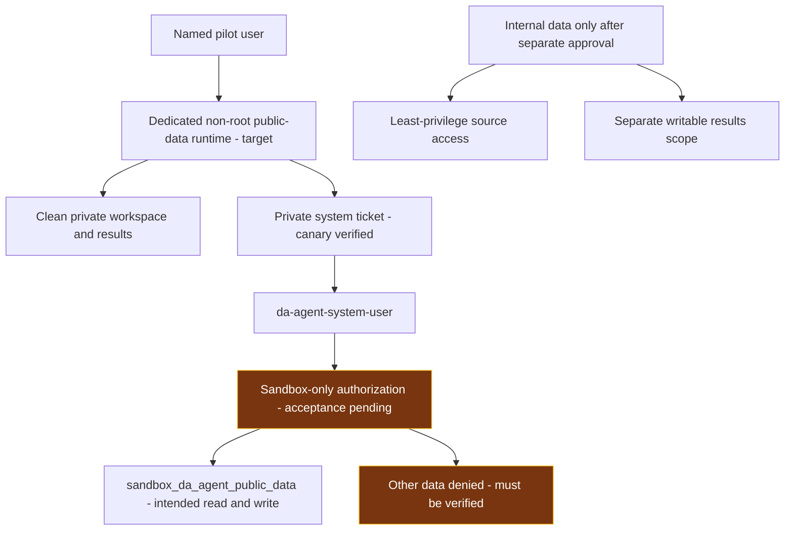
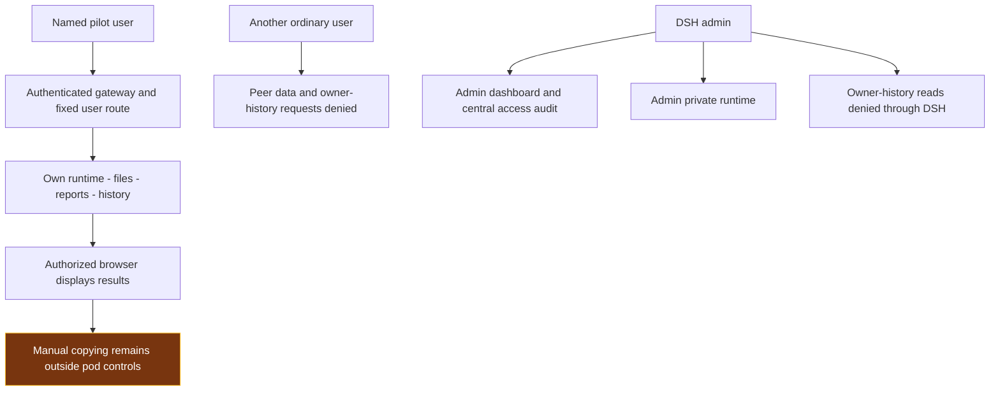

# DSH Pilot — Controlling Data Leakage, Source Damage and Result Exposure

The pilot assumes that the Harness, its tools and generated code can make mistakes or act beyond the intended task. Its protection therefore comes from network boundaries, execution identities, data permissions, private storage and authenticated access—not prompt instructions alone.

**The objective is to limit what can go wrong enough to make this specific pilot acceptable. It is not to prove that the Harness is universally safe.**

This report follows the three controls in the supplied pilot brief. It explains which environment to use, how each protection works, what the recorded tests establish and what still needs a decision or additional enforcement. The main DSH environment has deployed protections. The newly clarified pilot is **public-data-only**, using a dedicated system identity limited to one sandbox. System-account Kerberos authentication and identity propagation through Livy/Spark are now verified in an isolated temporary canary. The scoped pilot is not yet qualified: the exact sandbox was not visible under that identity, exclusive sandbox permissions are unverified, and its remote driver/executor still reached public TCP destinations.

**Main DSH model status:** DSH, LiteLLM and SGLang now declare **1,048,576 total tokens**, with output capped at 8,192. The final cold DSH reply at 1,007,689 input tokens passed with zero retries, followed by a real write/read workflow at 1,008,103 input tokens; ordinary work remains concurrent while one >128K request is admitted at a time. The earlier timeout retries were corrected and the final real test passed. Recovering GPU allocation warnings show that memory margin remains thin. Full configuration, speeds, final acceptance and limits are in the [embedded LLM guide](#embedded-llm-guide). Context capacity does not imply closure of the security risks below.

## Pilot boundary and environment choice

The managed-tools rollout adds Claude Code and TrueForge to the 20 main private runtimes. Operator-owned model settings and scoped credentials keep their configured inference on internal LiteLLM. Actual client calls and configuration refusals passed; the existing 1M DSH profiles and model pod were preserved. Claude defaults to 200K; an explicit 1M selection passed a short call but is not near-1M client acceptance. TrueForge's separate code sandbox is not enabled. These additions do not close the remote Spark or datalake authorization gaps below. See [managed-tool acceptance](MANAGED_CLAUDE_AND_TRUEFORGE.md).

### Public-data pilot and execution identity

The pilot described in the supplied operating plan uses **`da-agent-system-user`**, with read/write access only to **`sandbox_da_agent_public_data`**. Personal AD rights remain unchanged outside the pilot, but personal credentials are not the intended agent identity for this exercise. People still use named DSH logins for private workspaces and audit; the system account is the datalake execution identity, not a shared DSH web login. Only public data is permitted initially; use of internal BOT data requires a later internal approval decision. Read/write access to the disposable public sandbox is deliberate and must not be confused with unrestricted access to internal source data.

| Pilot condition | Current evidence and limit |
|---|---|
| Dedicated system account | A fresh private Kerberos login passed. Livy owner and Spark execution user both matched `da-agent-system-user` in synthetic session 630. The temporary ticket cache was isolated from existing users; no password was written to reports or Git. |
| Exactly one public-data sandbox | The exact name was not visible through the system account on the Hive catalog using `hdfs://botdlk-da`. This is not proof of nonexistence; creation, catalog/path or permissions may differ. The data owner must confirm the approved target and grants before read/write or exclusivity acceptance. |
| Local execution without Internet | Main No Internet pod probes passed. Fresh system-account Spark driver and executor probes reached `github.com:443` and `1.1.1.1:443`; public DNS TCP/53 timed out. The end-to-end offline requirement remains unmet. |
| Clear software/data terms | The running Harness package reports MIT, consistent with the [official license](https://github.com/deepseek-ai/deepseek-harness/blob/86a402200d95fecef4529d969836f1fe13c6cb0d/LICENSE). This does not clear model weights, dependencies, connected services or dataset reuse terms, and is not legal/committee approval. |
| DA cluster resource monitoring | The DA ResourceManager API returned validated memory, vCore-allocation, container/node and running-application metrics. Pilot queue limits, alerts, retention and human-to-job correlation were not established. The DSH dashboard is not a substitute for this monitoring. |

Use a **dedicated pilot runtime with a clean workspace/history and credential cache**, retaining central CIFS persistence through bounded pilot subpaths. A new working directory alone does not restrict access to legacy data already mounted in a process. Do not mount the broad legacy workspace or introduce internal datasets into this public-data exercise. Keep each human's workspace isolated even if the data-access principal is shared; correlate gateway user, runtime, Livy session and Spark application in the pilot audit design.

The approval/creation workflow in the plan is still required: data-owner approval, creation through the sandbox system, and granting this principal the intended sandbox role. Account existence alone proves none of those steps. Prepare the internal-review package in parallel, with verified facts and open conditions clearly labelled; do not describe preparation as approval to use internal data.

**Fresh system-account test:** metadata only; no source data was queried or modified and no permission was changed. The test-created Livy session was deleted and its absence verified. Its private ticket was destroyed and the temporary runtime removed. This verifies that identity, not every user's entitlements. See [system-account result](context-evidence/public-pilot-system-account-live-20261016.json) and [credential/runtime cleanup](context-evidence/public-pilot-system-account-cleanup-20261016.json).

Evidence: [AD account lookup](context-evidence/public-pilot-system-account-directory-20261016.json), [authentication availability](context-evidence/public-pilot-auth-availability-20261016.json), [sandbox metadata check](context-evidence/public-pilot-sandbox-metadata-20261016.json), [DA metrics](context-evidence/public-pilot-da-resource-metrics-20261016.json), [license check scope](context-evidence/public-pilot-license-review-20261016.json).

An analyst defines a DQ hypothesis and the permitted data scope. The agent can prepare Python or Spark code, execute it under the available identity and produce reports in that user's working area. The controls below must constrain those actions even when the generated code is wrong.

| Environment | Intended use | What it can reach and store |
|---|---|---|
| **No Internet / Internal — default** | Public-data pilot after scope validation; internal data requires separate approval | Dedicated user workspace, history and credential state; internal inference, restricted DNS, Kerberos and the permitted Livy endpoint. Representative direct public connections are blocked. |
| **Internet** | Obtain libraries and prepare dependency artifacts | Separate workspace/history and package incoming area. It does not mount the protected No Internet workspace. Tested datalake/KDC destinations are denied. |
| **Remote Livy/Spark compute** | Execute distributed analysis under the authenticated principal | A separate execution boundary in the datalake platform. DSH pod policies do not govern its driver or executors. Public TCP connectivity was observed there. |

The two DSH environments share the internal inference service and authentication gateway, **not writable project data, conversation history or credentials**. Switching environments requires logout and a new login. This is restricted egress, not a strict air gap: the default environment still needs approved internal connections.

Only reviewed dependency artifacts should move from Internet staging to the No Internet package cache. Sensitive prompts, datasets, reports and credentials are not part of that transfer workflow. Existing users' AD/datalake permissions remain unchanged outside the scoped pilot. The public-data exercise must use its dedicated sandbox-limited principal; selecting an environment alone neither imposes that identity nor grants a data entitlement.

## 1 Prevent external leakage

**Risk:** the Harness or generated code could transmit RDT, prompts, credentials or results to an external destination. The network control must cover every place the code executes, including remote workers.

### What enforces the boundary

The default DSH runtime is selected by the authenticated gateway and placed under a Kubernetes egress policy. That policy permits only the required internal destinations: the internal model gateway, restricted DNS, Kerberos and the allowed Livy connection. The DNS relay accepts the required internal names and rejects public/encoded test names locally. Direct public DNS and direct CoreDNS bypass probes are denied.

Model requests use internal LiteLLM and inference-only credentials. The [mounted configuration readback](context-evidence/pilot-model-route-config-20261016.json) found 22 model entries using internal service hosts and no explicit fallback settings in the checked configuration scopes. Recorded tests denied model/key administration and a client-selected API-base override. External provider fallback must remain disabled for the pilot; this static-file check does not audit every dynamic model entry, plugin or client. These controls constrain the approved inference path, not every possible relay through an allowed internal service.

The Internet environment is separate compute and storage. It can download packages into an incoming area, but cannot install directly into the protected workspace or modify the approved cache. An operator reviews artifacts and their hashes; the promotion helper verifies the exact bytes and publishes them to a cache that No Internet mounts read-only. Hash verification proves integrity, not that a package is harmless.

### What is verified and what remains

| Recorded observation | Meaning for the risk |
|---|---|
| Public-domain, direct-IP and DNS-bypass probes failed from the tested No Internet workers; internal inference returned the required response | The tested local pod boundary works for those destinations. This is not an exhaustive proxy/IPv6/relay assessment. |
| Internet workers reached package sites but failed the tested KDC, Livy and unrelated internal-service connections | Dependency preparation is separated from the tested internal data-access paths. |
| A package was downloaded, hash-promoted, installed without an index and imported inside No Internet; cache writes were denied | The intended library-transfer path works without sharing writable workspaces. |
| The authenticated system-account Spark driver **and executor** reached `github.com:443` and `1.1.1.1:443` | **The end-to-end Internet-denial requirement is not met.** Blocking Internet only in DSH does not contain code sent to remote Spark. |

The user previously chose to keep Livy/Spark available in the general platform with this documented exposure. That accepted operational exception does not qualify the newly clarified offline public-data pilot and is not a repaired firewall. No RDT was read or transmitted by the recorded connectivity tests.

**To meet the original requirement:** the datalake infrastructure owner must enforce restricted egress for the actual Spark drivers/executors and retain only their necessary internal services. Acceptance must test outbound paths from each relevant execution mode, including direct IP, DNS, configured proxies and IPv6 where enabled. If that enforcement cannot be provided, sensitive remote execution needs an explicit risk decision or a restriction on its use. This report does not silently disable the retained Livy service.

Evidence: [local boundaries](context-evidence/design-consistency-live-20261016.json), [new admin runtimes](context-evidence/admin-private-network-20261016.json), [offline package workflow](context-evidence/package-workflow-live-20261016.json), [earlier personal-account Spark retest](context-evidence/remote-spark-recheck-20261016.json), [fresh system-account driver/executor retest](context-evidence/public-pilot-system-account-live-20261016.json).

## 2 Prevent damage or excessive access

**Risk:** generated code could modify source data, delete writable content or reach unrelated resources. Denying Internet access does not prevent those actions inside an authorized internal system.

### What enforces the boundary

Each main DSH user has a dedicated execution environment for each network mode. The runtime uses UID/GID 10001, disables privilege escalation, drops Linux capabilities, uses RuntimeDefault seccomp and does not mount a Kubernetes service-account token. Separate workspace, session, attachment and credential mounts prevent an ordinary user from obtaining another user's files through a shared process or filesystem. Resource limits constrain the local runtime; remote Spark resources and permissions remain a datalake responsibility.

Projects and results belong in the user's working area. No Internet durable files/history use the mounted DA_WORKSPACE CIFS storage with bounded user paths; Internet staging uses separate storage. The approved package cache is read-only. **DA_WORKSPACE is persistence, not the source of RDT authorization and not an independent backup.**

RDT access follows the authenticated AD principal through Kerberos and Livy/Spark to the applicable Hive/HDFS permissions. A local DSH login is a separate identity. The personal Kerberos retest found the required service ticket and confirmed that Livy's owner matched Spark's execution user; it did not establish read-only access to an unspecified table or path.

### Source protection in the public-data pilot and later internal use

| Source-protection condition | Current position |
|---|---|
| Dedicated non-admin execution | Implemented for main private DSH runtimes; DSH2/DSH3 still need migration. |
| Public sandbox read/write, no unrelated data access | Intended for `da-agent-system-user`; authentication and Livy/Spark identity propagation are verified; its sandbox-only effective rights are not accepted, and the target was not visible in the checked catalog. |
| Internal source protection | Internal data is outside this initial pilot. Later use requires approval and an explicit source/results permission design; do not silently inherit broad personal rights into the pilot. |
| Results confined to approved storage | DSH provides isolated working areas. Datalake writes must also stay within the approved public sandbox/results scope. |

**To qualify this pilot:** confirm the sandbox creation/catalog/path and effective Hive/HDFS and sandbox-application grants for the now-tested system identity, and test permitted sandbox reads/writes on disposable public fixtures. The data owner must also provide a safe out-of-scope test target whose access is denied. Do not use genuine internal records for that negative test or assume that one visible database proves exclusivity. Keep a recoverable reference copy of public test inputs so generated transformations do not destroy the experiment's baseline.

Public-sandbox administration must not confer broader datalake administration. The system principal's credentials must stay out of the Internet environment. A shared service identity also needs human-to-job audit correlation; the current identity-propagation tests alone do not establish that correlation for all pilot users.

If internal RDT is approved later, establish least-privilege source access—read-only where required—and a separate writable result scope. A view alone is insufficient if execution can bypass it with broader credentials. None of these permissions or approvals is granted by this report.

Evidence: [private routing and audit checks](context-evidence/owner-admin-snapshot-live-20261016.json), [identity propagation](context-evidence/remote-spark-recheck-20261016.json), [Kerberos ticket-presence check](context-evidence/kerberos-personal-ticket-check-20261016.json).

## 3 Keep results contained

**Risk:** reports, logs, attachments or temporary files could expose RDT to another person, or be published/exported outside the approved pilot.

### What enforces the boundary

The main gateway admits provisioned local accounts and disables self-registration. It selects the user's fixed runtime; a URL, form field or forged identity header cannot select another user's backend. Application, report and terminal traffic pass through authenticated routes. Login sessions stay in one environment, and logout revokes the gateway session.

Workspaces, histories, attachments and credentials are private to the user and environment. Existing legacy content remains with its confirmed owner, `thanatcc`. Admin uses fresh private runtimes and cannot read those owner histories through DSH. The owner runtime masks the reviewed peer-data subtree, old authentication/credential aliases and recovery paths. Host, cluster and storage administrators remain a privileged trust boundary.

Central dashboard access is admin-only. The central access audit records time, event, user and environment—not passwords, Kerberos tickets, prompts or conversation bodies. Audit storage is outside the execution workspaces. It supports accountability, but is not a full command transcript or a tamper-proof external SIEM.

### What is verified and what remains

Recorded checks verified owner-history access, denial to other users including admin, non-admin denial of the dashboard/API and rejection of forged-role attempts. Real authenticated terminal WebSockets executed non-root commands in both owner and admin environments. Workspace/attachment markers survived replacement of the new admin runtime processes. The earlier isolated two-user acceptance also exercised synthetic report, attachment and session boundaries.

These checks establish the tested access paths. They do not certify every historical tool action, plugin or generated application. Pilot reports must remain behind the authenticated gateway; any publication or export must be separately authorized rather than treated as an automatic outcome of analysis.

**Browser boundary:** a person authorized to see a result can still copy, download, photograph or manually share it. Pod egress policies do not govern that person's device. If the pilot requires prevention of those actions, the endpoint owner must add managed-browser/VDI/DLP controls and verify the intended restrictions. This report does not claim those controls are deployed, and it does not disable useful downloads while presenting that as complete data-loss prevention.

**Legacy boundary:** DSH2 and DSH3 are not yet equivalent to the main deployment. They still run as root with a service-account token and three local accounts sharing each process. Basic anonymous/login/logout route checks passed, but that is not user isolation. Migration requires the pending decision on their history owners and reconciliation of live profiles/root working directories before restart. Their original data remains preserved.

Evidence: [owner/peer access](context-evidence/legacy-owner-restoration-live-20261016.json), [real terminal checks](context-evidence/owner-admin-terminal-live-20261016.json), [restart persistence](context-evidence/admin-private-persistence-20261016.json), [legacy response-content review](context-evidence/legacy-auth-content-review-20261016.json).

## Acceptance and remaining decisions

| Control | Current disposition | What is needed to satisfy the original brief |
|---|---|---|
| Prevent external leakage | Local No Internet controls verified; fresh system-account Spark driver/executor Internet access is confirmed | Infrastructure owner restricts the actual pilot driver/executor egress and repeats the probes; the earlier general-platform exception is not offline pilot acceptance. |
| Prevent damage or excessive access | Main runtime isolation and system-account authentication/identity verified; exclusive public-sandbox scope not accepted | Confirm the approved sandbox catalog/path and grants, validate read/write and safe out-of-scope denial, and keep internal data out until separately approved. |
| Keep results contained | Main authenticated routes, private data boundaries and central audit verified | Finish legacy-instance migration; define report/export handling and add endpoint controls if manual-copy prevention is required. |

The environment choice, data scope and named participants should be recorded for each pilot exercise. Infrastructure owners own network enforcement; data owners own entitlements; the DSH operator owns runtime/routing/persistence; endpoint owners own device restrictions; the pilot owner decides whether residual exposure is acceptable. An accepted exception must not be labelled a technical fix.

**Context and performance:** the main route now uses 1,048,576 total tokens, output capped at 8,192. The final cold DSH test passed at 1,007,689 input tokens in 19m30s, with zero retries and unchanged model process. A write/read tool continuation at 1,008,103 input tokens passed in 20.16s. Ordinary replies during long work took about 4–8 seconds across the recorded samples, and output throughput under long load was lower than short-only throughput. Recovering GPU allocation warnings left as little as 9.75 MiB reported free during mapping attempts. The embedded guide contains the measurements, rollback and limits; these context tests do not close the separate security risks.

The evidence linked here records specific checks on 16 October 2026. Opening or regenerating this HTML does not run new security tests or grant access to data. Detailed migration histories, raw logs, model trials and setup instructions are supporting material, not the main risk-control narrative.
