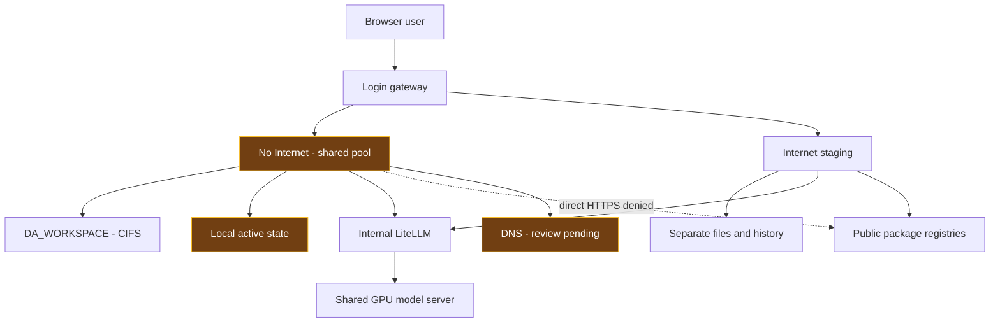
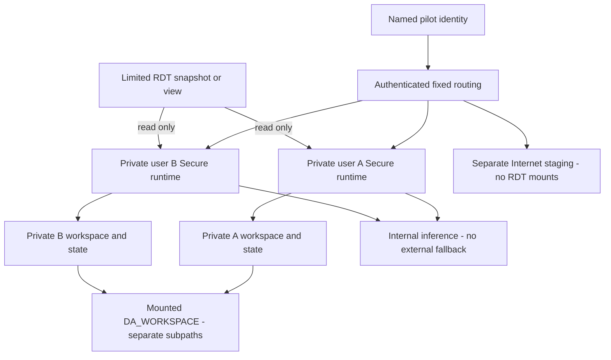
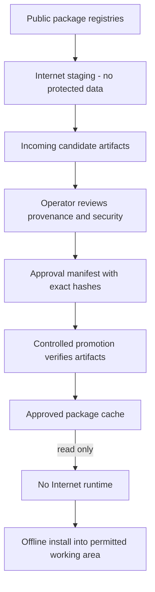

# DSH RDT Pilot — การควบคุมความเสี่ยงและแนวทางดำเนินงาน

**สถานะตามหลักฐานวันที่ 15 ตุลาคม 2569: ควบคุมได้บางส่วน ยังไม่ครบเงื่อนไขปิดทั้ง 3 ความเสี่ยง**

รายงานนี้สังเคราะห์หลักฐาน runtime rollout เวลา 20:39 น. ICT ผลตรวจย้อนหลังจาก raw transcript และผลทดสอบ CIFS ที่บันทึกภายหลังในวันเดียวกัน ผลเพิ่มเติมเวลา 21:32 น. ICT เป็นการคืน mount CIFS และทดสอบ Production จริงตาม record ที่แนบ ส่วนการเรียบเรียงรายงานความเสี่ยงก่อนหน้านี้ไม่ได้เป็นการทดสอบ Production รอบใหม่ ข้อความว่า “ใช้งานจริง” จึงอ้างถึง snapshot ที่ระบุไว้ ไม่ใช่สถานะที่ตรวจใหม่ทุกครั้งเมื่อเปิด HTML

## 1 เป้าหมายและข้อสรุปสำหรับผู้พิจารณา

การทดลองใช้ DSH กับ RDT ต้องเริ่มจากสมมติฐานว่า Harness, เครื่องมือที่เรียกใช้ และโค้ดที่ AI สร้างขึ้นอาจทำงานผิดพลาดหรือใช้สิทธิ์เกินความจำเป็นได้ จึงต้องจำกัดสิ่งที่ระบบเข้าถึงและผลกระทบที่เกิดขึ้นด้วยการควบคุมภายนอกตัว AI ไม่อาศัยเพียงคำสั่งใน prompt หรือความสามารถของโมเดลในการปฏิเสธงาน

**เป้าหมายคือจำกัดความเสียหายที่อาจเกิดขึ้นให้อยู่ในขอบเขตที่ยอมรับได้สำหรับ pilot นี้** โดยควบคุมสามเรื่องต่อเนื่องกัน: ไม่ให้ข้อมูลออกภายนอก ไม่ให้แก้ไขหรือเข้าถึงข้อมูลเกินขอบเขต และไม่ให้ผลลัพธ์เปิดเผยแก่ผู้ไม่มีสิทธิ์ การผ่านเรื่องใดเรื่องหนึ่งไม่ทดแทนอีกสองเรื่อง เช่น ปิด Internet แล้วก็ยังลบข้อมูลภายในได้ หากสิทธิ์ของแหล่งข้อมูลยังกว้างเกินไป

ปัจจุบันมี gateway สำหรับยืนยันตัวตน มี No Internet / Internal เป็นค่าเริ่มต้น และมี Internet environment แยกสำหรับเตรียม dependencies มีการทดสอบว่า Secure ติดต่อ public HTTPS ที่เลือกไม่ได้ แต่เรียกโมเดลภายในได้ อย่างไรก็ดี ผู้ใช้ใน environment เดียวกันยังใช้ process และ volumes ร่วมกัน ยังไม่มีหลักฐานการใช้ RDT snapshot/view แบบจำกัดสิทธิ์จริง ส่วน Secure workspace คืน mount DA_WORKSPACE แล้วตามผลตรวจเพิ่มเติมเวลา 21:32 น. ICT แต่ per-user isolation และ continuous central-state synchronization ยังไม่ครบ จึงยังสรุปว่าปิดความเสี่ยงครบไม่ได้

| ความเสี่ยง | สิ่งที่ต้องบังคับ | ข้อสรุปตามหลักฐาน |
|---|---|---|
| 1 ข้อมูลรั่วไหลภายนอก | ปิด outbound ของทุก runtime ที่แตะ RDT อนุญาตเฉพาะ internal services ที่จำเป็น และไม่มี external fallback | มีหลักฐาน direct HTTPS ถูกบล็อกใน Secure; DNS, relay, fallback และ workers อื่นยังตรวจไม่ครบ |
| 2 ข้อมูลเสียหายหรือเข้าถึงเกินสิทธิ์ | non-admin identity, แหล่ง RDT ที่จำกัดขอบเขตและ read-only, พื้นที่เขียนผลแยกต่างหาก | runtime ลดสิทธิ์แล้ว; ยังไม่ผ่าน negative tests กับแหล่ง RDT จริง |
| 3 ผลลัพธ์เปิดเผยภายใน | named pilot users, authentication และ authorization ครอบคลุมไฟล์ รายงาน sessions และ tools | login/logout และ anonymous denial ผ่าน; ยังไม่พิสูจน์ cross-user isolation ใน Production |

## 2 ระบบที่มีอยู่และขอบเขตที่ต้องคุม

ผู้ใช้เข้า gateway แล้วเลือก execution environment ซึ่งผูกกับ login session นั้น งาน shell, terminal และโค้ดที่สร้างขึ้นทำงานใน runtime ที่ถูกเลือก ส่วนการเรียกโมเดลใช้ LiteLLM และ GPU server ร่วมกัน การแชร์ inference ไม่จำเป็นต้องแชร์ workspace หรือ chat history และไม่ได้ทำให้สิทธิ์การเข้าถึงไฟล์แยกจากกันโดยอัตโนมัติ

Diagram นี้แสดง **shared pools ตามหลักฐานที่ใช้งานจริง** ไม่ใช่ภาพที่อ้างว่ามี per-user isolation แล้ว เส้นประไปยัง public services หมายถึงการเชื่อมต่อโดยตรงที่ถูกปฏิเสธในการทดสอบ จุดสีเหลืองยังมีข้อจำกัดต้องปิดเพิ่มเติม

ต้องจัดทำรายการ runtime ที่อยู่ใน pilot ให้ครบ ไม่ใช่ตรวจเฉพาะหน้าเว็บ DSH: รวม Harness, shell/subprocesses, workers ที่ประมวลผลข้อมูล, report server และ services ที่รับ prompt หรือผลลัพธ์ด้วย DSH2/DSH3 เดิมมี configuration ต่างจาก pools ใหม่ จึงห้ามถือว่าได้รับการคุ้มครองเหมือนกันโดยไม่ตรวจแต่ละตัว

## 3 ความเสี่ยงที่ 1 ป้องกันข้อมูลรั่วไหลภายนอก

### ความเสี่ยงเกิดที่ไหน

แม้ผู้ใช้ไม่กด export โค้ดที่สร้างขึ้นอาจส่งข้อมูลออกด้วย HTTP, package tools, plugins หรือ subprocess ได้ การเลือก “No Internet” บนหน้า login จึงต้องทำให้ request ถูกส่งไปยัง runtime ที่ถูกจำกัดเครือข่ายจริง และข้อจำกัดนั้นต้องติดตามไปถึง execution workers ทุกตัวที่รับข้อมูล RDT

### ใช้อะไร บังคับตรงไหน และลดความเสี่ยงอย่างไร

ใช้ **Kubernetes NetworkPolicy ที่บังคับจริงผ่าน CNI** กับ Secure runtimes โดยเริ่มจากไม่อนุญาต outbound แล้วเปิดเฉพาะปลายทางและ port ที่จำเป็น ใน configuration ที่บันทึกไว้ `dsh-offline-egress` อนุญาต cluster DNS ที่ TCP/UDP 53 และ LiteLLM ภายในที่ TCP 4000 ส่วน ingress ของ pools รับจาก authenticated gateway ตาม policy ที่กำหนด จึงไม่ใช่เพียงซ่อนปุ่มหรือบอก AI ว่าห้ามใช้ Internet

อย่างไรก็ตาม DNS ที่ forward ออกภายนอกอาจเป็นช่องส่งข้อมูล และ internal service ที่อนุญาตอาจทำหน้าที่ relay ต่อได้ จึงต้องทบทวนทั้งเส้นทาง ไม่ใช่เห็นชื่อปลายทางเป็น internal แล้วถือว่าปลอดภัย LiteLLM และ services ที่รับข้อมูลต้องตรวจ effective provider configuration, credentials ที่มีผลจริง, fallback และ egress ของตนเอง พร้อมปิด external fallback สำหรับ RDT โดยไม่พิมพ์ค่า secrets ลงรายงาน

Catalog ของ DSH ทั้งสอง pools แสดงเฉพาะ `litellm-cluster` แล้ว ช่วยลดการเลือก provider ภายนอกจากหน้าระบบ แต่ **catalog ไม่ใช่ firewall และไม่ใช่หลักฐานว่า LiteLLM ไม่มี external fallback** การปิดเส้นทางต้องตรวจและบังคับที่ service ปลายทางด้วย

Internet environment มีไว้ดาวน์โหลด dependencies จึงตั้งใจให้ติดต่อภายนอกได้ แต่ต้องไม่ mount แหล่ง RDT, protected workspace, chat history, attachments หรือ credentials ของ Secure และต้องไม่รับ prompt/log ที่มี RDT มาใช้เตรียม packages ขอบเขตนี้สำคัญมาก: outbound ต้องถูกปฏิเสธจากทุก environment ที่ประมวลผล RDT ส่วน Internet staging ที่ไม่มี RDT ต้องผ่านการทดสอบว่าเข้าถึง protected data ไม่ได้ ไม่ใช่ทดสอบว่า Internet staging ออก Internet ไม่ได้

### สิ่งที่ยืนยันแล้วและสิ่งที่ยังขาด

ในผล rollout ที่บันทึกไว้ Secure ติดต่อ GitHub, PyPI และ npm registry ไม่สำเร็จ โดย timeout และได้ HTTP `000`; Internet ติดต่อทั้งสามปลายทางได้ HTTP `200` ขณะเดียวกันทั้งสอง pools เรียก internal inference และได้ข้อความทดสอบที่คาดไว้ ผลนี้สนับสนุนว่ามี direct-egress separation จริงสำหรับเส้นทางที่ทดสอบ แต่ยังไม่ครอบคลุม DNS tunnelling, proxy/relay, IPv6, ทุก worker หรือ fallback ทุกเส้นทาง

ก่อนปิดข้อนี้ต้องทดสอบจาก **ภายในแต่ละ runtime ที่อยู่ในขอบเขต RDT** ทั้ง HTTP/HTTPS, direct IP, proxy environment, DNS และเส้นทางที่ workers ใช้จริง ให้ public outbound ที่ไม่จำเป็นล้มเหลว ขณะที่ inference และ internal services ที่อนุญาตยังทำงานได้ จากนั้นให้ infrastructure owner ยืนยัน policy selectors, allowed destinations, CNI enforcement และผลทดสอบ โดยการลงนามรับรองนี้แยกจากการที่โค้ดหรือ pipeline ผ่าน

**สถานะ: ปิดได้บางส่วน ยังไม่ครบเงื่อนไขป้องกัน external leakage ทั้งเส้นทาง**

## 4 ความเสี่ยงที่ 2 ป้องกันความเสียหายและการเข้าถึงเกินขอบเขต

### ความเสี่ยงเกิดที่ไหน

Generated code อาจอ่านไฟล์ที่ไม่เกี่ยวข้อง แก้ไขข้อมูลต้นทาง ลบข้อมูล หรือใช้ credentials ที่พบใน runtime ต่อไปยังระบบอื่นได้ การปิด Internet ไม่ป้องกันเหตุเหล่านี้ และการรันด้วย non-root เพียงอย่างเดียวก็ไม่เพียงพอ หากบัญชีฐานข้อมูลหรือ mount ที่มอบให้ยังมีสิทธิ์กว้าง

### ใช้อะไร บังคับตรงไหน และลดความเสี่ยงอย่างไร

แยก **execution identity**, **data-access identity** และ **พื้นที่ผลลัพธ์** ออกจากกัน Runtime ใช้ non-root UID/GID `10001`, ไม่อนุญาต privilege escalation, drop capabilities, ใช้ RuntimeDefault seccomp และไม่ mount Kubernetes service-account token ข้อจำกัดนี้ลดสิทธิ์ต่อ container/cluster แต่ UID เดียวกันในหลาย pods ไม่ใช่หลักฐานว่าเป็นบัญชีบุคคลที่แยกกัน และไม่ทดแทนสิทธิ์ของแหล่ง RDT

หากอ่าน RDT จากไฟล์ ให้ใช้ snapshot ที่มีเฉพาะขอบเขตที่อนุมัติ และ mount แบบ read-only ที่ `/data/rdt` โดย runtime ต้องไม่เห็น production root หรือ source credentials ที่ใช้เขียนได้ หากอ่านจากฐานข้อมูล ให้ใช้ dedicated non-admin account ที่อ่านได้เฉพาะ view/rows/columns ที่กำหนด และไม่มีสิทธิ์ UPDATE, DELETE, DDL หรือเข้าถึงแหล่งอื่น การห้ามเขียนต้องบังคับจาก filesystem/storage หรือ database permissions ไม่ใช่ตรวจเพียงว่า prompt บอกให้อ่านอย่างเดียว

พื้นที่ผลลัพธ์ใช้ working folder แยกจาก source และเขียนได้เฉพาะขอบเขตของผู้ใช้ เช่น subdirectory ที่กำหนดบน mounted DA_WORKSPACE โดยไม่เปิดทั้ง share ให้ runtime ทุกตัว Source อาจอ่านได้หลายผู้ใช้ตามสิทธิ์ แต่ output และ chat state ต้องไม่ถูกแชร์เพียงเพราะอยู่บน storage server เดียวกัน CPU, memory และ storage limits ช่วยจำกัดงานที่ใช้ทรัพยากรเกินจำเป็น แต่ไม่ได้ป้องกันการทำลายทุกอย่างภายในพื้นที่ที่อนุญาตให้เขียน

การคืน DA_WORKSPACE mount เป็นการแก้ storage regression เดิม ไม่ใช่การขอสิทธิ์เข้าถึง RDT เพิ่ม จึงต้องไม่เอาการระบุ dataset ใหม่หรือการแจก histories ให้แต่ละบัญชีมาเป็นเงื่อนไขที่สร้างขึ้นแทนงาน remount ส่วนการมอบสิทธิ์ RDT จริงและการกระจาย shared histories เป็นอีกขั้นตอนหนึ่งที่ต้องมีขอบเขตชัดเจน

### สิ่งที่ยืนยันแล้วและสิ่งที่ยังขาด

มีการอ่านกลับ security settings ของ runtime และมี source tests สำหรับ generator ที่รองรับ read-only snapshot แต่ยังไม่มีผลทดสอบกับแหล่ง RDT จริงที่ยืนยันว่าอ่านนอก scope หรือเขียน source ไม่ได้ Generator ถูกแก้ให้ Secure workspace ใช้ claim ของ DA_WORKSPACE และ subpath แยกตาม identity แล้ว; state/history ยังใช้ private local PVCs แต่ per-user deployment และ central history synchronization ยังไม่ได้เปิดใช้งานครบ

การทดสอบ CIFS แบบแยกพิสูจน์ว่า UID/GID `10001` เขียนและอ่านกลับบน DA_WORKSPACE ได้เมื่อกำหนด ownership mapping ให้ถูกต้อง **ผลนี้พิสูจน์ writable workspace เท่านั้น ไม่ได้พิสูจน์ว่า RDT source เป็น read-only หรือว่าผู้ใช้แต่ละคนถูกแยกแล้ว**

ก่อนปิดข้อนี้ ต้องใช้ตัวอย่างข้อมูลใน scope จริงทดสอบว่าอ่านได้ สร้างผลลัพธ์ใน working folder ได้ แต่เขียน/ลบ/เปลี่ยนชื่อ source ไม่ได้ และอ่านไฟล์ ตาราง แถว หรือคอลัมน์นอก scope ไม่ได้ ให้รวมการลอง path traversal, symlink และการใช้ tool/terminal/API ที่ผู้ใช้มีจริง พร้อมตรวจว่าข้อมูลต้นทางไม่ถูกเปลี่ยนหลังการทดสอบ การทดสอบเชิงลบควรเริ่มจาก snapshot/view ที่ไม่กระทบธุรกรรมจริง

**สถานะ: มี runtime hardening แล้ว แต่ยังไม่ปิดข้อนี้จนกว่าจะผ่าน source-access negative tests กับขอบเขต RDT ที่ใช้จริง**

## 5 ความเสี่ยงที่ 3 เก็บผลลัพธ์ให้อยู่ในขอบเขตผู้มีสิทธิ์

### ความเสี่ยงเกิดที่ไหน

รายงาน HTML, temporary files, logs, attachments และ chat history อาจมีข้อมูล RDT แม้ไฟล์ต้นทางจะ read-only ก็ตาม ผู้ใช้ที่ล็อกอินสำเร็จไม่ควรเปิดผลของผู้อื่นได้ และ URL รายงานไม่ควรกลายเป็นช่องทางข้าม authentication หรือเปิดเผยข้อมูลผ่าน application port อื่น

### ใช้อะไร บังคับตรงไหน และลดความเสี่ยงอย่างไร

เริ่มจาก **named pilot users ที่ได้รับอนุญาตเท่านั้น** ปิด self-registration และทบทวนรายชื่อบัญชีให้ตรงกับ pilot การมีบัญชีอยู่เดิมไม่ได้แปลว่าได้รับอนุญาตให้ใช้ RDT และบัญชีที่หลายคนใช้ร่วมกันไม่สามารถให้ accountability ระดับบุคคลได้เหมือน named identity

ให้ gateway ยืนยันตัวตนและเลือก backend จาก identity ที่ server ตรวจแล้ว ไม่รับชื่อปลายทางจาก URL หรือ header ที่ผู้ใช้ส่งมา ทุกช่องทางต้องใช้สิทธิ์ชุดเดียวกัน ทั้งหน้า report, file download, session API, attachments, terminal, WebSocket และ dynamic application ports พร้อมมี logout และ session invalidation ที่ทดสอบได้ Cookies ที่ใช้กับ HTTPS ต้องมี Secure และไม่เปิดช่องทางใหม่ที่หลุดการตรวจของ gateway

การแยกผู้ใช้ต้องลงไปถึง execution boundary: หนึ่ง identity/environment ต่อ private runtime พร้อม workspace, state/history และ launch token ของตนเอง Runtime ต้องไม่ mount volume หรือ central subpath ของผู้ใช้อื่น ส่วน inference และ approved package cache อาจแชร์ได้ตามขอบเขตที่ควบคุมไว้ การสร้าง `/workspace/users/<name>` ใน process เดียวที่มี shell access เป็นเพียงการจัดโฟลเดอร์ ไม่ใช่ security boundary

สำหรับการเผยแพร่ ให้ปิด automatic public publishing, tunnel, webhook และ external export ที่ไม่จำเป็น รวมถึงสำรวจ background jobs และ credentials ที่สามารถส่งออกได้ ต้องดูเนื้อหา logs/temporary files และกำหนดสิทธิ์กับ retention ให้เหมาะสม รายงานที่เสิร์ฟให้ผู้มีสิทธิ์ผ่าน browser ยังอาจถูกคัดลอกหรือถ่ายภาพได้ จึงต้องกำหนดข้อปฏิบัติของ pilot และใช้มาตรการองค์กรเพิ่มเติมหากจำเป็น ไม่อ้างว่า NetworkPolicy ป้องกันการนำออกโดยผู้มีสิทธิ์ได้ทุกกรณี

### สิ่งที่ยืนยันแล้วและสิ่งที่ยังขาด

ผลทดสอบที่บันทึกไว้ยืนยันว่า anonymous requests ไปยัง report/proxy/session routes ได้เนื้อหา login form และ registration ถูกปฏิเสธโดย account store ไม่เปลี่ยน Fresh login, logout และการใช้ cookie เดิมหลัง logout ผ่านการตรวจเนื้อหาจริงแล้ว อย่างไรก็ดี shared pools ยังไม่แยกผู้ใช้ระดับ process/storage และยังไม่มีผล A-to-B authorization test ครบทุกช่องทางใน Production

ก่อนปิดข้อนี้ ให้ทดสอบอย่างน้อยด้วยผู้ใช้ A, ผู้ใช้ B และผู้ไม่มี session: A เปิดของตนเองได้ แต่เปิดไฟล์ รายงาน history และ attachments ของ B ไม่ได้ รวมถึงการเดา URL/ID, เปลี่ยน header, ใช้ terminal และ WebSocket ต้องตรวจ response body ว่าไม่ส่งข้อมูลกลับมา เพราะ HTTP `200` ที่เป็น login form ไม่ใช่การเปิดรายงานสำเร็จ หลัง logout cookie เดิมต้องใช้ต่อไม่ได้ และหลัง restart ต้องยังได้ ownership และสิทธิ์เดิม

**สถานะ: authentication ผ่านตามขอบเขตที่ทดสอบ แต่ authorization ระหว่างผู้ใช้และการปิด export paths ยังไม่ครบ**

## 6 ภาพเป้าหมายและลำดับการทำงานของ pilot

Diagram นี้เป็น **target design ที่ยังไม่ได้ deploy ครบ** แสดงการแยก source, working folder และ identity โดยยังคง DA_WORKSPACE เป็น mounted workspace และใช้ inference ร่วมกันได้

การใช้งานเริ่มจาก named user ล็อกอินเข้า No Internet ระบบผูก identity กับ runtime ที่กำหนดไว้ Runtime อ่านได้เฉพาะ RDT snapshot/view และเขียนผลใน working folder ของตน ส่ง prompt ไปยัง inference ภายในที่ไม่มี external fallback แล้วให้ผู้มีสิทธิ์เปิดรายงานผ่าน gateway เดิม ผลลัพธ์และ histories ยังคงอยู่ในพื้นที่ที่มี ownership เดิมหลัง restart โดยไม่มีการย้ายข้อมูลไป Internet environment อัตโนมัติ

การเปลี่ยน environment ต้อง logout และเริ่ม login session ใหม่ ไม่ใช่สลับ network สิทธิ์ของ process ที่กำลังประมวลผล RDT อยู่ การเปลี่ยนนี้ไม่ควรคัดลอก workspace, histories, attachments หรือ secrets ตามไปด้วย การจัดเก็บบน central server เดียวกันทำได้เมื่อใช้ mount/subpath และสิทธิ์ที่แยกขอบเขตจริง ไม่ใช่ให้ทุก runtime เห็น root ของ share

## 7 ใช้ Internet เตรียม packages โดยไม่เปิดข้อมูล RDT

Internet environment มีหน้าที่เตรียม dependencies ให้ No Internet จึงต้องเป็นช่องทางรับ package artifacts ไม่ใช่ช่องทางเปิด protected workspace ไปยัง Internet ผู้ใช้หรือ operator จัดเตรียมรายการ dependencies โดยไม่นำ RDT, chat history หรือ secrets ติดไปด้วย แล้วดาวน์โหลดลง Incoming ที่แยกต่างหาก

Operator ตรวจที่มา เวอร์ชัน ผลตรวจความปลอดภัยและ license ตามกระบวนการองค์กร จากนั้นอนุมัติชื่อไฟล์และ SHA-256 ที่แน่นอน Promotion job ปฏิเสธ path ที่ไม่ปลอดภัย ไฟล์ที่ขาด หรือ hash ไม่ตรง แล้วจึงนำ artifact ไป Approved cache ที่ Secure mount แบบ read-only ฝั่ง Secure ใช้ Python no-index/find-links และ npm offline เพื่อไม่ย้อนกลับไปดาวน์โหลดจาก public registry

Hash ที่ตรงหมายถึง artifact ตรงกับสิ่งที่อนุมัติ ไม่ได้แปลว่า package ปลอดภัยในตัวเอง และ package install scripts ยังเป็นโค้ดที่ต้องถูกจำกัดด้วยสิทธิ์และเครือข่ายเช่นเดิม Internet ไม่ได้เข้าไปติดตั้งหรือแก้ไฟล์ใน Secure โดยตรง สำหรับ private runtimes ต้องเลือก Incoming PVC ของผู้ใช้ที่ถูกต้อง; promotion job แบบ shared เดิมไม่ควรถูกถือว่าเชื่อมต่อ private Incoming ทุกตัวโดยอัตโนมัติ

## 8 DA_WORKSPACE ต้องกลับมาตรงกับข้อกำหนดเดิม

Workspace เดิมใช้ `//bot.or.th/cfs/FILESERV/DA_WORKSPACE/workstation` โดย mount subdirectory `dsh` ที่ `/workspace` ผ่าน `da-workspace-pvc-new` การแยก Internet/No Internet ไม่ได้กำหนดว่าต้องทิ้ง central storage และข้อเสนอที่ผู้ใช้อนุมัติยังระบุให้เก็บ durable history centrally

การตรวจ raw transcript พบว่าผู้ช่วยเลือกเปลี่ยน protected workspace เป็น local volume เวลา **09:29:33 น. ICT วันที่ 15 ตุลาคม** หลัง non-root CIFS write ไม่ผ่าน การเปลี่ยนถูก commit ใน GitHub **`9c3b571` เวลา 10:21:54 น.** และ mirror ไป Azure **`dd6c3aa` เวลา 10:31 น.** ก่อน cutover สู่ pools ใหม่ ไม่มีคำสั่งให้ละทิ้ง DA_WORKSPACE ในบทสนทนาที่เกี่ยวข้อง นี่เป็น implementation deviation ไม่ใช่ข้อกำหนดของผู้ใช้

การทดสอบแยกภายหลังใช้ share เดิมและ CIFS options `uid=10001,gid=10001,forceuid,forcegid` ทำให้ non-root UID/GID 10001 เขียนและอ่านกลับได้ โดยลบเฉพาะ probe file ของตนเองแล้ว ผลนี้แสดงว่าควรแก้ ownership mapping แทนการเปลี่ยน storage backend ในช่วง canary นั้น Production ยังไม่ได้ remount และผล canary ไม่ใช่การทดสอบ per-user ACL หรือ database locking ต่อมามีการคืน mount จริงและตรวจพฤติกรรมตามผลเพิ่มเติมด้านล่าง

แนวทางแก้คือคืน DA_WORKSPACE เป็น **mounted workspace จริง** หลังเทียบไฟล์ใหม่บน local PVC กับไฟล์บน share และเก็บ conflict ทั้งสองเวอร์ชันไว้ ไม่ mount สำเนาเก่าทับจนทำให้งานใหม่หายจากมุมมอง Runtime state ที่ต้องใช้ local locking อาจอยู่บน storage ที่เหมาะสมได้ แต่ต้องรักษา central durable-history requirement ด้วยวิธีที่สอดคล้องและทดสอบ restore แล้ว การมี local workspace แล้วเสนอ backup ไป central ไม่ใช่สิ่งทดแทน mount เดิม

### ผลแก้ไขที่ deploy และตรวจจริง เวลา 21:32 น. ICT

Secure กลับมา mount `//bot.or.th/cfs/FILESERV/DA_WORKSPACE/workstation` ผ่าน claim `dsh-da-workspace-secure`, subpath `dsh` ที่ `/workspace` แล้ว อ่าน `/proc/mounts` ได้ filesystem `cifs` และ process ยังเป็น UID 10001 ค่า mount ใช้ UID/GID mapping และ `file_mode=0770` เพื่อให้สคริปต์รันตรงได้เหมือน share เดิม; Git repositories ที่ตรวจทั้งสองแห่งตั้ง `core.filemode=false` อยู่แล้ว

ก่อนเปลี่ยนได้หยุด writer แล้วเทียบ local workspace 2,651 ไฟล์ รอบแรกพบ 2,650 ไฟล์ตรงกันและคัดลอกใหม่ 1 ไฟล์ ไม่พบ conflict ส่วน central-only 29,064 ไฟล์เก็บไว้ทั้งหมด รอบก่อน cutover ตรวจซ้ำทั้ง 2,651 ไฟล์ตรงกัน ไม่มี content failure กลไก reconciliation เก็บ central version ที่ต่างไว้ก่อนแทนที่ และ unit tests ทดสอบกรณี conflict, destination-only files และ type collision แล้ว Local rollback PVC เดิมยังเก็บไว้

ตรวจ actual persistence ด้วยการเขียนจาก runtime แล้วอ่านจากอีก pod บน claim เดียวกัน และเขียนกลับจาก peer ให้ runtime อ่านได้ หลัง restart Secure อีกครั้ง markers ทั้งสองยังอยู่ และอ่านไฟล์จริงผ่าน runtime ซ้ำครบ 2,651 ไฟล์ตาม hash manifest ไม่พบ mismatch Login session เดิมและ fresh login/logout ผ่าน Secure list API ยังแสดง 80 histories Internal inference ให้ exact sentinel ที่คาดไว้ และ public HTTPS probe ยังล้มเหลวตาม policy เดิม จากนั้นลบเฉพาะ markers และ temporary test account

รอบแรกตัวตรวจ archive ใช้ `extractall(filter=...)` ที่ Python ใน image ไม่รองรับ จึง rollback mount กลับ local อัตโนมัติ และยืนยันว่า held login ยังใช้ได้ แก้เป็น portable extractor ที่ตรวจ path/type และอ่านเนื้อหากลับทุกไฟล์ แล้วตรวจ restore จาก central history archive ผ่าน 29,067 ไฟล์ ก่อน retry cutover สำเร็จ นี่เป็นการตรวจ extracted state bytes ไม่ใช่การ boot DSH จาก restored state ทั้งชุด

**ขอบเขตที่ยังเหลือ:** `/state` ที่กำลังใช้งานยังอยู่ local PVC เดิม จึงไม่ได้ย้ายฐานข้อมูลที่กำลังทำงานไปใช้ CIFS locks มี coherent central history baseline ที่สร้างขณะหยุด writer และตรวจ restore แล้ว แต่ยังไม่มี continuous state sync การคืน workspace mount จึงแก้แล้ว ส่วนการเก็บ history ที่เกิดใหม่อย่างต่อเนื่องบน central ยังไม่ปิด ไม่อ้าง zero data loss หรือ full disaster recovery Archive ไม่รวม top-level `/state/.credentials.yaml` แต่ยังอาจมี sensitive user content จึงต้องรักษาสิทธิ์ของพื้นที่ recovery

ดู [หลักฐาน actual mount, login, peer readback, restart และข้อจำกัด](context-evidence/central-workspace-live-20261015.json) Image ยังคง digest เดิมจาก build 62702; การเปลี่ยนครั้งนี้เป็น volume mapping และ operator workflow ไม่ใช่ runtime package upgrade

อ่าน [การตรวจ raw transcript และ Git แบบละเอียด](DA_WORKSPACE_DESIGN_REVIEW_20261015.md) และ [ผล CIFS canary](context-evidence/storage-design-audit-20261015.json) การคืน mount นี้ไม่ใช่การอนุญาตให้ Internet เห็น RDT หรือให้ทุกผู้ใช้เห็นทั้ง share

## 9 หลักฐานการ rollout และสิ่งที่ผลทดสอบยืนยันได้

ผลตรวจวันที่ 15 ตุลาคม เวลา **20:39 น. ICT** ระบุว่า gateway, Secure และ Internet ใช้ build **62702** จาก Azure image-source commit **`3fa74b72eaad7d7dd1e0986dd07a176f45ab2153`** และ immutable image **`sha256:96be6e7fad0a1d456484bacfed45612c3d3ba95290a9f59a03eb612d50a4efc1`** ทั้งสาม Ready และมี container restarts เป็นศูนย์ ณ snapshot นั้น Commit ที่แก้รายงานหรือ operator scripts ภายหลังเป็นคนละสิ่งกับ source commit ของ image นี้

| พฤติกรรมที่ตรวจ | ผลที่บันทึกไว้ | ขอบเขตของข้อสรุป |
|---|---|---|
| Fresh login และ logout ทั้งสอง environment | login 302 ตามด้วย UI จริง 200; logout ทำให้ cookie เดิมเข้าไม่ได้ | ยืนยัน authentication flow ที่ทดสอบ ไม่ใช่ cross-user authorization |
| Login session เดิมหลัง backend restart | ได้ authenticated UI 200 ทั้งสอง environment | ตรวจการ refresh backend cookie เมื่อ launch token เปลี่ยน |
| Secure history และ workspace/state | list API แสดง 80 histories; เทียบ 2,732 regular files รวม 6,632,175,696 original bytes ไม่พบ content failure | ตรวจเนื้อหาที่อยู่ในขอบเขต comparison; state เน้น sessions/attachments ไม่รวม locks, derived indexes และ symlink/hardlink aliases |
| Internet persistence | เก็บ synthetic markers 2 ไฟล์ / 176 bytes ได้; real history list เป็น 0 ก่อนและหลัง | ไม่ใช่หลักฐานการเก็บ real history corpus ของ Internet |
| Internal inference และ catalog | ได้ exact sentinel `RUNTIME_ROLLOUT_OK`; provider ที่ route ได้มีเพียง `litellm-cluster` | ยังไม่พิสูจน์ทุก tool หรือ fallback ของ downstream services |
| Terminal route | โหลดหน้า terminal ผ่าน HTTP ได้ | ไม่ได้ทดสอบ interactive commands และ WebSocket ใหม่ครบถ้วน |
| Direct public HTTPS | Secure timeout, Internet HTTP 200 ที่สามปลายทาง | เป็น representative probes ไม่ใช่การพิสูจน์ทุก leakage path |

Pools ใช้ Recreate เพื่อไม่ให้มี state writers สองตัวพร้อมกัน และ startup/readiness/liveness ตรวจ application จริงบน port 3080 แทนการตรวจเพียง forwarding port การ rollout เก็บ coherent archives ขณะหยุด writer และตรวจ login/content หลังเริ่มใหม่ ไม่พบ application regression ใน checks ที่ทำ จึงไม่ได้ invoke image rollback

Initial verification workers เคยไม่ผ่านขั้น CSI read-only mount/SELinux relabel ไม่ใช่พบ byte mismatch จึงแก้เป็นให้ archive-only worker สร้าง hash inventory แล้วเปรียบเทียบภายใน mounts ของ runtime เดิม ไม่ co-mount live state ใน verifier pod อื่น Mock tests ตรวจ recovery path ของ helper แล้ว แต่ intentional live rollback และ full archive restore ยังไม่ได้ทดสอบ

Rollback specifications อยู่ใน `C:/Users/skunpojt/rollback-runtime-hardening-20261015` และมี local snapshot PVCs เก็บไว้ ทั้งหมดนี้ยังไม่ใช่ central backup หรือ node-loss recovery ชุดหลักฐานนี้ยืนยัน restart persistence และ operational checks ตามที่บันทึก ไม่ใช่การรับรองว่า features ทั้งหมดหรือ controls ทั้งสามปิดครบแล้ว ดู [ผล rollout ที่อ่านกลับจริง](context-evidence/runtime-rollout-live-20261015.json)

## 10 แผนปิดความเสี่ยงและหลักฐานที่ต้องส่งมอบ

ดำเนินงานเป็นลำดับจากคงข้อมูลเดิมให้ครบ ไปสู่แยกสิทธิ์ และทดสอบปฏิเสธการเข้าถึงจริง เก็บ rollback ทุกครั้งที่เปลี่ยน routing, mounts หรือ state ไม่ใช้เพียง readiness, HTTP status หรือ pipeline badge ตัดสินว่าปลอดภัยแล้ว

| งานที่ต้องทำ | ผู้รับผิดชอบหลัก | หลักฐานก่อนถือว่าปิด |
|---|---|---|
| คืน mounted DA_WORKSPACE — ผ่านแล้วตามหลักฐาน 21:32 | Platform/storage operator | เทียบ 2,651 ไฟล์; actual CIFS mount; two-way peer readback; restart/login ผ่าน; local rollback PVC ยังอยู่ |
| กำหนด named pilot และ RDT scope | Pilot/data owner | รายชื่อบุคคลที่ได้รับอนุญาต และ snapshot/view/fields/rows ที่อ่านได้; ไม่อนุมานจากรายชื่อบัญชีเดิม |
| Deploy private user runtimes | Platform/application operator | fixed identity routing, private mounts/state/tokens; A-to-B file/report/history/terminal/API denial |
| บังคับ read-only source | Data/database/storage owner | อ่านใน scope ได้; source writes และ out-of-scope reads ถูกปฏิเสธ; output writes สำเร็จ; source content ไม่เปลี่ยน |
| ปิด leakage paths ให้ครบ | Infrastructure/security owner | outbound tests จากทุก RDT worker; ตรวจ DNS/relay/IPv6/proxy และ effective fallback; internal services ยังทำงานได้ |
| ปิด publisher/export ที่ไม่จำเป็น | Application/security owner | inventory jobs/plugins/credentials; ไม่มี automatic publishing/export ที่ไม่ได้อนุญาต; anonymous และ unauthorized user อ่านผลไม่ได้ |
| ยืนยัน persistence และ recovery | Platform/storage owner | coherent central history persistence, copied-state restore, restart/rollback checks และขอบเขต recovery ที่วัดได้ |
| รับความเสี่ยงคงเหลือของ pilot | Pilot owner/assessor | ทบทวนหลักฐานและข้อจำกัด รวมถึงการใช้งาน browser โดยผู้มีสิทธิ์ แยกจากการ commit/deploy |

การปิดความเสี่ยงควรผูกผลทดสอบกับ runtime, policy, identity, dataset scope และ image ที่ใช้จริง ผลผ่านจาก canary หรือ source tests ต้องคงป้ายกำกับนั้นไว้จนทดสอบ deployment จริงแล้ว การยืนยันโดย owner/assessor เป็นคนละขั้นตอนกับการเตรียม code หรือเอกสารเสร็จ

## 11 การดูแล upstream และข้อจำกัดของ shared inference

DSH ที่ติดตั้งตามหลักฐานยังเป็น `0.2.0-rc.2` Repository นี้เพิ่ม authentication, routing, deployment และ configuration overlays ไม่ได้เป็น source fork ที่ sync กับ official upstream ทุกไฟล์ การเปรียบเทียบเดิมตรวจ official master `571902028a75c64c1d767f4ae5fd099485f0ddf0` และ tag `dsh-v0.2.1-alpha.3`; การเรียบเรียงนี้ไม่ได้ตรวจ upstream ใหม่หรือ upgrade package

Upstream มีความสามารถด้าน workspace, tools, plugins, remote access, providers และ session persistence แต่ network/data isolation และ central storage เป็นความรับผิดชอบของ deployment ต้องทบทวน compatibility patches เช่น localhost helper override และ missing-image placeholder เป็นรายตัว ไม่อ้างว่า patch หนึ่งตัวพิสูจน์ว่า server Host fence ใช้งานไม่ได้ หรือว่า placeholder กู้หลักฐานภาพเดิมกลับมาแล้ว

ก่อน upgrade ให้ pin source/image ตรวจ patch targets กับ credential precedence และทดสอบบน copied state ทั้ง login, Host/Origin, sessions/attachments, tools, WebSocket, egress, data/user boundaries, restart และ restore เก็บ image/state เดิมไว้ และไม่ auto-merge upstream สู่ Production ดู [upstream synchronization procedure](UPSTREAM_SYNC_AND_INTERNET_POLICY.md), [official deployment guide ที่ pin ไว้](https://github.com/deepseek-ai/deepseek-harness/blob/571902028a75c64c1d767f4ae5fd099485f0ddf0/docs/user/guide/public-deployments.md) และ [official safety guidance ที่ pin ไว้](https://github.com/deepseek-ai/deepseek-harness/blob/571902028a75c64c1d767f4ae5fd099485f0ddf0/SAFETY.md)

ด้าน context ต้องแยก backend ceiling 1,048,576 tokens ออกจาก DSH/LiteLLM user limit 131,072 total tokens, output ceiling 8,192 และ compaction ใกล้ 98,304 ผล backend 1M เดิมและ mixed-load test ประมาณ 133K ไม่ใช่ผล end-to-end DSH 1M รอบใหม่ และไม่ใช่การรับรอง latency SLA ดู [ประวัติ context trials](CONTEXT_OPTIMIZATION_20261015.md) และ [scheduling evidence](SCHEDULING_FAIRNESS_20261015.md)

## 12 การอ่านหลักฐานและการตรวจเอกสารนี้

หลักฐานที่แนบเป็น recorded responses/logs ตามเวลาที่ระบุ ไม่ใช่ live webpage หรือการทดสอบใหม่เมื่อเปิดไฟล์ HTML ไม่มีการแสดง passwords, tokens หรือเนื้อหา RDT ในรายงาน การปฏิเสธ request หนึ่งครั้งไม่ยืนยันว่า guardrail ทุกชั้นทำงานหรือไม่มีข้อมูลออกนอกระบบ ต้องอ้าง execution/network evidence ให้ตรงกับข้อสรุป

- [Gateway authentication evidence](context-evidence/rdt-gateway-live-20261015.json): registration denial และ anonymous route behavior ตาม snapshot เดิม
- [Outbound probes ก่อน rollout](context-evidence/rdt-egress-recheck-20261015.json): direct connectivity tests ตามปลายทางที่ระบุ ไม่ใช่ทุก leakage path
- [Candidate cluster tests](context-evidence/rdt-candidate-cluster-check-62696.log): source/candidate routing tests ไม่ใช่ deployed cross-user RDT acceptance
- [Runtime rollout evidence](context-evidence/runtime-rollout-live-20261015.json): image/source readback, login, history/content, inference, catalog, egress และข้อจำกัดของ rollback
- [Live mounted-workspace correction](context-evidence/central-workspace-live-20261015.json): actual CIFS mount, reconciliation, successful retry after automatic rollback, peer readback, login/history และ state-sync limitations
- [Storage design audit](context-evidence/storage-design-audit-20261015.json): curated raw messages, Git change และ CIFS canary; Production mounts ไม่เปลี่ยนในการ review นั้น

HTML นี้ใช้รูปแบบ walkthrough เดิมและ diagram controls ที่ปรับจาก SMP EDA ได้แก่ zoom/reset/fullscreen, source copy และ SVG/PNG export โดยฝัง Mermaid 10.8.0 และ svg-pan-zoom 3.6.1 ไว้ในไฟล์ ไม่ต้องโหลด CDN เป้าหมายของ document QA คือให้เนื้อหาและ diagrams อ่านได้และเครื่องมือทำงาน ไม่ใช้ผล document QA แทน security acceptance ของ DSH ดู [document QA record](context-evidence/html-verification-20261015.json)
