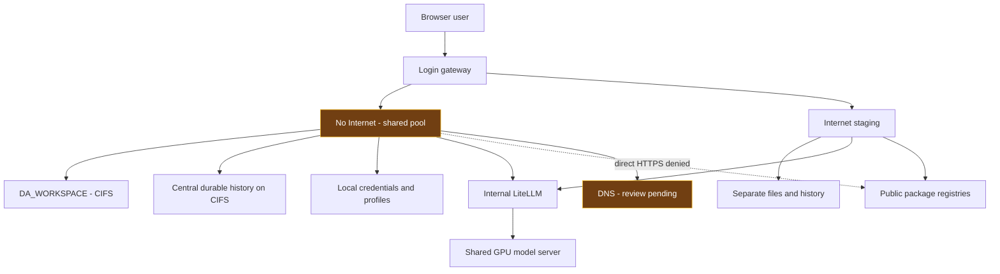
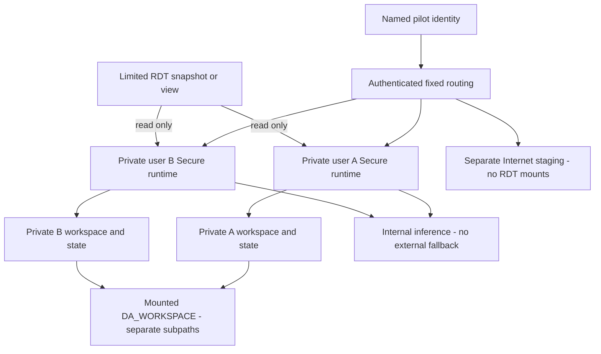
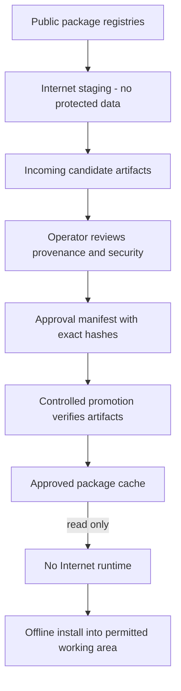

# DSH RDT Pilot — Security Controls, Architecture and Acceptance

**Evidence status, 16 October 2026: synthetic per-user acceptance passed; existing Production controls remain partially satisfied.**

Production baseline evidence is dated 15 October. A separate live canary on 16 October tested two disposable users and synthetic data, including restart persistence. It did not migrate real users, change Production routing or grant RDT access. All 80 legacy histories remained unchanged.

The objective is to limit what can go wrong enough to make this specific pilot acceptable. It is not a claim that the Harness, its model or generated code is universally safe. This report separates deployed controls, recorded tests, remaining gaps and target architecture. Opening the HTML does not run a new security test. The previous Thai report is preserved separately.

## 1 Executive assessment

Assume the Harness, its tools and generated code can make mistakes or exceed the intended scope. Enforce boundaries through infrastructure, execution identities, storage/database permissions and authenticated routes. Prompt instructions alone are insufficient.

Three controls must work together: prevent external leakage, prevent source damage or excessive access, and contain outputs within authorized users. Internet denial does not prevent deletion of writable internal data. Authentication does not isolate people sharing a process and filesystem.

Separate No Internet and Internet environments are deployed. Secure's workspace and durable histories now use the original mounted CIFS storage; credentials and profiles remain local. Representative public HTTPS requests failed from Secure while internal inference worked. Existing users still share each environment runtime. Per-user isolation and read-only source enforcement passed in a separate synthetic candidate. Existing Production has not been cut over, and approved real RDT access remains unverified.

| Risk | Required enforcement | Evidence-based conclusion |
|---|---|---|
| 1 External leakage | Block unnecessary outbound traffic from every RDT execution environment; permit necessary internal services; disable external fallback | Representative direct HTTPS separation passed. DNS, relays, IPv6 and every worker path are not exhaustively covered. |
| 2 Damage or excessive access | Dedicated non-admin identity, limited read-only RDT snapshot/view and separate writable results | Container hardening is implemented. Synthetic source reads and six read-only write/create/delete denials passed; actual RDT scope and enforcement remain untested. |
| 3 Internal disclosure | Named pilot users; authenticated and authorized report/file/session/tool access; no unapproved automatic publishing | Login/logout and anonymous denial are tested. Synthetic private runtimes passed cross-user and environment denial; Production pools remain shared. |

## 2 Current architecture and execution boundary

An authenticated login selects an environment and remains pinned to it. Shells, terminals and generated code execute there. LiteLLM and four-GPU inference are shared; this does not require shared workspaces or histories.

The diagram shows the **deployed shared pools**, not completed per-user isolation. The dotted path represents denied direct HTTPS requests. Highlighted components retain acceptance gaps.

Inventory every component receiving RDT: Harness, subprocesses, execution workers, report servers and services receiving prompts/results. Legacy DSH2/DSH3 use different configurations and cannot inherit the new pools' acceptance results. Internet On is an environment selection, not another name for DSH2/DSH3.

## 3 Control 1 — Prevent external leakage

### Threat and enforcement

Generated code can transmit information through HTTP, package tools, plugins, subprocesses or indirect services even when nobody clicks Export. Login selection must route to a genuinely restricted runtime, with restrictions covering every worker receiving protected data.

Use Kubernetes NetworkPolicy enforced by the CNI. Begin with outbound denial and permit only required destinations/ports. The recorded `dsh-offline-egress` policy allows cluster DNS on TCP/UDP 53 and internal LiteLLM on TCP 4000. Runtime ingress follows the authenticated gateway policy. A label, browser preference or model refusal is not equivalent enforcement.

DNS forwarding can carry encoded information; permitted internal services can relay requests externally. Review the whole path: effective providers, fallback, active credentials and downstream egress. The inspected LiteLLM configuration routes to internal services and has no configured fallback. Configuration evidence does not prove every indirect leakage path is blocked. Never include credential values in evidence.

The deployed DSH catalogs expose only `litellm-cluster`. This reduces accidental external-provider selection but does not replace a firewall or constrain arbitrary generated code by itself.

Internet staging intentionally reaches package registries. It must not mount Secure's workspace, RDT, histories, attachments or credentials, or receive RDT-containing prompts/logs during package preparation. Test that Internet cannot access protected content, rather than expecting Internet staging's public connections to fail.

### Recorded behavior and remaining acceptance

After the central-state rollout, Secure's GitHub, PyPI and npm requests timed out with HTTP `000`; Internet returned HTTP `200` for each. Both environments returned the exact internal inference sentinel. These results establish the particular direct-egress separation observed.

Before closure, test HTTP/HTTPS, direct IP, proxy settings, DNS, IPv6 and actual worker routes from every in-scope RDT runtime. Unnecessary external paths must fail while permitted internal services work. The infrastructure owner must confirm policy selectors, permitted destinations, CNI enforcement and results. Owner/assessor acceptance is separate from passing code tests.

**Status: partially satisfied; complete-path external-leakage prevention is not established.**

## 4 Control 2 — Prevent source damage and excessive access

Generated code can read unrelated files, modify/delete source data or reuse credentials found in the runtime. No Internet and non-root execution do not prevent this when data or database credentials remain broadly writable.

Separate the execution identity, data-access identity and results area. The runtime uses UID/GID `10001`, no privilege escalation, dropped capabilities, RuntimeDefault seccomp and no Kubernetes service-account token. These limit container/cluster privileges; a shared numeric UID does not establish separate human identities or restricted database rights.

For file-based RDT, expose a scope-limited snapshot read-only at `/data/rdt`. Do not mount the Production root or supply source-write credentials. For database access, use a dedicated non-admin account restricted to approved views, rows and columns, without UPDATE, DELETE, DDL or unrelated access. Enforce the restriction through storage/database permissions rather than prompts.

Keep writable results separate from source data and limited to each user's approved workspace. CPU, memory and storage quotas constrain resource use but do not prevent destruction inside a writable area.

Restoring DA_WORKSPACE corrected a storage regression; it did not grant new RDT access. Dataset identification and history ownership were not prerequisites for restoring that mount. They are needed for the separate data-access and per-user cutover.

The private-runtime generator supports an explicitly approved read-only snapshot and identity-specific central workspace/state paths. Source tests verify distinct paths for generated users. Production still uses shared environment pools. Non-root CIFS read/write tests prove workspace compatibility, not read-only RDT enforcement or cross-user isolation.

Before closure, show approved scoped reads and result writes succeed while source writes/deletes/renames and out-of-scope reads fail. Include traversal, symlinks, tools, terminal and APIs; verify unchanged source content. Start with an approved test snapshot/view, not destructive Production probes.

**Status: hardening and synthetic read-only enforcement passed; actual scoped RDT acceptance remains open.**

## 5 Control 3 — Keep results within authorized users

Reports, attachments, logs, temporary files and histories can disclose information internally without Internet access. Controls must cover every route returning content, not only login.

Use named pilot identities, administrative provisioning and authenticated report access. Bind identity to a dedicated runtime, workspace, history/attachments and launch token. Reject spoofed identity headers and requests without a valid session. Do not enable automatic publishing or external export without explicit authorization.

Registration is disabled. Recorded registration requests returned 403 without adding an account. Anonymous report/proxy/session routes returned the actual login form. Fresh login/logout, cookie rejection after logout and held sessions after backend restart passed. Actual terminal WebSocket command execution passed in both environments at UID `10001`.

Users within a current pool still share its process and mounted environment tree. Authentication is not cross-user authorization. Another account's files, reports, sessions and attachments must be inaccessible through HTTP, WebSocket, terminal and tools before closure.

Test user A, user B and an unauthenticated client. Inspect response content for guessed IDs/URLs, modified headers and direct backend routes. HTTP `200` containing login is not successful report access. Repeat ownership/access checks after logout and restart.

**Status: authentication passed within the recorded scope; per-user authorization and export-path closure remain incomplete.**

## 6 Target architecture and pilot interaction

This diagram is a **target tested with two synthetic identities, not deployed for existing Production users**. It separates source access, results and identity while retaining mounted DA_WORKSPACE and shared inference.

A named user enters No Internet and reaches a fixed private runtime. It reads only the approved snapshot/view, writes to its own working area and uses internal inference without external fallback. Authorized users open results through authenticated routes. Ownership must survive restart.

Changing environments requires logout and a new login, not changing network permissions underneath a running RDT process. Do not automatically transfer projects, histories, attachments or secrets into Internet staging. Physical central storage can be shared while mount boundaries and server permissions isolate logical areas. Broad legacy mounts must not expose future private trees when claiming user isolation.

## 7 Dependency preparation without sharing protected workspaces

The 16 October isolation canary used an empty read-only cache fixture. It did not validate package download, promotion or offline installation.

Internet staging prepares dependencies for No Internet. It is an artifact-preparation area, not a route into protected projects. Dependency lists must not include RDT, histories or secrets.

Download into Incoming and retain package versions, provenance and hashes. Review before promotion. A controlled job verifies approved artifacts and copies them to Approved. Secure mounts Approved read-only and installs from the offline cache. Internet cannot install directly inside Secure or modify its protected workspace.

Hashes establish identity, not safety. Review installation hooks, transitive dependencies and provenance. Test actual offline installation and import/execution. Retain approvals and the promoted manifest. This does not make the platform air-gapped: internal gateway, DNS, inference and storage connectivity remain necessary.

## 8 DA_WORKSPACE, active history and corrected storage

The original requirement was mounted DA_WORKSPACE restricted to `dsh`, with no protected share in the Internet environment. Replacing it with local storage after a CIFS permission failure was an implementation decision, not a user requirement. Explicit UID/GID mapping proved non-root compatibility and enabled the actual mount's restoration.

Raw USER_INPUT and UNC paths identify **dsh_storage**, not dsh_volume:

`\\bot.or.th\cfs\FILESERV\DA_WORKSPACE\workstation\dsh\dsh_storage`

| Content | No Internet / Secure | Internet |
|---|---|---|
| `/workspace` | Original CIFS share, subpath `dsh` | Separate local staging |
| Sessions, attachments, storages, workspaces and logs under `/state` | Direct CIFS submounts at `dsh/dsh_storage/<directory>` | Separate local state |
| Credentials and web profiles | Original local state; top-level credentials excluded from central migration | Its own local state |
| Packages | Approved cache read-only | Incoming preparation area |

Direct mounts write durable content centrally; these directories do not require the old 15-second copy loop. The share is not an independent backup, storage-server recovery plan or zero-loss guarantee. CIFS forced modes do not establish Windows/server ACL correctness.

The single Secure writer was stopped before copying and hash-verifying **29,078 files**. Previous central directories and original local state were retained. Additional stopped reconciliation confirmed **28,898 canonical central project files unchanged**, without conflicts or content failures. The procedure now reconciles canonical projects before switching directories. Internet and the model server were not restarted by this storage deployment.

### Legacy working-directory repair

The earlier review found 43 of 80 stored sessions under inaccessible `/root` paths. Explicit mappings point them to existing canonical CIFS project folders. Only the compressed header's `cwd` changed. IDs and all other header fields were preserved; compressed conversation-event frames remained byte-identical by SHA-256. Original generations were retained. Missing mappings, absent targets and destination collisions cause refusal before mutation; conversation text is not blanket-replaced.

Installed DSH persistence passed CIFS create/flush/reopen. An independent process could not take a held writer lease and acquired it after release. Early probe harness attempts omitted required V4 fields and initially misclassified generic `EACCES`; corrected setup and the denial/release pair established acceptance.

Final checks listed **80 histories with 80 readable working directories and no `/root` cwd records**. All **82 session files** stayed byte-identical across another process replacement. Four new durable-directory markers survived and were removed. Login/logout, held sessions and actual terminal WebSocket execution passed in both environments. Temporary acceptance credentials were removed.

This does not establish every historical session's tool resumption. See [live evidence](context-evidence/central-state-live-20261015.json), [migration procedure and experience](CENTRAL_STATE_RESTORATION_20261015.md) and [storage guide](MULTI_TENANT_STORAGE_AND_PERSISTENCE.md). Reconcile newer central writes before reverting to an older local mount; retain both versions.

## 9 Deployment evidence and its limits

### New synthetic canary — 16 October

Two test users exercised four dedicated Secure/Internet runtimes. Before and after replacing all four processes, exact own reports, attachment-file fixtures and real DSH history pages remained readable; cross-user/environment history requests, anonymous reads and forged HTTP/WebSocket identity headers were denied. Actual terminal commands ran at UID 10001. Both Secure workers rejected append/delete/create on the synthetic source with EROFS; Internet had no source mount. Direct neighbor-runtime HTTP was denied. Secure GitHub probes timed out; Internet returned 200.

The first attempt found client identity headers passing through custom forwarding. The corrected gateway canonicalizes both normalized and raw HTTP/WebSocket identity headers. A negative control reproduced the defect in the original source. The correction was verified through a ConfigMap overlay in the isolated canary, **not installed in the existing Production gateway**. Both test namespaces are stopped and temporary Kubernetes Secrets removed; synthetic audit volumes remain. No model load test occurred.

Legacy preservation was verified across both attempts: 80 histories in 82 files retained aggregate SHA-256 `7bb4aa235893e12b0bf545a4f87e00a3a6df2a656e33acdb5231c8def460c317`. No legacy histories were reassigned. See the [full test, failures and limits](USER_ISOLATION_SYNTHETIC_TEST_20261016.md). This is candidate acceptance, not closure of real-user/RDT Production gaps.

### Earlier Production baseline — 15 October

Build **62702**, image-source revision **`3fa74b72eaad7d7dd1e0986dd07a176f45ab2153`**, produced the gateway/pool runtime image:

`sha256:96be6e7fad0a1d456484bacfed45612c3d3ba95290a9f59a03eb612d50a4efc1`

Subsequent operator/document commits do not imply a rebuilt application image. Storage changes were pushed as GitHub `0e504ea` and Azure `f948b04`. The live storage annotation was read back against the Azure commit and mounts matched the tracked manifest. This English rewrite is documentation work, not another runtime deployment.

| Check | Recorded result | Limit |
|---|---|---|
| Login/logout and held sessions | Both environments passed; tested logout cookie invalidated | Not cross-user authorization |
| Central state | 29,078 stopped files checked; 80 histories and readable cwd values | Not full historical tool resumption |
| Restart persistence | 82 session files unchanged; four new markers survived | Not storage-server recovery or full restored-runtime boot |
| Terminal WebSocket | Actual sentinel command at UID 10001 in both environments | Not every terminal/tool operation |
| Public HTTPS | Secure timeouts; Internet 200 at GitHub/PyPI/npm | Not all leakage paths |
| Internal inference | Exact expected sentinel in both environments | Not every model/tool workflow |
| Source/report checks | 17 Python tests, manifest checks and HTML controls passed | Not deployed cross-user/RDT acceptance |

Recreate avoids overlapping writers. Startup/readiness/liveness probes check the application rather than only a forwarding port. Readiness cannot create high availability with one inference process.

Earlier verifier workers hit CSI read-only-mount/SELinux setup errors, not byte mismatches. Corrected archive comparison avoids co-mounting live local state in another verifier. An earlier workspace validator used an unsupported Python extraction API and triggered actual automatic mount rollback; the portable retry passed. That earlier rollback is not a live exercise of every subsequent recovery path.

Original storage and rollback specifications are retained. Direct mounts and restart acceptance are separate from archive restore, node-loss recovery and server ACL assurance. Older local-only history statements remain dated historical evidence.

## 10 Proceeding when ownership and RDT scope are unknown

Unknown ownership does not block the completed storage restoration. It prevents safely redistributing histories or granting new RDT rights. Do not infer ownership from an account, project name, topic or folder.

A fresh read-only review found **9 gateway accounts**, **80 unique sessions** and **82 generation files**. Their inspected headers contain no `owner`, `username`, `userId`, `createdBy`, `user` or `principal` field. Headers cannot establish authenticated ownership. Account existence does not establish pilot approval. Account names remain in a private local CSV, not this published report.

The practical staged approach is:

1. **Preserve legacy records together.** Keep the 80 histories and central projects intact. Do not clone them into every private account or broaden access. Keeping the current service available is an interim operational choice, not closure of its shared-pool risk.
2. **Synthetic isolation acceptance completed.** Two disposable identities and four private runtimes passed positive access, A-to-B/environment denial and restart persistence. Six source mutations failed read-only. This validates the tested mechanism without assigning real histories or using RDT. Production cutover remains pending.
3. **Start new private histories cleanly.** Once a human identity is confirmed, provision an empty private environment. Leave legacy records in their current boundary. Migrate only verified ownership or an explicit recorded shared-access decision. Remove broad legacy access to private trees before cutover.
4. **Default new pilot RDT access to none.** Do not mount guessed sources or copy Production data. Test read-only enforcement with synthetic fixtures. A data/system owner can later identify the limited folder/snapshot/view and dedicated account.
5. **Close against actual access tests.** Verify scoped reads, rejected source writes/out-of-scope reads, private results, cross-user denial, every worker's outbound restrictions and absence of unapproved publishing. Separate infrastructure/data/pilot acceptance from code completion.

Synthetic acceptance is now complete. It does **not** mean legacy access has already been restricted, accounts disabled, private users cut over or RDT access granted.

| Work item | Current disposition | Closure evidence |
|---|---|---|
| Central workspace and histories | Deployed and tested | Direct mounts, content hashes, accessible paths and restart checks recorded |
| Approved identities and ownership | Unknown; preserve legacy records | Confirm human identity and ownership/shared-access decisions |
| Private runtimes | Live synthetic candidate passed; Production pools still shared | Deployed fixed routing and A-to-B file/report/history/terminal/API denial |
| Read-only RDT | Actual scope unidentified | Approved source/identity; permitted reads/results and rejected writes/out-of-scope reads |
| Leakage paths | Representative direct tests passed | Every worker; DNS/relay/IPv6/proxy/fallback and infrastructure confirmation |
| Publishing/export containment | Not fully closed | Job/plugin/credential inventory and unauthorized-access/export tests |
| Independent recovery | Separate from the central mount | Server ACL review, backup/DR and full restored-runtime boot as required |

## 11 Upstream maintenance and shared inference

The recorded package is `0.2.0-rc.2`. This repository maintains deployment/authentication/routing/configuration overlays, not a fully synchronized source fork. The previous comparison inspected official master `571902028a75c64c1d767f4ae5fd099485f0ddf0` and tag `dsh-v0.2.1-alpha.3`. This rewrite did not refresh upstream or upgrade the package.

Upstream supplies workspaces, tools, plugins, remote access, providers and session persistence. Infrastructure/data isolation and central storage remain deployment responsibilities. Review compatibility patches individually: a localhost-helper patch does not prove a broken Host fence, and a missing-image placeholder does not recover original image evidence.

Pin source/image, fail closed on changed patch targets, inspect credential precedence and test copied state before upgrading. Cover auth/Host/Origin, sessions, attachments, tools, WebSocket, network/user/data boundaries, restart and restore. Retain old image/state; do not auto-merge into Production. See [synchronization procedure](UPSTREAM_SYNC_AND_INTERNET_POLICY.md), the [pinned official deployment guide](https://github.com/deepseek-ai/deepseek-harness/blob/571902028a75c64c1d767f4ae5fd099485f0ddf0/docs/user/guide/public-deployments.md) and [pinned safety guidance](https://github.com/deepseek-ai/deepseek-harness/blob/571902028a75c64c1d767f4ae5fd099485f0ddf0/SAFETY.md).

Backend ceiling: **1,048,576 tokens**. DSH web/LiteLLM guardrail: **131,072 total**, **8,192 maximum output**, **256-token proxy reserve**, configured compaction near **98,304**. Backend memory fraction is 0.90, running-request cap 16, prefill chunk 1,024, maximum prefill 2,048, mixed prefill/decode and decode interval four. V2 reserves part of each chunk for short uncached tails while retaining long progress.

Bounded V2 tests completed short requests in 0.59–1.47 seconds during approximately 133K work. A later two-request sample returned exact output at approximately 34–35 output tokens/second per request including elapsed time. These are samples, not an SLA or sustained benchmark. The earlier successful near-1M run belongs to a previous scheduler profile; it is not current end-to-end DSH 1M, two-1M concurrency or V2 near-1M fairness acceptance. See [context trials](CONTEXT_OPTIMIZATION_20261015.md) and [scheduling evidence](SCHEDULING_FAIRNESS_20261015.md).

## 12 Evidence and document use

Embedded records are saved responses/logs at their stated times, not a live webpage or a new test when opened. Original evidence remains unchanged and may include Thai source text. Narrative, navigation and controls are English. Passwords, tokens and RDT content are not intentionally reproduced.

- [Synthetic isolation acceptance](context-evidence/user-isolation-canary-20261016.json): successful live candidate and configuration readback.
- [First attempt](context-evidence/user-isolation-canary-first-attempt-20261016.json): observed defect, correction and unchanged legacy fingerprints.
- [Identity metadata review](context-evidence/identity-metadata-review-20261015.json): counts and absent ownership fields; account names retained privately.
- [Latest central-state evidence](context-evidence/central-state-live-20261015.json): mounts, copied-state counts, cwd correction, hashes, restart, terminal and connectivity.
- [Earlier storage review](context-evidence/environment-session-storage-review-20261015.json): raw-source provenance and pre-correction inaccessible paths.
- [Workspace correction](context-evidence/central-workspace-live-20261015.json): CIFS restoration, reconciliation, peer readback and earlier rollback.
- [Runtime image rollout](context-evidence/runtime-rollout-live-20261015.json): image/source readback and bounded acceptance.
- [Gateway evidence](context-evidence/rdt-gateway-live-20261015.json): registration denial and anonymous routes.
- [Earlier egress probes](context-evidence/rdt-egress-recheck-20261015.json): direct connectivity scope.
- [Candidate cluster tests](context-evidence/rdt-candidate-cluster-check-62696.log): candidate checks, not deployed cross-user RDT acceptance.
- [Raw design audit](context-evidence/storage-design-audit-20261015.json): curated messages, Git change and CIFS canary.

The standalone HTML retains SMP EDA-style zoom/reset/fullscreen, source copy and SVG/PNG export. Mermaid 10.8.0 and svg-pan-zoom 3.6.1 are embedded; no CDN is required. It also embeds the actual English README content, not just a reference. Document QA verifies rendering and controls, not DSH security acceptance. See [QA record](context-evidence/html-verification-20261015.json).
