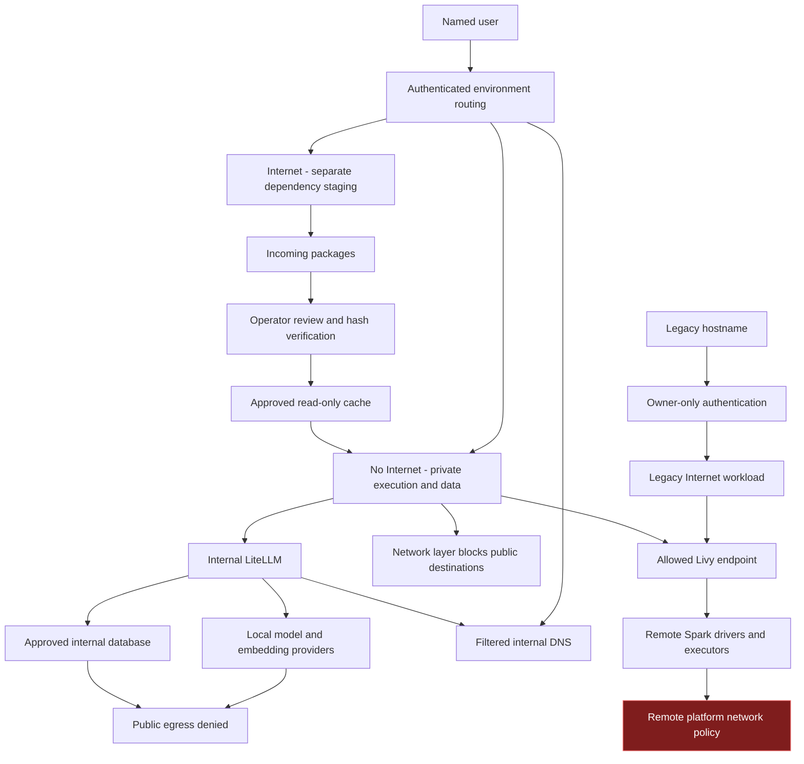
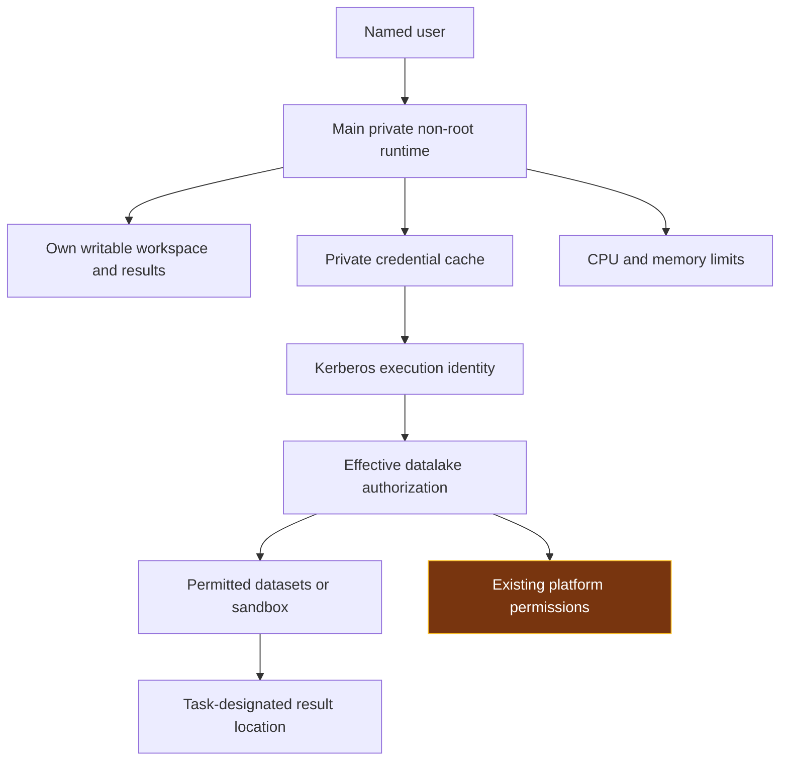
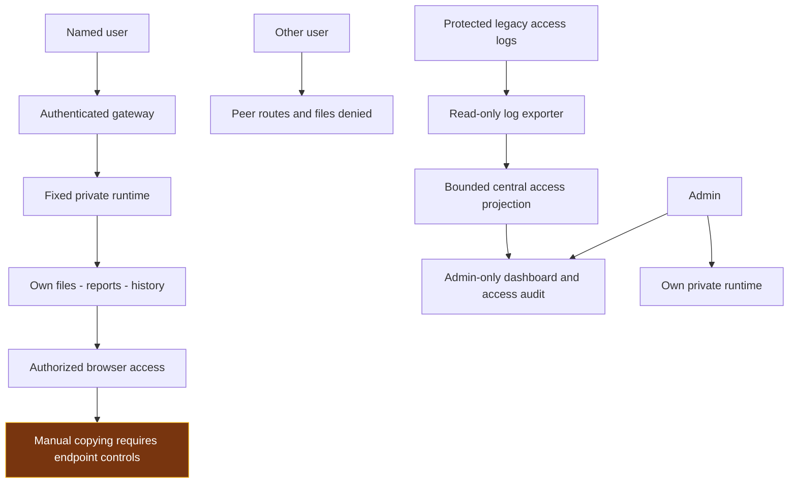

# DSH — Controlling Three Security Risks

DSH controls three risks: external leakage, damage or excessive access, and exposure of results. The Harness, its tools and generated code are treated as automation that can make mistakes. The application therefore enforces boundaries through network policy, private execution, scoped storage and authenticated routes rather than relying on prompt instructions.

**Scope conclusion:** the agreed DSH-controlled measures described below are implemented, with their defined acceptance checks completed in the recorded deployment review. No unresolved local failure was identified by those checks. This is completion of the reviewed application scope, not a guarantee against every attack, mistake or future regression. External dependencies and deliberate scope limits are consolidated in the final section; they are not presented as unfinished DSH implementation.

This report explains the design and responsibility boundaries. Detailed measurements, test histories and recovery procedures remain in separate operational documents. This revision does not perform a new deployment or security test.

### Technology choices and the boundaries they support

The pilot outline separates the technology choice from the acceptable risk boundary. A component being installed, or a rule appearing in a prompt, does not establish that the boundary is enforced. The following summary describes how the DSH design addresses the outline; it does not adopt its illustrative responses as approved requirements.

| Component | DSH design and reason | Risk-control role |
|---|---|---|
| Agent framework / Harness | DeepSeek Harness provides the web workspace, file operations, tools and report generation. Generated code is treated as untrusted automation. | Put enforcement outside the agent: private execution, destination restrictions and authenticated file access. |
| Language model | Internally hosted DeepSeek-V4.1-Flash is reached through the managed LiteLLM route. | Keep managed model requests on internal infrastructure; disable external fallback instead of relying on the model to avoid external providers. |
| Model serving | LiteLLM provides the controlled API route to the SGLang GPU service. A local embedding service is separate from generation. | Separate shared inference from private workspaces and keep provider credentials outside user-controlled routing decisions. The outline's Ollama serving example is not the DSH text-generation architecture. |
| Code execution | Tools run in each user's selected Kubernetes runtime. Libraries come from the prepared runtime and approved package path. | Non-root identity, limited mounts, resource limits and network policy contain execution. Remote submitted jobs have a separate platform boundary. |
| Infrastructure and storage | Kubernetes supplies compute isolation; scoped central CIFS directories provide durable working files and histories. | Separate users and environments, avoid broad parent mounts, and keep original inputs apart from writable results when a task requires input protection. Persistence is not an independent backup. |
| UI and data access | An authenticated gateway serves user-bound workspaces, reports and terminals. Connected data services apply the chosen execution identity's permissions. | No public file bypass or automatic publication. An internal UI does not by itself restrict datasets or make remote execution offline. |

The outline uses public snapshots, read-only originals and no production connection as examples. Those are valid choices for a specifically approved exercise, but they are not universal restrictions imposed by this deployment. Define the permitted data, account, destinations, write scope and output recipients before an exercise. If its boundary requires sandbox-only access or immutable inputs, provision the matching platform permissions or protected input copy; instructions alone are insufficient.

## 1 Prevent external leakage

### Control objective

Prevent unauthorized public connections from the No Internet execution environment while retaining only the internal services required for work. Internet access is provided through a separate environment for dependency preparation, with no automatic transfer of protected data.

### Separate execution and network boundaries

No Internet / Internal is the default login choice. Each main user has a private runtime for this environment and a different private Internet runtime. Authentication fixes the user/environment route for the login session. Switching environments requires logout and a new login; a submitted username, routing header or changed selection cannot choose another user's backend.

No Internet has a restricted outbound network policy. Its approved paths include internal inference, controlled DNS and permitted authentication or job-submission services. Public-domain and direct-IP connectivity are restricted at the network layer, including commands launched from the terminal. The runtime has no Kubernetes management token with which to change its own policy.

The Internet environment has separate compute, workspace, histories and credentials. It does not mount protected No Internet working data. Its public connectivity supports dependency preparation; it is not an alternate processing route for protected prompts, tickets, datasets or reports. The shared internal gateway and inference services do not merge user workspaces. This architecture provides restricted egress, rather than a strict air gap.

The gateway, LiteLLM, local model providers and supporting database have their own destination restrictions. Filtered internal DNS serves approved internal names rather than forwarding arbitrary public lookups. Supplied model clients use internal LiteLLM with model-scoped credentials and operator-owned configuration; external model fallback is disabled for the managed route. Client configuration complements infrastructure enforcement and does not replace it.

### Transfer dependencies without sharing protected workspaces

The Internet environment downloads package artifacts into an incoming area. An operator reviews their source, version and expected hashes. A controlled promotion process verifies selected bytes and places approved artifacts in a separate cache. No Internet mounts that cache read-only and installs without a public package index.

Internet cannot directly install into the protected runtime or modify its workspace. Prompts, datasets, credentials, histories and reports are not dependency artifacts and must not use this transfer path. Hash verification establishes artifact integrity; package approval remains necessary because an intact package can still contain harmful code.

### Keep environment choices explicit

Legacy DSH2 and DSH3 are owner-only Internet-capable instances. They do not offer a misleading No Internet choice. Their authenticated proxies and ingress restrictions prevent direct peer access, while retaining their intended internal inference and permitted service connections. Protected offline work uses the designated No Internet environment.

An internal connection to another platform does not grant administration of that platform. If a submitted command executes remotely, that platform applies its own permissions and network rules; this responsibility is separated in the final section.

## 2 Prevent damage or excessive access

### Control objective

Contain local execution and prevent peer or administrative access beyond the selected user's environment. Preserve existing permissions on connected platforms instead of silently granting broader access or imposing an unrequested replacement authorization policy.

### Run tools within a private, restricted workload

Each main user/environment has a separate execution process with bounded workspace, session, attachment and credential mounts. Isolation is enforced through the workload and mounted scope, rather than merely choosing different folders in one shared process. Broad parent directories containing other users' data and host-management interfaces are not exposed to ordinary execution.

The workloads execute as non-root, disable privilege escalation, drop Linux capabilities, use RuntimeDefault seccomp and have no mounted Kubernetes management token. CPU and memory limits constrain local resource use. Legacy instances similarly use restricted non-root execution with a designated owner account.

DSH, Claude Code and TrueForge inherit the selected runtime's identity, mounts and network policy. Installing a tool does not grant a privileged container, host socket or another user's credentials. TrueForge's optional nested sandbox remains disabled under the current restrictions; its absence is an agreed capability limit, not a reason to weaken the container boundary.

### Preserve private work and bounded write access

Protected working files and durable histories use bounded central CIFS paths. Internet workspaces and histories remain separate. Credentials and profiles remain in their designated private state locations, while approved dependency artifacts are read-only. Generated outputs belong in the user's designated writable working area.

Existing histories and files retain their ownership. An explicitly authorized support copy is independent and does not reassign the source, expose a shared parent directory or establish ongoing synchronization. Persistence across runtime replacement is part of the application design; independent recovery from authorized or accidental deletion is a separate storage-service responsibility.

### Use connected services under existing authorization

Datalake connections authenticate with the applicable Kerberos principal. DSH does not expand that principal's permissions, grant administration of the datalake or redefine its dataset scope. Submitted commands remain subject to that platform's authorization and execution controls. Existing personal and system-account entitlements are preserved as agreed.

A generated command can still make a mistake within permissions already granted. Tasks should therefore separate original inputs from outputs and review destructive operations where appropriate. If a particular exercise requires sandbox-only or read-only access, the relevant platform owner provisions that entitlement; it is not a universal missing DSH feature.

### Separate input protection from permission to execute

A private runtime prevents access to another user's workspace; it does not make the current user's writable source data immutable. Where the agreed task forbids modifying originals, expose an approved read-only input snapshot or view and write generated code, reports and working copies to a separate writable location. The data or storage owner must enforce that distinction. Do not describe preserved personal read/write entitlements as a read-only guarantee.

The agent may generate and run analytical code within its assigned boundary, but must not receive cluster administration, host-management sockets, unrelated service credentials or permission to enlarge its own mounts or network access. Tool approval is an additional operational choice; it is not a substitute for restricting the execution identity. A connected remote job inherits the remote platform's controls, not the local container's filesystem or egress policy.

### Bound shared resources

The inference route counts the complete request, reserves output capacity and controls admission of expensive work. Long requests use bounded waiting and an explicit busy response while shorter work remains schedulable. This manages shared capacity; it does not guarantee a response time or change data authorization. Local process limits and shared inference scheduling are DSH controls; remote job queues remain under the platform that executes those jobs.

For a shared-service pilot, define a workload budget as well as CPU and memory limits: allowed job duration, cancellation responsibility, output/storage growth and expected concurrent use. Long-running or repeated work should be cancellable through its executing service and should not bypass admission controls by spawning unrelated jobs. Administrators use the centralized dashboard and activity log to identify the affected user/environment and investigate abnormal consumption. Gateway access events are not complete CPU/GPU, disk or remote-cluster telemetry; remote job accounting, disk quotas and enforced execution deadlines must be configured where those workloads run before claiming those specific boundaries.

## 3 Keep results contained

### Control objective

Keep histories, reports, files, attachments and terminal access within authorized user routes. Separate operational oversight from automatic access to user content.

### Authenticate access and bind it to private storage

The gateway admits provisioned named accounts, disables self-registration and binds each authenticated user to the assigned runtime. Reports, files, attachments and terminal WebSockets use the authenticated boundary. Server-side identity and route checks reject forged roles, peer-runtime selection and direct bypass paths.

Each user/environment has separate working files and history storage. Switching environments does not automatically transfer content or credentials. Logout invalidates the gateway session. Legacy instances admit only their designated owners; shared guest and cross-account logins are disabled.

Account stores use salted scrypt password records and bounded verification. Authentication records are stored outside execution workspaces, with protected account volumes and operator-only recovery material. Supplied bootstrap configuration does not create factory-password accounts. Users can change passwords through the authenticated flow; startup does not overwrite a changed password.

### Centralize oversight without merging user content

The admin-only dashboard combines operational information and access events. Administrative visibility does not automatically grant access to another user's conversations or files. Any authorized support copy remains in a separate private store and preserves the original owner's records.

Access auditing records relevant events, user, environment and time outside execution workspaces. It excludes passwords, Kerberos tickets and conversation bodies. Legacy exporters read only their access-log scope and write a bounded central projection. Execution users do not receive the account or audit stores. Required gateway auditing fails closed when an access event cannot be persisted.

The dashboard distinguishes timestamped infrastructure snapshots from current gateway information. Refreshing a snapshot is not a new infrastructure test. Access logs support accountability; a full command recorder, conversation archive and independent audit-retention service are separate capabilities.

### Deliver generated results through the same boundary

Working reports, charts, temporary files and generated applications remain in the private environment. Server-side file access uses the authenticated identity rather than a submitted owner name or arbitrary filesystem path. Exposing a new application requires the same authenticated proxy and user-bound storage; it does not justify a new public bypass route.

The managed workflow does not automatically publish protected results externally. The No Internet environment's network policy blocks direct public transmission from its execution runtime. Internet-capable tools must not be represented as having the same offline restriction. Authorized viewing and downloading are normal application functions; additional restrictions on what a person copies require an explicit handling policy and endpoint controls.

### Review analytical results before operational use

Containment includes controlling how a result is used, not only who can download it. Keep generated code, input selection, calculation assumptions and resulting reports together in the private workspace so an authorized reviewer can reproduce the analysis. Label exploratory findings as provisional and compare important calculations with known reference results before relying on them.

A fluent answer, a completed tool run or a plausible chart is not validation of analytical correctness. The pilot workflow should require human review before a result triggers an operational decision, source-data correction or downstream publication. If an integration can perform such actions, enforce its permitted operations and approval step at that integration; a report warning alone does not prevent writeback. These are task-level operating boundaries, not a claim that DSH implements a universal accuracy gate or disables every user's existing write permission.

### Translate the pilot outline into an explicit decision

| Outline risk dimension | How it fits the three controls | Decision needed for the particular exercise |
|---|---|---|
| Data confidentiality | Risk 1 restricts outbound execution; Risk 3 limits access to resulting files. | Identify permitted data classification, destinations and recipients. A public-data-only claim needs a defined dataset and matching access scope. |
| Source-data integrity | Risk 2 separates protected originals from writable results. | Decide whether originals must be read-only and arrange that permission at the source. |
| System access and autonomy | Risk 2 constrains identities, tools, mounts and privilege changes. | Define allowed connected services and destructive operations; retain remote-platform enforcement. |
| Resource and operational impact | Risk 2 bounds local execution and shared inference; central oversight supports investigation. | Assign job deadlines, cancellation, storage budgets and remote-cluster monitoring to the enforcing service. |
| Analytical reliability | Risk 3 keeps provisional findings in an authorized review workflow. | Set reference calculations, reviewer and permitted downstream actions; do not treat generated output as approved automatically. |

Agree the boundary first, then identify the enforcing component and its owner. A boundary that is undecided or not checked must remain explicitly unconfirmed; the outline's example controls and this design explanation do not establish a new acceptance result. This keeps the three-risk structure while making the pilot's technology, autonomy and review decisions understandable.

## External dependencies and agreed scope limits

The following items define responsibility and intended use. They do not constitute outstanding implementation of the local DSH controls, and categorizing them here does not make their exposure disappear.

| Boundary | Responsibility and agreed treatment |
|---|---|
| Remote Livy/Spark execution | The datalake platform controls its drivers, executors, job limits and outbound network. DSH restricts its local submission path but does not administer those machines. Livy/Spark remains available under the previously accepted remote-egress exception. Restricted local egress must not be described as a guarantee about a remote worker. |
| Dataset and sandbox authorization | The platform's existing Kerberos/AD and data permissions remain authoritative. No DSH-imposed universal read-only policy is required. A sandbox-only or read-only entitlement is confirmed by its owner when that specific usage claim is needed. |
| Authorized browser handling | Viewing, copying and downloading by an authorized person are distinct from peer access or unauthorized publication. Device restrictions, managed browsers or DLP apply only where required by the organization's handling policy. |
| Identity lifecycle | Corporate SSO/MFA and organization-wide recovery policies are outside the agreed local-account deployment. Owner-managed password changes are provided. By explicit decision, automatic operator rotation is not scheduled; a known password remains usable until changed. This is a retained operational choice, not evidence that hashing neutralizes a known password. |
| Storage recovery and infrastructure administration | Central storage provides persistence. Storage-server ACL administration, independent backups and disaster recovery belong to that service. Cluster, host and storage administrators remain trusted privileged operators. |
| Audit-service extensions | Current central access logging and dashboard oversight are included. Complete command/body capture, remote-job correlation and independently retained audit archives are additional integrations requiring a defined policy; they are not claimed as current features. |
| Deliberately Internet-capable environments | Internet staging and the legacy Internet instances retain their intended public connectivity. They are not protected No Internet environments and must not be used as an automatic bridge for protected content. |

**Completion rule:** the reviewed DSH application controls are implemented and their recorded acceptance checks are complete. Keep them maintained through controlled upgrades and regression checks. A new requirement, failed test or discovered bypass reopens the affected local item; an external dependency remains assigned to its owner rather than silently being declared fixed. This report introduces no new data access, mandatory datalake permission change, credential rotation or platform restriction.
