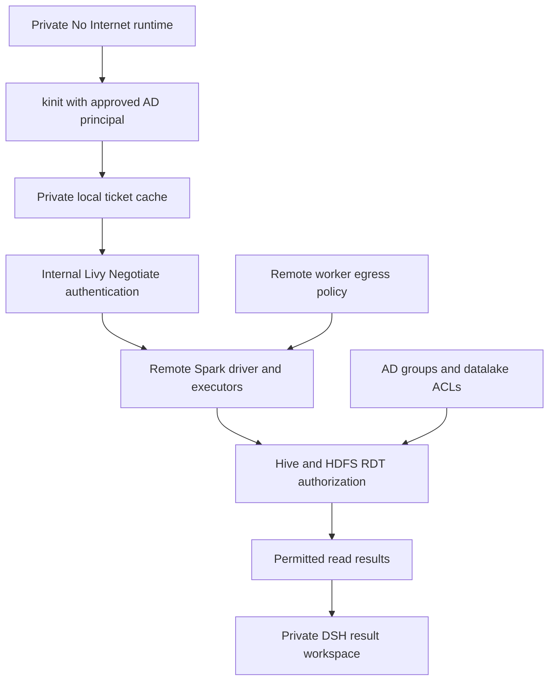
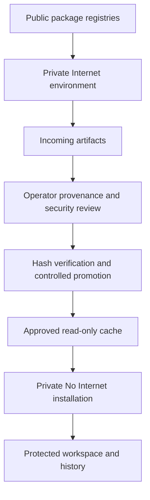

# DSH RDT Pilot — Security Controls and Execution Architecture

**Live configuration clarification, 16 October:** DSH does not currently have end-to-end 1M access through LiteLLM. Fresh readback found the SGLang backend at 1,048,576 tokens, but LiteLLM’s loaded callback enforces 131,072 total tokens, 8,192 maximum output and a 256-token reserve. The legacy `dsh-secure` runtime still contains `contextWindow: 1048576` in `/state/cordis.patch.yml`; this is a configuration mismatch, not proof of usable 1M requests. The table below describes the intended product budget, not a fresh verification of every runtime profile. No runtime settings were changed in this clarification. Performance figures remain recorded samples, not a new benchmark.

**Ownership correction, 16 October 2026:** The user explicitly identifies `thanatcc` as the owner of the legacy histories and files, not `admin`. `thanatcc` is a local DSH login; ownership does not grant the admin role. Live access is still incorrectly assigned to admin legacy runtimes, while `thanatcc` has private runtimes. Restoring owner access requires bounded storage migration, because the legacy mount also exposes the private-user subtree. No ownership migration or access reassignment has been performed by this correction. Admin dashboard and audit oversight remain separate from data ownership.

**16 October 2026: private user routing, central audit and datalake-aware restricted egress are deployed. Existing per-user AD/datalake rights are preserved. Remote Spark public TCP access is an explicitly accepted exception; Livy/Spark remains available.**

The objective is to limit what can go wrong enough to make this specific pilot acceptable, rather than declare the Harness or generated code universally safe. This report explains where each control acts, what was tested and what remains unverified. Opening saved evidence does not run a new test or authorize data access.

## 1 Executive assessment

Fresh [local verification](context-evidence/design-consistency-live-20261016.json) passed all 16 private login/environment combinations, authenticated admin audit access, ordinary-user admin denial and all 18 worker network probes (9 No Internet, 9 Internet). Internal inference returned the required text and the legacy fingerprint remained unchanged. These checks do not repeat the remote Spark test or certify every user’s datalake entitlements.

**Design consistency:** Per-user and per-environment separation is the intended design, but denying `thanatcc` its own legacy histories is an owner-access defect, not successful peer isolation. Historical test results labelled “admin legacy history” describe the old access route, not ownership. Other users must remain denied; `thanatcc` must regain access through owner-bounded mounts. Admin dashboard/audit authority does not transfer ownership. Remote Spark public TCP access is a recorded failed boundary retained as an accepted risk. One authenticated Spark identity test does not establish all user-specific Hive/HDFS permissions, and DSH preserves existing AD/datalake rights rather than imposing universal read-only access.

**RDT uses Kerberos (`kinit`) and the datalake connection, including Livy/Spark and Hive/HDFS authorization. DA_WORKSPACE stores DSH files and history.** Mounting it is neither the source of RDT authorization nor proof of read-only RDT access. A local DSH login such as `thanatcc` is not an AD identity. The earlier request for an RDT PVC/folder conflated these independent controls and is withdrawn.

| Risk | Deployed enforcement | Evidence and limit |
|---|---|---|
| Prevent external leakage | Private No Internet workers; exact internal DNS, Kerberos, Livy and inference destinations; restricted inference keys | All 18 workers tested. Public-domain and direct-IP probes fail from all 9 No Internet workers; internal paths work. Remote Spark driver and executor actually reached GitHub/public IP; local pod policy does not cover that downstream path. |
| Prevent damage/excessive access | Non-root execution, no Kubernetes token, private workspace/state and ticket cache | Local isolation/persistence tested. Per user instruction, existing AD/Hive/HDFS rights are inherited; DSH grants no new data authority and does not universally enforce read-only access. |
| Keep results contained | Fixed user/environment routing; authenticated application and terminal routes; legacy histories still routed to admin (ownership correction pending); central audit | All 16 private logins denied a legacy history and admin APIs. Administrator remains trusted. Browser exports and remote reports need separate review. |

Local controls now go beyond the former shared-pool design. The approved data-access policy preserves each user’s existing AD/datalake permissions. This supersedes the earlier requirement for universal read-only RDT access; it is a requirement change, not proof that write-capable AD accounts became read-only. DA_WORKSPACE remains independent of datalake authorization.

## 2 Deployed user and environment architecture

Nine existing local accounts have fixed routes. Eight non-admin accounts each receive private No Internet and Internet runtimes: 16 private runtimes. The two original runtimes still route to admin, which is an access mismatch: the confirmed legacy owner is `thanatcc`. Registration remains disabled; switching environments requires logout and a new login.

Runtimes share inference, not writable workspaces, attachments, sessions or credentials. UID/GID 10001, disabled privilege escalation, dropped capabilities, RuntimeDefault seccomp, no service-account token and resource limits constrain execution. Per-user mounts provide isolation despite the same numeric container UID. This does not protect against trusted administrators or a host/kernel compromise.

### Storage and persistence

Secure files and durable histories use the original mounted DA_WORKSPACE share, with separate per-user subpaths. Credentials and Kerberos caches remain in private local state.

| Content | No Internet | Internet |
|---|---|---|
| Private `/workspace` | CIFS `dsh/private/<identity>/secure` | Per-user local PVC |
| Sessions, attachments, storages, workspaces, logs | CIFS `dsh/private/<identity>/state/<directory>` | Per-user local state PVC |
| Configuration, credentials and tickets | Private local `/state`; `/state/kerberos/ccache` | Separate private local state |
| Legacy data owned by thanatcc; live routing pending | Existing `dsh` and `dsh/dsh_storage` trees | Original Internet state; ownership/access review pending |
| Package access | Approved cache read-only | Incoming writable |
| Gateway audit | CIFS `dsh-admin-audit`, outside runtime mounts | Same central gateway audit |

The [fresh ownership review](context-evidence/legacy-ownership-correction-20261016.json) confirms all 80 histories / 82 files retain their recorded hash. Before cutover, inventory newer files in both existing and private owner trees, reconcile without overwriting, preserve session IDs and working-directory mappings, mount only owner directories, then verify owner access, peer denial and restart persistence. The original records remain preserved.

Direct mounts persist content centrally. Non-admin runtimes do not mount the share root; admin retains trusted access to the legacy records. Persistence and restart tests passed. Storage migration details remain in separate operational records.

## 3 Control 1 — Prevent external leakage

Kubernetes NetworkPolicy restricts the No Internet pod, including DSH, generated code, terminal commands and local subprocesses. Allowed paths are internal LiteLLM port 4000, an allowlisted resolver, verified KDCs TCP/UDP 88 and the existing Livy endpoint TCP 28998. This is **No Internet / restricted egress**, not an air gap: internal authentication, application, storage and inference remain connected.

The resolver accepts exact internal names and necessary Kerberos SRV lookups. Public and encoded names return NXDOMAIN locally. Forwarded questions are rebuilt with client extra/EDNS payloads removed; query names are not logged. Direct CoreDNS and public DNS are blocked. Split-DNS inventory was verified from pods rather than assumed from Windows results.

Internet runtimes reach public registries but cannot reach KDC, Livy or unrelated private services. They do not mount protected data or histories. Users must not paste protected data into Internet sessions; infrastructure cannot undo an explicit transfer.

Private identities and admin pools use inference-only LiteLLM virtual keys. Exact inference works; key enumeration, key generation and model creation return 403. A client API-base override was rejected. The shared master key was not rotated for unrelated applications. Restricted credentials supplement network controls; they do not prove that every allowed service cannot relay data externally.

All 9 No Internet workers failed GitHub/PyPI/npm resolution, public direct-IP, public DNS and direct CoreDNS TCP/UDP probes. All resolved approved internal names, reached KDC 88, received anonymous Livy 401 with `WWW-Authenticate: Negotiate`, and returned exact internal inference. All 9 Internet workers reached registries/inference but failed KDC, Livy and unrelated PostgreSQL access. The PostgreSQL negative control succeeded before restrictions and failed afterward.

These are destination-specific observations, not exhaustive IPv6/proxy/relay/browser acceptance. Remote Spark executors are outside DSH pod policies. A real synthetic Livy/Spark test confirmed both driver and executor can connect to `github.com:443` and `1.1.1.1:443` (public DNS port 53 was blocked). This demonstrates an allowed public TCP path outside DSH’s local policy, which fails the intended outbound-denial requirement. These were TCP-connect probes, not HTTP-body or data-exfiltration tests; no RDT was read or transmitted, and no compromise is asserted. The test session owner matched the Spark user; this verifies the observed mechanism for one identity, not other users’ entitlements. The test used existing Windows SSPI Negotiate without retrieving a password or copying a ticket into DSH.

The first small session ended before probes. A retry using the existing example’s 2GiB driver/executor settings and a dedicated temporary staging path ran the probes successfully. Both sessions were explicitly stopped and verified absent from Livy’s active list. See [failed initial execution](context-evidence/remote-spark-first-attempt-20261016.json) and [actual driver/executor results](context-evidence/remote-spark-boundary-live-20261016.json).

A reversible patch removes only Livy port 28998 from No Internet egress, preserving Kerberos, inference, DNS and mounted storage. It passed server dry-run but was not applied. The user explicitly chose “Keep Livy/Spark available with this documented risk.” Livy remains available and AD permissions are unchanged. This closes the routing decision as an accepted exception; it does not fix remote public TCP access or establish end-to-end No Internet. Future containment would block new Livy connections but would not terminate existing remote applications. See [prepared patch review](context-evidence/livy-containment-prepared-20261016.json).

Evidence: [all-worker network tests](context-evidence/internal-network-live-20261016.json), [applied policies](context-evidence/internal-network-policies-20261016.json), [split DNS review](context-evidence/internal-endpoint-split-dns-20261016.json).

## 4 Control 2 — Kerberos and datalake authorization

**Fresh authenticated retest, 16 October:** The existing personal Windows SSPI identity successfully created bounded synthetic Spark session 628. Livy owner and Spark execution-user hashes matched. Both driver and executor again reached `github.com:443` and `1.1.1.1:443`; public DNS `8.8.8.8:53` was blocked. The session was stopped and verified absent. No RDT was read or written. This confirms identity propagation and a failed remote egress boundary, not read-only dataset authorization. See the [fresh retest record](context-evidence/remote-spark-recheck-20261016.json).

The user identified personal accounts or `da-agent-system-user` as the relevant identities. The latter was not authenticated in this retest, and the personal result is not attributed to it. Neither an account name nor successful authentication establishes read-only access: table/path-specific entitlements are required. No specific dataset target was supplied, so no dataset authorization or write-denial claim is made. Existing AD/datalake permissions remain the selected policy.

`kinit` establishes a user-specific identity. The user explicitly selected “Preserve each user’s existing AD/datalake permissions” on 16 October 2026. DSH therefore does not add a universal read-only restriction or provision a common service identity. Existing AD/Hive/HDFS authorization governs reads and writes. Generated code can perform operations already permitted to that principal: this is a retained authority and risk, not a new DSH grant.

One credential can test a common connection/identity mechanism; it cannot prove the entitlements of other users. DSH acceptance verifies private credential/cache storage, fixed local-user routing and execution/network containment. Data owners continue to administer each principal’s rights. Local DSH login and Kerberos identity are distinct: DSH does not force their usernames to match. It prevents gateway identity spoofing and shared mounts; it does not prevent a person from authenticating as another AD account whose credentials they possess.

The replacement runtime contains Kerberos tools. No Internet uses BOT.OR.TH configuration and a private ticket cache with group/other access denied. A set-group-ID bit inherited from Kubernetes fsGroup does not grant group access. No new AD principal, keytab or datalake permission was provisioned. Tickets/passwords must not enter Git, audit logs or Internet staging.

A universal read-only permission test is no longer a release requirement under the revised policy. A representative authenticated connection can establish mechanism behavior, while per-user entitlements remain the datalake owner’s responsibility. Do not infer authenticated identity from anonymous 401 or KDC connectivity. Remote Spark network behavior is evaluated with synthetic connectivity probes, without reading or modifying RDT.

Earlier canaries used a synthetic filesystem fixture historically named `/data/rdt`. Its read-only denials establish only fixture behavior. New source calls it a synthetic fixture explicitly; it is not the actual RDT access mechanism.

## 5 Control 3 — Contain reports, histories and execution

Authenticated session identity selects a fixed private runtime. Client headers cannot nominate another user. Applications and web terminals pass through authenticated proxy routes; terminal commands run in that selected environment, not in a cluster administrator shell. Runtime ingress permits the gateway rather than neighboring runtimes. Local DSH login is not AD/SSO.

Production tests exercised all 16 private login/environment combinations, terminal pages, denial of a legacy history ID and admin APIs even with forged headers. A separate four-runtime canary tested HTTP/WebSocket binding, real terminal commands, synthetic reports/history and restart persistence. The 80 legacy histories belong to `thanatcc`, although live access remains through admin runtimes; they were not copied into other accounts.

Central audit fields are strictly time, event, user and environment. Events cover login/logout, runtime access, terminal/WebSocket access and admin denials, excluding passwords, tokens, prompts and conversation text. Only admin can read the audit API. Archives are retained; when configured capacity is exhausted, new login/runtime access fails closed until approved operator archival. This is access audit, not a full command transcript or tamper-proof SIEM.

No external publisher was introduced. That is narrower than proving every plugin, browser download or remote report path safe. Pod policies cannot stop an authorized browser user manually sharing displayed results. Named-pilot/export acceptance remains an owner decision. Legacy DSH2/DSH3 retain old root/Internet configurations and are excluded from private-pilot acceptance; they must not process protected RDT under this report's approval.

Evidence: [private Production routing](context-evidence/private-routing-live-20261016.json), [isolation/audit canary](context-evidence/isolation-audit-canary-20261016.json), [audit regressions](context-evidence/admin-dashboard-audit-tests-20261016.json).

## 6 Dependency supply without protected workspace sharing

Internet prepares packages; it cannot install directly into No Internet or edit protected files/history. An operator reviews provenance/security and promotes hash-verified artifacts into Approved. Secure installs from the read-only cache without public registries. Hashes detect substitution, not malicious package logic. The earlier canaries used empty caches. Fresh end-to-end acceptance now downloaded pinned `six==1.17.0` in Internet, matched its SHA-256 to HTTPS PyPI metadata, checked wheel members for path traversal, native code, .pth files and entry points, promoted it with reviewed hashes, then installed/imported it in a temporary No Internet venv using `--no-index`. The exact result was `OFFLINE_PACKAGE_OK`; attempts to append to Approved were denied. Temporary venv cleanup completed. These are functional/provenance checks, not a claim that hashes or a wheel inspection prove a package benign.

The old promoter hashed a pathname then reopened it for copying. The corrected operator code opens source components with directory descriptors and no-follow semantics, stages bytes from the same opened file, validates every row before publication, refuses symlink/path traversal and conflicting overwrites, and publishes individual artifacts atomically. The promotion job has no network egress, no Kubernetes token and a read-only root filesystem. Five real Linux regressions passed, including substitution after source open and hash failure without publishing another row. Operators still control admission and provenance review. The pinned runtime image is unchanged; reviewed promotion source runs from a separately hashed immutable ConfigMap. See [complete live package acceptance](context-evidence/package-workflow-live-20261016.json).

## 7 Upstream maintenance

The deployment uses the official published package plus our authentication, routing and configuration overlays. It is not a source fork that should merge every official file. Fresh checks on 16 October confirmed the running `0.2.0-rc.2` still matches npm's **latest** and **next** channels. Official master is now `86a402200d95fecef4529d969836f1fe13c6cb0d`; the preview channel is `0.2.1-alpha.4`.

There was no automatic release-check workflow. The prepared workflow will check release channels daily, build/test changed default-channel candidates and propose a package-pin PR. GitHub rejected its publication because the stored PAT lacks workflow permission; it is not active. Alpha versions require explicit selection. It does not auto-merge or deploy Production. Local candidate tests do not establish copied-state migration or every browser/runtime behavior. See the [maintenance procedure](UPSTREAM_SYNC_AND_INTERNET_POLICY.md).

## 8 LLM results and setup

| Recorded test | Result |
|---|---|
| Short exact replies | 0.223–0.233 seconds |
| Two simultaneous 119-token replies | 35.16–35.20 effective output tokens/sec each |
| Short replies during 24,044-token work | 0.440–0.588 seconds; all finished before the larger request |
| Historical near-1M backend test | 1,000,015 input tokens; exact required response |
| Current end-to-end DSH 1M / two-1M concurrency | Not established; DSH/LiteLLM remains 128K |

These are bounded samples including request overhead, not an SLA or sustained decode benchmark. The backend context ceiling is 1M; the product budget is 128K. The full [LLM setup guide and test results](LLM_SETUP_AND_TEST_RESULTS.md) are included as a separate expandable section below. Raw test logs and migration histories are linked separately.

## 9 Closure checklist and accepted exceptions

The agreed disposition distinguishes verified controls, inherited permissions and accepted exposure:

1. Existing user-specific AD/datalake entitlements remain inherited controls, not a missing universal read-only DSH feature. No new access was provisioned.
2. **Accepted exception:** remote Spark driver/executor public TCP access. The user chose to keep Livy/Spark available. Containment is not applied; full-path No Internet is not claimed.
3. Named-pilot/report/export governance remains an operational responsibility, including the trusted-admin and legacy-instance exceptions. Authentication and private report/file routes are tested; browser/manual export and every plugin are not certified by those tests.
4. Offline package workflow is now verified by an actual download → hash promotion → No Internet installation/import, with five adversarial promotion tests. Future artifacts still require operator review.

No new datalake permission was granted. No AD password or ticket was exported. The embedded README supplies setup/maintenance guidance; detailed test records remain separate from the risk summary.
