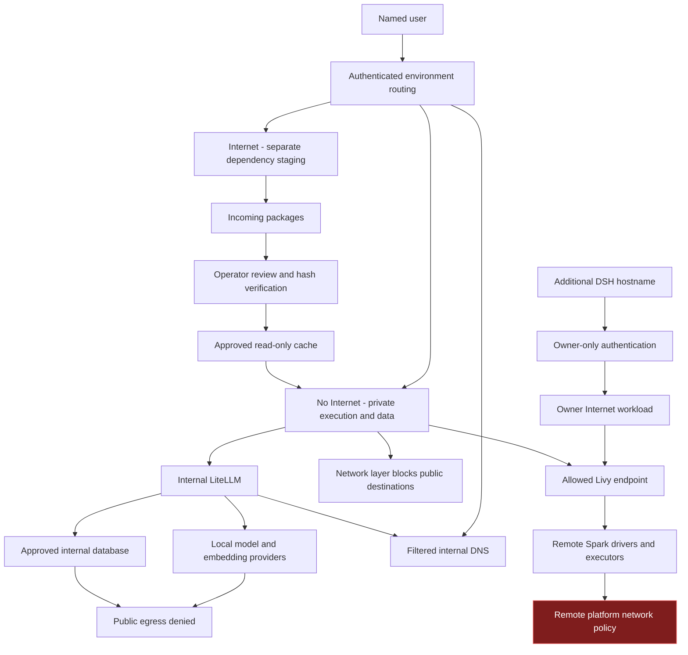
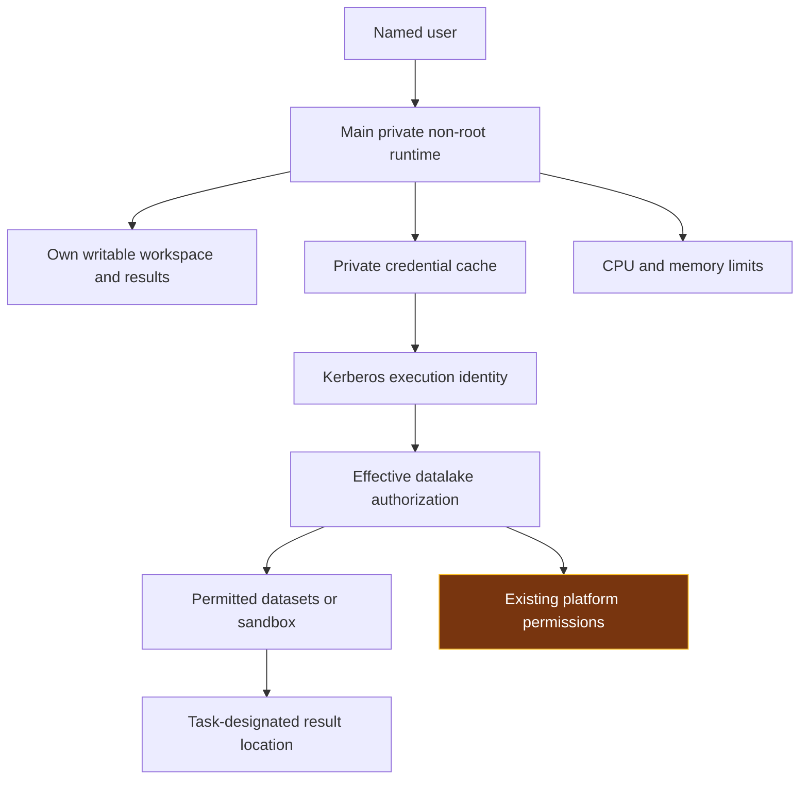
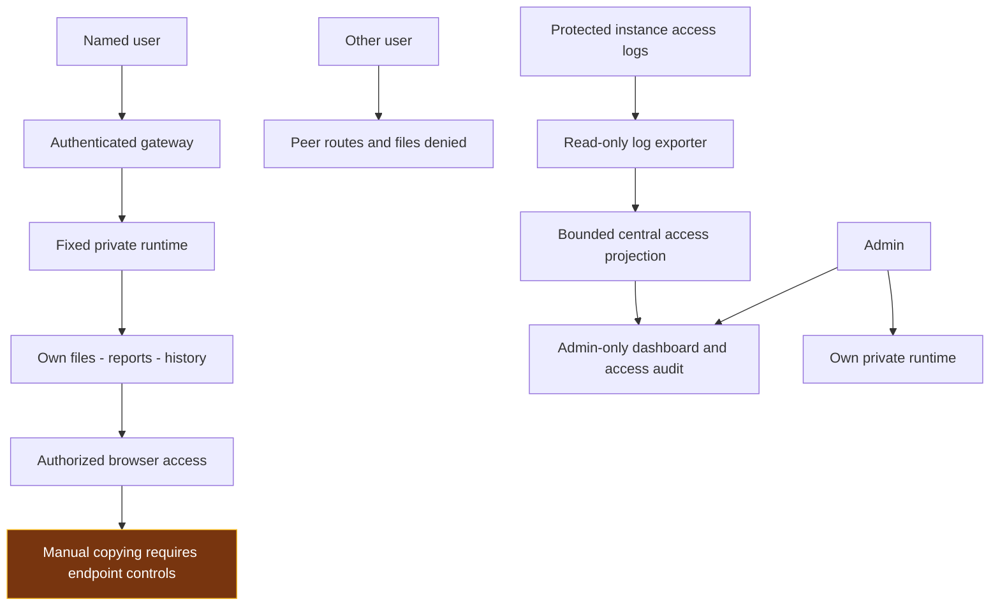
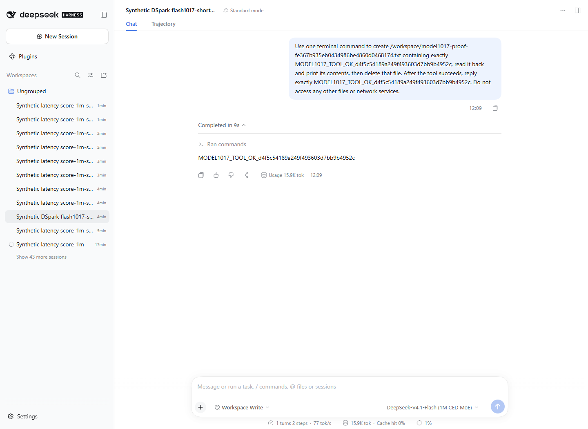
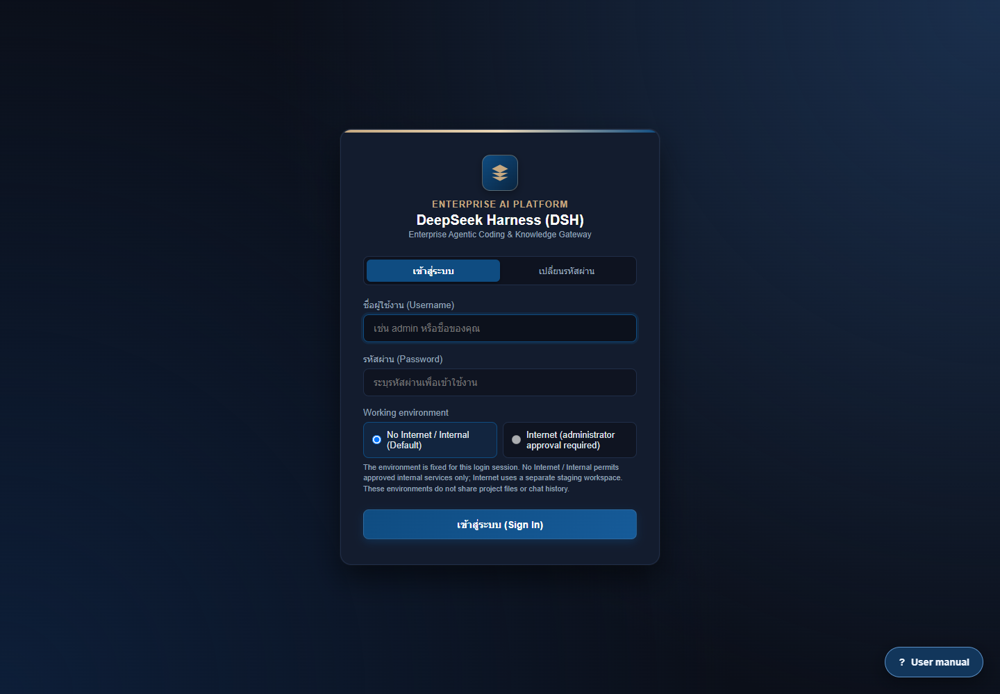
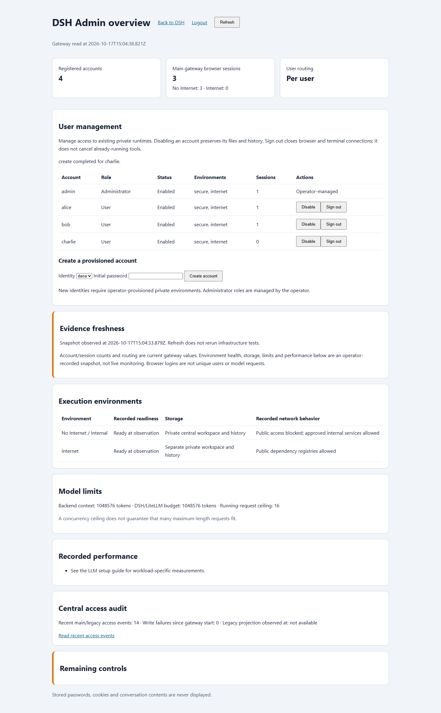

# DSH — Security, Environments and Features

This guide explains how the platform controls external leakage, damage or excessive access, and exposure of results, followed by its features and labelled interface screenshots. The environment outline is incorporated as design decisions rather than treated as an approved configuration.

For installation, configuration, rollback and measured results, use the companion [Setup and Stress-Test Guide](DSH_SETUP_AND_STRESS_TEST_GUIDE.html).

DSH controls three risks: external leakage, damage or excessive access, and exposure of results. The Harness, its tools and generated code are treated as automation that can make mistakes. The application therefore enforces boundaries through network policy, private execution, scoped storage and authenticated routes rather than relying on prompt instructions.

### Technology choices and the boundaries they support

The pilot outline separates the technology choice from the acceptable risk boundary. A component being installed, or a rule appearing in a prompt, does not establish that the boundary is enforced. The following summary describes how the DSH design addresses the outline; it does not adopt its illustrative responses as approved requirements.

| Component | DSH design and reason | Risk-control role |
|---|---|---|
| Agent framework / Harness | DeepSeek Harness provides the web workspace, file operations, tools and report generation. Generated code is treated as untrusted automation. | Put enforcement outside the agent: private execution, destination restrictions and authenticated file access. |
| Language model | Internally hosted DeepSeek-V4.1-Flash is reached through the managed LiteLLM route. | Keep managed model requests on internal infrastructure; disable external fallback instead of relying on the model to avoid external providers. |
| Model serving | LiteLLM provides the controlled API route to the SGLang GPU service. A local embedding service is separate from generation. | Separate shared inference from private workspaces and keep provider credentials outside user-controlled routing decisions. The outline's Ollama serving example is not the DSH text-generation architecture. |
| Code execution | Tools run in each user's selected Kubernetes runtime. Libraries come from the prepared runtime and approved package path. | Non-root identity, limited mounts, resource limits and network policy contain execution. Remote submitted jobs have a separate platform boundary. |
| Infrastructure and storage | Kubernetes supplies compute isolation; scoped central CIFS directories provide durable working files and histories. | Separate users and environments, avoid broad parent mounts, and keep original inputs apart from writable results when a task requires input protection. Persistence is not an independent backup. |
| UI and data access | An authenticated gateway serves user-bound workspaces, reports and terminals. Connected data services apply the chosen execution identity's permissions. | No public file bypass or automatic publication. An internal UI does not by itself restrict datasets or make remote execution offline. |

The outline uses public snapshots, read-only originals and no production connection as examples. Those are valid choices for a specifically approved exercise, but they are not universal restrictions imposed by this deployment. Define the permitted data, account, destinations, write scope and output recipients before an exercise. If its boundary requires sandbox-only access or immutable inputs, provision the matching platform permissions or protected input copy; instructions alone are insufficient.

## 1 Prevent external leakage

### Control objective

Prevent unauthorized public connections from the No Internet execution environment while retaining only the internal services required for work. Internet access is provided through a separate environment for dependency preparation, with no automatic transfer of protected data.

### Separate execution and network boundaries

No Internet / Internal is the default login choice. Each main user has a private runtime for this environment and a different private Internet runtime. Authentication fixes the user/environment route for the login session. Switching environments requires logout and a new login; a submitted username, routing header or changed selection cannot choose another user's backend.

No Internet has a restricted outbound network policy. Its approved paths include internal inference, controlled DNS and permitted authentication or job-submission services. Public-domain and direct-IP connectivity are restricted at the network layer, including commands launched from the terminal. The runtime has no Kubernetes management token with which to change its own policy.

The Internet environment has separate compute, workspace, histories and credentials. It does not mount protected No Internet working data. Its public connectivity supports dependency preparation; it is not an alternate processing route for protected prompts, tickets, datasets or reports. The shared internal gateway and inference services do not merge user workspaces. This architecture provides restricted egress, rather than a strict air gap.

The gateway, LiteLLM, local model providers and supporting database have their own destination restrictions. Filtered internal DNS serves approved internal names rather than forwarding arbitrary public lookups. Supplied model clients use internal LiteLLM with model-scoped credentials and operator-owned configuration; external model fallback is disabled for the managed route. Client configuration complements infrastructure enforcement and does not replace it.

### Transfer dependencies without sharing protected workspaces

The Internet environment downloads package artifacts into an incoming area. An operator reviews their source, version and expected hashes. A controlled promotion process verifies selected bytes and places approved artifacts in a separate cache. No Internet mounts that cache read-only and installs without a public package index.

Internet cannot directly install into the protected runtime or modify its workspace. Prompts, datasets, credentials, histories and reports are not dependency artifacts and must not use this transfer path. Hash verification establishes artifact integrity; package approval remains necessary because an intact package can still contain harmful code.

### Keep environment choices explicit

DSH2 and DSH3 are owner-only Internet-capable instances. The No Internet choice is disabled on these instances. Their authenticated proxies and ingress restrictions prevent direct peer access, while retaining their intended internal inference and permitted service connections. Protected offline work uses the designated No Internet environment.

An internal connection to another platform does not grant administration of that platform. If a submitted command executes remotely, that platform applies its own permissions and network rules; this responsibility is separated in the final section.

## 2 Prevent damage or excessive access

### Control objective

Contain local execution and prevent peer or administrative access beyond the selected user's environment. Preserve existing permissions on connected platforms instead of silently granting broader access or imposing an unrequested replacement authorization policy.

### Run tools within a private, restricted workload

Each main user/environment has a separate execution process with bounded workspace, session, attachment and credential mounts. Isolation is enforced through the workload and mounted scope, rather than merely choosing different folders in one shared process. Broad parent directories containing other users' data and host-management interfaces are not exposed to ordinary execution.

The workloads execute as non-root, disable privilege escalation, drop Linux capabilities, use RuntimeDefault seccomp and have no mounted Kubernetes management token. CPU and memory limits constrain local resource use. Additional instances similarly use restricted non-root execution with a designated owner account.

DSH and the managed Claude Code, TrueForge and Kilo CLI clients inherit the selected runtime's identity, mounts and network policy. Installing a tool does not grant a privileged container, host socket or another user's credentials. TrueForge's optional nested sandbox is disabled. Its ordinary tools run within the selected runtime's existing restrictions.

### Preserve private work and bounded write access

Protected working files and durable histories use bounded central CIFS paths. Internet workspaces and histories remain separate. Credentials and profiles remain in their designated private state locations, while approved dependency artifacts are read-only. Generated outputs belong in the user's designated writable working area.

Existing histories and files retain their ownership. An explicitly authorized support copy is independent and does not reassign the source, expose a shared parent directory or establish ongoing synchronization. Persistence across runtime replacement is part of the application design; independent recovery from authorized or accidental deletion is a separate storage-service responsibility.

### Use connected services under existing authorization

Datalake connections authenticate with the applicable Kerberos principal. DSH does not expand that principal's permissions, grant administration of the datalake or redefine its dataset scope. Submitted commands remain subject to that platform's authorization and execution controls. Existing personal and system-account entitlements are preserved.

A generated command can still make a mistake within permissions already granted. Tasks should therefore separate original inputs from outputs and review destructive operations where appropriate. For sandbox-only or read-only work, use an entitlement provisioned by the relevant platform owner.

### Separate input protection from permission to execute

A private runtime prevents access to another user's workspace; it does not make the current user's writable source data immutable. Where the agreed task forbids modifying originals, expose an approved read-only input snapshot or view and write generated code, reports and working copies to a separate writable location. The data or storage owner must enforce that distinction. Do not describe preserved personal read/write entitlements as a read-only guarantee.

The agent may generate and run analytical code within its assigned boundary, but must not receive cluster administration, host-management sockets, unrelated service credentials or permission to enlarge its own mounts or network access. Tool approval is an additional operational choice; it is not a substitute for restricting the execution identity. A connected remote job inherits the remote platform's controls, not the local container's filesystem or egress policy.

### Bound shared resources

The inference route counts the complete request, reserves output capacity and controls admission of expensive work. Long requests use bounded waiting and an explicit busy response while shorter work remains schedulable. Admission manages shared capacity independently of data authorization. Local process limits and shared inference scheduling are DSH controls; remote job queues remain under the platform that executes those jobs.

For a shared-service pilot, define a workload budget as well as CPU and memory limits: allowed job duration, cancellation responsibility, output/storage growth and expected concurrent use. Long-running or repeated work should be cancellable through its executing service and should not bypass admission controls by spawning unrelated jobs. Administrators use the centralized dashboard and activity log to identify the affected user/environment and investigate abnormal consumption. Gateway access events are not complete CPU/GPU, disk or remote-cluster telemetry; remote job accounting, disk quotas and enforced execution deadlines must be configured where those workloads run before claiming those specific boundaries.

## 3 Keep results contained

### Control objective

Keep histories, reports, files, attachments and terminal access within authorized user routes. Separate operational oversight from automatic access to user content.

### Authenticate access and bind it to private storage

The gateway supports self-service account creation by assigning an exclusive, prepared private runtime pair. New accounts have Internet denied by default; an administrator grants it separately. Each authenticated identity is bound to its own assigned runtime, and full capacity causes signup refusal rather than shared execution. Reports, files, attachments and terminal WebSockets use the authenticated boundary. Server-side identity and route checks reject forged roles, peer-runtime selection and direct bypass paths.

Each user/environment has separate working files and history storage. Switching environments does not automatically transfer content or credentials. Logout invalidates the gateway session. Additional instances admit only their designated owners; shared guest and cross-account logins are disabled.

Account stores use salted scrypt password records and bounded verification. Authentication records are stored outside execution workspaces, with protected account volumes and operator-only recovery material. Supplied bootstrap configuration does not create factory-password accounts. Users can change passwords through the authenticated flow; startup does not overwrite a changed password.

### Centralize oversight without merging user content

The admin-only dashboard combines operational information and access events. Administrative visibility does not automatically grant access to another user's conversations or files. Any authorized support copy remains in a separate private store and preserves the original owner's records.

Access auditing records relevant events, user, environment and time outside execution workspaces. It excludes passwords, Kerberos tickets and conversation bodies. Instance exporters read only their access-log scope and write a bounded central projection. Execution users do not receive the account or audit stores. Required gateway auditing fails closed when an access event cannot be persisted.

The dashboard distinguishes timestamped infrastructure snapshots from current gateway information. Refresh reloads the saved snapshot. Access logs support accountability; a full command recorder, conversation archive and independent audit-retention service are separate capabilities.

### Deliver generated results through the same boundary

Working reports, charts, temporary files and generated applications remain in the private environment. Server-side file access uses the authenticated identity rather than a submitted owner name or arbitrary filesystem path. Exposing a new application requires the same authenticated proxy and user-bound storage; it does not justify a new public bypass route.

The managed workflow does not automatically publish protected results externally. The No Internet environment's network policy blocks direct public transmission from its execution runtime. Internet-capable tools must not be represented as having the same offline restriction. Authorized viewing and downloading are normal application functions; additional restrictions on what a person copies require an explicit handling policy and endpoint controls.

### Review analytical results before operational use

Containment includes controlling how a result is used, not only who can download it. Keep generated code, input selection, calculation assumptions and resulting reports together in the private workspace so an authorized reviewer can reproduce the analysis. Label exploratory findings as provisional and compare important calculations with known reference results before relying on them.

A fluent answer, a completed tool run or a plausible chart is not validation of analytical correctness. The pilot workflow should require human review before a result triggers an operational decision, source-data correction or downstream publication. If an integration can perform such actions, enforce its permitted operations and approval step at that integration; a report warning alone does not prevent writeback. These are task-level operating boundaries, not a claim that DSH implements a universal accuracy gate or disables every user's existing write permission.

### Translate the pilot outline into an explicit decision

| Outline risk dimension | How it fits the three controls | Decision needed for the particular exercise |
|---|---|---|
| Data confidentiality | Risk 1 restricts outbound execution; Risk 3 limits access to resulting files. | Identify permitted data classification, destinations and recipients. A public-data-only claim needs a defined dataset and matching access scope. |
| Source-data integrity | Risk 2 separates protected originals from writable results. | Decide whether originals must be read-only and arrange that permission at the source. |
| System access and autonomy | Risk 2 constrains identities, tools, mounts and privilege changes. | Define allowed connected services and destructive operations; retain remote-platform enforcement. |
| Resource and operational impact | Risk 2 bounds local execution and shared inference; central oversight supports investigation. | Assign job deadlines, cancellation, storage budgets and remote-cluster monitoring to the enforcing service. |
| Analytical reliability | Risk 3 keeps provisional findings in an authorized review workflow. | Set reference calculations, reviewer and permitted downstream actions; do not treat generated output as approved automatically. |

Agree the boundary first, then identify the enforcing component and its owner. A boundary that is undecided or not checked must remain explicitly unconfirmed; the outline's example controls and this design explanation do not establish a new acceptance result. This keeps the three-risk structure while making the pilot's technology, autonomy and review decisions understandable.

## Connected services and responsibilities

Use these responsibility boundaries when planning connected services, data access and operations.

| Boundary | Responsibility and agreed treatment |
|---|---|
| Remote Livy/Spark execution | The datalake platform controls its drivers, executors, job limits and outbound network. DSH restricts its local submission path but does not administer those machines. Livy/Spark remains available. Its remote workers require their own outbound controls. |
| Dataset and sandbox authorization | The platform's existing Kerberos/AD and data permissions remain authoritative. Use a sandbox-only or read-only entitlement when the task requires it. |
| Authorized browser handling | Viewing, copying and downloading by an authorized person are distinct from peer access or unauthorized publication. Device restrictions, managed browsers or DLP apply only where required by the organization's handling policy. |
| Identity lifecycle | Authentication uses local accounts with an authenticated password-change flow. Corporate SSO/MFA and organization-wide recovery require separate integration. Change any exposed or known password; hashing protects stored records, not a password already known to someone else. |
| Storage recovery and infrastructure administration | Central storage provides persistence. Storage-server ACL administration, independent backups and disaster recovery belong to that service. Cluster, host and storage administrators remain trusted privileged operators. |
| Audit-service extensions | Current central access logging and dashboard oversight are included. Complete command/body capture, remote-job correlation and independently retained audit archives require additional collectors and an operating policy. |
| Deliberately Internet-capable environments | Internet staging and the additional Internet instances retain their intended public connectivity. They are not protected No Internet environments and must not be used as an automatic bridge for protected content. |

## Platform features and intended use

The main interface is the DSH web workspace. Claude Code, TrueForge and Kilo CLI are optional clients available inside its private execution environment; they do not replace the DSH web interface. One shared local model serves these clients without sharing their working files.

| Capability | How it is used | Implemented boundary or limitation |
|---|---|---|
| Named local login | Use Create account, then sign in to your private No Internet workspace; change your password through the login page | Internet needs separate admin approval. Signup is bounded by private-pair capacity; local identity is separate from AD. |
| Environment selection | No Internet / Internal is the default; Internet is a separate login choice | Logout and sign in again to change environment. Project files, histories and credentials are not automatically transferred. |
| Private user execution | Work in the assigned runtime and its mounted workspace | Main users have separate runtimes in both environments. Additional instances are owner-only Internet environments. |
| Web chat and task execution | Ask DSH to inspect code, edit files, explain documents and run available tools | Commands run with the runtime's non-root permissions. Review consequential changes; model output is not automatically correct. |
| Workspaces and projects | Keep repositories, scripts and results under `/workspace` | The selected environment's mounts define what is visible. A folder name alone is not the isolation mechanism. |
| Persistent history and attachments | Reopen sessions and use their associated files | Workspace, session and attachment stores persist according to their mounts. Credential/profile state has a separate scope. |
| Long-context analysis | Supply relevant repository/document material to the managed local model | DSH supports a 1,048,576 total-token budget, not unlimited input plus output. Large cold prompts can take many minutes. |
| Compaction and tool-result pruning | Use `/compact` where appropriate; automatic compaction is configured | Compaction must reduce context; it can refuse a non-reducing summary. Save important findings and source references before compacting. |
| Web terminal | Open the authenticated terminal and run tools in the selected environment | Same user, mounts, non-root identity and network boundary; opening a terminal does not grant host or cluster administration. |
| Application previews | Start a server on an approved free port, then open the authenticated app route | Serve only the intended result folder. A new server must remain behind the gateway; an arbitrary public route is not automatically protected. |
| Claude Code | Run the installed `claude` client from the terminal | Managed internal endpoint/model and persistent private client state. Current default uses the client's 1,000,000-token mode. |
| TrueForge | Start `trueforge`, then open its authenticated port-3000 app route | Private client state and managed internal model. Optional nested code sandbox is disabled. |
| JupyterLab | Run `jupyter lab`, then open `/proxy/8888/lab` on the same DSH address | Python notebooks in the selected private workspace; authenticated gateway, non-root kernel, unchanged environment network restrictions. |
| Kilo Code CLI | Run `kilo` or `kilo run` from the authenticated terminal | Pinned managed CLI, internal LiteLLM only, private `/state/kilo` state, sharing/telemetry disabled. Qualification is recorded in the [managed-client guide](MANAGED_CLIENT_SUPPORT.html). |
| Offline dependency preparation | Download in Internet, approve artifacts, install from the read-only cache in No Internet | Python/npm helpers exist. Native/OS dependencies may need a qualified runtime-image build; the package cache is not a shared writable workspace. |
| Kerberos and datalake connection | Authenticate privately using the intended principal and configured client | Existing platform permissions remain authoritative. Local DSH login and central storage do not grant data access. |
| Central dashboard and user management | Admin reviews accounts, private environments, browser sessions and access events; creates accounts from available private capacity, approves/revokes Internet, enables/disables access and signs users out | User files and history remain intact. Replenishing private capacity and granting administrator roles remain operator actions. |
| Plugins and upstream tools | Use approved installed DSH plugins/tools within the same runtime | The upstream plugin architecture is available; each optional integration needs its own configuration and qualification. |
| Upstream maintenance | Detect releases, verify patch contracts, build and test candidates | Default follows the official npm latest channel. Reviewed compatibility patches and deployment overlays are separate; no automatic Production merge. |
| Flexible inference placement | Keep DSH workspaces separate from LiteLLM and GPU compute | Same-cluster node separation uses Service DNS. A remote GPU origin is supported by the portable renderer; remote LiteLLM uses the approved gateway relay or coordinated client policies. See [topology and setup](FLEXIBLE_DEPLOYMENT.html). |
| Operations and rollback | Preserve specifications, image/source digests and mounted data before change | Restore compatible configuration on regression; never overwrite newer work with an older history copy. |

### Managed client compatibility

Claude Code returned the expected ordinary reply in 1.17 seconds; TrueForge returned it in 0.73 seconds with its saved assistant response verified in the recorded 1017 compatibility tests. Kilo CLI 7.8.12 subsequently passed an exact ordinary reply in 9.05 seconds in a non-root No Internet canary, plus a real read-tool operation and saved-session recovery after pod replacement; it is deployed to all 20 main runtimes. These timings are separate samples including different startup conditions, not a controlled client speed comparison. These are ordinary-request checks, separate from native DSH near-1M acceptance. They do not establish near-1M support or a latency guarantee for every client. [Client versions, usage and acceptance scope](MANAGED_CLIENT_SUPPORT.html).

## Who can create accounts and use Internet

Use **Create account** on the login page to sign up and receive an exclusive prepared private runtime pair. Internet stays denied until an administrator grants it through User management. Administrators can also create accounts from available private capacity. Full capacity refuses signup; operators add new empty pairs. See the [signup and approval guide](SELF_SERVICE_SIGNUP.html).

Internet access is a separate per-user permission. Every non-admin account starts without it; administrators retain access and may grant or revoke it individually. The Internet radio option is disabled until valid credentials confirm the permission. The server rejects a forged Internet selection regardless of the browser state. Revocation signs the user out and closes tracked gateway connections; it does not cancel tools already executing. Password changes preserve the permission. No Internet remains the default even for approved users.

These controls are deployed on the main gateway. Separate legacy-instance gateways are not covered by this permission change. Activity oversight and account administration do not grant ownership of private user content.

The deployed dashboard provides account management, access activity and numeric summaries from the configured private runtimes, including assigned signup pairs: stored sessions, running agents, queued messages, turns, LLM steps, input/output token totals, recorded decode and wall-clock output rates, and workspace/durable-storage sizes. These are scoped snapshots, not live GPU utilization or independent Claude Code/TrueForge accounting. Actual deployed-code authorization and numeric collection were checked using a loopback-only disposable authenticated account; a real administrator password/browser login was not part of that acceptance. See the [dashboard definitions and scope](ADMIN_USAGE_TELEMETRY.html). Saved demonstration screenshots do not show current utilization.

## Environment and access design

Users enter through the authenticated gateway. The selected identity and environment determine the private runtime and storage scope; browser-supplied names or routing headers do not grant access to another user's environment.

| Access surface | Purpose | Enforced boundary |
|---|---|---|
| Main No Internet environment | Work with internal data and tools without direct public Internet access | Default environment; private execution/storage and restricted destinations. Remote submitted jobs remain subject to their own platform's network controls. |
| Main Internet environment | Prepare dependencies and perform explicitly Internet-capable work | Separate private execution, files, histories and credentials. It does not mount protected No Internet content. |
| Additional owner instances | Provide an assigned owner's Internet-capable workspace | Owner-only authentication and scoped storage; not represented as No Internet environments. |
| Admin overview, /admin | Manage accounts, Internet grants and available private capacity; review access events | Admin authorization; operational oversight does not automatically grant ownership of users' files or histories. |
| Terminal, /terminal, and approved application previews | Run tools and view generated applications in the selected environment | Authenticated HTTP/WebSocket routing and the same private runtime identity, mounts and network policy. |
| Shared internal inference and optional embeddings | Serve model requests without duplicating GPU models for each user | Internal authenticated route with controlled destinations; shared inference does not merge workspaces. |

Logout ends the gateway session. Changing environment requires signing in again and does not copy files, conversation history or credentials between environments. Incoming and approved package areas provide the controlled dependency-transfer path; they are not shared project storage.

## Interface screenshots

### DSH working session: controlled tool operation

This is an actual completed synthetic DSH conversation in a disposable No Internet runtime using the 1017 checkpoint. The task creates, reads and removes one synthetic file, then returns its exact marker. The screenshot shows the operating interface and recorded response; corresponding execution records confirm the tool result and cleanup. It is not a Production user session, a general authorization test or complete 1017 near-1M qualification.

The sign-in screenshot illustrates the recorded interface, not a fresh availability check. Dashboard screenshots use demonstration accounts and values to explain the controls.

### Main login and environment selection

No Internet / Internal is selected by default.

### Central dashboard and user management

Open **Admin overview** from DSH, or sign in as an administrator and open `/admin`.

Dashboard interface with demonstration accounts. The account table shows each user's role, enabled status, assigned environments and active browser sessions.

1. **Review accounts:** inspect the account table and environment assignments. Current account/session information is read from the gateway; infrastructure panels show their observation time.
2. **Create an account:** enter a unique username and an initial password of at least 12 characters, then select **Create account**. An exclusive prepared private pair is assigned automatically. The user can also sign up through the login page. If capacity is full, an operator adds new empty pairs; existing slots are not recycled.
3. **Disable or enable access:** select **Disable** or **Enable** beside an ordinary account. Disabling prevents new logins and ends its active gateway sessions and WebSocket connections. Its workspace and histories are preserved.
4. **Sign a user out:** select **Sign out** to revoke current gateway sessions and close browser/terminal WebSocket connections. This does not disable the account or cancel a tool already running in its private runtime.
5. **Review activity:** open **Central access audit** to inspect login, access and account-management events. Management events identify the administrator and affected account.

Administrator accounts and roles are maintained by the operator. The dashboard does not grant datalake permissions or expose stored passwords, Kerberos credentials or conversation contents.

