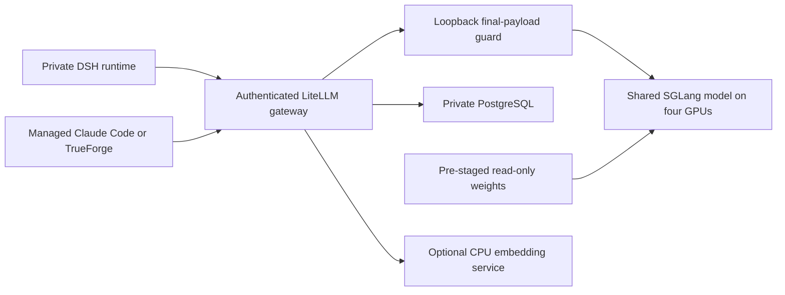

# DSH — Step-by-Step Setup and Stress-Test Results

This operator guide separates reproducible setup, recorded accepted behavior and experimental profiles. Read the companion [Security, Environments and Features](DSH_SECURITY_ENVIRONMENT_AND_FEATURES.html) for the three risk boundaries and interface screenshots. Creating these documents does not deploy or benchmark the system.

## Latest implementation and qualification

**19 October 2026: the DSpark profile is qualified for the recorded workloads.** The current portable defaults match the promoted profile. The complete near-1M, cached-output and tool tests ran before a handover with identical GPU arguments and the same four runtime-module hashes. Startup, structured replies, corrected concurrency delivery and prose checks ran again after that handover. These are distinct test scopes, rather than a claim that every long workload was rerun after it.

| Setting | Current qualified profile |
|---|---|
| Total context ceiling | 1,048,576 tokens |
| Speculative decoding | DSpark block 5 |
| Static GPU memory fraction | 0.923 |
| Active request / decode graph cap | 8 / 8 |
| GPU prefill chunk / maximum prefill | 1,024 / 1,024 |
| Prefix tails | 16 |
| Long admission | One active request above 128K, one bounded FIFO waiter; ordinary requests bypass long admission |

### Measured results and their scope

| Workload | Result | Interpretation |
|---|---|---|
| Full near-1M DSH request | 1,007,752 input / 431 output tokens; exact saved answer; 1,342.17 seconds overall; 147.82 streaming output tokens/sec | Long preparation and output generation are different costs. No retry, allocator warning or unexpected restart in this run. |
| Ordinary replies during near-1M work | 46 correct, saved, retry-free replies; paired median 5.08 seconds; two eight-client bursts | One long request can coexist with ordinary work. This is not two full-1M requests or a latency SLA. |
| Cached near-1M follow-up | 1,008,209 input / 1,199 output tokens; exact answer in 14.86 seconds; 158.32 streaming tokens/sec | Reused context, not a new cold-preparation benchmark. |
| Real tool continuation | 1,009,673 input tokens; create/read/delete marker sequence passed in 13.42 seconds; cleanup verified | Actual file/tool behavior in a disposable runtime, not a Production data mutation. |
| Fresh post-handover concurrency | 31/31 exact, saved, retry-free replies across 1, 2, 4, 8 and 16 clients | The active cap is eight; a 16-client burst can queue. All 16 are not guaranteed to decode simultaneously. |
| Natural-language explanation | Initial answer required factual correction; reviewed correction streamed at 96.76 tokens/sec | Structured 164–166 tokens/sec samples do not establish 100+ for all prose or general analytical accuracy. |
| History preservation | 167 original histories / 188 original session files across 20 main runtimes retained their IDs and bytes | The inference change did not require replacing user workspace mounts. |

### Reliability boundaries and lessons

Memory remains tight: a one-second NVML sample observed a minimum of 38 MiB free per GPU during the capacity workload. This is sampled telemetry, not a continuous peak bound or proof of universal stability. Keep admission control and the exact last qualified rollback configuration.

Earlier trials failed from temporary score/dequantization allocations despite apparently sufficient KV-cache slots. Smaller score tiles, reduced intermediates and additional dynamic headroom enabled the current workload. Startup equivalence checks complement full actual DSH tests; neither replaces the other.

A Windows control-channel failure initially marked one follow-up controller failed. Its raw result remains preserved. All 16 saved native replies were independently recovered and verified, and the corrected single-channel fresh test then passed all 31 replies. That transport incident is not relabelled as a model OOM or silently removed.

The managed DeepSeek aliases declare 1M in all 20 main web profiles; other model entries retain their own budgets. These results concern native DSH through shared inference. They do not by themselves repeat every Claude Code/TrueForge capacity test or all application security checks.

See the [sanitized qualification record](https://github.com/skunpoj/dsh_setup/blob/main/docs/context-evidence/dspark-qualification-20261019.json) and the [detailed optimization report](https://github.com/skunpoj/dsh_setup/blob/main/docs/PERFORMANCE_OPTIMIZATION_20261018.html) for the workload-specific source records.


### Full latest-test coverage

| Check | Recorded result |
|---|---|
| 256K capacity | 257,691 input tokens; correct saved answer in 130.57 seconds; eight overlapping short replies, median 3.56 seconds. The seven-token answer is too short for a useful decode-speed benchmark. |
| Fresh structured output | Three exact, persisted 599-token answers at 164.60–166.11 streaming output tokens/sec. |
| Startup reference gates | 80 score cases, eight tiled cases, 132 FP4 cases and eight memory checks passed; optimized Python is refused before the gates can be bypassed. |
| Full-capacity ordinary bursts | Eight-client cohorts passed at prepared prefixes of 655,360 and 917,504 tokens, with the long request still active. |

| Fresh clients after handover | Individual whole-request time | Combined cohort output tokens/sec |
|---|---|---:|
| 1 | 1.29 seconds | 92.35 |
| 2 | 2.59–2.84 seconds | 83.76 |
| 4 | 2.87–3.88 seconds | 122.43 |
| 8 | 3.20–5.98 seconds | 158.45 |
| 16 | 3.11–11.21 seconds | 169.01 |

The five fresh groups total 31 unique saved replies. All were exact and retry-free. Combined throughput includes the entire request window and is distinct from one conversation's streaming speed. The model can admit eight active requests; excess clients may queue.

### Checkpoint scope

The results above remain bound to the checkpoint and four runtime-source hashes qualified on 19 October 2026. A separate task is staging DeepSeek-V4.1-Flash-1017, pinned revision `1bae0e1088993b9b82de08f59de5be5a34e42170`. That staging work does not change which model these results tested, and does not qualify the new weights. Re-run the relevant acceptance checks before attributing the recorded performance to that checkpoint.


## Deploy the DSH application and private environments

### 1 Prepare site settings and preserve rollback

Choose the approved namespace, public gateway hostname, trusted CA, internal service destinations, storage claims and operator identities. Keep private settings and credential values outside Git. Save current image digests, workload/configuration specifications and history/workspace checks before an existing-site change. Build a test namespace first; a documentation example is not an instruction to apply all legacy manifests.

### 2 Build and qualify the application image

The repository Dockerfile packages pinned DSH, Claude Code and TrueForge versions, Linux/Python/Kerberos tooling and the reviewed compatibility overlays. Its default package versions are DSH 0.2.0-rc.2, Claude Code 2.1.301 and TrueForge 0.179.2. Build through the approved image pipeline, inspect the installed package/patch checks and retain the pushed immutable digest. No Internet runtime must start from a prebuilt image rather than downloading packages at startup. Version pins are source defaults, not a fresh check of the upstream registry.

### 3 Provision private storage and identity routes

Use one private runtime per user and environment with bounded workspace, session, attachment and credential mounts. Assign the original owner explicitly when migrating existing content. No Internet uses scoped central storage for durable work/history; keep credentials private and Internet staging separate. Approved packages are read-only to No Internet. Run as the configured non-root identity and map share permissions deliberately. Do not mount a broad parent containing other users' content or migrate a live writer without reconciliation.

### 4 Configure the gateway, policy and internal services

Provision accounts through the protected gateway store and map server-side user/environment routes. Do not put credentials into source manifests. Default login to No Internet; switching requires a new login. Apply the enforcing network policies, filtered internal DNS and service-specific allowlists before making the environment available. Cover gateway, tools, inference and database separately. Retain authenticated terminal, attachment/report and application-preview routes; do not create a public bypass. Livy/Spark remains available under its documented remote-network boundary.

### 5 Provision named accounts and verify isolation

Create only accounts with an already provisioned private runtime pair, then let owners change initial passwords privately. Verify correct and incorrect login, logout, role checks, cross-user file/history refusal, terminal routing, No Internet public-destination denial, internal inference and approved-package read-only behavior. Use synthetic users/content for negative tests. A successful login alone does not verify storage or network isolation.

### 6 Check persistence, dashboard and handover

Create a disposable workspace/history marker, replace the intended runtime in a controlled test and read back the same content. Check the centralized dashboard and access audit without exposing credentials or conversation bodies. Preserve existing histories byte-for-byte during migrations; central persistence is not an independent backup. Roll back application/image/configuration on regression while retaining newer durable writes.

The detailed operational procedures remain in [storage and persistence](https://github.com/skunpoj/dsh_setup/blob/main/docs/MULTI_TENANT_STORAGE_AND_PERSISTENCE.md), [upstream maintenance](https://github.com/skunpoj/dsh_setup/blob/main/docs/UPSTREAM_SYNC_AND_INTERNET_POLICY.md) and the reviewed repository deployment sources. Site-specific Secret, storage and destination values are intentionally not supplied by this public guide.

## Shared inference architecture


The platform uses one shared four-GPU generative model. Private user runtimes share inference while keeping their own files and state. Use the portable `gpu-stack` source and supply private site values outside Git.




## Step-by-step GPU and LiteLLM setup

These steps reproduce the current qualified portable profile, including its reviewed runtime overlays. Verify the pinned sources and requalify behavior on the target environment before rollout.

### 1 Prepare prerequisites and a test environment

Use a reviewed test namespace and verify GPU capacity before scheduling. Install the approved NVIDIA device plugin and an enforcing network-policy implementation. The portable template requests 256 GiB host RAM and allows 512 GiB; verify actual capacity rather than assuming it is available.

Stage the approved model revision in a PVC, with the expected model path under `/approved`. Verify the complete files against their approved source/revision/hash manifest. Review any model code required by `--trust-remote-code`; runtime downloads remain disabled and the model cache is read-only.

### 2 Provision private database and inference credentials

Provision PostgreSQL and its protected durable storage through the site's operating process. The portable renderer does not create or migrate the database. Prepare credential and database Secrets privately. The example bundle refers to `local-inference-credentials` and `local-inference-database`; required keys include `LITELLM_MASTER_KEY`, `INTERNAL_ROUTE_KEY` and `DATABASE_URL`.

Never put their values in the guide, Git, model prompts or shell transcripts. The master key is for operators. Give each runtime a restricted model-only client key and verify that administrative API operations are denied. Only the authenticated gateway should reach the model; clients must not bypass the final-wire guard through a direct model ingress.

### 3 Render a candidate from portable settings

Copy `gpu-stack/settings.example.json` into a private location. Set the namespace, model PVC, existing Secret names and qualified digest-pinned gateway image there. Install Python and PyYAML in the operator's tooling environment, then render:

```sh
python gpu-stack/render.py \
  --settings /private/settings.json \
  --output /private/inference-candidate.yaml
kubectl -n <test-namespace> apply --dry-run=server \
  -f /private/inference-candidate.yaml
```

Inspect the rendered objects before applying them. The renderer refuses mutable image tags, unexpected settings and accidental overwrite of an existing candidate. The reviewed scheduler source hashes must match the installed runtime.

### 4 Apply network boundaries and health checks

Clients reach authenticated LiteLLM on port 4000. The final-wire listener is loopback-only, not a Kubernetes Service. The model listens on port 8000 behind the gateway boundary; PostgreSQL uses its narrowly allowed internal path. Client/worker, gateway, model, database and DNS policies must be considered separately. Use the site's approved internal resolver; generic DNS allowance alone is not a No Internet boundary.

Start the candidate only after weights, Secrets and database are available. Align the startup probe and progress deadline with the measured model initialization time; the reviewed deployment uses a 2,100-second progress deadline. Check actual loaded source, arguments, image IDs and response content rather than accepting readiness alone. A single shared model restart interrupts inference and needs a controlled handover.

### 5 Configure the clients consistently

Point managed DSH and CLI profiles at internal LiteLLM using restricted credentials. Keep total context, output ceiling, timeout, compaction policy and the final payload counter aligned. The managed SDK loader corrects the qualified character-estimation output-budget issue for the internal route only; unrelated clients/routes retain their own limits.

Use read-only operator-managed client policy. Claude/TrueForge installations and private state are separate from GPU provisioning. TrueForge's optional nested sandbox is not required for ordinary chat/API use and remains disabled under the current container restrictions. Do not grant privilege or mount a host socket to make it work.

### Optional embedding integration

BGE-M3 is a separate embedding use case, not the shared generative GPU model. Stage its approved model in the CPU Ollama service and use only the permitted internal or authenticated embedding route. Not every DSH runtime necessarily has direct permission to contact that provider. Do not add a public egress exception to make an embedding example work.

Example for an already permitted endpoint, using normal TLS verification:

```python
import json
import os
import urllib.request

request = urllib.request.Request(
    os.environ["APPROVED_EMBEDDING_URL"],
    data=json.dumps({
        "model": "bge-m3:latest",
        "input": ["Sample public financial inquiry"]
    }).encode(),
    headers={"Content-Type": "application/json"},
)
with urllib.request.urlopen(request, timeout=30) as response:
    vector = json.load(response)["embeddings"][0]
print(len(vector))  # BGE-M3's expected vector length is 1024.
```

Load the approved model before embedding requests. A model installed on disk may not be loaded in memory; check `/api/ps`. Configure the trusted CA and keep certificate verification enabled.

### 6 Qualify behavior and preserve rollback

Progressively test 128K, 256K, 512K and near-1M input with known answers and source checks. Verify substantial output, actual file/tool continuation and persisted responses. Run ordinary DSH requests during long work, distinguish API versus DSH versus alternative-client results, and measure admission/first-text/preparation/streaming separately. Test cancellation, queue bounds, endpoint overrides, over-budget refusal, credential scope and direct-model denial.

Run this native DSH concurrency probe from the repository root, supplying the approved disposable canary and a private result path. It refuses persistent or host-mounted storage and runs concurrent clients through one operator channel:

```sh
python scripts/probe_dsh_concurrency.py --namespace "$APP_NAMESPACE" --pod "$DISPOSABLE_DSH_POD" --expected-app "$DISPOSABLE_DSH_APP" --host "$DSH_HOST" --output "$PRIVATE_RESULT_JSON"
```

Check saved native answers and model health before attributing an operator transport failure to inference. The probe does not deploy or restart workloads. A confirmed incorrect answer or actual model failure remains a rollback trigger.

Retain the last qualified profile/image/source and state-preservation baseline before a change. Keep sufficient temporary GPU workspace by preserving the qualified memory fraction and bounded prefill settings. Keep the one-long-request admission policy and check answer accuracy against the task’s sources. Roll back on a genuine regression without overwriting newer workspace/history data.

The portable setup and its tests are maintained in `gpu-stack/`; detailed dated performance and acceptance records remain in the separate LLM guide.

## Use the deployed platform

Choose the intended environment before starting. The examples below cover common tasks.

### 1 Sign in and choose the environment

1. Open the main DSH address and sign in with your provisioned local account.
2. Leave No Internet / Internal selected for protected local work. Choose Internet only for its intended staging work.
3. Open the intended workspace or create a new session. Verify which environment you are using before adding files or authenticating to connected services.
4. To switch environments, logout and sign in again. To change a password, use the authenticated password-change flow; do not put credentials in chat or project files.

Check connectivity from the selected environment when needed; a listed web tool may still be blocked by its network policy.

### 2 Review a repository with traceable answers

Example prompt:

> Inspect this repository without changing files. Explain the request path, authentication boundary and persistence locations. Cite the exact file and line range for each factual claim. Separate observations from assumptions and list anything you could not verify.

For a large review, choose relevant code and documents rather than padding the input. Ask for a source ledger and check it against the actual files. Keep enough context headroom for tool definitions, output and follow-up work.

### 3 Produce a bounded analysis result

Place `sample.csv` in the selected workspace and ask:

> Read sample.csv. Report its row count, column names and missing-value counts. Write results/summary.json and a short results/report.html. Do not modify the input. State the exact files you read and verify the saved output.

Run a local inspection from the terminal when useful:

```sh
cd /workspace/<project>
python3 -m json.tool results/summary.json
```

Compare the saved results with the input and the requested calculations.

### 4 Use the web terminal and application preview

Open the authenticated terminal route for the selected DSH service. It runs in the assigned environment, not directly on the Kubernetes node. A new terminal tab does not switch identities or network environments.

To preview an existing result folder on a free approved port:

```sh
cd /workspace/<project>
python3 -m http.server 8080 --bind 0.0.0.0 --directory results
```

Open the service's authenticated `/proxy/8080/` route or configured port-8080 alias. Login must still be required. Stop the server with Ctrl+C after use. Serving only `results` avoids unintentionally publishing the entire workspace. Do not add an ingress or disable authentication merely to make a preview work.

### 5 Prepare Python dependencies for No Internet

In the Internet environment, create a pinned requirements file:

```sh
printf 'six==1.17.0\n' > requirements.txt
prepare-offline-deps python requirements.txt
```

This downloads to the incoming package area. An operator reviews source/version/hashes and performs controlled promotion. In No Internet, after approval:

```sh
python3 -m venv /workspace/<project>/.venv
/workspace/<project>/.venv/bin/python -m pip install \
  --no-index --find-links=/packages/approved/python six==1.17.0
/workspace/<project>/.venv/bin/python -c "import six; print(six.__version__)"
```

For npm, `prepare-offline-deps npm <project-directory>` requires the project's lockfile and populates incoming cache with install scripts disabled. Native modules, platform-specific wheels and OS libraries require compatibility review; copying an arbitrary package directory between environments is not a supported substitute.

### 6 Use managed alternative clients

From the selected terminal:

```sh
cd /workspace/<project>
claude -p "Read README.md and list three implementation questions; cite the relevant sections."
```

To use TrueForge, first ensure port 3000 is free, run `trueforge`, wait for its listening message and open the service's authenticated `/proxy/3000/` route or configured port-3000 alias. Its model/provider configuration is operator-managed; private chat state remains in that environment. Do not enable privileged container features to make the optional nested sandbox start.

### 7 Authenticate to a permitted datalake service

```sh
kinit <approved-principal>
klist
```

Enter the password only at the private authentication prompt. Use your configured Livy/Spark/Hive/HDFS client under that principal. DSH preserves the platform's effective permissions; an internal job submission is not datalake administration. Keep output in its intended location, review destructive operations and follow the platform's rules. Do not move tickets into Internet staging.

### 8 Use the admin overview

An authorized admin opens `/admin` through the main gateway. Review account/session counts, per-user routing, the observation timestamp, environment descriptions and recent access events. Refresh rereads the saved infrastructure snapshot and current gateway values; it does not execute a GPU benchmark or network probe. Use the separate operational tools for live troubleshooting. Admin rights do not automatically expose private conversation bodies; an explicitly authorized support copy remains independent.


## Storage, administration and maintenance

### Where work is stored

`/workspace` is the working location presented to each runtime; its backing PVC/subpath defines the durable store. Main No Internet project data and durable DSH histories use scoped central CIFS mounts. Credentials and profiles remain in private state locations. Internet workspaces/state remain separate, and the approved cache is mounted read-only where needed. Consult the runtime’s mount configuration for its backing storage.

DSH sessions/attachments and managed-client state are distinct stores. Claude uses its persistent private state; TrueForge uses its private application state. Instance client `/state` wiring can alias its existing owner-only durable home rather than creating another shared tree. Do not replace a working mount without stopped-writer reconciliation and preservation of newer writes.

### User and audit administration

Operators provision private runtime mappings through the identity and routing procedure. Administrators then manage provisioned local accounts through the dashboard. Account changes require an authenticated administrator session and a session-bound management token; ordinary users and cross-origin requests cannot perform these actions. Passwords are stored as salted scrypt records. Disabling access preserves ownership, files and histories; removing workloads or data is a separate operator procedure.

The access audit records bounded metadata such as time, event, user and environment. It is not a terminal-command recorder or an archive of all prompts/responses. Additional-instance access projections and main gateway events are combined under the admin boundary. Retention capacity, off-platform archival and remote-job correlation need the defined operational policy.

### Deploy dashboard changes

Run the account-management and existing dashboard regression suites before replacing the gateway:

```sh
node tests/test_admin_users.js
node tests/test_admin_dashboard.js
```

Use a new private rollback directory and the SHA-256 of the currently mounted gateway source. First inspect the plan, then repeat with `--apply` for the reviewed handover:

```sh
python scripts/rollout_admin_management.py \
  --output /private/admin-management-rollout \
  --expected-source-sha256 <current-mounted-source-sha256>

python scripts/rollout_admin_management.py \
  --output /private/admin-management-rollout \
  --expected-source-sha256 <current-mounted-source-sha256> \
  --apply
```

The rollout replaces only the authentication gateway, preserves account content and checks the mounted source and authentication behavior. Users sign in again after the gateway reload. Inference services, private execution pods and history mounts are not replaced. On failed checks, the procedure restores the previous deployment configuration without restoring older account or history data.

### Updates and rollback

The official npm package remains the base. Local gateway/Kubernetes/model overlays and the versioned ten-target DSH compatibility patch set are maintained separately. Daily/manual candidate qualification tracks npm latest; changed upstream hashes stop the patch process. Patch preflight and postchecks verify the expected upstream code before a candidate is promoted. Missing source assets cause an explicit error.

Before a rollout, retain the exact image, source ConfigMaps, profile and workload specification; verify that the relevant agents are idle. Replace workloads in a controlled sequence and read back affected content, history and mounts. On regression, restore a compatible configuration/image while preserving newer durable writes. A mounted share is persistence, not an independent backup. Do not restart the shared model merely to update a document or client page.


## Qualification results and stress-test history

The following results describe their stated workloads and dates. The current qualification is summarized above; older restored or rejected profiles remain explicitly historical. Streaming tokens/sec, whole-request latency and aggregate throughput measure different things. A configured request cap does not prove that many full-context requests can execute together.

### Runtime profile and context budget

| Setting | Qualified profile at the recorded review |
|---|---|
| Model | DeepSeek-V4.1-Flash on the existing four-GPU node |
| Runtime image | `lmsysorg/sglang@sha256:4a5d132a06a77c8331e15845f2e925adc788b00105097ad55409afa3f4fa4860` |
| Tensor parallelism | `--tp-size 4` |
| Total context ceiling | `--context-length 1048576` |
| Static memory fraction | `--mem-fraction-static 0.923` |
| Maximum running requests | `--max-running-requests 8` |
| Prefill work | `--chunked-prefill-size 1024`, `--max-prefill-tokens 1024` |
| Bounded prefill | `--prefill-max-requests 2`; mixed prefill/decode batches disabled |
| Decode scheduling | `--prefill-decode-interval 4`; ordinary decodes remain concurrent |
| Prefix reuse | `--swa-prefix-tails 16` |
| Model runner | DSpark block size 5; CUDA graph cap 8; source-fenced score and FP4 memory overlays |
| Model output budget | At most 8,192 output tokens; final guard reserves another 256 tokens |
| Clients | DSH/TrueForge declare 1,048,576 total; Claude's current default uses its 1,000,000-token mode |

One expensive request above the managed 128K threshold is admitted at a time; ordinary requests remain concurrent. The running-request cap of eight applies to workloads that fit the shared memory budget. The final-wire policy has one active long request plus one FIFO waiting position, with up to 1,500 seconds waiting for admission; additional long requests receive a capacity error. Ordinary work bypasses this long-request queue. Streaming keepalive comments permit cancellation before model output; they are not generated answers. Keep a single forwarder process/replica because the admission lease is not distributed.

### GPU memory and scheduling design

DSpark predicts several candidate tokens using its draft path and checks them with the target model. It speeds accepted output without reducing the context ceiling. The memory changes target separate peaks: owned attention-score buffers are reused for ReLU and weighting, score computation uses smaller tiles, and FP4 dequantization avoids expanded scales and oversized integer lookup indices. Reducing the active-request and graph caps to eight releases persistent graph memory while preserving ordinary parallel service.

The startup gate compares the original and patched calculations on the actual GPUs before the model starts: 80 score cases, eight tiled cases, 132 FP4 cases and eight FP4 memory checks passed. Isolated large-score peak memory fell from 1,088 to 272 MiB; isolated FP4 peak memory fell from 1,280 to 584 MiB. These peaks occur in different operations and must not be added together as a global memory saving. Source hashes fence the pinned runtime; changed upstream targets stop initialization. Qualification helpers reject optimized Python modes that would disable their assertions.

The shared final-payload guard still admits one expensive request and one bounded FIFO waiter. Ordinary work bypasses that long queue. Eight is the actively running GPU cap, not a total user limit: a 16-client burst queues and completes. Two full-1M requests are not admitted simultaneously. Central workspaces, credentials and history mounts are unchanged by the GPU rollout.

### Actual DSH performance and concurrency

| Actual DSH check | Measured result |
|---|---|
| Focused 256K stage | 257,691 input; exact seven-token answer in 130.57s; eight correct short replies, median 3.56s |
| Recorded near-1M known-answer task | 1,007,752 input / 431 output; **22m22.2s**; exact and saved |
| Near-1M answer stream | **147.82 tokens/sec** |
| Ordinary replies during long work | **46/46** exact, saved and retry-free; **3.56–11.21s** |
| Ordinary paired median | **5.08s** |
| Eight-client cohorts during long work | Two completed cohorts at prepared prefixes above 600K and 900K |
| Structured short answers | Three outputs of 599 tokens; **164.60–166.11 streaming tokens/sec each** |
| Natural-language samples | First: 406 tokens at 76.76 tokens/sec; factual correction: 350 tokens at **96.76 tokens/sec**, final content reviewed |
| Cached near-1M continuation | 1,008,209 input / 1,199 output; **14.86s**; **158.32 streaming tokens/sec** |
| Actual near-1M tool continuation | 1,009,673 input; **13.42s**; actual file create/read/delete checked |
| Short client bursts after capacity run | **31/31** exact saved replies across 1, 2, 4, 8 and 16 clients; active GPU cap stays eight |
| Full near-1M qualification failures | **0 retries / 0 allocator warnings / 0 unexpected restarts** |
| Existing history preservation | **167 histories / 188 files across 20 runtimes** retained IDs and bytes |

These fresh client bursts ran after the identical-profile handover. The GPU admits at most eight active requests; a 16-client burst queues additional requests.

| Clients | Correct replies | Elapsed per reply | Stream tokens/sec per conversation | Combined tokens/sec over full cohort |
|---:|---:|---|---|---:|
| 1 | 1/1 | 1.29–1.29s | 169.05–169.05 | 92.35 |
| 2 | 2/2 | 2.59–2.84s | 70.96–138.66 | 83.76 |
| 4 | 4/4 | 2.87–3.88s | 54.86–102.88 | 122.43 |
| 8 | 8/8 | 3.20–5.98s | 49.89–99.33 | 158.45 |
| 16 | 16/16 | 3.11–11.21s | 47.91–104.15 | 169.01 |

Combined throughput includes the cohort request window and is not the rate of a single conversation.

Preparing a million-token input remains expensive. The earlier cold reference took **24m36s**; this run took **22m22.2s**, with a different known-answer payload and traffic schedule. This is a measured comparison, not a controlled percentage improvement. The successful cached continuation reuses prepared context and is not a cold preparation result. Larger 8,192-token warm steps previously lost prefix reuse under diverse traffic, so the qualified default remains 2,048.

Streaming rate is `(output tokens − 1) / first-to-last-text seconds`; whole-turn time includes preparation, queueing and DSH delivery. The three 599-token structured answers exceed 100 streaming tokens/sec; natural prose and a near-1M answer have their own rates above. This does not promise 100+ for every conversation or concurrent load. The known-answer task checks three references distributed through the input and the complete requested number sequence; it does not establish general million-token analytical quality. Fresh tests here use actual native DSH session APIs through the shared gateway, not a fresh Claude Code, TrueForge or browser-login acceptance.

One-second NVML samples through the full near-1M capacity run observed a minimum **38 MiB free per GPU**. Follow-ups are not covered by that sample. Sampling does not bound shorter allocation peaks. GPU headroom remains limited, so the matched full-context, short-traffic and tool tests—not nominal cache slots—qualify this profile.

The full near-1M, cached-output and tool results were recorded before an operator-channel recovery. The same qualified GPU specification was then redeployed with all four runtime-module hashes unchanged. The current generation reran GPU reference gates, three real DSH structured replies, 31 concurrent-client replies and a natural-language sample. The full cold near-1M test was not repeated solely for this identical-profile handover.

The deployed bootstrap refuses optimized Python modes before optional imports so qualification assertions remain active. GPU reference gates run before startup and generated source hashes are read back independently. Workspace mounts remain unchanged, and the saved 1M specification is retained for rollback.

[Full measurements and trial history](https://github.com/skunpoj/dsh_setup/blob/main/docs/PERFORMANCE_OPTIMIZATION_20261018.html).

