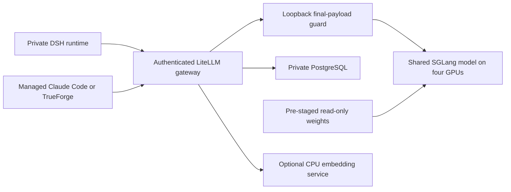

# DSH — Step-by-Step Setup and Stress-Test Results

This operator guide separates reproducible setup, recorded accepted behavior and experimental profiles. Read the companion [Security, Environments and Features](DSH_SECURITY_ENVIRONMENT_AND_FEATURES.html) for the three risk boundaries and interface screenshots. Creating these documents does not deploy or benchmark the system.

## What is deployed — recorded configuration and qualification

**19 October 2026: the corrected 128 MiB score-tile profile passed the recorded DeepSeek-V4.1-Flash-1017 workloads on the existing four H100 NVL GPUs.** The checkpoint is pinned to revision `1bae0e1088993b9b82de08f59de5be5a34e42170`. Earlier checkpoint results and the first 1017 trial remain separate historical records.

| Setting | Qualified profile |
|---|---|
| Total context | 1,048,576 tokens, including output and reserve |
| Speculation | DSpark block 5 |
| Static memory | 0.923 |
| Active request / decode graph cap | 8 / 8 |
| Prefill chunk / maximum | 1,024 / 1,024 |
| Maximum prefill requests / prefix tails / decode interval | 2 / 16 / 4 |
| Attention-score tile / warm step | 128 MiB / 2,048 tokens |
| Long admission | One active request above 128K and one bounded FIFO waiter; ordinary requests bypass this queue |

### Measured results and their scope

| Actual DSH check | Recorded result |
|---|---|
| 256K | 257,688 input / 7 output; 147.06s; 12 short replies, median 3.58s |
| Cold near-1M | 1,007,752 input / 431 output; exact saved answer in **27m33.97s**; 149.15 stream tokens/sec |
| Short requests alongside cold work | **60/60** correct, saved and retry-free; paired median **5.11s**, including two eight-client bursts |
| Immediate cached continuation | 1,008,209 input / 1,199 output; **15.13s**, **159.22 stream tokens/sec**; exact, saved and retry-free |
| Real tool continuation | 1,009,686 input; **12.94s**; actual create/read/delete command, successful tool result and file absent before/after |
| Fresh ordinary concurrency | **31/31** replies across 1, 2, 4, 8 and 16 clients; cap eight means excess clients may queue |
| Structured 599-token replies | Three correct saved answers at **163.34–166.48 stream tokens/sec** |
| Managed clients | Ordinary Claude Code 2.1.301 reply 1.171s and TrueForge 0.179.2 reply 0.732s, saved; these are not fresh CLI 1M tests |
| History preservation | **167 histories / 188 original files / 20 main runtimes**: original IDs and bytes unchanged |
| Runtime failures | Zero retries, allocation mapping warnings, fatal signatures or model restarts in the final qualification |

The first 1017 trial returned the correct near-1M answer with 52 short replies, but eight recoverable allocation warnings failed its strict gate. Reducing the score tile from 256 to 128 MiB passed GPU mathematical equivalence before the final full rerun. A correct answer alone did not qualify the first profile.

Minimum free GPU memory observed at one-second NVML sampling was **38 MiB per GPU**; memory remains tight. This is not a continuous peak bound. An optional prose follow-up after burst traffic re-entered cold preparation and was cancelled. It provides no prose-quality acceptance and does not guarantee cache reuse after load. Keep it distinct from the passed immediate cached continuation. Streaming speed excludes cold preparation and is not an SLA or a claim that every task exceeds 100 tokens/sec.

| Fresh clients | Completion window | Combined cohort output tokens/sec |
|---|---|---:|
| 1 | 1.29s | 92.02 |
| 2 | 1.82s | 130.51 |
| 4 | 2.61–3.12s | 152.49 |
| 8 | 3.18–5.96s | 159.81 |
| 16 | 2.89–10.97s | 173.57 |

These are bounded workload-specific samples, not simultaneous full-1M capability for sixteen clients. Two full-1M requests are not admitted simultaneously. Saved original failed and cancelled cases remain part of the trial history. The checkpoint-specific [model update report](MODEL_UPDATE_1017.html) describes the rollout and qualification; the security companion stays focused on controlling the three risks.


## How to install DSH

For the consolidated DSpark decisions, failed trials, memory corrections, preparation overhead and accepted measurements, see the [inference optimization experience record](INFERENCE_OPTIMIZATION_EXPERIENCE.html).

This walkthrough follows the repository's actual build, manifest-generation and inference-rendering interfaces. Run commands from the repository root in a POSIX operator shell. Windows operators can use WSL; Python-only generation also works in PowerShell. The recorded deployment and performance results appear separately under **What is deployed** and **Qualification results**.

### Installation sequence and completion gates

Follow steps 1–8 in order. Keep one private installation record with the source commit, chosen input values, rendered manifest hashes and acceptance results. Complete each gate before proceeding.

| Stage | Completion gate | Detailed reference |
|---|---|---|
| Prerequisites and images | Correct cluster; drivers/CSI/CNI available; image pulled by digest | Steps 1–2 below |
| Storage and database | Claims mounted with intended identity; weights readable; PostgreSQL initialized; Secret keys present | Step 3 and [storage guide](MULTI_TENANT_STORAGE_AND_PERSISTENCE.md) |
| Inference | Reviewed manifest; correct loaded checkpoint; authenticated correct answer; direct bypass denied | Step 4 and [portable GPU setup](../gpu-stack/README.md) |
| Private runtimes and gateway | All references resolved; private mounts/routes; login and roles accepted | Steps 5–6 below |
| Functional acceptance | Cross-user denial, persistence, terminal, network, tools and long/short inference checks pass | Step 7 and [LLM configuration/results](LLM_SETUP_AND_TEST_RESULTS.html) |
| Handover | Qualified configuration recorded; rollback preserves newer data | Step 8 below |

The portable GPU renderer and the site-bound DSH generator are two components of this sequence. Generating both files does not automatically join their service names, namespaces, DNS or credentials; the private site bundles must join those explicitly.

### 1 Choose the deployment target and collect inputs

Use **DeepSeek-V4.1-Flash-1017**, pinned to revision `1bae0e1088993b9b82de08f59de5be5a34e42170`, for the qualified DeepSeek setup. Follow the [checkpoint staging and integrity procedure](MODEL_UPDATE_1017.html) before starting inference. Stage the verified snapshot so `/models/approved` inside the model container resolves to that exact checkpoint; the portable template uses this generic mount path rather than downloading weights or selecting the newest release automatically. A readable `config.json` alone does not establish the checkpoint identity or complete shard integrity.

| Configuration scope | Installation setting |
|---|---|
| DeepSeek model, LiteLLM route and managed DSH profile | 1,048,576 total tokens; 8,192 maximum output; 256-token proxy reserve |
| DeepSeek inference optimization | DSpark block five; qualified 0.923 static fraction; eight active slots; 1,024-token prefill chunks/budget; 128 MiB score tiles |
| DeepSeek long-request admission | One expensive request above the 131,072-token input-plus-output threshold, plus one bounded waiter; this threshold is not a 128K context ceiling |
| Separate GLM and Qwen catalog/provider entries, when installed | Keep each model's own supported and verified limits; the DeepSeek update does not raise their limits or replace their weights |

Keep the stable DeepSeek client aliases pointing to the updated checkpoint. Do not change every catalog entry to 1M: aliases, actual checkpoint support and route budgets must agree for each model separately. Verify the loaded model path/revision and an actual answer after rollout. The application image, model weights and model-serving image are independent versions; updating the checkpoint does not upgrade the DSH package.

Use a new test namespace for a new installation. For an existing installation, preserve its current namespace, claims, account store and owner mapping; do not run initial provisioning over live routing. Never apply the entire `k8s` directory: it includes historical deployments and site-specific examples.

| Input | Operator supplies | Used by |
|---|---|---|
| Cluster access | Approved kubeconfig/context, policy-enforcing CNI, GPU device plugin, ingress and trusted TLS | Kubernetes deployment and acceptance |
| GPU capacity | Existing four-GPU node, compatible driver/runtime and sufficient shared memory | Model workload |
| Model storage | Bound model PVC and approved checkpoint staged at `/models/approved` | Portable model renderer |
| Central storage | SMB CSI driver, private share credentials, share location, UID/GID mapping and ACLs | Private No Internet projects and durable histories |
| Other storage | StorageClass, auth-state claim, per-runtime state/token claims, incoming/approved package claims | Gateway and private environments |
| Database | Running PostgreSQL service, persistent storage, backup policy and private connection URL | LiteLLM key management |
| Images | Built DSH application digest, qualified LiteLLM digest and pinned model image | Three distinct workloads; the DSH image is not the model image |
| Network | Gateway hostname/TLS, filtered resolver, cluster domain and approved internal destinations | Routing, Host/Origin checks and destination policies |
| Identities | Named DSH users, roles, environment permissions and restricted inference credentials | Private routes and authentication |

Keep values in an operator-only directory outside the checkout. The public examples intentionally contain no usable site credentials. A required value is an installation input, not a value the renderer discovers automatically.

```sh
git clone https://github.com/skunpoj/dsh_setup.git
cd dsh_setup
git rev-parse HEAD
python -m venv .venv
. .venv/bin/activate
python -m pip install PyYAML
kubectl config current-context
kubectl get nodes
kubectl get storageclass
```

Record the selected source commit and inspect the context before any write. Install Python packages on the operator workstation, not by enabling Internet on a No Internet runtime. Use an approved local package cache where operator Internet is unavailable.

### 2 Build and inspect the application image

The Dockerfile packages DSH, Claude Code, TrueForge, terminal and Kerberos tooling plus reviewed overlays. Read its pinned build arguments before changing versions. The checked-in Azure pipeline is a site-specific example; configure your own registry connection, repository and agent pool rather than copying its private registry settings.

```sh
export DSH_IMAGE_TAG='registry.example.net/ai/dsh-runtime:reviewed-build'
docker build --pull -t "$DSH_IMAGE_TAG" .
docker run --rm --entrypoint node -w /opt/dsh "$DSH_IMAGE_TAG" tests/test_user_isolation_routing.js
docker run --rm --entrypoint node -w /opt/dsh "$DSH_IMAGE_TAG" tests/test_auth_proxy_internet.js
docker run --rm --entrypoint node -w /opt/dsh "$DSH_IMAGE_TAG" tests/test_admin_users.js
docker push "$DSH_IMAGE_TAG"
docker pull "$DSH_IMAGE_TAG"
docker image inspect "$DSH_IMAGE_TAG" --format '{{json .RepoDigests}}'
```

Select the registry digest from the final output and set `DSH_IMAGE` to that complete `registry/repository@sha256:…` reference. Check installed client versions and patch checks inside this image. A successful build alone is not a login, persistence or network test. Stage the image into the target registry before restricting runtime egress.

### 3 Prepare storage, database and Secrets

Create the target namespace and provision its database and storage through the site's supported deployment tooling. Configure PostgreSQL service labels and the destination policy together: the portable renderer expects the database pod label `app: llm-database` and port 5432. Supply these inference Secrets through the approved secret manager:

| Secret | Required keys |
|---|---|
| `credentialSecret` from the settings JSON | `LITELLM_MASTER_KEY`, `INTERNAL_ROUTE_KEY` |
| `databaseSecret` from the settings JSON | `DATABASE_URL` |
| Each DSH inference-client Secret | `litellm-api-key` containing a model-only client key |

Keep the master key out of execution-worker mounts. Do not print Secret YAML, put credentials in command arguments or store them in the repository. PostgreSQL installation, schema initialization/migration and account-key issuance are operator steps; `gpu-stack/render.py` does not perform them.

For central storage, adapt a private copy of `k8s/dsh-da-workspace.yaml`: replace the share, volume handle, Secret reference and namespace; retain UID/GID 10001 only if it matches the chosen image. Verify non-root create, flush and reopen against an isolated test directory. Configure server ACLs as well as client mount modes. Keep the original share mounted; do not replace it with a local volume to bypass a permission error.

### 4 Render shared inference before applying it

```sh
export PRIVATE_DIR='/private/dsh-install'
mkdir -p "$PRIVATE_DIR"
chmod 700 "$PRIVATE_DIR"
cp gpu-stack/settings.example.json "$PRIVATE_DIR/inference-settings.json"
# Edit the private JSON with the approved namespace, existing PVC,
# gateway image digest and existing Secret names from steps 1–3.
python gpu-stack/render.py --settings "$PRIVATE_DIR/inference-settings.json" --output "$PRIVATE_DIR/inference-candidate.yaml"
```

The renderer creates model/gateway workloads, Services, immutable source ConfigMaps and their network policies. It does not create the namespace, model PVC, weights, PostgreSQL or Secrets. Its generic DNS rule is not the platform's filtered-DNS implementation. Review service names, peer labels and source hashes before connecting DSH.

```sh
export INFERENCE_NS='ai-workspace'
kubectl -n "$INFERENCE_NS" apply --dry-run=server -f "$PRIVATE_DIR/inference-candidate.yaml"
kubectl -n "$INFERENCE_NS" diff -f "$PRIVATE_DIR/inference-candidate.yaml"
# kubectl diff returns 1 when it finds changes; inspect them.
kubectl -n "$INFERENCE_NS" apply -f "$PRIVATE_DIR/inference-candidate.yaml"
kubectl -n "$INFERENCE_NS" rollout status deployment/local-model --timeout=2100s
kubectl -n "$INFERENCE_NS" rollout status deployment/local-inference --timeout=300s
```

Apply only to the reviewed target. Read back image IDs, arguments, mounted source and actual answer content. The first model start can be lengthy. Test authenticated inference using a restricted key without exposing it. Model port 8000 must remain private to the gateway; the final-wire preparation listener is loopback-only. Keep the 1M total budget, 8,192 output ceiling, 256 reserve and one-long-request admission aligned across clients and proxy.

### 5 Generate private user/environment candidates

```sh
python scripts/generate_user_runtimes.py --help
python scripts/generate_user_runtimes.py --users pilot-a pilot-b --image "$DSH_IMAGE" --output "$PRIVATE_DIR/private-users.raw.yaml"
```

This writes Deployments, per-runtime PVCs, private Services, routing and gateway-source ConfigMaps, and the gateway Deployment. It does not apply them, create login accounts, issue inference keys, initialize central subdirectories or migrate histories. Unlike the inference renderer, it can overwrite its output path; use a new filename for each review.

The current application generator is **site-bound**: it emits namespace `llm`, `.llm.svc.cluster.local` routes, the template's DNS configuration and existing central/package claim references. It does not accept a namespace option. Before using another site, adapt a private copy of the generated YAML and referenced configuration together. Do not assume `kubectl -n` rewrites explicit namespaces or route hostnames. Keep an untouched generated file and a separate reviewed `private-users.site.yaml`.

For each candidate, inspect every PVC, Secret and ConfigMap reference. Provision missing claims and per-user inference Secrets first; prepare only that user's central subdirectories. Keep Secure and Internet project/history/credential mounts separate. The central claim is shared infrastructure, but each worker mounts only its scoped subpaths. Verify no broad parent exposes peer directories. The generator does not contain the gateway Service, ingress or all supporting policy/configuration resources; supply their reviewed private-site versions separately.

The existing `provision_inference_client.py` targets namespace `llm` and deployment `litellm`; it is not directly compatible with the portable `local-inference` names. Adapt that integration explicitly, or issue restricted keys through the target LiteLLM administrator interface. Likewise, `rollout_private_routing.py` is an existing-site migration utility with ownership/evidence gates, not a new-cluster installer.

### 6 Apply supporting controls, then start private workloads

Prepare a private supporting bundle containing the filtered DNS configuration/service, storage and profile ConfigMaps, gateway Service, TLS ingress, environment network policies and package-promotion resources. Use the corresponding `k8s` files as reference inputs, not a blanket apply list. Replace all site destinations and align their labels with the generated workloads. Approved package storage is read-only to No Internet; only controlled promotion writes to it.

Before applying, run the offline reference check against all prepared bundles:

```sh
python scripts/check_installation_bundle.py \
  --manifest "$PRIVATE_DIR/inference-candidate.yaml" \
  --manifest "$PRIVATE_DIR/supporting.site.yaml" \
  --manifest "$PRIVATE_DIR/private-users.site.yaml"
```

Missing PVCs, Secrets, ConfigMaps, account references, ingress Services and unpinned container images are reported. Resolve each failure in the bundles. For a resource that already exists, verify its name and namespace separately and pass `--external Kind/namespace/name` for that resource. This is an explicit dependency declaration, not permission to assume a Secret or volume exists. Inspect required Secret key names without exposing their values. Never include credential values in the checker arguments or output.

The offline checker does not prove Secret key contents, PVC binding, correct subdirectories/ACLs, DNS resolution, network enforcement, database schema, registry access or application behavior. Server dry-run validates the cluster API/schema/admission path; Kubernetes can still accept a Deployment whose referenced resource is absent. Both checks and the following runtime tests are needed.

```sh
export APP_NS='llm'
kubectl -n "$APP_NS" apply --dry-run=server -f "$PRIVATE_DIR/supporting.site.yaml"
kubectl -n "$APP_NS" apply --dry-run=server -f "$PRIVATE_DIR/private-users.site.yaml"
kubectl -n "$APP_NS" diff -f "$PRIVATE_DIR/supporting.site.yaml"
kubectl -n "$APP_NS" diff -f "$PRIVATE_DIR/private-users.site.yaml"
# After reviewing both diffs, install supporting controls first.
kubectl -n "$APP_NS" apply -f "$PRIVATE_DIR/supporting.site.yaml"
kubectl -n "$APP_NS" apply -f "$PRIVATE_DIR/private-users.site.yaml"
kubectl -n "$APP_NS" get deployments,pods,pvc,services,networkpolicies
```

The two `.site.yaml` bundles are operator-prepared outputs, not files supplied by this repository. Resolve every referenced resource before this step. Configure the gateway's trusted host and TLS, default No Internet selection, server-side private routing and disabled registration. Grant Internet separately per named account. Seed the initial administrator through the protected account-store procedure; do not introduce a factory password. Use Admin → User management for additional already-provisioned private runtimes.

### 7 Verify the installed behavior before handover

| Check | Required result |
|---|---|
| Login and account roles | Correct login works; incorrect login, forged roles and ordinary-user admin calls fail; logout invalidates access |
| Environment selection | No Internet is default; unauthorized Internet selection is refused by the server |
| Isolation | Two synthetic users cannot read each other's histories, files, attachments or terminal sessions |
| Network | Public-domain and direct-IP requests fail in No Internet; permitted inference works; Internet operates only in its separate environment |
| Dependency transfer | Internet writes incoming artifacts; reviewed promotion verifies hashes; No Internet can read approved artifacts but cannot alter them |
| Persistence | A disposable file and conversation survive controlled runtime replacement with identical content; existing histories retain IDs and bytes |
| Inference | Native DSH gives correct persisted answers at ordinary, 256K, 512K and near-1M sizes, with real tool continuation and short requests overlapping long work |
| Admission and recovery | A second long request obeys the bounded queue; further waiters are refused; cancellation releases admission; short work continues |
| Administration | Authorized overview shows correctly scoped activity/capacity; other users cannot obtain admin data |

For each row, record the expected result, observed result and pass/fail. Stop handover if a required check fails; correct the configuration and rerun the affected check. For mounts, inspect the actual mounted source and read back saved file contents after restart. For inference, verify the model identifier, exact answer and saved assistant response, not just HTTP success. For packages, test both permitted installation from the approved cache and refusal to modify it. For networking, test from the execution process as well as the browser-facing gateway.

Start with synthetic content. Use actual browser login, HTTP/WebSocket terminal interaction and saved conversation readback; a rollout status does not replace these checks. Record first-text latency, preparation time and streaming output rate separately. Remote submitted jobs retain the remote platform's network and AD permission boundaries.

### 8 Roll back without losing newer work

Before upgrading an existing site, retain the exact old Deployment specs, immutable ConfigMaps/image digests, routing/account configuration and a private history/file fingerprint. Keep credentials in protected recovery storage. Replace one private runtime at a time and repeat the affected behavior checks. On regression restore its reviewed old image/configuration and route; do not delete PVCs or overwrite newer histories with an old snapshot. Stop the writer and reconcile newer central writes before changing storage mounts. Model changes on the single shared GPU node interrupt inference; retain the last qualified model profile for that separate rollback.

### Installation coverage

The commands above expose the actual installation sequence and remaining operator inputs. The portable inference renderer and private-runtime generator can be exercised offline. A fresh-cluster install, site bundle, database migration and initial administrator bootstrap still require the target site's supported tooling and acceptance. They are not a single copy-and-run installer. Existing deployment qualification is documented separately and does not establish a fresh-site installation test.


## Shared inference architecture


The platform uses one shared four-GPU generative model. Private user runtimes share inference while keeping their own files and state. Use the portable `gpu-stack` source and supply private site values outside Git.




## Step-by-step GPU and LiteLLM setup

These steps reproduce the current qualified portable profile, including its reviewed runtime overlays. Verify the pinned sources and requalify behavior on the target environment before rollout.

### 1 Prepare prerequisites and a test environment

Use a reviewed test namespace and verify GPU capacity before scheduling. Install the approved NVIDIA device plugin and an enforcing network-policy implementation. The portable template requests 256 GiB host RAM and allows 512 GiB; verify actual capacity rather than assuming it is available.

Stage the approved model revision in a PVC, with the expected model path under `/approved`. Verify the complete files against their approved source/revision/hash manifest. Review any model code required by `--trust-remote-code`; runtime downloads remain disabled and the model cache is read-only.

### 2 Provision private database and inference credentials

Provision PostgreSQL and its protected durable storage through the site's operating process. The portable renderer does not create or migrate the database. Prepare credential and database Secrets privately. The example bundle refers to `local-inference-credentials` and `local-inference-database`; required keys include `LITELLM_MASTER_KEY`, `INTERNAL_ROUTE_KEY` and `DATABASE_URL`.

Never put their values in the guide, Git, model prompts or shell transcripts. The master key is for operators. Give each runtime a restricted model-only client key and verify that administrative API operations are denied. Only the authenticated gateway should reach the model; clients must not bypass the final-wire guard through a direct model ingress.

### 3 Render a candidate from portable settings

Copy `gpu-stack/settings.example.json` into a private location. Set the namespace, model PVC, existing Secret names and qualified digest-pinned gateway image there. Install Python and PyYAML in the operator's tooling environment, then render:

```sh
python gpu-stack/render.py \
  --settings /private/settings.json \
  --output /private/inference-candidate.yaml
kubectl -n <test-namespace> apply --dry-run=server \
  -f /private/inference-candidate.yaml
```

Inspect the rendered objects before applying them. The renderer refuses mutable image tags, unexpected settings and accidental overwrite of an existing candidate. The reviewed scheduler source hashes must match the installed runtime.

### 4 Apply network boundaries and health checks

Clients reach authenticated LiteLLM on port 4000. The final-wire listener is loopback-only, not a Kubernetes Service. The model listens on port 8000 behind the gateway boundary; PostgreSQL uses its narrowly allowed internal path. Client/worker, gateway, model, database and DNS policies must be considered separately. Use the site's approved internal resolver; generic DNS allowance alone is not a No Internet boundary.

Start the candidate only after weights, Secrets and database are available. Align the startup probe and progress deadline with the measured model initialization time; the reviewed deployment uses a 2,100-second progress deadline. Check actual loaded source, arguments, image IDs and response content rather than accepting readiness alone. A single shared model restart interrupts inference and needs a controlled handover.

### 5 Configure the clients consistently

Point managed DSH and CLI profiles at internal LiteLLM using restricted credentials. Keep total context, output ceiling, timeout, compaction policy and the final payload counter aligned. The managed SDK loader corrects the qualified character-estimation output-budget issue for the internal route only; unrelated clients/routes retain their own limits.

Use read-only operator-managed client policy. Claude/TrueForge installations and private state are separate from GPU provisioning. TrueForge's optional nested sandbox is not required for ordinary chat/API use and remains disabled under the current container restrictions. Do not grant privilege or mount a host socket to make it work.

### Optional embedding integration

BGE-M3 is a separate embedding use case, not the shared generative GPU model. Stage its approved model in the CPU Ollama service and use only the permitted internal or authenticated embedding route. Not every DSH runtime necessarily has direct permission to contact that provider. Do not add a public egress exception to make an embedding example work.

Example for an already permitted endpoint, using normal TLS verification:

```python
import json
import os
import urllib.request

request = urllib.request.Request(
    os.environ["APPROVED_EMBEDDING_URL"],
    data=json.dumps({
        "model": "bge-m3:latest",
        "input": ["Sample public financial inquiry"]
    }).encode(),
    headers={"Content-Type": "application/json"},
)
with urllib.request.urlopen(request, timeout=30) as response:
    vector = json.load(response)["embeddings"][0]
print(len(vector))  # BGE-M3's expected vector length is 1024.
```

Load the approved model before embedding requests. A model installed on disk may not be loaded in memory; check `/api/ps`. Configure the trusted CA and keep certificate verification enabled.

### 6 Qualify behavior and preserve rollback

Progressively test 128K, 256K, 512K and near-1M input with known answers and source checks. Verify substantial output, actual file/tool continuation and persisted responses. Run ordinary DSH requests during long work, distinguish API versus DSH versus alternative-client results, and measure admission/first-text/preparation/streaming separately. Test cancellation, queue bounds, endpoint overrides, over-budget refusal, credential scope and direct-model denial.

Run this native DSH concurrency probe from the repository root, supplying the approved disposable canary and a private result path. It refuses persistent or host-mounted storage and runs concurrent clients through one operator channel:

```sh
python scripts/probe_dsh_concurrency.py --namespace "$APP_NAMESPACE" --pod "$DISPOSABLE_DSH_POD" --expected-app "$DISPOSABLE_DSH_APP" --host "$DSH_HOST" --output "$PRIVATE_RESULT_JSON"
```

Check saved native answers and model health before attributing an operator transport failure to inference. The probe does not deploy or restart workloads. A confirmed incorrect answer or actual model failure remains a rollback trigger.

Retain the last qualified profile/image/source and state-preservation baseline before a change. Keep sufficient temporary GPU workspace by preserving the qualified memory fraction and bounded prefill settings. Keep the one-long-request admission policy and check answer accuracy against the task’s sources. Roll back on a genuine regression without overwriting newer workspace/history data.

The portable setup and its tests are maintained in `gpu-stack/`; detailed dated performance and acceptance records remain in the separate LLM guide.

## Use the deployed platform

Choose the intended environment before starting. The examples below cover common tasks.

### 1 Sign in and choose the environment

1. Open the main DSH address and sign in with your provisioned local account.
2. Leave No Internet / Internal selected for protected local work. Choose Internet only for its intended staging work.
3. Open the intended workspace or create a new session. Verify which environment you are using before adding files or authenticating to connected services.
4. To switch environments, logout and sign in again. To change a password, use the authenticated password-change flow; do not put credentials in chat or project files.

Check connectivity from the selected environment when needed; a listed web tool may still be blocked by its network policy.

### 2 Review a repository with traceable answers

Example prompt:

> Inspect this repository without changing files. Explain the request path, authentication boundary and persistence locations. Cite the exact file and line range for each factual claim. Separate observations from assumptions and list anything you could not verify.

For a large review, choose relevant code and documents rather than padding the input. Ask for a source ledger and check it against the actual files. Keep enough context headroom for tool definitions, output and follow-up work.

### 3 Produce a bounded analysis result

Place `sample.csv` in the selected workspace and ask:

> Read sample.csv. Report its row count, column names and missing-value counts. Write results/summary.json and a short results/report.html. Do not modify the input. State the exact files you read and verify the saved output.

Run a local inspection from the terminal when useful:

```sh
cd /workspace/<project>
python3 -m json.tool results/summary.json
```

Compare the saved results with the input and the requested calculations.

### 4 Use the web terminal and application preview

Open the authenticated terminal route for the selected DSH service. It runs in the assigned environment, not directly on the Kubernetes node. A new terminal tab does not switch identities or network environments.

To preview an existing result folder on a free approved port:

```sh
cd /workspace/<project>
python3 -m http.server 8080 --bind 0.0.0.0 --directory results
```

Open the service's authenticated `/proxy/8080/` route or configured port-8080 alias. Login must still be required. Stop the server with Ctrl+C after use. Serving only `results` avoids unintentionally publishing the entire workspace. Do not add an ingress or disable authentication merely to make a preview work.

### 5 Prepare Python dependencies for No Internet

In the Internet environment, create a pinned requirements file:

```sh
printf 'six==1.17.0\n' > requirements.txt
prepare-offline-deps python requirements.txt
```

This downloads to the incoming package area. An operator reviews source/version/hashes and performs controlled promotion. In No Internet, after approval:

```sh
python3 -m venv /workspace/<project>/.venv
/workspace/<project>/.venv/bin/python -m pip install \
  --no-index --find-links=/packages/approved/python six==1.17.0
/workspace/<project>/.venv/bin/python -c "import six; print(six.__version__)"
```

For npm, `prepare-offline-deps npm <project-directory>` requires the project's lockfile and populates incoming cache with install scripts disabled. Native modules, platform-specific wheels and OS libraries require compatibility review; copying an arbitrary package directory between environments is not a supported substitute.

### 6 Use managed alternative clients

From the selected terminal:

```sh
cd /workspace/<project>
claude -p "Read README.md and list three implementation questions; cite the relevant sections."
```

To use TrueForge, first ensure port 3000 is free, run `trueforge`, wait for its listening message and open the service's authenticated `/proxy/3000/` route or configured port-3000 alias. Its model/provider configuration is operator-managed; private chat state remains in that environment. Do not enable privileged container features to make the optional nested sandbox start.

### 7 Authenticate to a permitted datalake service

```sh
kinit <approved-principal>
klist
```

Enter the password only at the private authentication prompt. Use your configured Livy/Spark/Hive/HDFS client under that principal. DSH preserves the platform's effective permissions; an internal job submission is not datalake administration. Keep output in its intended location, review destructive operations and follow the platform's rules. Do not move tickets into Internet staging.

### 8 Use the admin overview

An authorized admin opens `/admin` through the main gateway. Review account/session counts, per-user routing, the observation timestamp, environment descriptions and recent access events. Refresh rereads the saved infrastructure snapshot and current gateway values; it does not execute a GPU benchmark or network probe. Use the separate operational tools for live troubleshooting. Admin rights do not automatically expose private conversation bodies; an explicitly authorized support copy remains independent.


## Storage, administration and maintenance

### Where work is stored

`/workspace` is the working location presented to each runtime; its backing PVC/subpath defines the durable store. Main No Internet project data and durable DSH histories use scoped central CIFS mounts. Credentials and profiles remain in private state locations. Internet workspaces/state remain separate, and the approved cache is mounted read-only where needed. Consult the runtime’s mount configuration for its backing storage.

DSH sessions/attachments and managed-client state are distinct stores. Claude uses its persistent private state; TrueForge uses its private application state. Instance client `/state` wiring can alias its existing owner-only durable home rather than creating another shared tree. Do not replace a working mount without stopped-writer reconciliation and preservation of newer writes.

### User and audit administration

Operators provision private runtime mappings through the identity and routing procedure. Administrators then manage provisioned local accounts through the dashboard. Account changes require an authenticated administrator session and a session-bound management token; ordinary users and cross-origin requests cannot perform these actions. Passwords are stored as salted scrypt records. Disabling access preserves ownership, files and histories; removing workloads or data is a separate operator procedure.

The access audit records bounded metadata such as time, event, user and environment. It is not a terminal-command recorder or an archive of all prompts/responses. Additional-instance access projections and main gateway events are combined under the admin boundary. Retention capacity, off-platform archival and remote-job correlation need the defined operational policy.

### Deploy dashboard changes

Run the account-management and existing dashboard regression suites before replacing the gateway:

```sh
node tests/test_admin_users.js
node tests/test_admin_dashboard.js
```

Use a new private rollback directory and the SHA-256 of the currently mounted gateway source. First inspect the plan, then repeat with `--apply` for the reviewed handover:

```sh
python scripts/rollout_admin_management.py \
  --output /private/admin-management-rollout \
  --expected-source-sha256 <current-mounted-source-sha256>

python scripts/rollout_admin_management.py \
  --output /private/admin-management-rollout \
  --expected-source-sha256 <current-mounted-source-sha256> \
  --apply
```

The rollout replaces only the authentication gateway, preserves account content and checks the mounted source and authentication behavior. Users sign in again after the gateway reload. Inference services, private execution pods and history mounts are not replaced. On failed checks, the procedure restores the previous deployment configuration without restoring older account or history data.

### Updates and rollback

The official npm package remains the base. Local gateway/Kubernetes/model overlays and the versioned ten-target DSH compatibility patch set are maintained separately. Daily/manual candidate qualification tracks npm latest; changed upstream hashes stop the patch process. Patch preflight and postchecks verify the expected upstream code before a candidate is promoted. Missing source assets cause an explicit error.

Before a rollout, retain the exact image, source ConfigMaps, profile and workload specification; verify that the relevant agents are idle. Replace workloads in a controlled sequence and read back affected content, history and mounts. On regression, restore a compatible configuration/image while preserving newer durable writes. A mounted share is persistence, not an independent backup. Do not restart the shared model merely to update a document or client page.


## Qualification results and stress-test history

The following results describe their stated workloads and dates. The current qualification is summarized above; older restored or rejected profiles remain explicitly historical. Streaming tokens/sec, whole-request latency and aggregate throughput measure different things. A configured request cap does not prove that many full-context requests can execute together.

### Runtime profile and context budget

The qualified checkpoint is DeepSeek-V4.1-Flash-1017 revision `1bae0e1088993b9b82de08f59de5be5a34e42170`, served on the existing four-GPU node. It uses the pinned SGLang image and source-fenced score-tile/FP4 overlays, verified against original GPU calculations before startup. The final score tile is 128 MiB; changing an upstream target fails the source fence rather than silently applying an unreviewed patch.

### Recorded 1017 acceptance

**19 October 2026: the corrected 128 MiB score-tile profile passed the recorded DeepSeek-V4.1-Flash-1017 workloads on the existing four H100 NVL GPUs.** The checkpoint is pinned to revision `1bae0e1088993b9b82de08f59de5be5a34e42170`. Earlier checkpoint results and the first 1017 trial remain separate historical records.

| Setting | Qualified profile |
|---|---|
| Total context | 1,048,576 tokens, including output and reserve |
| Speculation | DSpark block 5 |
| Static memory | 0.923 |
| Active request / decode graph cap | 8 / 8 |
| Prefill chunk / maximum | 1,024 / 1,024 |
| Maximum prefill requests / prefix tails / decode interval | 2 / 16 / 4 |
| Attention-score tile / warm step | 128 MiB / 2,048 tokens |
| Long admission | One active request above 128K and one bounded FIFO waiter; ordinary requests bypass this queue |

### Measured results and their scope

| Actual DSH check | Recorded result |
|---|---|
| 256K | 257,688 input / 7 output; 147.06s; 12 short replies, median 3.58s |
| Cold near-1M | 1,007,752 input / 431 output; exact saved answer in **27m33.97s**; 149.15 stream tokens/sec |
| Short requests alongside cold work | **60/60** correct, saved and retry-free; paired median **5.11s**, including two eight-client bursts |
| Immediate cached continuation | 1,008,209 input / 1,199 output; **15.13s**, **159.22 stream tokens/sec**; exact, saved and retry-free |
| Real tool continuation | 1,009,686 input; **12.94s**; actual create/read/delete command, successful tool result and file absent before/after |
| Fresh ordinary concurrency | **31/31** replies across 1, 2, 4, 8 and 16 clients; cap eight means excess clients may queue |
| Structured 599-token replies | Three correct saved answers at **163.34–166.48 stream tokens/sec** |
| Managed clients | Ordinary Claude Code 2.1.301 reply 1.171s and TrueForge 0.179.2 reply 0.732s, saved; these are not fresh CLI 1M tests |
| History preservation | **167 histories / 188 original files / 20 main runtimes**: original IDs and bytes unchanged |
| Runtime failures | Zero retries, allocation mapping warnings, fatal signatures or model restarts in the final qualification |

The first 1017 trial returned the correct near-1M answer with 52 short replies, but eight recoverable allocation warnings failed its strict gate. Reducing the score tile from 256 to 128 MiB passed GPU mathematical equivalence before the final full rerun. A correct answer alone did not qualify the first profile.

Minimum free GPU memory observed at one-second NVML sampling was **38 MiB per GPU**; memory remains tight. This is not a continuous peak bound. An optional prose follow-up after burst traffic re-entered cold preparation and was cancelled. It provides no prose-quality acceptance and does not guarantee cache reuse after load. Keep it distinct from the passed immediate cached continuation. Streaming speed excludes cold preparation and is not an SLA or a claim that every task exceeds 100 tokens/sec.

| Fresh clients | Completion window | Combined cohort output tokens/sec |
|---|---|---:|
| 1 | 1.29s | 92.02 |
| 2 | 1.82s | 130.51 |
| 4 | 2.61–3.12s | 152.49 |
| 8 | 3.18–5.96s | 159.81 |
| 16 | 2.89–10.97s | 173.57 |

These are bounded workload-specific samples, not simultaneous full-1M capability for sixteen clients. Two full-1M requests are not admitted simultaneously. Saved original failed and cancelled cases remain part of the trial history. The checkpoint-specific [model update report](MODEL_UPDATE_1017.html) describes the rollout and qualification; the security companion stays focused on controlling the three risks.


