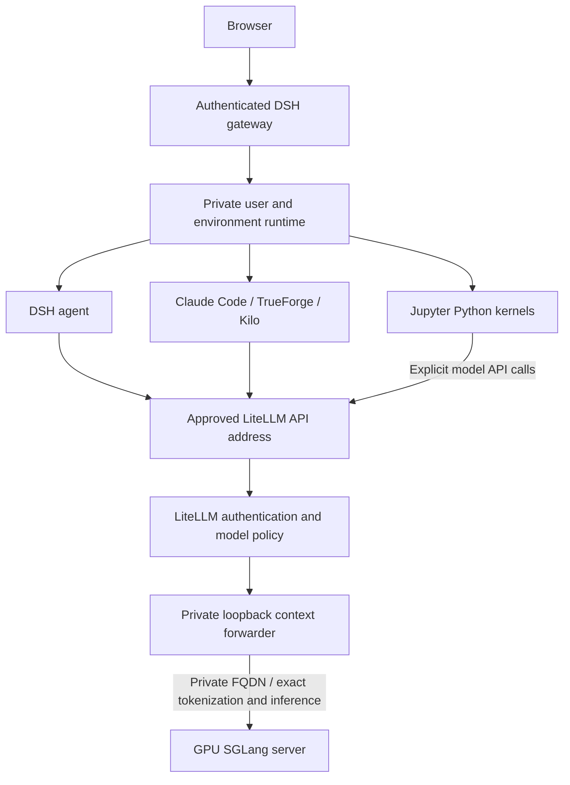

# DSH, LiteLLM and GPU deployment across machines

DSH is the user workspace and tool-execution layer. LiteLLM is the authenticated model API and policy layer. SGLang is the GPU inference layer. They communicate over network APIs and do not have to run on the same machine. A local/on-premises model means the organization operates it; it does not mean every component calls `localhost`.

## Deployment choices

| Topology | How it works | Configuration status |
|---|---|---|
| One Kubernetes cluster, different nodes | Kubernetes Services route DSH calls to LiteLLM and GPU pods regardless of their nodes | Existing architecture; keep stable Service DNS and enforce node/network access |
| DSH/LiteLLM cluster with a separate GPU machine or cluster | The guarded forwarder calls a fixed private GPU FQDN | Portable renderer supports `backendOrigin` and explicit private host CIDRs; it deploys no local GPU workload in this mode |
| DSH cluster with separate LiteLLM and GPU infrastructure | DSH calls its stable approved gateway address; an operator-managed internal relay forwards to the private LiteLLM FQDN | Relay configuration recipe supplied; remote DNS, TLS, network and endpoint acceptance are site-specific |
| Arbitrary endpoint selected by an ordinary user or prompt | Would bypass the managed endpoint boundary | Not a deployment option; endpoint changes are operator changes |



The GPU server may be on another node or machine. Private user files, credentials, notebooks and histories remain on their configured DSH storage; moving inference does not copy those volumes. The model receives the request content selected by the client, including supplied documents and tool results. Only approved inference destinations may receive that content.

## Which address each component uses

| Caller | Destination | Required address form |
|---|---|---|
| DSH, Kilo and TrueForge | Approved LiteLLM OpenAI-compatible API | `https://llm.example.internal/v1`, or the current stable internal Service alias |
| Claude Code | Approved LiteLLM Anthropic-compatible API | `https://llm.example.internal` without `/v1`; the client adds its API path |
| Jupyter | No automatic LLM connection | Python runs locally in the private worker; use the same approved API explicitly when needed |
| LiteLLM | Its guard sidecar | `http://127.0.0.1:4001/v1`; this loopback stays local to the LiteLLM pod |
| Guard sidecar | GPU backend | Plain origin such as `https://gpu-inference.example.internal:8443`; `/v1/tokenize` and other backend paths are derived from it |

`localhost` always refers to the process's own machine or pod network. It must not be used to name a server on a different machine. Kubernetes `.svc.cluster.local` names are cluster-internal FQDNs; they are not automatically resolvable from another cluster or a laptop.

## Preserve managed-client endpoint policy

The current worker image, profiles and managed clients use the stable logical gateway `http://litellm.llm.svc.cluster.local:4000`. Several defaults deliberately contain that address, including the scoped long-context transport hook. This release does not claim that changing a single environment variable retargets every client.

When LiteLLM moves outside the cluster, the recommended compatibility route is to keep that logical address and place an internal reverse proxy behind it. The proxy forwards to the operator-approved LiteLLM FQDN, verifies its TLS certificate/SNI and preserves API paths, Authorization, streaming and long-request timeouts. DSH, Claude, Kilo, TrueForge and the 1M transport hook retain the same trusted logical origin.

The [relay recipe](https://github.com/skunpoj/dsh_setup/blob/main/config/remote-litellm-relay.nginx.conf) disables request/response buffering, preserves incoming API authorization and enables upstream TLS verification. It is a configuration recipe, not a deployed relay or a newly qualified proxy image. Do not set a fixed shared administrator key in its configuration. Remote LiteLLM must validate the existing user/client keys or operator-provisioned replacements.

A Kubernetes `ExternalName` only supplies a DNS alias. It does not rewrite HTTP Host, set TLS SNI, provision a certificate, authenticate the caller or create an egress allowance. Use a properly configured relay or explicitly qualify operator-rendered client policies. An alternate direct client origin requires coordinated changes to DSH profiles, Claude managed settings, TrueForge provider/host policy, Kilo policy and the scoped budget/timeout hook; do not edit only one client.

The [Kubernetes Service documentation](https://kubernetes.io/docs/concepts/services-networking/service/#externalname) explains the HTTP Host/TLS caveat. The relay uses the documented [NGINX proxy directives](https://nginx.org/en/docs/http/ngx_http_proxy_module.html) for TLS verification and streaming behavior.

The managed route keeps LiteLLM and the guard between clients and the GPU. A direct DSH-to-GPU route would bypass those authorization, budgeting and admission controls; it is not the qualified managed route simply because the backend exposes an OpenAI-compatible API.

## Separate GPU backend: setup steps

1. Deploy and qualify the model server on the GPU machine. Keep the checkpoint, tokenizer, chat template, scheduler and 1M admission assumptions consistent with the qualified profile. The remote server must support the guard's `/v1/models`, `/v1/tokenize`, `/v1/chat/completions`, `/generate` and `/abort_request` paths. A generic chat-only OpenAI endpoint does not establish 1M compatibility.
2. Provision private DNS and a fixed ingress/VIP for that backend. Use HTTPS with a trusted certificate, or an approved private encrypted network. Do not expose the unauthenticated model backend publicly. Restrict its firewall to the LiteLLM/forwarder egress identity. If custom CA or mutual TLS is required, qualify a gateway image/trust configuration that supports it; this renderer does not create a new CA, client certificate or backend authentication scheme.
3. Prepare LiteLLM's credential and database Secrets as described in the [GPU setup guide](https://github.com/skunpoj/dsh_setup/blob/main/gpu-stack/README.md). Do not put passwords, API keys or database URLs in settings JSON.
4. Copy `gpu-stack/settings.remote-backend.example.json` to a private file. Replace the namespace, image digest, Secret names, backend origin and host addresses. `192.0.2.40/32` is a documentation placeholder. Use actual approved private destination `/32` or `/128` host CIDRs. Omit `modelClaim` in remote mode.
5. Render and inspect the candidate:

```sh
python gpu-stack/render.py \
  --settings /private/remote-backend.json \
  --output /private/inference-remote-candidate.yaml
kubectl apply --dry-run=server -f /private/inference-remote-candidate.yaml
```

Remote mode emits only the gateway configuration, LiteLLM/forwarder Deployment, Service and boundary policy. It does not deploy weights, reserve GPUs, install scheduler patches on the remote machine or change its configuration.

6. Review policy differences before applying anything. The renderer's Service is named `local-inference`, while current managed clients use the logical `litellm` alias. Bind the approved gateway address through the intended Service/relay during a controlled handover; generated manifests alone do not retarget existing workers. Its ingress policy expects approved caller pods labelled `inference-client: allowed`; grant that label and the corresponding caller-side egress only to intended private runtimes. Supply the database selector/policy required by the actual database. Kubernetes NetworkPolicy cannot select an arbitrary FQDN: permit only the resolved private host addresses and required port. Update the approved address set when a backend VIP changes. NetworkPolicy is additive, so review all policies selecting the workload.
7. From the actual caller environment, verify DNS, certificate validation, authenticated model access, exact tokenization and a synthetic streaming response. Then verify tools, cancellation, a controlled long-context task, short-request responsiveness, browser/terminal behavior and state persistence. Repeat representative egress-denial checks. A dry-run or correct small reply does not prove remote 1M performance.
8. Preserve existing Service selectors/ports, Deployment specifications, image digests and data mounts for rollback. Change only the intended inference route. Restore routing/configuration on regression; never restore an old history copy over newer user work.

## DNS, network and data boundaries

No Internet means public egress is denied while explicitly required internal services remain reachable. An approved internal LiteLLM or GPU FQDN can be on another machine without enabling general Internet access. DNS resolution and TCP access are separate controls: both must be permitted narrowly. A relay does not justify allowing arbitrary hosts, wildcard public DNS or `0.0.0.0/0` egress.

Review the additive policy behavior and destination constraints in the [Kubernetes NetworkPolicy documentation](https://kubernetes.io/docs/concepts/services-networking/network-policies/).

DSH access remains authenticated and user/environment-bound. Workspace, notebook and history isolation is independent of model location. Credentials stay in protected Secrets/files; endpoint origins contain no credentials. Use existing database and storage permissions. Central storage remains a central CIFS share where configured, with separate Internet storage; moving inference does not mount that share on the GPU host.

The shared GPU still imposes the same memory and concurrency limits. More network separation does not add model capacity or guarantee faster token generation. One expensive long request, queued admission and ordinary-request concurrency remain model/gateway policy responsibilities. The datalake platform's previously accepted remote-worker exception is unchanged by this topology option.

## Features retained across these topologies

- Web IDE, private workspaces, tools, sessions, attachments and authenticated terminal/app routes.
- Self-service private No Internet accounts; administrator Internet approval/revocation, account management and central audit.
- Claude Code, TrueForge, Kilo Code and JupyterLab within the selected private runtime. Notebooks do not load a separate GPU model automatically.
- Approved dependency staging and read-only package transfer into No Internet.
- Central persistent projects/history and separate per-user/environment credentials.
- Internal 1M model budgets, scoped long deadlines, token counting, output reservation, admission control and qualified scheduler behavior when the same compatible guarded backend is used.
- Existing usage telemetry and storage observations; moving a service does not make saved infrastructure snapshots real time or add accounting for independent clients.
- Pinned upstream overlays, candidate compatibility checks, immutable image references and configuration rollback.

## Qualification boundary

The renderer passed 12 configuration/boundary tests and Kubernetes server-side dry-run for the four-object remote candidate. The existing local mode was compared with the prior committed renderer and produced the same eight objects and values. The relay file is an operator recipe. No live services were moved to a different machine by this documentation/configuration change; no new remote endpoint, DNS infrastructure, TLS deployment or cross-machine 1M workload is claimed verified.
