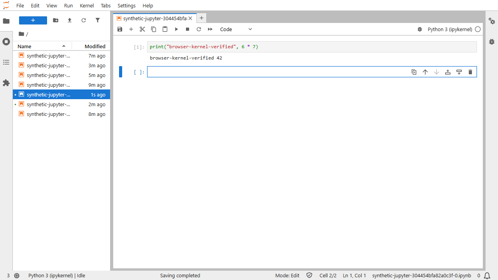

# JupyterLab in a private DSH environment

JupyterLab adds Python notebooks beside Kilo Code, Claude Code and TrueForge. It starts on demand inside the selected user's existing execution runtime. Kernels inherit its non-root identity, CPU/memory limits, private files and network policy.

## Open a notebook

1. Sign in to DSH and select your environment. No Internet is the default; Internet requires administrator approval.
2. Choose **JupyterLab** in the login application's dropdown. If stopped, open Web Terminal and run `jupyter lab` (or `jupyterlab`). Keep that process running.
3. Open `/proxy/8888/lab` on the same DSH address in another tab. Your existing DSH sign-in authorizes access.
4. Create a Python 3 notebook, run `print(6 * 7)` and check that the output is `42`.
5. Save beneath `/workspace`. Stop kernels when finished; Ctrl+C in the launch terminal stops the server.

Use `/applications` to save a friendly `<username>-jupyter` URL or map another application's port. See [custom URLs, ports and hostname setup](APP_URLS_AND_INGRESS.html). Jupyter's friendly URL redirects to its fixed notebook base URL.

`jupyter --version` shows the installed Lab version. The image pins JupyterLab 4.6.4, Jupyter Server 2.21.1 and ipykernel 7.4.0. Installation happens during the image build, so notebook startup performs no package download.



The Python kernel runs inside the selected DSH environment. This example uses synthetic content and displays the output saved after executing the cell in the browser.

## Storage and packages

Notebooks use the environment's existing `/workspace`: central DA_WORKSPACE/CIFS in No Internet and a separate private workspace in Internet. Settings, runtime files and IPython state use private `/state/jupyter`. Switching users or environments does not copy notebooks, sessions, credentials or kernels.

The Python kernel uses `/opt/dsh/jupyter`. Explicitly approved private packages can be installed into `/state/jupyter/site-packages`, without modifying the image or another user's environment. No Internet retains its approved offline cache. Internet dependency preparation and operator promotion follow the existing package workflow.

For an approved Python package already promoted to the offline cache, use:

```sh
/opt/dsh/jupyter/bin/python -m pip install \
  --no-index --find-links /packages/approved/python \
  --target /state/jupyter/site-packages PACKAGE_NAME
```

Replace `PACKAGE_NAME` with the approved package/version. Restart the affected kernel after installation. This does not install operating-system packages or change another user's kernel.

Notebook code retains the runtime's current internal-service and Kerberos permissions. Jupyter grants no additional datalake identity or GPU allocation. Kernels run as ordinary worker processes; model requests use the approved shared inference service.

## Authentication and execution

The authenticated app gateway selects a fixed user/environment destination and replaces identity headers. Jupyter checks that gateway identity and the forwarded host. NetworkPolicy permits gateway ingress and denies peer workers. No independent notebook ingress or public Service is created.

The launcher fixes port 8888, root `/workspace` and browser base URL `/proxy/8888/`. At Tornado's routing boundary it restores the prefix stripped by the existing app gateway. Assets, REST requests and kernel WebSockets use the same authenticated route without modifying the upstream package or changing gateway routing.

XSRF checks stay enabled. State-changing requests and kernel WebSockets also require the trusted browser origin. A second login cookie or URL token cannot bypass the gateway identity requirement. Logout/revocation closes tracked gateway connections; detached kernels require separate cancellation in Jupyter or the terminal.

Each account/environment uses its own process and state, within its existing private workload. No Internet policy covers notebook code and subprocesses. Jobs submitted to remote compute remain governed by that platform's controls.

## Setup and verification

Build through the image pipeline, qualify an immutable digest with synthetic state, and replace private workers sequentially while preserving mounts and routing. Let active work finish before replacing a worker. Retain previous Deployment specifications for rollback. The GPU model needs no replacement. The gateway adds JSON sign-in errors for expired notebook API requests; its existing user-bound app forwarding is preserved.

The image build runs non-root `tests/test_managed_jupyter.py`: actual Lab HTML, notebook save/read, a real Python kernel and WebSocket execution, plus missing-identity, missing-XSRF and hostile-origin rejection. Deployment checks separately cover authenticated routing, private storage, peer denial and notebook persistence across replacement.

The operator browser acceptance uses two synthetic users in both environments. It saves and reads notebooks, runs actual Python kernels, denies cross-user/cross-environment file access and tests restart persistence. It also opens the real Lab interface, selects Python, executes a distinct cell and reads back its saved output. These synthetic checks do not open another user's notebooks.

For rollout, use an immutable qualified image and the matching acceptance record:

```sh
python scripts/rollout_jupyter_runtime.py \
  --image registry.example.com/dsh-runtime@sha256:QUALIFIED_DIGEST \
  --acceptance /private/notebook-acceptance/result.json \
  --output /private/jupyter-rollout --apply
```

The helper checks for running agents, preserves existing mounts and session-file hashes, verifies workspace/state markers after replacement and restores the saved configuration on regression. It supports `--only` for a bounded set of workers. Acceptance must identify the same running image; an image-build result alone is insufficient.

Official references: [Server security](https://jupyter-server.readthedocs.io/en/latest/operators/security.html), [URL prefix](https://jupyter-server.readthedocs.io/en/latest/operators/public-server.html#running-the-notebook-with-a-customized-url-prefix), [Lab URLs](https://jupyterlab.readthedocs.io/en/stable/user/urls.html).
