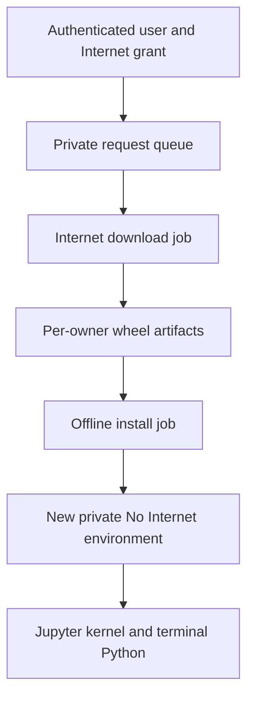

# Self-service Python packages

Download supported packages yourself without sharing your Internet and No Internet workspaces. A separate Internet job downloads pinned wheels; an installer with **no network access** creates a new environment in your private No Internet workspace. Your Internet runtime never mounts or modifies that workspace.

## Before you start

Your account needs the existing administrator **Allow Internet** grant to download new packages. This does not change signup: new users can immediately use their private No Internet workspace without individual approval. Once Internet is granted, supported package requests need no separate per-package approval. The original operator-reviewed shared Approved cache remains available as an alternative.

This workflow supports **Python binary wheels from PyPI**, including dependencies with compatible wheels. It does not support source builds, arbitrary package URLs, editable installs, startup `.pth` hooks, npm, apt or changes to the base image. Ask the operator to prepare unsupported or system-level dependencies through the reviewed image/cache process. A package unavailable as a compatible wheel fails rather than running a source build.

## Install and use a package

1. Sign in to your account. Open **My apps → My Python environments**, or `/packages` on your DSH address. You can remain signed into No Internet.
2. Enter a short environment name, such as `analysis`. Use lowercase letters, digits and hyphens, starting with a letter.
3. Enter exact versions, for example `six==1.17.0` or `numpy==2.2.6`. You may request up to eight package pins, separated by spaces, commas or new lines.
4. Select **Download and install privately**. The page refreshes status automatically: queued, downloading, installing, then complete or failed. Do not close an active notebook kernel just to submit a request.
5. On completion, copy the displayed **Python path** or choose the displayed **Jupyter kernel** in JupyterLab. The kernel name includes a unique request suffix. Select the new kernel for a new notebook or explicitly switch an existing notebook's kernel; existing kernels are not switched automatically.
6. In Web Terminal, run the displayed Python, for example:

   ```sh
   /workspace/.venvs/pkg-analysis-<request-suffix>/bin/python -c "import six; print(six.__version__)"
   ```

   You can also activate that environment using its `bin/activate` file. Ask DSH, Claude Code, Kilo or TrueForge to run that same absolute Python path for the project. They see the same private No Internet files; their conversations remain separate. A client does not automatically change its interpreter merely because an environment was installed.
7. Save notebooks and project files beneath `/workspace`. Existing projects, histories and previously installed environments are preserved. Each successful request creates a **new versioned environment**, even if the friendly name is reused. Remove an unused environment only after checking that no notebook or application uses it.

The base Python and managed clients remain unchanged. This is a project-local installation, not permission for Internet code to update the No Internet runtime or another user's files. Installed packages run with your normal No Internet permissions when you import them. Source hashes establish artifact consistency, not that a package is harmless.

## How isolation is maintained



- **Gateway:** binds the request to the signed-in user and fixed environment routes. Users cannot supply an owner, PVC, host, shell command or arbitrary download URL. Requests require the session's anti-forgery token and trusted origin. Each user sees only their requests; request creation is recorded in the central access audit.
- **Downloader:** receives only that owner's temporary artifact volume and its own request/result paths. It has no No Internet workspace, session history, credential volume, model key or Kubernetes management token. A network policy permits public HTTPS and cluster DNS while excluding private IPv4 destinations. The fixed downloader uses verified TLS to PyPI; this is not a general browsing environment.
- **Verification:** validates wheel structure and bounded sizes, rejects path traversal, symlinks and `.pth` startup hooks, and compares every wheel's SHA-256 with official PyPI release metadata. The authoritative manifest is stored outside the writable artifact folder.
- **Installer:** has zero allowed network ingress/egress and no Kubernetes token. It mounts only the requesting user's real No Internet workspace mappings, the user's Jupyter data subdirectory and read-only artifacts. It does not mount DSH histories, credential/profile directories or model keys. It rechecks hashes from opened regular files and installs with `--no-index`, `--no-deps` and `--require-hashes` into a new directory. Existing owner-specific mask mounts are preserved.
- **Controller:** a separate non-root service creates only the required Jobs and artifact PVCs and reads approved runtime specifications. It cannot read Secrets, execute into pods or update user runtimes. The gateway and execution workers receive no cluster-management credential. An expired authorization projection stops new work; revoking Internet stops new downloads and cancels work still in the download phase. An already-started offline installation may finish. Disabling the account cancels pending package jobs. Neither action uninstalls completed environments or cancels arbitrary code a user already launched.

Only the requesting user's package artifacts are transferred. Internet and No Internet project files, session histories and credentials remain separate. Package content is not automatically published to other users or the platform-wide Approved cache.


## Limits and troubleshooting

| Limit | Current setting |
|---|---:|
| Active requests per user | 1 |
| Active package requests across the service | 2 |
| Exact top-level package pins per request | 8 |
| Wheels including dependencies | 40 |
| Download size per request | 300 MiB |
| Expanded wheel contents | 1 GiB |
| Retained request records per user | 20 |
| Temporary artifact PVC per owner | 1 GiB |

Old temporary artifacts are reclaimed on subsequent downloads; installed environments are retained in the owner's workspace and consume its storage quota. At the request-record limit, ask the operator to archive completed records. A failed request leaves previous environments usable. Incompatible wheels, unavailable versions, quota exhaustion or revoked Internet permission return a failed request rather than changing existing installations. Operators inspect the bounded worker result and Job logs without publishing credentials or command contents to the user interface.

## Operator setup

The implementation is an optional gateway overlay around the pinned DSH image. It is not an upstream DSH feature and does not rebuild the GPU model. The runtime image must contain `/opt/dsh/jupyter/bin/python`, pip and ipykernel, matching the qualified image and workspace platform.

1. Deploy and qualify the main private-user environment pairs, fixed routing, persistence and Internet grants first. Confirm the CNI actually enforces NetworkPolicy. Keep registry credentials, server addresses, storage credentials and generated site files outside the public repository.
2. Check out the reviewed repository revision. Preserve a fresh gateway specification and source ConfigMap. Choose the site's storage class and an operator-private output directory. Render without applying:

   ```sh
   python scripts/deploy_self_service_packages.py \
     --namespace "$NAMESPACE" --gateway dsh-environment-gateway \
     --storage-class "$STORAGE_CLASS" --output "$PRIVATE_DIR/package-plan"
   ```

3. Review the rendered Jobs, three network policies, controller Role, new queue PVC and gateway-only additions. The gateway's existing image, initialization, storage, security and user account/session bindings must remain intact. All source keys in the fresh ConfigMap must be retained. The current single-node setup uses RWO volumes; a multi-node deployment needs reviewed placement and storage that supports gateway/controller/worker access. Do not assume RWO works across nodes.
4. Run an isolated two-user acceptance against that exact image and source. Verify both users' installs, private listing/mounts, wheel tampering denial, public and internal connection denial from the installer, revoked-grant denial, real Jupyter kernels and CIFS installation. Replace the synthetic gateway/controller/workers and compare saved notebooks, environments, settings and histories. Record `status: passed`, the exact `featureSourceSHA256` and `runtimeImage`, and these boolean results:

   ```json
   {"twoUserIsolationPassed":true,"wheelInstallationPassed":true,
    "installerNetworkDenied":true,"tamperDenied":true,"revokeDenied":true,
    "persistencePassed":true,"jupyterKernelPassed":true,"cifsInstallationPassed":true}
   ```

   The declaration alone is not acceptance. Retain the underlying test results; the deployment tool requires the matching source/image fingerprint.
5. Apply into a **new** private output directory with that acceptance receipt:

   ```sh
   python scripts/deploy_self_service_packages.py \
     --namespace "$NAMESPACE" --gateway dsh-environment-gateway \
     --storage-class "$STORAGE_CLASS" --output "$PRIVATE_DIR/package-rollout" \
     --acceptance "$PRIVATE_DIR/package-acceptance.json" --apply
   ```

   The tool initializes only the new queue, deploys the restricted controller and uses a compare-and-swap gateway specification patch. A gateway handover may briefly interrupt requests; the main acceptance observed one transient 503 during the handover. No user runtime or GPU model is restarted by this overlay. A concurrent gateway edit causes refusal; preserve it and rerender rather than overwrite it.
6. Verify actual HTTPS sign-in/session preservation, a fresh package request, its returned private path, real Jupyter import and terminal import. Compare original account records, histories and gateway mounts/image/init settings. Do not use readiness alone as evidence. Keep the before-spec and immutable source references private for rollback.
7. On rollout failure, the tool restores the saved specification only if the live specification still equals its own candidate and pauses its controller. A later rollback also requires fresh comparison: do not overwrite another release or restore an older account store over newer users. Preserve queue/artifact PVCs and installed user environments; backing out a gateway feature is not data cleanup. Re-running the installer over an existing installation is intentionally refused; upgrades require a separately reviewed migration.

## Verified workflow

The isolated qualification installed a native NumPy wheel for one user and a pure-Python wheel for another concurrently, with separate artifacts and workspace paths. Both completed in about 26 seconds. Actual Jupyter kernels imported the private packages from local and CIFS workspaces. Tampered wheels and cross-owner request access were refused. The installer could reach neither a public address nor internal inference. Saved notebooks, settings, kernel registrations, environment files and request records survived the synthetic gateway/controller/worker replacements; 36 selected file hashes matched.

After rollout, a new main-service request completed through verified HTTPS in **26.94 seconds**. The private package imported in an actual Jupyter kernel and Web Terminal. A held login survived the gateway handover. All 16 other account records stayed unchanged, and the test account's three existing histories/six session files were byte-preserved. The temporary account was restored disabled with its original Internet permission. These are package-workflow checks, not a new LLM performance test. The feature applies to main DSH; the two additional owner-only instances retain their existing package process.

Watch the captioned package walkthrough · [User manual](DSH_USER_MANUAL.html) · Sanitized test summary
