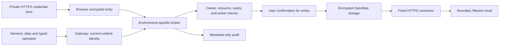

# User-managed credentials

DSH provides a dedicated Credentials page for configured API-token and personal-access-token connections. Users enter provider secrets through this page instead of chat. The harness uses aliases and receives filtered operation results. Existing login passwords and Kerberos/datalake permissions are unchanged.

## Add and manage a connection

Open **Credentials** in your authenticated DSH environment and confirm your current account password. Choose an approved profile, alias, workspace label, resource, operations and expiry. Enter the provider token in the secret field. The browser encrypts it for that environment's broker before submitting it. Save and replacement never return the stored value. The page supports listing metadata, replacement, disable, delete, last-use information and pending operation approval. There is no reveal or export endpoint.

The No Internet and Internet environments have different brokers, encryption keys, vault namespaces and destination rules. Changing environments does not transfer credentials. A recreated username receives a different credential identity; changing an existing account password preserves its identity.

## How the harness uses it

The runtime adapter supports `list`, `profiles`, `execute` and `result`. It authenticates using the private runtime's existing routing identity. The gateway determines the actual account and environment rather than trusting identifiers supplied by generated code. The adapter cannot save credentials or approve its own writes.

Install the credential-free adapter using the command on the Credentials page if it is not already present. Its code, CA certificate and service address are configuration, not provider secrets. Run it with Node from the selected workspace. A workspace name is an additional policy label within a user's runtime; it is not a separate operating-system boundary between that user's own projects.

## The three risk controls

**Prevent external leakage.** No Internet connections use only approved internal destinations. The Internet broker is separate. Connector profiles fix the host, path template, method, parameters and returned fields. The broker validates resolved destination addresses, excludes metadata/private addresses from public connectors, checks TLS, refuses redirects, bounds requests and responses, and filters the active secret from returned values. Provider values are not returned to the model. Existing remote Livy/Spark availability and its separately accepted remote-egress risk are unchanged by this feature.

**Prevent damage or excessive access.** Each stored connection belongs to one stable account identity and environment. Operations must match the selected resource, workspace label, expiry and permitted actions. A consequential operation produces a pending request in the Credentials page. Approval binds the exact parameters and is consumed once before dispatch. Changed requests and replayed approvals are denied. A timeout after dispatch is reported as uncertain: inspect the provider before retrying. The broker does not turn arbitrary shell commands into privileged credential-bearing commands or expand the provider account's permissions.

**Contain results and govern use.** Credential pages require an authenticated account. Changes require recent reauthentication, matching origin and a session-bound request token. Audit records describe actor, operation, decision and a hashed credential reference without provider secrets. Logs rotate within a fixed size. Disable and delete immediately stop subsequent broker use; deleting a stored copy does not revoke the token at its provider. Users should revoke it there when appropriate. Previously pasted chat secrets are not removed retroactively by this feature.

## Implemented scope and limits

The initial connectors cover fixed GitHub and Azure DevOps API operations. Operators configure approved endpoints and resource templates privately. Acceptance used synthetic tokens and a local TLS provider fixture; it did not authenticate real user provider tokens or create live provider issues. OAuth consent and Kerberos ticket acquisition need approved application and service configuration and are not included. A provider token's actual privileges remain the provider's responsibility.

The runtime routing identity remains available within its own owner runtime. The design keeps stored provider values in a separate service, while account isolation, explicit scopes and network policy govern use. It does not promise that arbitrary code can never misuse an operation the user has granted.

## Operation, persistence and recovery

OpenBao uses persistent encrypted Raft storage over TLS. Separate broker tokens access only their environment's key namespace. User secrets are not stored in the gateway account file, source repository, chat transcript or worker filesystem. The vault restarts sealed and operations fail closed until an operator unseals it through protected external custody. Login and ordinary DSH functions remain independent of vault availability.

The supplied Windows operator bootstrap protects recovery material with DPAPI outside the checkout. Keep recovery custody and encrypted snapshots in an approved protected backup process; one running vault replica is not a high-availability service. The operator script verifies an encrypted snapshot by restoring it into an isolated temporary volume, then removes that clone. Existing vaults are never reinitialized for a restart. Certificate renewal and periodic recovery checks remain operational duties.

Deployment overlays preserve the running application image, routing and storage mounts. Gateway ingress permits the ingress controller on the existing web port and private workers on the separate tool port. A regression test checks both rules; rollout acceptance checks the external HTTPS login route and unauthenticated session denial as well as internal broker behavior. The deployment can withdraw the integration without touching user histories or workspaces.

## Verification and lesson

Recorded acceptance covers two disposable users in both environments, encrypted entry, reauthentication, origin checks, cross-user denial, environment separation, workspace mismatch, disable/delete, metadata and audit filtering, browser form behavior, restart persistence and isolated encrypted-backup restore. Native connector tests cover TLS, redirection refusal, filtered responses, approvals and resource limits. These are bounded tests of the affected behavior, not a universal safety claim.

The current English supplement is **106 seconds with Fola narration and 27 aligned caption cues**. It explains entry, controlled use, governance and recovery. It supplements the existing presentation rather than replacing its historical chapters. The previous silent storyboard remains historical.

Production acceptance on 24 October verified the external login route, both broker connections and tool authentication. The adapter was installed without restarting 32 existing runtimes: 22 authorized identities authenticated and 10 unassigned or Internet-unapproved routes were denied, matching the current account policy. The deployment uses source overlays on the existing pinned application image; it is not a new image build.

[Operator deployment and recovery](CREDENTIAL_OPERATIONS.md).
