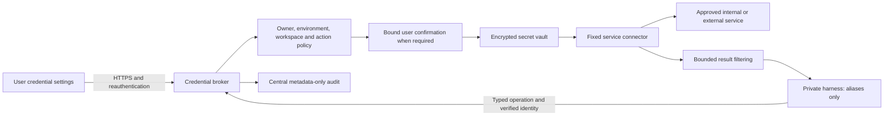

# User-managed credentials: design and implementation contract

Status, 24 October 2026: proposed broker architecture with a tested policy module in source. The credential settings page, encrypted vault, broker connectors and deployment are not implemented or live. Existing model-scoped runtime credentials are not a general user vault. Do not enter real credentials into a demonstration or chat.

## What the user does

Open **Settings → Credentials** (planned), reauthenticate, and add a connection through a dedicated HTTPS form or provider OAuth consent. Give it a useful alias such as `my-repository`. Choose the permitted workspace, No Internet or Internet environment, resource, actions and expiry. Save replaces the secret without returning its value. The list shows provider, alias, masked identifier, scopes, expiry and last use, with Test, Replace, Disable and Delete actions. No reveal or export action is offered by default. Password managers may fill the form; chat is never the entry channel.

In chat say “Read this repository using my-repository.” The model sees only the alias and allowed capabilities. The harness requests a typed operation from the broker. The broker derives the owner and runtime identity from a verified session/workload identity, checks policy, retrieves the secret, calls the approved service, and returns a bounded result. A guessed alias never grants access.

For a push, deployment, deletion or another configured consequential action, show the exact destination, resource and operation in a separate confirmation panel. Consent is bound to the broker-computed request digest, user, workspace, environment and expiry. Changed arguments require new consent. Consume the approval atomically with dispatch; a retry cannot reuse it. Provider idempotency keys are needed where supported because a network timeout does not prove that a write failed.

## Architecture

Use an established secret manager behind the broker, with encryption at rest, TLS, separate key custody, scoped workload identities, encrypted backups and a tested restore procedure. Prefer short-lived provider credentials or delegated OAuth over reusable passwords. Refresh tokens stay in the vault. Do not put vault master keys in images, Git, workspace storage, chat state or the same backup as plaintext secrets. A Kubernetes Secret alone does not establish encryption at rest; configure and verify that separately.

The gateway authenticates the user; the broker independently verifies the authenticated principal and runtime/workspace binding. Do not trust user-supplied `owner` headers or a model-provided username. Use short-lived audience-bound workload tokens or mutual TLS and server-side bindings. The user settings route is separate from model/tool APIs, requires CSRF protection and recent authentication for changes, and never logs request bodies. Disable analytics, session replay, third-party scripts and caching on secret-entry pages. Browser storage and URLs must never contain secret values.

## Control 1: prevent external leakage

No Internet credentials can be used only through approved internal connectors. The broker itself has restricted egress; a general Internet-enabled broker would bypass the runtime's network policy. Keep internal and Internet connector pools and identities separate. No Internet does not silently fall back to the Internet pool. Internet credentials do not become available to the internal workspace automatically.

Connectors have fixed, operator-reviewed endpoints and resource scopes. Reject caller-selected URLs, redirects to other destinations, arbitrary proxy settings and DNS rebinding. Resolve and enforce approved destinations at the network boundary; application URL checks alone are insufficient. Cloud metadata, host management, arbitrary sockets and unrelated internal networks are denied. Remote execution workers need their own egress controls. If they retain Internet access, that remains a separate exception requiring explicit acceptance; credential management does not close it.

Never return an access token or password to the model. Avoid global environment variables, command arguments, shell history, generic `curl` tools and plaintext credential files in the harness. Prefer broker-owned Git/HTTP/database connectors. If an incompatible tool must receive a credential, run it in a separate constrained process with no harness filesystem/process access, a short-lived narrowly scoped token and a short lease. Treat that as lower assurance: a process that receives a secret can leak it. Do not describe ordinary injection into the user's terminal as keeping secrets hidden from generated code.

## Control 2: prevent damage or excessive access

Authorize the intersection of provider rights, owner policy and platform restrictions. A credential does not enlarge the user's AD/datalake rights. Read-only connections remain read-only; write operations require explicit scope and the configured approval. The platform cannot promise read-only protection while deliberately using a write-capable account through unrestricted tools.

DSH login passwords remain salted one-way hashes and must not be decrypted or reused for other services. For Kerberos, prefer a private interactive authentication flow that obtains a short-lived ticket without storing the AD password. Keep ticket caches per user and environment in protected ephemeral storage, isolate renewal, and destroy caches on expiry or revocation. Where a dedicated service identity is required, store its keytab in the vault and constrain its resources separately. Delegation and remote job identities must be verified; local login is not AD authentication.

Private Click2Deploy uses only the owner's explicitly granted deployment connection, within its assigned resources. Shared admin deployment uses a separate platform identity and audit trail. Never mount the administrator deployment credential into a user's DSH container. Enforce quotas, concurrency limits, maximum operation duration and destination permissions at the broker/provider, not only in prompts.

## Control 3: keep results contained

Return only the data the task and policy permit, with size limits and structured errors. Provider error bodies, response headers, signed URLs, repository URLs containing tokens and debug traces can contain secrets. Use allowlisted result fields, secret-pattern filtering and bounded output. Redaction is defense in depth, not proof that arbitrary confidential content cannot leak.

Store audit events outside user workspaces: actor, credential opaque ID, environment, workspace, connector, operation, resource identifier, decision, approval ID, timestamp and outcome. Exclude secret values, authorization headers, raw arguments, conversation bodies and sensitive query results. Sanitize resource identifiers before logging. Required audit persistence should fail closed for new credential operations. Administrators see usage and policy metadata; routine administration does not reveal user secrets. Emergency access needs a separate audited process and governed key access.

Disable blocks new uses immediately; cancel active work where supported. Delete removes stored versions according to retention policy and requests provider revocation where supported. Neither deletion nor logout can recall a token already copied or reverse a completed remote operation. Tell the user when provider revocation failed. Rotation is explicit; existing user passwords are not changed automatically.

## Implementation sequence

1. Deploy the vault and separate internal/Internet brokers with key custody, backup, restore and workload identity verified. No new paid service is assumed by this design.
2. Add authenticated credential settings, recent-authentication checks, CSRF protection, bounded secret inputs, encrypted writes and metadata-only reads. Never add a generic secret-retrieval endpoint to model tools.
3. Implement narrowly typed connectors, beginning with read-only repository access. Add delegated OAuth and Kerberos handling appropriate to each provider. Validate scopes server-side.
4. Add single-use approvals, central audit, per-user quotas, revocation and lifecycle tasks. Broker computes request digests from canonical arguments; approvals are stored and consumed server-side, never accepted as client assertions.
5. Integrate aliases into DSH, Claude Code/TrueForge and Click2Deploy through adapters. The adapters return tool results, not tokens. Disable unmanaged credential fallbacks for these managed operations.
6. Qualify with two disposable users and synthetic secrets, then roll out gradually. Keep provider credentials and existing histories unchanged during qualification. Previously pasted secrets are not erased by a new vault; review their exposure and rotate through a separate authorized process.

## Acceptance before calling this live

| Test | Required result |
|---|---|
| User B guesses user A's alias; spoofs owner or runtime | Denied without secret lookup or provider request |
| Same user switches workspace or environment | No implicit credential access or transfer |
| Expired, revoked or disabled connection | New operations denied |
| Read grant used for push/delete; different repository | Denied before provider dispatch |
| Approval replay, concurrent replay, changed payload | Denied; one dispatch at most within documented retry semantics |
| Arbitrary URL, redirect, metadata address, DNS change | Denied by connector and network boundary |
| Synthetic canary secret in success/error/debug output | Absent from model requests, chat/history, attachments, logs, browser storage and audit |
| Secret replacement, worker restart and vault restore | Correct owner mapping preserved; encrypted material and revocation state verified |
| Vault or required audit unavailable | Explicit failure; no credential fallback |
| Provider revocation while a job runs | New uses blocked; active-job limitations reported accurately |

`scripts/credential_policy.js` implements only the decision contract and metadata projection. Its tests cover owner, environment, workspace, operation, resource, expiry, revocation and approval bindings. It does not authenticate callers, consume approvals, contact a vault, filter tool output or enforce network policy. Passing it does not establish end-to-end credential security.

## Video edition status

The guide includes a draft silent captioned storyboard, not a completed narrated lesson or a live UI recording. The current Fola-narrated course remains unchanged. A new narrated edition must use the approved Fola generation route, align captions to returned speech, and pass playback and published-byte checks before replacing a course lesson.

## Reference guidance

- [OWASP secrets management](https://cheatsheetseries.owasp.org/cheatsheets/Secrets_Management_Cheat_Sheet.html)
- [Kubernetes Secrets good practices](https://kubernetes.io/docs/concepts/security/secrets-good-practices/)
- [Vault response wrapping](https://developer.hashicorp.com/vault/docs/concepts/response-wrapping) — useful for narrowly scoped handoffs, not a substitute for keeping secrets out of the harness.
