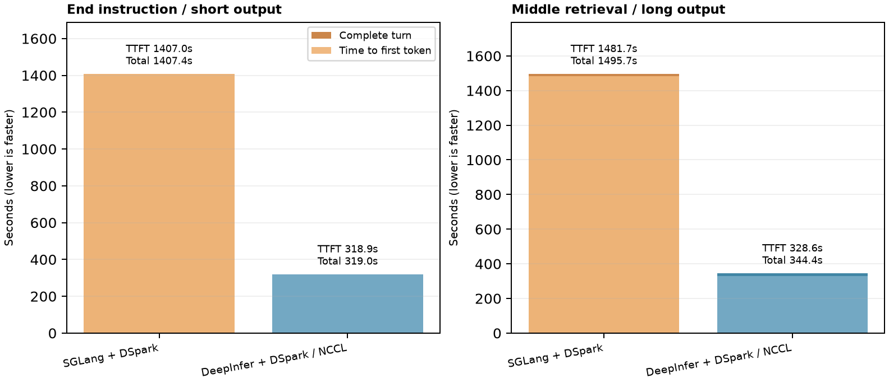

# GPU serving comparison and administrator change plan

**One current report:** [View the PDF](GPU_PLATFORM_REVIEW.pdf)
([direct download](https://raw.githubusercontent.com/skunpoj/dsh_setup/main/docs/gpu-platform/GPU_PLATFORM_REVIEW.pdf)).

The report starts with contents before the executive summary. The executive summary contains
the concise short-prompt comparison plus two one-million-token experiment tables. Section 1
combines the methods and detailed measured matrix, presents W1/W3/W4 once, separates
measured results from a conditional expected-outcome calculation, and describes
the actual LiteLLM-to-DeepInfer route. The current container uses an SGLang
dependency-base image, while PID 1 executes mounted DeepInfer source with the
NCCL expert-communication backend. Base image, running engine and mounted source
are separate identities and must be verified separately.

The graph uses our finite HTTP-cohort measurements, not PR246's B200 data.
Four allocated GPUs, three repeats, offeredC1/2/4/8/16, active cap8. W3 is a
predictable counting workload; it is not a generic conversational benchmark.

- [SVG graph](throughput-latency.svg)
- [Long-context SVG graph](long-context-comparison.svg)
- [Measured CSV](../../gpu-stack/benchmarks/measured-results.csv)
- [Measured JSON](../../gpu-stack/benchmarks/measured-results.json)
- [Conditional W1 scenario and assumptions](conditional-scenario.json)
- [Matched one-million-token results and limits](matched-1m-results.json)
- [Middle-retrieval and long-output one-million-token results](matched-1m-middle-long-results.json)
- [Original HTTP probe](../../gpu-stack/benchmarks/http_probe.py)
- [Three serving profiles and code inspector](../../gpu-stack/profiles/README.md)
- [Administrator procedure and recovery runbook](../../gpu-stack/runbooks/gpu-peer-access.md)
- [GPU source ownership and release map](../GPU_SOURCE_OWNERSHIP.md)
- [Related engine source fork](https://github.com/skunpoj/DeepInfer/tree/b4df8657412de7ea8bab8b442c2b8c68f5c1068a)

The report includes two fresh, serial, direct-engine one-million-token checks per
engine. The first checks an exact instruction at the end with a short response;
the second checks a unique value near the middle and requests up to 1,024 output
tokens (981 from SGLang; 1,024 from DeepInfer). They are one-run, single-user synthetic checks, not cache-controlled,
multi-user, statistical or post-change results. The proposed after-host-change profile is **not deployed or
qualified**. A complete comparison of all 293 mounted Python paths against the
referenced public DeepInfer commit found 289 byte-identical files, two
line-ending-only differences, two content differences and no missing mounted
path. The running entry point is byte-identical. The live tokenizer predecessor
still logs a prompt preview while the public count-only privacy successor is
source-ready but not deployed; the other content difference is a retained
Phase-B offline example, not the running server path. This supersedes the earlier
selected 264-match/one-difference result. Compiled/image provenance, controlled
restart, peer-copy, DeepEP, model correctness and authenticated application-path
acceptance remain open. No host or runtime change is claimed. Internal endpoints,
identities, secrets and private operational evidence are not published here.
