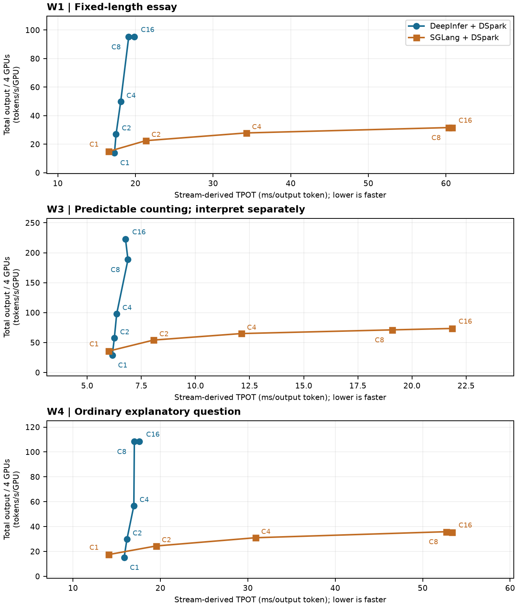

# GPU serving comparison and administrator change plan

**One current report:** [View the PDF](GPU_PLATFORM_REVIEW.pdf)
([direct download](https://raw.githubusercontent.com/skunpoj/dsh_setup/main/docs/gpu-platform/GPU_PLATFORM_REVIEW.pdf)).

The report starts with an executive summary and contents; section1 explains the
method. It presents W1/W3/W4 once, explains why W2 was not rerun, separates
measured results from a conditional expected-outcome calculation, and describes
the actual LiteLLM-to-DeepInfer route. DeepInfer is **not** the vLLM serving engine;
the retained Service name and humming's project ownership do not change that.

The graph uses our finite HTTP-cohort measurements, not PR246's B200 data.
Four allocated GPUs, three repeats, offeredC1/2/4/8/16, active cap8. W3 is a
predictable counting workload; it is not a generic conversational benchmark.

- [SVG graph](throughput-latency.svg)
- [Measured CSV](../../gpu-stack/benchmarks/measured-results.csv)
- [Measured JSON](../../gpu-stack/benchmarks/measured-results.json)
- [Conditional W1 scenario and assumptions](conditional-scenario.json)
- [Original HTTP probe](../../gpu-stack/benchmarks/http_probe.py)
- [Three serving profiles and code inspector](../../gpu-stack/profiles/README.md)
- [Administrator procedure and recovery runbook](../../gpu-stack/runbooks/gpu-peer-access.md)
- [Related engine source fork](https://github.com/skunpoj/DeepInfer/tree/b4df8657412de7ea8bab8b442c2b8c68f5c1068a)

The proposed after-host-change profile is **not deployed or qualified**. Exact
engine/binary provenance still has a known tokenizer difference. This revision
adds no new benchmark, host change or complete authenticated application-path
acceptance. Internal endpoints, identities, secrets and private operational
evidence are not published in this directory.
