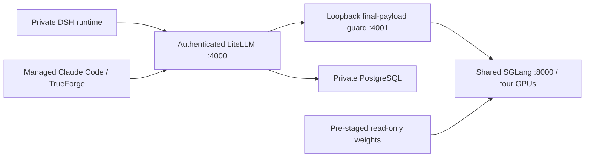

# Portable GPU + LiteLLM + 1M setup

## Latest existing-node allocator acceptance

The revised profile passed an actual DSH turn with **1,007,697 input / 119 output tokens**, returning the complete expected answer and persisting it with **zero retries**. Whole-turn time was **1475.94 seconds**; the answer streamed in **3.54 seconds**, approximately **33.34 output tokens/second**. Streaming rate excludes preparation, queueing and agent overhead.

**62/62 overlapping short DSH replies** were complete, exact and persisted, with zero retries, in **5.58–11.69 seconds** (median 7.62). Their measured output streams delivered **21.62–36.42 tokens/second**. The late eight-client cohort started after a recorded **907,264-token** prepared prefix; all eight passed in **7.09–7.63 seconds**, with the actual long turn active before and after.

The final run recorded **zero allocator mapping warnings and zero unexpected model restarts**. The prior mixed-batch candidate failed and is preserved in the [allocator report](../docs/GPU_ALLOCATOR_QUALIFICATION_20261017.html). This profile separates prefill/decode and caps a prefill batch at two requests while retaining parallel ordinary decoding and the 16-running-request cap. It is not sixteen maximum contexts, a fresh-cluster acceptance or an SLA. The earlier fresh-model record below belongs to its own historical profile.

## Existing-node runtime acceptance

An earlier fresh, site-adapted model deployment using the pinned image and its recorded preceding profile passed an actual **1,007,695-input-token DSH turn** and bounded mixed concurrency on 17 October 2026. The existing weight snapshot, gateway/database and a disposable DSH runtime were used. The startup progress deadline is 2,100 seconds; no extra GPU node was used. The test does not qualify a new cluster, download, private storage, or two full-1M sessions. [Results and retained limitations](../docs/FRESH_GPU_ACCEPTANCE_20261017.html).

This is the public counterpart for the GPU inference portion of the deployment repository. It contains sanitized source and a renderer, not a copy of private cluster configuration. No organization endpoints, node names, private registries, credentials, user identities, central-share paths or live workload IDs are required by this bundle. Public upstream image digests and model names remain to identify the qualified software.

## Features and design



- One shared model copy; user workspace/history isolation belongs to the DSH deployment, not to GPU allocation.
- 1,048,576 total tokens, at most 8,192 output tokens and a 256-token reserve. The final forwarded messages/tools are counted with the backend tokenizer. Input plus requested output plus reserve must fit.
- One request with input plus reserved output above 131,072 is admitted at a time. One additional long request may wait in a bounded FIFO position for up to 1,500 seconds; excess waiting requests receive 429. Early streaming comments keep cancellation available during waiting/preparation. The two configured aliases have no hidden rate-limit retries. Ordinary work remains concurrent; the model running cap is 16, not sixteen full 1M conversations.
- Small prefill chunks (512; maximum prefill 1,024), separate prefill/decode batches, a two-request prefill cap, a pinned scheduler reservation and a single chunk-owner guard bound transient attention work. Four decode rounds run between prefill batches; ordinary decoding remains parallel up to the shared running cap. Eight additional sliding-window prefix tails allocate capacity for prefix reuse within the same static memory budget. They are not an eight-user limit or a guarantee that every long prefix survives diverse concurrent traffic; an eight-diverse-request test exposed cache loss. Before each long warm step, foreground streams may drain for up to eight seconds. This is cooperative scheduling, not preemption or a latency guarantee.
- One gateway replica with Recreate is essential: admission uses a local process-shared file lock. Do not scale replicas/workers without a distributed admission design.
- Only two local aliases are exposed. There is no external fallback. No ingress, public hostname, shared workspace, database password or client API key is embedded. The final-wire listener binds to loopback and is never a Service.

## Setup method

1. Use a new test namespace first. Install the NVIDIA device plugin and an enforcing Kubernetes network-policy implementation through the cluster's approved process. Reserve four compatible GPUs and sufficient host memory; the template requests 256 GiB RAM and permits 512 GiB. Check node capacity before scheduling. No extra node is assumed.
2. Pre-stage the licensed/approved model files on a PVC named `model-weights`, at `/approved` within the volume. Verify the complete weights against the approved upstream manifest, revision and hashes. `config.json` existence is only a startup check, not integrity evidence. Review any model code before allowing `--trust-remote-code`; the cache is read-only and runtime downloads are disabled. The model image is public and digest-pinned. Registry/image availability and model license approval remain operator prerequisites.
3. Provision PostgreSQL with protected durable storage and recovery according to your environment. In this namespace its pods must have `app: llm-database` and listen on 5432. This bundle does not install or migrate a database. An external database requires a separately reviewed narrow egress rule; do not permit all egress to make startup pass.
4. Create two existing Secrets through your private secret-management process: `local-inference-credentials` with `LITELLM_MASTER_KEY` and a random `INTERNAL_ROUTE_KEY`; `local-inference-database` with `DATABASE_URL`. Never commit their values or rendered secret manifests. The master key is for operators; issue restricted model-only per-runtime virtual keys to clients, not the master key. Check management endpoints are denied for those keys.
5. Install Python 3.10+ and PyYAML for rendering. Copy `settings.example.json` to a private settings file outside the repository. Set the namespace/PVC/Secret names and qualified gateway digest. Run:

   ```sh
   python gpu-stack/render.py --settings /private/settings.json --output /private/candidate.yaml
   kubectl -n <test-namespace> apply --dry-run=server -f /private/candidate.yaml
   ```

   The renderer does not create the namespace or contact the cluster. It rejects unexpected setting keys, invalid names, mutable image tags and overwriting an existing candidate. Review the emitted objects before applying. Pin changes to the SGLang image require requalifying both scheduler source hashes; changed source fails closed.
6. Apply only to the reviewed test namespace. Database/Secrets/PVC must already exist. NetworkPolicy allows same-namespace `inference-client: allowed` pods to reach the authenticated gateway, the gateway to reach only the model/database/DNS, and the model no outbound network. There is no direct client access to the unauthenticated model. Namespace label changes and allowed-client labels are operator privileges. DNS examples assume ordinary kube-dns labels: verify against your CNI and NodeLocal DNS implementation. Generic DNS access is not protection against DNS exfiltration; use an internal-only resolver and test it before classifying the whole environment No Internet. Client, execution-worker and database policies are separate required controls.
7. Verify actual readiness, image IDs, mounted source hashes, model identity, token limits and an authenticated exact reply. Check key-management denial, direct model denial, endpoint-override rejection, public TCP/domain/direct-IP/DNS denial and internal service access. Readiness alone is insufficient. Do not replace a working Production service with this portable candidate without these checks.
8. Point managed DSH/CLI profiles at the private gateway Service with restricted keys. Set matching 1M context, output ceiling, long-response timeout and compaction budget. The existing DSH managed transport handles the qualified SDK's character-based output-budget bug; this GPU bundle does not install those client hooks. Follow [client setup and results](../docs/LLM_SETUP_AND_TEST_RESULTS.html) and qualify each installed client/version separately.

## Qualification, performance and rollback

Run progressive 128K, 256K, 512K and near-1M tests with distributed known answers and source citations, plus substantial output and real tool continuation. Verify persisted replies, exact final payload counts, cancellation, over-budget refusal, second-long admission/429, zero hidden retries and cache reuse with normalized tool defaults. During each long test run real short DSH conversations; record time to first text, elapsed time, output length and output rate separately. A direct API burst is not end-to-end DSH or CLI acceptance.

The 17 October accepted reference used 1,007,697 input / 119 output tokens and completed in **24m36s**, with **33.34 streaming output tokens/sec** and 62 correct overlapping ordinary replies. The 18 October larger-step and DSpark experiments did not qualify an operating improvement: DSpark produced 162.50–165.61 tokens/sec on structured short answers, then failed long-input temporary-memory allocation; 8,192-token preparation steps lost a long prefix after diverse concurrent short traffic. The original model and 2,048-token preparation step were restored. Consult the [optimization report](../docs/PERFORMANCE_OPTIMIZATION_20261018.html) for recovery, measurements and rejected profiles. These results belong to the recorded deployment, rather than fresh tests of this generic template.

`DSH_LONG_WARM_STEP_TOKENS` is an operator-only guard setting, default **2,048**. It accepts multiples of 512 between 512 and 8,192 and rejects invalid values at startup. It controls final-wire preparation calls, independently of the engine's 512-token prefill chunk. Do not increase it based on short-only timing. Numeric progress telemetry records preparation/cached token counts, request time and foreground-yield time without prompt contents or token IDs.

Before changes, save private manifests, exact images, source ConfigMaps, settings and state-preservation checks. Recreate of the only GPU deployment interrupts inference; prepare a maintenance handover. Keep the exact last qualified 1M specification, image and source overlay available, with the earlier 128K guardrail as a separate fallback. Roll back on startup failure, incorrect replies, lost history, regression in ordinary latency or GPU restart. Restore an explicitly saved qualified specification; do not blindly undo to the immediately previous revision, which may be a rejected experiment. Reconcile newer durable writes before any storage restore; changing inference should not change storage mounts. This bundle does not mount or migrate user data.

## Source maintenance and publication boundary

`runtime/` is a reviewed public derivative of the deployment's forwarding/guard/scheduler source. Deliberate differences: the tokenizer URL is mandatory configuration, unrelated-provider fallback is rejected, synthetic prompt capture is removed, and organization-specific patch marker names are neutralized. Algorithm constants and patch-source hashes are retained. Regenerate/review/test these copies when canonical code changes; do not maintain divergent fixes silently. `SOURCE_MANIFEST.json` binds this publication to source-content hashes without disclosing private repository paths or endpoints.

The new bundle is sanitized. Existing repository documentation/history contains site-specific deployment records; this addition does not redact that earlier material or claim repository-wide sanitization. Private settings, keys, database URLs, infrastructure addresses, storage paths and generated cluster output must stay outside Git. Existing Production remains unchanged by rendering or publishing this bundle.

## CI activation

`ci-example.yml` is a reviewed GitHub Actions example, not an active workflow. The publishing token cannot create/update workflow files, so an authorized repository maintainer must copy it to `.github/workflows/portable-gpu.yml` to enable automatic checks. The Linux qualification was run directly; publishing this example does not claim hosted CI passed. It runs the guard/manifest/privacy checks and rejects canonical forwarding-source drift.


## Bounded long admission and cancellation

The final-wire route admits one long request and one FIFO waiter (up to 1,500 seconds); excess long waiters receive an immediate capacity error. Ordinary requests bypass that lock. Streaming clients receive content-free SSE comments during waiting/preparation, so cancellation can propagate before model output. A single inference replica/process is required; this is not a distributed admission queue. The legacy callback default remains 300 seconds. See [actual DSH acceptance](../docs/ADMISSION_RESPONSIVENESS_20261017.html).
